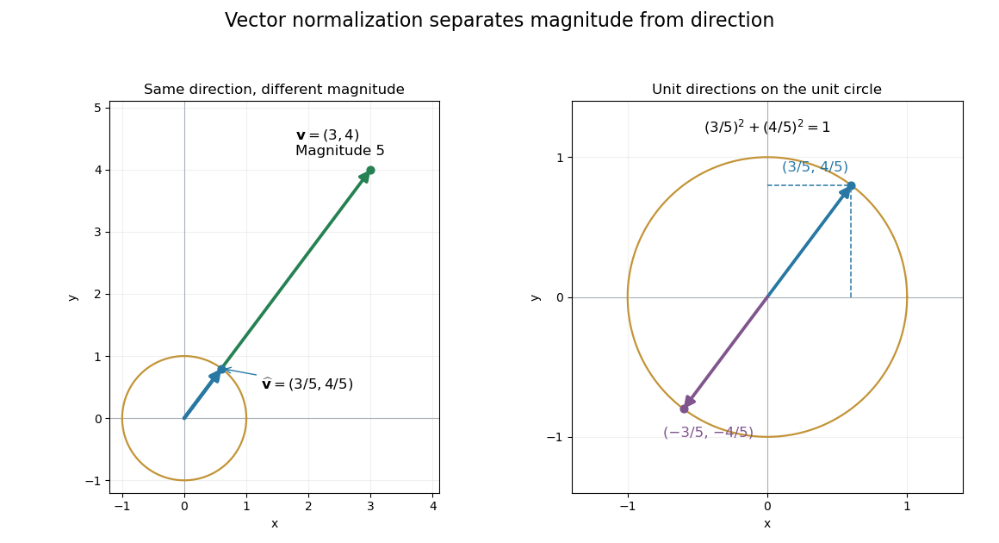

# Unit vector

↑ **Parent:** [Vector](vector.md)  
ⓦ [Wiki](https://en.wikipedia.org/wiki/Unit_vector)

A [unit vector](unit-vector.md) is a [vector](vector.md) of [norm](norm.md) one in a [normed vector space](normed-vector-space-split.md). For a nonzero [vector](vector.md) $v$, [vector normalization](vector-normalization.md) produces one by dividing by $\|v\|$. In a real [Euclidean space](euclidean-norm.md), this keeps the direction and removes the magnitude. The [zero vector](zero-vector.md) cannot be normalized because its [norm](norm.md) is zero.

For $\mathbf v=(3,4)$ with [Euclidean norm](euclidean-norm.md) $5$, the corresponding [unit vector](unit-vector.md) is

$$
\widehat{\mathbf v}=\left(\frac35,\frac45\right),\qquad
\left\|\widehat{\mathbf v}\right\|_2^2=\frac9{25}+\frac{16}{25}=1.
$$

The [Euclidean vector](euclidean-vector.md) can therefore be reconstructed as $\mathbf v=5\widehat{\mathbf v}$: size and direction are distinct pieces of information. The [standard basis](standard-basis.md) vectors are familiar [unit vectors](unit-vector.md), but a [unit vector](unit-vector.md) need not point along a coordinate axis.

**[Figure 5](#image-normalization-keeps-direction-and-places-the-endpoint-on-the-unit-circle). Normalization keeps direction and places the endpoint on the unit circle**. The original [Euclidean vector](euclidean-vector.md) $(3,4)$ has magnitude $5$. Its [vector normalization](vector-normalization.md) $(3/5,4/5)$ lies on the [unit circle](complex-unit-circle.md). The enlarged right panel also shows its negative, which has the same [Euclidean norm](euclidean-norm.md) and the opposite direction.

**Table of contents**

- [Vector normalization](vector-normalization.md)
  - [Vector normalization is not linear](vector-normalization-is-not-linear.md)

## ↑ Ancestors (7)

1. [Vector](vector.md)
2. [Vector space](vector-space-split.md)
3. [Linear algebra](linear-algebra-split.md)
4. [Algebra](algebra-split.md)
5. [Area of mathematics](area-of-mathematics.md)
6. [Mathematics](mathematics-split.md)
7. [Codex Wiki](split.md)

## ← Incoming links (207)

- [Apparent-gravity camera frame](apparent-gravity-camera-frame.md)
- [Approximate eigenvector](approximate-eigenvector.md)
- [Areal velocity](areal-velocity.md)
- [Astronomical horizon](astronomical-horizon.md)
- [Biot-Savart law](biot-savart-law.md)
- [Cartesian basis](cartesian-basis.md)
- [Causal Dirac spinor current](causal-dirac-spinor-current.md)
- [Central spring stiffness matrix](central-spring-stiffness-matrix.md)
- [Clock model](clock-model.md)
- [Commuting plane reflections](commuting-plane-reflections.md)
- [Continuation predictor-corrector step](continuation-predictor-corrector-step.md)
- [Continuous dual space](continuous-dual-space-split.md)
- [Coriolis acceleration in local Earth coordinates](coriolis-acceleration-in-local-earth-coordinates.md)
- [Coulomb's law](coulomb-s-law.md)
- [Cross-polytope](cross-polytope.md)
- [Cross product equation with a fixed unit vector](cross-product-equation-with-a-fixed-unit-vector.md)
- [Declination](declination.md)
- [Del in cylindrical and spherical coordinates](del-in-cylindrical-and-spherical-coordinates.md)
- [Derivative along a curve](derivative-along-a-curve.md)
- [Diagonal scaling for a two-dimensional linear system](diagonal-scaling-for-a-two-dimensional-linear-system.md)
- [Direction vector](direction-vector.md)
- [Directional derivative](directional-derivative.md)
- [Doppler frequency along a trajectory](doppler-frequency-along-a-trajectory.md)
- [Dot product](dot-product.md)
- [Eigenvector](eigenvector.md)
- [Electron spin](electron-spin.md)
- [Equatorial coordinate system](equatorial-coordinate-system.md)
- [Exact two-dimensional power iteration](exact-two-dimensional-power-iteration.md)
- [Exponential of a Pauli vector](exponential-of-a-pauli-vector.md)
- [Extreme point](extreme-point.md)
- [Faraday rotation from circular phases](faraday-rotation-from-circular-phases.md)
- [FRET dipole orientation factor](fret-dipole-orientation-factor.md)
- [Gradient](gradient.md)
- [Gradient in orthogonal coordinates](gradient-in-orthogonal-coordinates.md)
- [Gravity gradiometry](gravity-gradiometry.md)
- [Great-circle distance](great-circle-distance.md)
- [Ground state](ground-state.md)
- [Ground-state degeneracy](ground-state-degeneracy.md)
- [Gyroscope direction reference](gyroscope-direction-reference.md)
- [Helium-3 A phase](helium-3-a-phase.md)
- [Hermitian operator](hermitian-operator.md)
- [Hermitian quadratic form](hermitian-quadratic-form.md)
- [Horizontal coordinate system](horizontal-coordinate-system.md)
- [Householder transformation](householder-transformation.md)
- [Inertia tensor](inertia-tensor.md)
- [Inertia tensor of paired point masses](inertia-tensor-of-paired-point-masses.md)
- [Interference (wave propagation)](interference-wave-propagation.md)
- [Inverse of a scalar plus a cross-product operator](inverse-of-a-scalar-plus-a-cross-product-operator.md)
- [Isotropic orientation fourth moment](isotropic-orientation-fourth-moment.md)
- [Isotropic rotational diffusion in three dimensions](isotropic-rotational-diffusion-in-three-dimensions.md)
- [Jones matrix](jones-matrix.md)
- [Latitude law of Foucault precession](latitude-law-of-foucault-precession.md)
- [Left singular vector](left-singular-vector.md)
- [Lever arm](lever-arm.md)
- [Low-rank approximation](low-rank-approximation.md)
- [Malus's law](malus-s-law.md)
- [Minimum pairwise dot-product sum of three unit vectors](minimum-pairwise-dot-product-sum-of-three-unit-vectors.md)
- [Nearest points to the origin on a positive-definite ellipsoid](nearest-points-to-the-origin-on-a-positive-definite-ellipsoid.md)
- [Numerical-range endpoint approximate-eigenvalue theorem](numerical-range-endpoint-approximate-eigenvalue-theorem.md)
- [Orbital-frame rotation from inclination and node](orbital-frame-rotation-from-inclination-and-node.md)
- [Orthogonal projection of a circle between planes](orthogonal-projection-of-a-circle-between-planes.md)
- [Outward conormal of a surface boundary](outward-conormal-of-a-surface-boundary.md)
- [Solution](past-exam-of-the-mathematics-course-of-the-university-of-cambridge/2002/ia/paper-3/6e/a/solution.md)
- [Solution](past-exam-of-the-mathematics-course-of-the-university-of-cambridge/2003/ia/paper-1/8d/i/solution.md)
- [Solution](past-exam-of-the-mathematics-course-of-the-university-of-cambridge/2003/ia/paper-1/8d/ii/solution.md)
- [Solution](past-exam-of-the-mathematics-course-of-the-university-of-cambridge/2003/ia/paper-1/8d/iii/solution.md)
- [Solution](past-exam-of-the-mathematics-course-of-the-university-of-cambridge/2003/ia/paper-1/8d/solution.md)
- [Solution](past-exam-of-the-mathematics-course-of-the-university-of-cambridge/2003/ia/paper-4/12e/solution.md)
- [Solution](past-exam-of-the-mathematics-course-of-the-university-of-cambridge/2005/ia/paper-1/2b/solution.md)
- [Solution](past-exam-of-the-mathematics-course-of-the-university-of-cambridge/2005/ia/paper-3/8d/solution.md)
- [Solution](past-exam-of-the-mathematics-course-of-the-university-of-cambridge/2005/iii/paper-46/2/i/solution.md)
- [Solution](past-exam-of-the-mathematics-course-of-the-university-of-cambridge/2005/iii/paper-46/2/ii/solution.md)
- [Solution](past-exam-of-the-mathematics-course-of-the-university-of-cambridge/2005/iii/paper-46/2/solution.md)
- [Solution](past-exam-of-the-mathematics-course-of-the-university-of-cambridge/2006/ia/paper-1/6c/solution.md)
- [Solution](past-exam-of-the-mathematics-course-of-the-university-of-cambridge/2006/iii/paper-19/2/solution.md)
- [Solution](past-exam-of-the-mathematics-course-of-the-university-of-cambridge/2006/iii/paper-66/3/b/solution.md)
- [Solution](past-exam-of-the-mathematics-course-of-the-university-of-cambridge/2007/ia/paper-1/1a/i/solution.md)
- [Solution](past-exam-of-the-mathematics-course-of-the-university-of-cambridge/2007/ia/paper-1/5b/i/a/solution.md)
- [Solution](past-exam-of-the-mathematics-course-of-the-university-of-cambridge/2007/ia/paper-1/5b/i/solution.md)
- [Solution](past-exam-of-the-mathematics-course-of-the-university-of-cambridge/2007/ia/paper-1/6c/ii/solution.md)
- [Solution](past-exam-of-the-mathematics-course-of-the-university-of-cambridge/2008/ia/paper-3/3c/ii/solution.md)
- [Solution](past-exam-of-the-mathematics-course-of-the-university-of-cambridge/2008/ib/paper-1/2g/solution.md)
- [Solution](past-exam-of-the-mathematics-course-of-the-university-of-cambridge/2008/iii/paper-14/3/solution.md)
- [Solution](past-exam-of-the-mathematics-course-of-the-university-of-cambridge/2009/ia/paper-1/5c/solution.md)
- [Solution](past-exam-of-the-mathematics-course-of-the-university-of-cambridge/2009/ia/paper-1/8a/a/solution.md)
- [Solution](past-exam-of-the-mathematics-course-of-the-university-of-cambridge/2009/iii/paper-42/1/solution.md)
- [Solution](past-exam-of-the-mathematics-course-of-the-university-of-cambridge/2010/iii/paper-56/4/solution.md)
- [Solution](past-exam-of-the-mathematics-course-of-the-university-of-cambridge/2010/iii/paper-61/1/solution.md)
- [Solution](past-exam-of-the-mathematics-course-of-the-university-of-cambridge/2010/iii/paper-61/3/solution.md)
- [Solution](past-exam-of-the-mathematics-course-of-the-university-of-cambridge/2012/ia/paper-1/5c/solution.md)
- [Solution](past-exam-of-the-mathematics-course-of-the-university-of-cambridge/2014/ia/paper-1/5b/ii/solution.md)
- [Solution](past-exam-of-the-mathematics-course-of-the-university-of-cambridge/2014/ia/paper-1/8c/iv/solution.md)
- [Solution](past-exam-of-the-mathematics-course-of-the-university-of-cambridge/2014/ia/paper-4/4c/solution.md)
- [Solution](past-exam-of-the-mathematics-course-of-the-university-of-cambridge/2014/iii/paper-63/1/c/solution.md)
- [Solution](past-exam-of-the-mathematics-course-of-the-university-of-cambridge/2014/iii/paper-63/1/d/solution.md)
- [Solution](past-exam-of-the-mathematics-course-of-the-university-of-cambridge/2015/ia/paper-3/3a/ii/solution.md)
- [Solution](past-exam-of-the-mathematics-course-of-the-university-of-cambridge/2015/ia/paper-4/10c/solution.md)
- [Solution](past-exam-of-the-mathematics-course-of-the-university-of-cambridge/2015/iii/paper-44/2/solution.md)
- [Solution](past-exam-of-the-mathematics-course-of-the-university-of-cambridge/2015/iii/paper-63/1/solution.md)
- [Solution](past-exam-of-the-mathematics-course-of-the-university-of-cambridge/2015/iii/paper-7/1/solution.md)
- [Solution](past-exam-of-the-mathematics-course-of-the-university-of-cambridge/2015/iii/paper-7/3/solution.md)
- [Solution](past-exam-of-the-mathematics-course-of-the-university-of-cambridge/2016/ia/paper-1/2c/solution.md)
- [Solution](past-exam-of-the-mathematics-course-of-the-university-of-cambridge/2016/ia/paper-1/6b/solution.md)
- [Solution](past-exam-of-the-mathematics-course-of-the-university-of-cambridge/2016/iii/paper-112/2/iv/solution.md)
- [Solution](past-exam-of-the-mathematics-course-of-the-university-of-cambridge/2017/ia/paper-4/3a/solution.md)
- [Solution](past-exam-of-the-mathematics-course-of-the-university-of-cambridge/2017/ii/paper-4/20i/d/solution.md)
- [Solution](past-exam-of-the-mathematics-course-of-the-university-of-cambridge/2017/ii/paper-4/27k/c/i/solution.md)
- [Solution](past-exam-of-the-mathematics-course-of-the-university-of-cambridge/2017/ii/paper-4/27k/c/ii/solution.md)
- [Solution](past-exam-of-the-mathematics-course-of-the-university-of-cambridge/2017/iii/paper-337/1/i/solution.md)
- [Solution](past-exam-of-the-mathematics-course-of-the-university-of-cambridge/2017/iii/paper-338/1/a/ii/solution.md)
- [Solution](past-exam-of-the-mathematics-course-of-the-university-of-cambridge/2018/ib/paper-3/2f/solution.md)
- [Solution](past-exam-of-the-mathematics-course-of-the-university-of-cambridge/2019/iii/paper-339/2/b/solution.md)
- [Solution](past-exam-of-the-mathematics-course-of-the-university-of-cambridge/2019/iii/paper-339/2/c/i/solution.md)
- [Solution](past-exam-of-the-mathematics-course-of-the-university-of-cambridge/2020/ia/paper-1/5c/b/solution.md)
- [Solution](past-exam-of-the-mathematics-course-of-the-year-1-of-the-natural-sciences-course-of-the-university-of-cambridge/2002/paper-1/1/a/solution.md)
- [Solution](past-exam-of-the-mathematics-course-of-the-year-1-of-the-natural-sciences-course-of-the-university-of-cambridge/2003/paper-2/8/a/i/solution.md)
- [Solution](past-exam-of-the-mathematics-course-of-the-year-1-of-the-natural-sciences-course-of-the-university-of-cambridge/2006/paper-2/2/a/solution.md)
- [Solution](past-exam-of-the-mathematics-course-of-the-year-1-of-the-natural-sciences-course-of-the-university-of-cambridge/2011/paper-1/13/a/iii/solution.md)
- [Solution](past-exam-of-the-mathematics-course-of-the-year-1-of-the-natural-sciences-course-of-the-university-of-cambridge/2011/paper-2/13/b/solution.md)
- [Solution](past-exam-of-the-mathematics-course-of-the-year-1-of-the-natural-sciences-course-of-the-university-of-cambridge/2012/paper-1/16/a/solution.md)
- [Solution](past-exam-of-the-mathematics-course-of-the-year-1-of-the-natural-sciences-course-of-the-university-of-cambridge/2013/paper-2/4/solution.md)
- [Solution](past-exam-of-the-mathematics-course-of-the-year-1-of-the-natural-sciences-course-of-the-university-of-cambridge/2013/paper-2/9/b/solution.md)
- [Solution](past-exam-of-the-mathematics-course-of-the-year-1-of-the-natural-sciences-course-of-the-university-of-cambridge/2014/paper-1/14/a/solution.md)
- [Solution](past-exam-of-the-mathematics-course-of-the-year-1-of-the-natural-sciences-course-of-the-university-of-cambridge/2014/paper-2/17/c/i/solution.md)
- [Solution](past-exam-of-the-mathematics-course-of-the-year-1-of-the-natural-sciences-course-of-the-university-of-cambridge/2015/paper-1/11/c/iii/solution.md)
- [Solution](past-exam-of-the-mathematics-course-of-the-year-1-of-the-natural-sciences-course-of-the-university-of-cambridge/2015/paper-1/20/c/solution.md)
- [Solution](past-exam-of-the-mathematics-course-of-the-year-1-of-the-natural-sciences-course-of-the-university-of-cambridge/2016/paper-2/2/solution.md)
- [Solution](past-exam-of-the-mathematics-course-of-the-year-1-of-the-natural-sciences-course-of-the-university-of-cambridge/2018/paper-2/11/c/solution.md)
- [Solution](past-exam-of-the-mathematics-course-of-the-year-1-of-the-natural-sciences-course-of-the-university-of-cambridge/2018/paper-2/12/e/iii/solution.md)
- [Solution](past-exam-of-the-mathematics-course-of-the-year-1-of-the-natural-sciences-course-of-the-university-of-cambridge/2019/paper-1/18/a/i/solution.md)
- [Solution](past-exam-of-the-mathematics-course-of-the-year-1-of-the-natural-sciences-course-of-the-university-of-cambridge/2019/paper-2/10/b/solution.md)
- [Solution](past-exam-of-the-mathematics-course-of-the-year-1-of-the-natural-sciences-course-of-the-university-of-cambridge/2019/paper-2/11/a/i/solution.md)
- [Solution](past-exam-of-the-mathematics-course-of-the-year-1-of-the-natural-sciences-course-of-the-university-of-cambridge/2019/paper-2/11/b/solution.md)
- [Solution](past-exam-of-the-mathematics-course-of-the-year-1-of-the-natural-sciences-course-of-the-university-of-cambridge/2020/paper-1/18/c/ii/solution.md)
- [Solution](past-exam-of-the-mathematics-course-of-the-year-1-of-the-natural-sciences-course-of-the-university-of-cambridge/2021/paper-1/14/b/solution.md)
- [Solution](past-exam-of-the-mathematics-course-of-the-year-1-of-the-natural-sciences-course-of-the-university-of-cambridge/2023/paper-2/17/b/solution.md)
- [Solution](past-exam-of-the-mathematics-course-of-the-year-1-of-the-natural-sciences-course-of-the-university-of-cambridge/2023/paper-2/7/b/solution.md)
- [Solution](past-exam-of-the-mathematics-course-of-the-year-1-of-the-natural-sciences-course-of-the-university-of-cambridge/2024/paper-2/11/a/solution.md)
- [Solution](past-exam-of-the-mathematics-course-of-the-year-1-of-the-natural-sciences-course-of-the-university-of-cambridge/2024/paper-2/11/d/ii/solution.md)
- [Solution](past-exam-of-the-mathematics-course-of-the-year-1-of-the-natural-sciences-course-of-the-university-of-cambridge/2025/paper-1/11/b/i/solution.md)
- [Solution](past-exam-of-the-mathematics-course-of-the-year-1-of-the-natural-sciences-course-of-the-university-of-cambridge/2025/paper-1/17/c/solution.md)
- [Solution](past-exam-of-the-mathematics-course-of-the-year-1-of-the-natural-sciences-course-of-the-university-of-cambridge/2025/paper-1/17/d/solution.md)
- [Solution](past-exam-of-the-mathematics-course-of-the-year-1-of-the-natural-sciences-course-of-the-university-of-cambridge/2025/paper-2/2/solution.md)
- [Solution](past-exam-of-the-mathematics-course-of-the-year-2-of-the-natural-sciences-course-of-the-university-of-cambridge/2003/paper-1/1/solution.md)
- [Solution](past-exam-of-the-mathematics-course-of-the-year-2-of-the-natural-sciences-course-of-the-university-of-cambridge/2003/paper-2/7/solution.md)
- [Solution](past-exam-of-the-mathematics-course-of-the-year-2-of-the-natural-sciences-course-of-the-university-of-cambridge/2005/paper-1/1/solution.md)
- [Solution](past-exam-of-the-mathematics-course-of-the-year-2-of-the-natural-sciences-course-of-the-university-of-cambridge/2006/paper-1/1/solution.md)
- [Solution](past-exam-of-the-mathematics-course-of-the-year-2-of-the-natural-sciences-course-of-the-university-of-cambridge/2008/paper-1/1/a/solution.md)
- [Solution](past-exam-of-the-mathematics-course-of-the-year-2-of-the-natural-sciences-course-of-the-university-of-cambridge/2009/paper-2/6/solution.md)
- [Solution](past-exam-of-the-mathematics-course-of-the-year-2-of-the-natural-sciences-course-of-the-university-of-cambridge/2011/paper-1/1/solution.md)
- [Solution](past-exam-of-the-mathematics-course-of-the-year-2-of-the-natural-sciences-course-of-the-university-of-cambridge/2011/paper-2/6/solution.md)
- [Solution](past-exam-of-the-mathematics-course-of-the-year-2-of-the-natural-sciences-course-of-the-university-of-cambridge/2012/paper-1/6/i/a/solution.md)
- [Solution](past-exam-of-the-mathematics-course-of-the-year-2-of-the-natural-sciences-course-of-the-university-of-cambridge/2020/paper-1/1/b/solution.md)
- [Solution](past-exam-of-the-mathematics-course-of-the-year-2-of-the-natural-sciences-course-of-the-university-of-cambridge/2020/paper-1/9/a/solution.md)
- [Solution](past-exam-of-the-optics-and-electrodynamics-course-of-the-university-of-cambridge/2022/section-b/4/a/solution.md)
- [Solution](past-exam-of-the-physics-b-course-of-the-university-of-cambridge/2013/paper-1/section-c/c10/solution.md)
- [Solution](past-exam-of-the-physics-b-course-of-the-university-of-cambridge/2017/paper-1/section-c/c10/solution.md)
- [Solution](past-exam-of-the-physics-b-course-of-the-university-of-cambridge/2017/paper-2/section-a/a3/solution.md)
- [Solution](past-exam-of-the-physics-b-course-of-the-university-of-cambridge/2019/paper-2/section-b/b8/d/solution.md)
- [Solution](past-exam-of-the-physics-b-course-of-the-university-of-cambridge/2021/paper-1/section-a/a3/solution.md)
- [Solution](past-exam-of-the-quantum-condensed-matter-field-theory-course-of-the-university-of-cambridge/2016/paper-1/1/a/solution.md)
- [Solution](past-exam-of-the-theoretical-physics-ii-course-of-the-university-of-cambridge/2015/paper-1/1/b/solution.md)
- [Solution](past-exam-of-the-theoretical-physics-ii-course-of-the-university-of-cambridge/2019/1/d/solution.md)
- [Point-mass tidal stretching and squeezing](point-mass-tidal-stretching-and-squeezing.md)
- [Power iteration](power-iteration.md)
- [Power iteration direction error](power-iteration-direction-error.md)
- [Power iteration eigenpair diagnostics](power-iteration-eigenpair-diagnostics.md)
- [Principal moment of inertia](principal-moment-of-inertia.md)
- [Projected area](projected-area.md)
- [Pseudo-arclength continuation](pseudo-arclength-continuation.md)
- [Pythagorean trigonometric identity](pythagorean-trigonometric-identity.md)
- [Quantum state ray](quantum-state-ray.md)
- [Radial unit vector in spherical coordinates](radial-unit-vector-in-spherical-coordinates.md)
- [Radiance](radiance.md)
- [Radiant flux through an oriented surface](radiant-flux-through-an-oriented-surface.md)
- [Random hyperplane rounding](random-hyperplane-rounding.md)
- [Riemannian distance](riemannian-distance.md)
- [Right singular vector](right-singular-vector.md)
- [Saturated isotropic magnetostrictive strain](saturated-isotropic-magnetostrictive-strain.md)
- [Scalar projection](scalar-projection.md)
- [Sign and phase in power iteration](sign-and-phase-in-power-iteration.md)
- [Sine addition formula](sine-addition-formula.md)
- [Singular value](singular-value.md)
- [Special orthogonal group in two dimensions](special-orthogonal-group-in-two-dimensions.md)
- [Spectrum of a bounded operator](spectrum-of-a-bounded-operator.md)
- [Spectrum of a scalar matrix plus a rank-one projector](spectrum-of-a-scalar-matrix-plus-a-rank-one-projector.md)
- [Specular reflection](specular-reflection.md)
- [Sphere center from three tetrahedron face distances](sphere-center-from-three-tetrahedron-face-distances.md)
- [Spherical geometry](spherical-geometry.md)
- [Spherical law of cosines](spherical-law-of-cosines.md)
- [Spherical law of sines](spherical-law-of-sines.md)
- [Spherical trigonometry](spherical-trigonometry.md)
- [Spin measurement](spin-measurement.md)
- [Sum of future-pointing null vectors](sum-of-future-pointing-null-vectors.md)
- [Supersonic flow](supersonic-flow.md)
- [Torque-driven circular swept area](torque-driven-circular-swept-area.md)
- [Unit-direction kinetic-energy identity](unit-direction-kinetic-energy-identity.md)
- [Unit tangent vector](unit-tangent-vector.md)
- [Unit vector](unit-vector.md)
- [Valence shell electron pair repulsion theory](valence-shell-electron-pair-repulsion-theory.md)
- [Vector calculus in elliptic cylindrical coordinates](vector-calculus-in-elliptic-cylindrical-coordinates.md)
- [Vector coloring](vector-coloring.md)
- [Vector normalization](vector-normalization.md)
- [Vector projection](vector-projection.md)
- [Velocity in polar coordinates](velocity-in-polar-coordinates.md)
- [XY model](xy-model.md)
- [Zenith](zenith.md)
