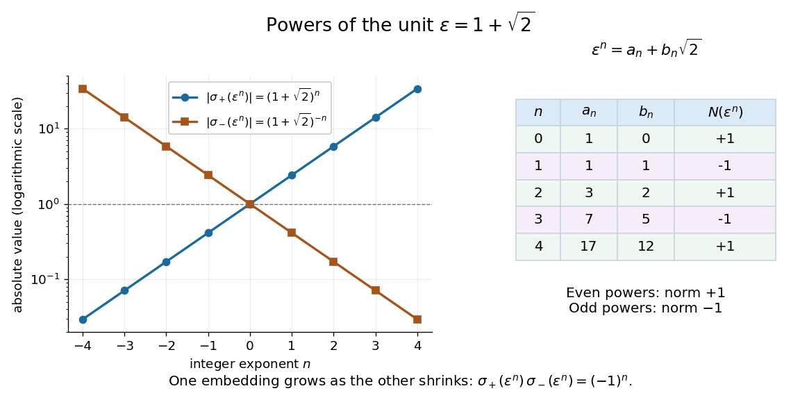

# Units of Q of square root two

↑ **Parent:** [Dirichlet's unit theorem](dirichlet-s-unit-theorem.md)

The [unit](unit-in-a-ring.md) $\varepsilon=1+\sqrt2$ has [field norm](field-norm.md) minus one and is the least [unit](unit-in-a-ring.md) greater than one in the [field embedding](field-embedding.md) sending $\sqrt2$ to its positive value. It is a [fundamental unit](fundamental-unit-number-theory.md). The [Dirichlet unit theorem](dirichlet-s-unit-theorem.md) therefore gives

$$
\mathbb Z[\sqrt2]^\times
=\{\mathord\pm(1+\sqrt2)^n:n\in\mathbb Z\}.
$$

Writing $\varepsilon^n=a_n+b_n\sqrt2$, direct multiplication gives

$$
a_0=1,\quad b_0=0,\qquad a_{n+1}=a_n+2b_n,\quad b_{n+1}=a_n+b_n.
$$

For $n=0,1,2,3,4$, the pairs $(a_n,b_n)$ are $(1,0),(1,1),(3,2),(7,5),(17,12)$, and

$$
a_n^2-2b_n^2=(-1)^n.
$$

In particular, $\eta=\varepsilon^2=3+2\sqrt2$ has [field norm](field-norm.md) one. Its powers start $1$, $3+2\sqrt2$, $17+12\sqrt2$, $99+70\sqrt2$, and give solutions $(a,b)$ of the [Pell equation](pell-equation.md) $a^2-2b^2=1$. This turns finding one [unit](unit-in-a-ring.md) into generating infinitely many exact [integer](integer-split.md) solutions.

The two [field embeddings](field-embedding.md) show a striking balance:

$$
\sigma_+(\varepsilon^n)=(1+\sqrt2)^n,\qquad
\sigma_-(\varepsilon^n)=(1-\sqrt2)^n=(-1)^n(1+\sqrt2)^{-n}.
$$

For positive $n$, one value grows while the other approaches zero, and their product stays $(-1)^n$. Taking [logarithms](logarithm.md) of their [absolute values](absolute-value.md) converts this multiplication into equally spaced points, the simplest example of the [logarithmic embedding of number field units](logarithmic-embedding-of-number-field-units.md).[Milne, Algebraic Number Theory, Chapter 5, the unit theorem](https://www.jmilne.org/math/CourseNotes/ANT.pdf)

**[Figure 2](#image-unit-powers-grow-in-one-real-embedding-and-shrink-in-the-other). Unit powers grow in one real embedding and shrink in the other**. The plots use [logarithmic scales](logarithmic-scale.md) for the [absolute values](absolute-value.md) of the two [field embeddings](field-embedding.md) of $(1+\sqrt2)^n$. The table gives exact coefficients and signed [field norms](field-norm.md); odd powers have negative second embedding. Even powers are powers of $3+2\sqrt2$ and solve the [Pell equation](pell-equation.md) $a^2-2b^2=1$.

**Table of contents**

- [Units congruent to one modulo 3 plus square root two](units-congruent-to-one-modulo-3-plus-square-root-two.md)

## ↑ Ancestors (6)

1. [Dirichlet's unit theorem](dirichlet-s-unit-theorem.md)
2. [Algebraic number theory](algebraic-number-theory-split.md)
3. [Algebra](algebra-split.md)
4. [Area of mathematics](area-of-mathematics.md)
5. [Mathematics](mathematics-split.md)
6. [Codex Wiki](split.md)

## ← Incoming links (1)

- [Solution](past-exam-of-the-mathematics-course-of-the-university-of-cambridge/2019/ii/paper-1/20g/b/solution.md)
