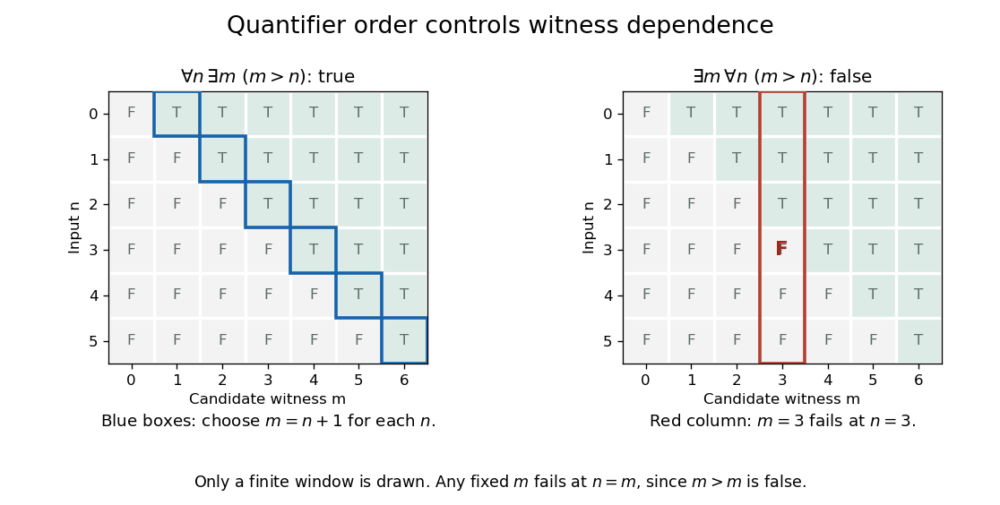

# Universal quantification

↑ **Parent:** [First-order formula](first-order-formula.md)  
ⓦ [Wiki](https://en.wikipedia.org/wiki/Universal_quantification)

[Universal quantification](universal-quantification.md) forms $\forall x\,\varphi(x,\mathbf y)$. In a [first-order structure](first-order-structure.md), it is true at an assignment to $\mathbf y$ when every domain element assigned to $x$ makes the instance true. Its introduction rule requires that the generalized variable not occur freely in undischarged assumptions.

Over the [natural numbers](natural-number.md), reversing the preceding [existential quantification](existential-quantification.md) and [universal quantification](universal-quantification.md) gives a true [first-order sentence](first-order-sentence.md):

$$
\forall n\in\mathbb N\,\exists m\in\mathbb N\;(m>n).
$$

Choose $m=n+1$. The computed witnesses for $n=0,1,2,3$ are $m=1,2,3,4$. The choice may depend on the previously given $n$. The formula states that every [natural number](natural-number.md) has a larger [natural number](natural-number.md); the reversed formula demands one larger than all of them.

**[Figure 5](#image-universal-quantification-followed-by-existential-quantification-permits-a-different-witness-for-each-input). Universal quantification followed by existential quantification permits a different witness for each input**.

The diagram displays a finite window, while the rules $m=n+1$ and $n=m$ settle the two statements for every [natural number](natural-number.md). This dependence is why quantifier order matters in precise specifications. Choosing one $m$ that works for every $n$ would also provide a witness for each $n$; the reverse inference fails here.

To introduce [universal quantification](universal-quantification.md) in [natural deduction](natural-deduction.md), reason with an arbitrary input, without assuming a special property of it. The construction $m=n+1$ does exactly this and also gives a proof in [intuitionistic first-order logic](intuitionistic-first-order-logic.md). The introduction and elimination rules for both quantifiers are developed in [Frank Pfenning, First-Order Logic and Type Theory, section 4.1](https://www.cs.cmu.edu/~fp/courses/15317-f08/lectures/06-quant.pdf).

## ↑ Ancestors (7)

1. [First-order formula](first-order-formula.md)
2. [First-order logic](first-order-logic.md)
3. [Mathematical logic](mathematical-logic-split.md)
4. [Foundations of mathematics](foundations-of-mathematics-split.md)
5. [Area of mathematics](area-of-mathematics.md)
6. [Mathematics](mathematics-split.md)
7. [Codex Wiki](split.md)

## ← Incoming links (11)

- [Existential quantification](existential-quantification.md)
- [Existential second-order logic](existential-second-order-logic.md)
- [Full semantics for second-order logic](full-semantics-for-second-order-logic.md)
- [Gödel-Gentzen negative translation](godel-gentzen-negative-translation.md)
- [Mathematical logic](mathematical-logic-split.md)
- [Solution](past-exam-of-the-mathematics-course-of-the-university-of-cambridge/2017/iii/paper-135/5/solution.md)
- [Second-order logic](second-order-logic.md)
- [Set intersection](set-intersection.md)
- [Stability of a formula under double negation](stability-of-a-formula-under-double-negation.md)
- [Uniform convergence](uniform-convergence.md)
- [Universal quantification](universal-quantification.md)
