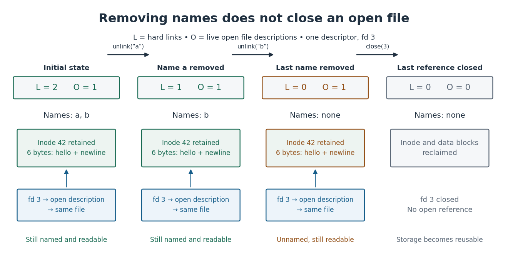

# Unlinking an open file

↑ **Parent:** [Hard link](hard-link.md)

For an ordinary [file](computer-file.md) under the [POSIX](posix.md) rules used here, successful `unlink("a")` removes the named [directory entry](directory-entry.md) and decreases the [hard link](hard-link.md) count. An existing [open file description](open-file-description.md) still refers to the same [file](computer-file.md); removing a name does not detach an already open [file descriptor](file-descriptor.md). When the final [hard link](hard-link.md) disappears, the contents remain available through open references until those references close. This distinction is between the lifetime of a name and the lifetime of the underlying [file](computer-file.md). [The Open Group, POSIX.1-2017, unlink: removal of names and deferred removal of open-file contents](https://pubs.opengroup.org/onlinepubs/9699919799/functions/unlink.html)

Start with names `a` and `b` for [inode](inode.md) 42 and one [file descriptor](file-descriptor.md) `3` referring to one [open file description](open-file-description.md). Let $L$ count [hard links](hard-link.md) and $O$ count live [open file descriptions](open-file-description.md) for this [file](computer-file.md). Assume successful operations, no additional references, and no [memory-mapped file](memory-mapped-file.md). The stages are

$$
(L,O):\quad (2,1)\xrightarrow{\mathrm{unlink}(a)}(1,1)\xrightarrow{\mathrm{unlink}(b)}(0,1)\xrightarrow{\mathrm{close}(3)}(0,0).
$$

After the first removal, `b` still works. After the second, neither name works, but a read through the existing [file descriptor](file-descriptor.md) can still obtain all six [bytes](byte.md) if its [open file description](open-file-description.md)'s current position is at the beginning. The final close releases the last open reference, allowing the [inode](inode.md) and its [file data blocks](file-data-block.md) to be reclaimed. Freed storage is reusable; this does not promise that old [bytes](byte.md) are securely erased. [The Open Group, POSIX, close: releasing descriptors, open file descriptions and unlinked-file storage](https://pubs.opengroup.org/onlinepubs/009604499/functions/close.html)

**[Figure 25](#image-hard-link-and-open-reference-counts-distinguish-removal-of-names-from-reclamation-of-a-file). Hard link and open-reference counts distinguish removal of names from reclamation of a file**.

The reasoning is bookkeeping rather than a long proof: each successful removal subtracts one from $L$ and leaves $O$ unchanged; closing the only [file descriptor](file-descriptor.md) in this example releases the sole [open file description](open-file-description.md). Storage is reclaimable only at the last stage. $O$ is a teaching count, not a count of [file descriptors](file-descriptor.md) or an asserted internal [inode](inode.md) field: several [file descriptors](file-descriptor.md) can share one [open file description](open-file-description.md), and other references such as a [memory-mapped file](memory-mapped-file.md) require additional lifetime accounting. The diagrams are abstract models, not operations on actual user [files](computer-file.md).

## ↑ Ancestors (6)

1. [Hard link](hard-link.md)
2. [File-system namespace](file-system-namespace.md)
3. [File system](file-system.md)
4. [Operating system](operating-system.md)
5. [Computer science](computer-science-split.md)
6. [Codex Wiki](split.md)

## ← Incoming links (2)

- [Kernel (operating system)](kernel-operating-system.md)
- [POSIX](posix.md)
