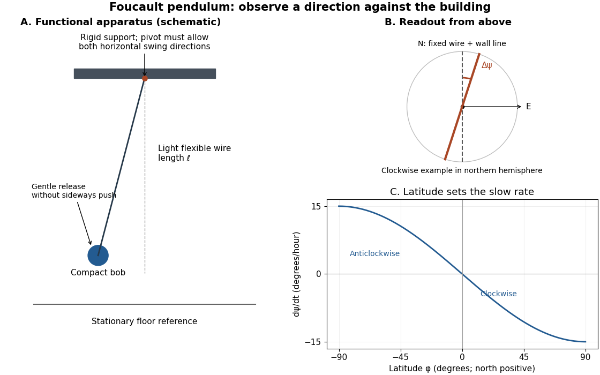

# UNSW Foucault pendulum observation

↑ **Parent:** [Foucault pendulum](foucault-pendulum.md)

The University of New South Wales documents an undriven, visitor-started [Foucault pendulum](foucault-pendulum.md). A fixed vertical wire and wall line define its initial north–south swing [plane](plane.md). The documented comparison one hour later shows reduced [amplitude](wave-amplitude.md) and about nine degrees of anticlockwise [precession](precession.md). The apparatus swings for several hours without an electromagnetic drive.[The Foucault pendulum, opening observation sequence and Our Foucault Pendulum: wire/wall reference, one-hour comparison, no electromagnetic drive](the-foucault-pendulum-by-joe-wolfe.md)

**[Figure 6](#image-functional-foucault-pendulum-apparatus-fixed-sighting-reference-and-predicted-latitude-dependence-schematic-with-no-historical-dimensions). Functional Foucault pendulum apparatus, fixed sighting reference, and predicted latitude dependence; schematic with no historical dimensions**.

To turn that demonstration into a quantitative experiment, the following is a proposed measurement protocol. Establish a rigid support with no preferred horizontal swing direction, measure the wire length to the bob's centre, and mark two perpendicular horizontal axes fixed to the building. Start with a small displacement along the sighting [plane](plane.md), then release with as little transverse [velocity](velocity.md) as possible. Record the actual launch method; burning a fine restraining thread is one possible proposed release, not a claim about the documented UNSW launch. Keep people clear of the bob and avoid touching the suspension during the observation.

Record the horizontal [position](position.md) from above with a stationary, calibrated camera, or sight the bob against the wire and wall line at recorded times. Fit the long axis of each short group of swings to estimate its orientation $\psi$; use the extrema on both sides rather than following the bob's rapidly reversing [velocity](velocity.md). A swing line has orientation modulo $\pi$, so unwrap successive small direction changes continuously. Rotate no camera or reference between measurements. Record the fast [oscillation period](period-of-an-oscillation.md) separately, and compare the slope of $\psi(t)$ with the [Latitude law of Foucault precession](latitude-law-of-foucault-precession.md). Repeat launches along different directions and monitor [ellipses](ellipse.md), pivot motion, and air currents before attributing the slow change to [Earth's rotation](earth-s-rotation.md).

## ↑ Ancestors (6)

1. [Foucault pendulum](foucault-pendulum.md)
2. [Simple pendulum](simple-pendulum-split.md)
3. [Classical mechanics](classical-mechanics-split.md)
4. [Branches of physics](branches-of-physics.md)
5. [Physics](physics-split.md)
6. [Codex Wiki](split.md)
