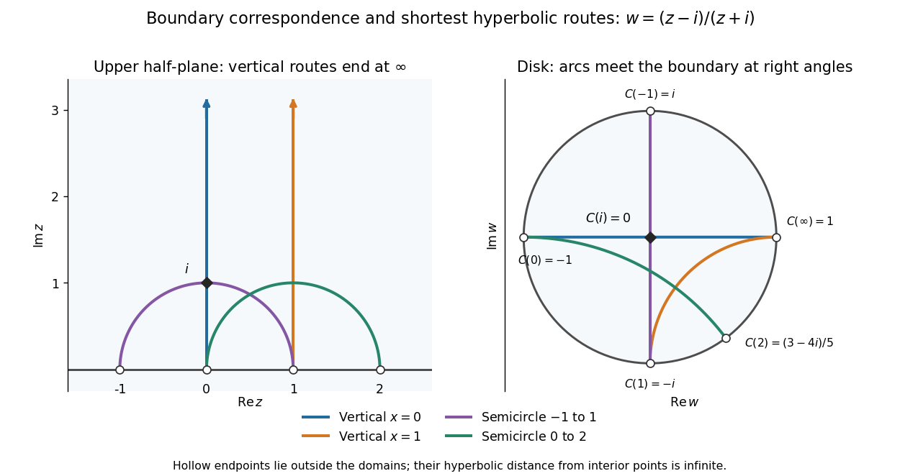

# Upper half-plane (complex analysis)

↑ **Parent:** [Complex analysis](complex-analysis-split.md)  
ⓦ [Wiki](https://en.wikipedia.org/wiki/Upper_half-plane)

The [upper half-plane](upper-half-plane-complex-analysis.md) is the [open set](open-set.md)

$$
\mathbb H=\{z=x+iy\in\mathbb C:y>0\}.
$$

It contains precisely the [complex numbers](complex-number.md) with positive [imaginary part](imaginary-part.md): $1+i$ is inside, $1$ lies on its [boundary](boundary-of-a-set.md), and $1-i$ belongs to the [lower half-plane](lower-half-plane.md). In the [complex plane](complex-plane.md) its [boundary](boundary-of-a-set.md) is the [real line](real-line.md); in the [Riemann sphere](riemann-sphere.md) the [boundary](boundary-of-a-set.md) also includes infinity. It is a [convex set](convex-set.md), hence a [simply connected domain](simply-connected-domain.md), and the [Cayley transform between the half-plane and disk](cayley-transform-between-the-half-plane-and-disk.md) makes it [biholomorphic](biholomorphism.md) to the [unit disc](unit-disc.md).

With the [hyperbolic metric](hyperbolic-metric.md) $ds=|dz|/\operatorname{Im}z$, the same domain becomes the [Poincaré half-plane model](poincare-half-plane-model.md). Its [hyperbolic geodesics](geodesic-in-the-poincare-half-plane-model.md) are vertical lines and upper semicircles whose centres lie on the [real line](real-line.md). Under the [Cayley transform](cayley-transform-complex-analysis.md), these become arcs of [circles](circle.md) orthogonal to the [unit circle](complex-unit-circle.md), with diameters as the straight-line cases. [Series, Hyperbolic Geometry, sections 2.1 and 2.1.1](https://warwick.ac.uk/fac/sci/maths/people/staff/caroline_series/hyperbolic_geometry_ma448_lecture_notes.pdf)

**[Figure 4](#image-boundary-points-and-hyperbolic-geodesics-correspond-under-the-cayley-transform-from-the-upper-half-plane-to-the-unit-disc). Boundary points and hyperbolic geodesics correspond under the Cayley transform from the upper half-plane to the unit disc**.

Matching colours identify each [hyperbolic geodesic](geodesic-in-the-poincare-half-plane-model.md) and its image. The vertical line through zero maps to a diameter; the vertical line through one maps to an arc ending at $-i$ and $1$. A semicircle from $-1$ to $1$ also maps to a diameter, whereas the semicircle from $0$ to $2$ maps to a curved arc. Their endpoints lie on the [boundary](boundary-of-a-set.md), outside the domains: the endpoints are infinitely far from interior points in [hyperbolic distance](hyperbolic-distance.md).

The [upper half-plane](upper-half-plane-complex-analysis.md) is useful because its straight [boundary](boundary-of-a-set.md) and explicit [upper half-plane automorphisms](conformal-automorphism-of-the-upper-half-plane.md) make [conformal maps](conformal-map.md) and [hyperbolic geometry](hyperbolic-geometry.md) calculable. The picture explains why shortest [hyperbolic geodesic](geodesic-in-the-poincare-half-plane-model.md) routes can look curved in Euclidean coordinates; their lengths are measured with the position-dependent [hyperbolic metric](hyperbolic-metric.md).

For historical context, in his letter to Klein of 22 September 1882, Poincaré constructs a [quadrilateral](quadrilateral.md) bounded by four [circles](circle.md) orthogonal to a fundamental [circle](circle.md), and studies transformations generating repeated copies. In modern language, the sides inside that [circle](circle.md) are [hyperbolic geodesics](geodesic-in-the-poincare-half-plane-model.md) in a disk model. The letter directly exhibits the connection between transformation [groups](group-split.md), geometry and complex [functions](function-split.md). [Poincaré to Klein, 22 September 1882, English translation, opening construction](https://henripoincarepapers.univ-nantes.fr/chp/text/klein-en-1882-09-22.html)

**Table of contents**

- [Conformal automorphism of the upper half-plane](conformal-automorphism-of-the-upper-half-plane.md)

## ↑ Ancestors (5)

1. [Complex analysis](complex-analysis-split.md)
2. [Analysis](analysis-split.md)
3. [Area of mathematics](area-of-mathematics.md)
4. [Mathematics](mathematics-split.md)
5. [Codex Wiki](split.md)

## ← Incoming links (1)

- [Solution](past-exam-of-the-mathematics-course-of-the-university-of-cambridge/2017/ib/paper-4/14a/solution.md)
