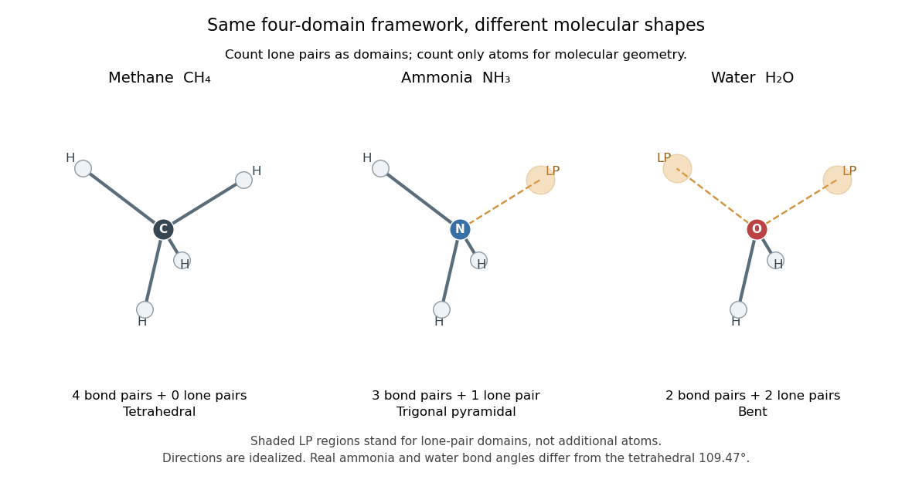

# Valence shell electron pair repulsion theory

↑ **Parent:** [Lewis structure](lewis-structure.md)  
ⓦ [Wiki](https://en.wikipedia.org/wiki/VSEPR_theory)

The [VSEPR model](valence-shell-electron-pair-repulsion-theory.md) predicts approximate [molecular geometry](molecular-geometry.md) by arranging the [electron domains](electron-domain.md) around a central [chemical atom](atom-physics.md) to reduce their mutual repulsion. Start with a [Lewis structure](lewis-structure.md), count the domains, and then distinguish the resulting [electron pair geometry](electron-pair-geometry.md) from the positions of the [chemical atoms](atom-physics.md) themselves. A [lone pair](lone-pair.md) counts as a domain even though it is not another [chemical atom](atom-physics.md).[MIT 3.091, lecture 11: Lewis structures, domains and molecular shapes](https://ocw.mit.edu/courses/3-091-introduction-to-solid-state-chemistry-fall-2018/g9v8zj6VObw_transcript.pdf)

Three worked counts have the same total of eight [valence electrons](valence-electron.md). In [methane](methane.md), [carbon](carbon.md)'s four plus the contributions of four [hydrogen](hydrogen.md) [chemical atoms](atom-physics.md) give $4+4=8$: four [bond pairs](bond-pair.md), no [lone pairs](lone-pair.md), and [tetrahedral molecular geometry](tetrahedral-molecular-geometry.md). In [ammonia](ammonia.md), [nitrogen](nitrogen.md)'s five plus three from [hydrogen](hydrogen.md) give $5+3=8$: three [bond pairs](bond-pair.md) and one [lone pair](lone-pair.md), producing [trigonal pyramidal molecular geometry](trigonal-pyramidal-molecular-geometry.md). In [water](water.md), [oxygen](oxygen.md)'s six plus two from [hydrogen](hydrogen.md) give $6+2=8$: two [bond pairs](bond-pair.md) and two [lone pairs](lone-pair.md), producing [bent molecular geometry](bent-molecular-geometry.md). All three have four [electron domains](electron-domain.md); their [molecular geometries](molecular-geometry.md) differ.

**[Figure 7](#image-four-electron-domains-give-three-molecular-shapes-as-lone-pairs-replace-bonded-neighbours). Four electron domains give three molecular shapes as lone pairs replace bonded neighbours**.

The regular tetrahedral directions can be represented by the [unit vectors](unit-vector.md)

$$
\frac1{\sqrt3}(1,1,1),\quad
\frac1{\sqrt3}(1,-1,-1),\quad
\frac1{\sqrt3}(-1,1,-1),\quad
\frac1{\sqrt3}(-1,-1,1).
$$

Each pair has [dot product](dot-product.md) $-1/3$, so the ideal [bond angle](bond-angle.md) is $\theta=\arccos(-1/3)\approx109.47^\circ$. This is a geometric calculation, rather than a prediction that every four-domain [molecule](molecule-split.md) has that exact [bond angle](bond-angle.md). [Lone pairs](lone-pair.md) and different kinds of [chemical bonds](chemical-bond-split.md) distort the ideal arrangement; [water](water.md)'s H–O–H angle is about $104.5^\circ$.[Chemistry 2e, 7.6: ideal geometry and water's bond angle](chemistry-2e-by-paul-flowers-and-others.md)

The model is attractive because small-number bookkeeping produces a spatial prediction without first solving for every [molecular orbital](molecular-orbital.md). Shape then helps explain [chemical polarity](chemical-polarity.md) and which [hydrogen bond donor](hydrogen-bond-donor.md) or [hydrogen bond acceptor](hydrogen-bond-acceptor.md) sites are accessible. It is a qualitative model, not a full calculation of the electronic [energy](energy-split.md) or a universal solution for every [chemical compound](chemical-compound.md). Gillespie and Nyholm's 1957 review [Inorganic stereochemistry, Quarterly Reviews 11, 339–380](https://doi.org/10.1039/QR9571100339) is a historical anchor for its development.

**Table of contents**

- [Electron domain](electron-domain.md)
- [Electron pair geometry](electron-pair-geometry.md)

## ↑ Ancestors (5)

1. [Lewis structure](lewis-structure.md)
2. [Covalent bond](covalent-bond-split.md)
3. [Chemical bond](chemical-bond-split.md)
4. [Chemistry](chemistry-split.md)
5. [Codex Wiki](split.md)
