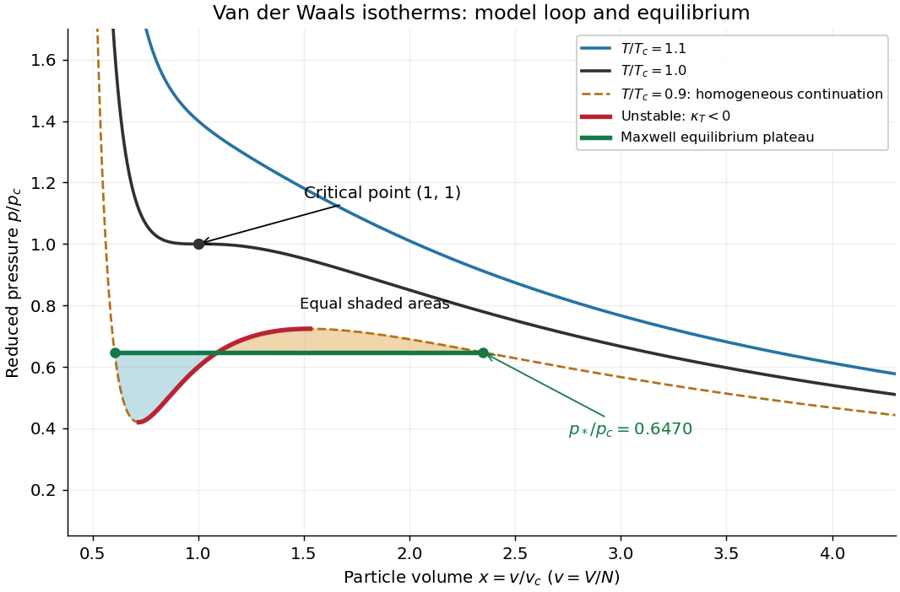

# Van der Waals isotherm

↑ **Parent:** [Van der Waals equation](van-der-waals-equation.md)

A [Van der Waals isotherm](van-der-waals-isotherm.md) is the [pressure](pressure.md)–particle [volume](volume-thermodynamics.md) curve at a fixed [temperature](temperature.md). Put $x=v/v_c$, $t=T/T_c$, and $q=p/p_c$, using the [Van der Waals critical point](van-der-waals-critical-point.md) values below. Then the existing [Van der Waals law of corresponding states](van-der-waals-law-of-corresponding-states.md) becomes

$$
q(x,t)=\frac{8t}{3x-1}-\frac{3}{x^2},\qquad x>\frac13.
$$

All curves in the figure are calculations in this reduced model.

**[Figure 40](#van-der-waals-reduced-isotherms). Van der Waals isotherms below, at and above the Van der Waals critical point**. The dashed subcritical homogeneous continuation contains an unstable red segment. The green [Maxwell construction](maxwell-construction.md) plateau describes equilibrium [phase coexistence](phase-coexistence.md); the two shaded areas are equal. Curves are model calculations, not [carbon dioxide](carbon-dioxide.md) measurements.

For a uniform [thermodynamic phase](thermodynamic-phase.md), the [isothermal compressibility](isothermal-compressibility.md) is

$$
\kappa_T=-\frac1v\left(\frac{\partial v}{\partial p}\right)_T
=-\frac{1}{v(\partial p/\partial v)_T}.
$$

Thus the upward-sloping portion of a subcritical [Van der Waals isotherm](van-der-waals-isotherm.md) has $\kappa_T<0$: compression would reduce [pressure](pressure.md), allowing a density disturbance to grow. It is mechanically unstable. The [spinodal points](spinodal-point.md) bound that portion; setting the [derivative](derivative.md) $\partial q/\partial x$ to zero gives their curve $t=(3x-1)^2/(4x^3)$. Negative slope alone guarantees only local mechanical stability: portions between the [spinodal](spinodal.md) and the [phase coexistence](phase-coexistence.md) endpoints have [metastability](metastability.md). Equilibrium replaces the entire interval between those endpoints, including these metastable portions, by a [Maxwell construction](maxwell-construction.md) plateau.[§5.1, equation 5.3 and §5.1.1, Maxwell Construction and Meta-Stable States: unstable middle branch and coexistence versus spinodal](statistical-physics-by-david-tong.md)

## ↑ Ancestors (8)

1. [Van der Waals equation](van-der-waals-equation.md)
2. [Equation of state](equation-of-state.md)
3. [Pressure](pressure.md)
4. [Thermodynamics](thermodynamics-split.md)
5. [Statistical physics](statistical-physics-split.md)
6. [Branches of physics](branches-of-physics.md)
7. [Physics](physics-split.md)
8. [Codex Wiki](split.md)

## ← Incoming links (2)

- [Van der Waals critical point](van-der-waals-critical-point.md)
- [Van der Waals isotherm](van-der-waals-isotherm.md)
