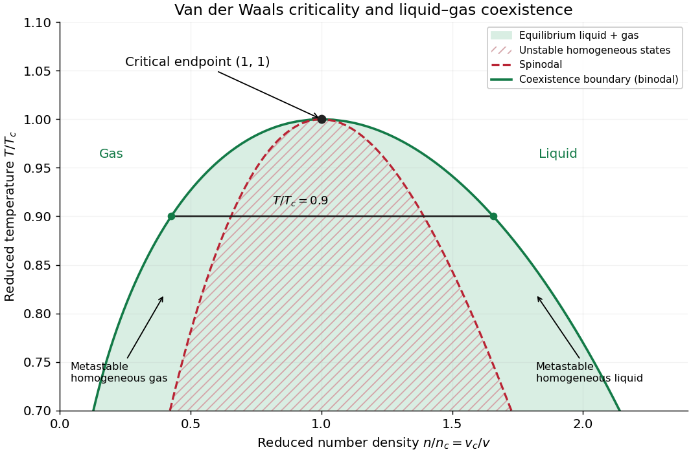

# Van der Waals liquid-gas coexistence

↑ **Parent:** [Van der Waals equation](van-der-waals-equation.md)

Below $T_c$, the equilibrium [liquid](liquid.md) and [gas](gas.md) have the same [temperature](temperature-split.md), [pressure](pressure-split.md) $p_*$, and per-particle [chemical potential](chemical-potential-split.md). For macroscopic bulk [thermodynamic phases](thermodynamic-phase.md), neglect interface contributions. The [Maxwell equal-area construction](maxwell-construction.md) determines $v_l$ and $v_g$ by

$$
p(v_l,T)=p(v_g,T)=p_*,\qquad
\int_{v_l}^{v_g}[p(v,T)-p_*]\,dv=0.
$$

It expresses equality of [chemical potentials](chemical-potential-split.md), since $d\mu=v\,dp$ at fixed [temperature](temperature-split.md). Equivalently, the equilibrium [Helmholtz free energy](helmholtz-free-energy.md) per particle follows a common [tangent line](tangent-line.md) between the two endpoint states, lying below the homogeneous continuation between them. The construction uses that mathematical continuation to compare endpoints; it is not a physical compression path through negative [isothermal compressibility](isothermal-compressibility.md) states.[§5.1.1, equation 5.5, Maxwell Construction and figures 36–37: chemical-potential equality and flat coexistence intervals](statistical-physics-by-david-tong.md)

Here is a reproducible calculated example at $t=0.9$. With $q_*=p_*/p_c$, the homogeneous intersections solve the [cubic equation](cubic-equation.md)

$$
3q_*x^3-(q_*+8t)x^2+9x-3=0.
$$

The [Maxwell construction](maxwell-construction.md) gives

$$
q_*\simeq0.646998352,\qquad
(x_l,x_m,x_g)\simeq(0.603401903,\ 1.090526633,\ 2.348842376).
$$

All three [roots of a polynomial](root-of-a-polynomial.md) satisfy $x>1/3$. Only the smallest and largest are the [phase coexistence](phase-coexistence.md) endpoints; the middle one has negative [isothermal compressibility](isothermal-compressibility.md). Equal [pressures](pressure-split.md) at three admissible values of [volume](volume-thermodynamics.md) therefore do not imply three stable [thermodynamic phases](thermodynamic-phase.md). An analytic area check is

$$
\frac{8t}{3}\ln\frac{3x_g-1}{3x_l-1}
+3\left(\frac1{x_g}-\frac1{x_l}\right)-q_*(x_g-x_l)=0.
$$

At full numerical precision, the residual is below $10^{-11}$ in reduced units; independent numerical integration gives the same cancellation. At $t=0.9$, the [spinodal points](spinodal-point.md) are instead $x\simeq0.718597189$ and $1.528504964$.

**[Figure 5](#van-der-waals-critical-coexistence). Phase coexistence and spinodal curves meet at the Van der Waals critical point**. The horizontal coordinate is reduced [number density](number-density.md) $n/n_c=1/x$, not [molar volume](molar-volume.md). The green region is equilibrium [liquid](liquid.md)–[gas](gas.md) coexistence, bounded by the [binodal](binodal.md). Hatching marks unstable homogeneous states, and the strips between solid and dashed boundaries mark homogeneous [metastability](metastability.md). This is a model [phase diagram](phase-diagram.md), not measured data.

The equilibrium plateau changes the [phase fraction](phase-fraction.md) rather than the endpoint densities. For a gas particle fraction $f_g=N_g/N$ and mean particle [volume](volume-thermodynamics.md) $\bar v=V/N$, the [lever rule](lever-rule.md) reads

$$
\bar v=(1-f_g)v_l+f_gv_g,\qquad
f_g=\frac{\bar v-v_l}{v_g-v_l}.
$$

Thus $\bar v=v_c$ at $t=0.9$ gives $f_g\simeq0.227219$: this is a particle fraction, not the [volume fraction](volume-fraction.md) occupied by [gas](gas.md). Differentiating equality of [chemical potentials](chemical-potential-split.md) along this model's [phase coexistence curve](phase-coexistence-curve.md) yields the same [Clapeyron equation](clausius-clapeyron-relation.md) explained below, $dp_*/dT=\ell/[T(v_g-v_l)]$, with [latent heat](latent-heat.md) $\ell$ per particle. Both endpoint differences vanish as the [Van der Waals critical point](van-der-waals-critical-point.md) is approached; the equation's critical limit must be taken as a ratio.

The [Maxwell construction](maxwell-construction.md) presumes a pure bulk [fluid](fluid.md) at [thermodynamic equilibrium](thermodynamic-equilibrium.md). Its endpoint equality does not specify how rapidly a real compression reaches equilibrium. A homogeneous [metastable](metastability.md) sample can persist while [nucleation](nucleation.md) is delayed; the [spinodal](spinodal.md) marks loss of local mechanical stability in this [mean-field theory](mean-field-theory.md), rather than the equilibrium onset of condensation. [Surface tension](surface-tension-split.md), finite sample size and impurities can affect the observed transition. These qualifications matter when comparing a mathematical [Van der Waals isotherm](van-der-waals-isotherm.md) with a visible [liquid meniscus](meniscus-liquid-surface.md).

**Table of contents**

- [Low-temperature liquid volume of a van der Waals gas](low-temperature-liquid-volume-of-a-van-der-waals-gas.md)

## ↑ Ancestors (8)

1. [Van der Waals equation](van-der-waals-equation.md)
2. [Equation of state](equation-of-state.md)
3. [Pressure](pressure-split.md)
4. [Thermodynamics](thermodynamics-split.md)
5. [Statistical physics](statistical-physics-split.md)
6. [Branches of physics](branches-of-physics.md)
7. [Physics](physics-split.md)
8. [Codex Wiki](split.md)

## ← Incoming links (2)

- [Molar Van der Waals worked example](molar-van-der-waals-worked-example.md)
- [Nobel Prize in Physics in 1910](nobel-prize-in-physics-in-1910.md)
