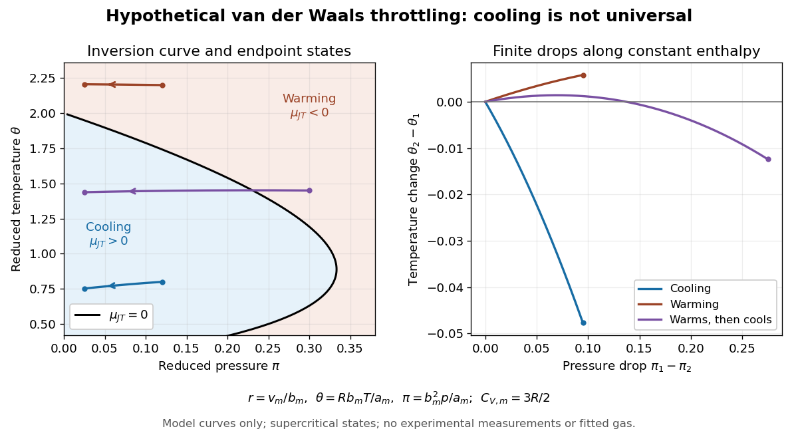

# Van der Waals throttling model

↑ **Parent:** [Joule-Thomson coefficient](joule-thomson-coefficient.md)

A hypothetical [Van der Waals equation](van-der-waals-equation.md) model illustrates positive and negative [Joule-Thomson coefficient](joule-thomson-coefficient.md) regions and a finite throttle that first warms, then cools. Use the molar convention already distinguished in [Van der Waals equation](van-der-waals-equation.md):

$$
p=\frac{RT}{v_{\rm m}-b_{\rm m}}-\frac{a_{\rm m}}{v_{\rm m}^2},
\qquad
u_{\rm m}=C_{V,\rm m}T-\frac{a_{\rm m}}{v_{\rm m}},
\qquad C_{V,\rm m}=\frac32R.
$$

Here $v_{\rm m}$ is [molar volume](molar-volume.md), $R$ the [molar gas constant](molar-gas-constant.md), $u_{\rm m}$ [internal energy](internal-energy-split.md) per [mole](mole-unit.md), and $C_{V,\rm m}$ the stipulated constant [molar heat capacity](molar-heat-capacity.md) at fixed [volume](volume-thermodynamics.md). The second equation is an additional caloric assumption: an [equation of state](equation-of-state.md) alone does not specify the [temperature](temperature-split.md) dependence of [internal energy](internal-energy-split.md). It satisfies the equilibrium identity $(\partial u_{\rm m}/\partial v_{\rm m})_T=T(\partial p/\partial T)_{v_{\rm m}}-p=a_{\rm m}/v_{\rm m}^2$. The arbitrary [energy](energy-split.md) reference is set to zero.

**[Figure 2](#van-der-waals-throttling-inversion-model). Hypothetical Van der Waals throttling model: Joule-Thomson inversion curve and finite temperature responses**. All curves are original model calculations, not [nitrogen](nitrogen.md), [carbon dioxide](carbon-dioxide.md) or other gas measurements. Colors label the response along constant [molar enthalpy](molar-enthalpy.md); arrows point toward lower [pressure](pressure-split.md). The displayed states are above the model [Van der Waals critical point](van-der-waals-critical-point.md) [temperature](temperature-split.md) and have positive [isothermal compressibility](isothermal-compressibility.md). The purple path crosses the zero-coefficient curve and has a [temperature](temperature-split.md) maximum.

Define dimensionless variables $r=v_{\rm m}/b_{\rm m}$, $\theta=Rb_{\rm m}T/a_{\rm m}$, $\pi=b_{\rm m}^2p/a_{\rm m}$ and $\eta=b_{\rm m}h_{\rm m}/a_{\rm m}$, where $h_{\rm m}$ is [molar enthalpy](molar-enthalpy.md). These differ from the critical-value scaling in [Van der Waals law of corresponding states](van-der-waals-law-of-corresponding-states.md). The throttle calculation reduces to

$$
\pi=\frac{\theta}{r-1}-\frac1{r^2},\qquad
\eta=\frac32\theta+\pi r-\frac1r,
\qquad
\theta(r;\eta)=\frac{\eta+2/r}{3/2+r/(r-1)}.
$$

Thus a prescribed inlet fixes $\eta$, and solving the first and last equations at the outlet [pressure](pressure-split.md) gives the final [temperature](temperature-split.md). For an inlet $(\theta_1,\pi_1)=(0.8,0.12)$ and outlet $\pi_2=0.025$, the model gives $\theta_2\simeq0.752287$, a decrease of $0.047713$. The inlet $(2.2,0.12)$ instead gives $\theta_2\simeq2.205786$, an increase of $0.005786$. The purple inlet $(1.45,0.30)$ initially warms but ends at $\theta_2\simeq1.437585$ for the same outlet [pressure](pressure-split.md). These are reduced toy values, not kelvin readings or experimental evidence. No physical gas parameters were fitted.

For a short inversion derivation, implicit [differentiation](differentiation.md) of the [Van der Waals equation](van-der-waals-equation.md) at fixed [pressure](pressure-split.md) gives

$$
\left(\frac{\partial v_{\rm m}}{\partial T}\right)_p
=\frac{R/(v_{\rm m}-b_{\rm m})}{RT/(v_{\rm m}-b_{\rm m})^2-2a_{\rm m}/v_{\rm m}^3}.
$$

Insert this into $T(\partial v_{\rm m}/\partial T)_p=v_{\rm m}$ and substitute back into the [equation of state](equation-of-state.md). The [Joule-Thomson inversion curve](joule-thomson-inversion-curve.md) is

$$
T_{\rm inv}=\frac{2a_{\rm m}}{Rb_{\rm m}}\left(1-\frac{b_{\rm m}}{v_{\rm m}}\right)^2,
\qquad
\theta_{\rm inv}=2(1-1/r)^2,
\qquad
\pi_{\rm inv}=\frac{2r-3}{r^2}.
$$

Positive inversion [pressure](pressure-split.md) requires $r>3/2$. Its maximum [pressure](pressure-split.md) is $\pi=1/3$ at $r=3$, while the upper dilute limit is $\theta_{\rm inv}\to2$. Using [Van der Waals critical point](van-der-waals-critical-point.md) values, the latter is $T_{\rm inv,max}/T_c=27/4$. The inversion locus depends on the [equation of state](equation-of-state.md); the chosen [molar heat capacity](molar-heat-capacity.md) additionally determines how much [temperature](temperature-split.md) changes along each finite throttle.[Fitzpatrick, Joule-Thompson Throttling, equations 6.188–6.190 and following paragraph: inversion locus, maximum temperature and limits of the van der Waals prediction](thermodynamics-and-statistical-mechanics-by-richard-fitzpatrick/joule-thompson-throttling.md)

The displayed region has $\theta>8/27$, above the model's critical [temperature](temperature-split.md), and uses only $r>1$, $p>0$, $(\partial p/\partial v_{\rm m})_T<0$ and positive $C_{p,\rm m}$. Subcritical calculations require attention to [phase coexistence](phase-coexistence.md), [metastability](metastability.md) and the [Maxwell construction](maxwell-construction.md); an unstable homogeneous continuation is not an equilibrium throttle endpoint. Even on a stable branch, this [mean-field theory](mean-field-theory.md) with constant $C_{V,\rm m}$ is a qualitative model, not an accurate inversion map for a particular [real gas](real-gas.md). [Phase transitions](phase-transition.md), changing composition, appreciable [heat](heat-split.md) leakage or bulk [kinetic energy](kinetic-energy.md) changes require a different property calculation or [steady-flow energy balance](steady-flow-energy-balance.md). At [phase coexistence](phase-coexistence.md), the smooth single-[thermodynamic phase](thermodynamic-phase.md) coefficient formula cannot replace a balance involving the [phase fraction](phase-fraction.md).

## ↑ Ancestors (7)

1. [Joule-Thomson coefficient](joule-thomson-coefficient.md)
2. [Enthalpy](enthalpy-split.md)
3. [Thermodynamics](thermodynamics-split.md)
4. [Statistical physics](statistical-physics-split.md)
5. [Branches of physics](branches-of-physics.md)
6. [Physics](physics-split.md)
7. [Codex Wiki](split.md)

## ← Incoming links (2)

- [Joule-Thomson coefficient](joule-thomson-coefficient.md)
- [Van der Waals throttling model](van-der-waals-throttling-model.md)
