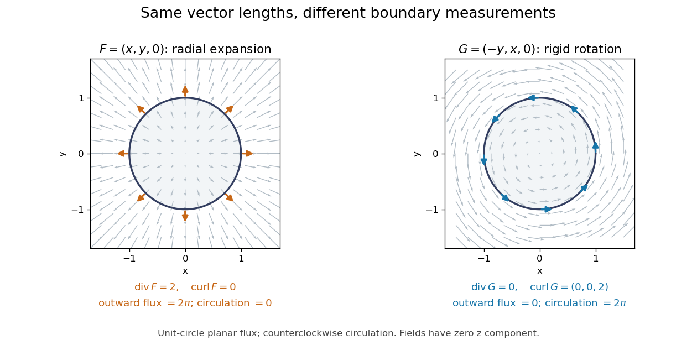

# Vector calculus

↑ **Parent:** [Multivariable calculus](multivariable-calculus.md)  
ⓦ [Wiki](https://en.wikipedia.org/wiki/Vector_calculus)

Vector calculus studies differentiation and integration of [scalar fields](scalar-field.md) and [vector fields](vector-field.md). Three operators answer different local questions: the [gradient](gradient.md) describes change of a scalar value, the [divergence](divergence.md) describes net outward flow, and the [curl](curl.md) describes local circulation. Their associated integral theorems turn local derivatives into measurements along paths and across boundaries.

The difference between [divergence](divergence.md) and [curl](curl.md) is especially visible in two smooth [vector fields](vector-field.md) on three-dimensional [Euclidean space](euclidean-norm.md):

$$
F(x,y,z)=(x,y,0),\qquad G(x,y,z)=(-y,x,0).
$$

At each point they have the same [Euclidean norm](euclidean-norm.md) $\sqrt{x^2+y^2}$, but their directions differ. For $F$, $\nabla\cdot F=2$ and $\nabla\times F=0$. For $G$, $\nabla\cdot G=0$ and $\nabla\times G=(0,0,2)$. One expands radially in each horizontal plane; the other describes rigid rotation.

**[Figure 32](#image-equal-magnitude-fields-can-have-different-divergence-and-curl-radial-expansion-gives-outward-flux-while-rotation-gives-circulation). Equal-magnitude fields can have different divergence and curl: radial expansion gives outward flux, while rotation gives circulation**.

Around the counterclockwise unit [circle](circle.md) in the plane $z=0$, $F$ is normal to the boundary and has zero tangential component. Its outward planar [flux integral](flux-integral.md) is $2\pi$, while its [line integral](line-integral.md) around the circle is zero. For $G$ the values are reversed: outward planar [flux](flux.md) is zero, and circulation is $2\pi$. The [divergence](divergence.md) and [curl](curl.md) predict exactly which boundary measurement survives.

Why is this useful? A [velocity field](velocity-field.md) can move material through a boundary or circulate it within a region. [Conservation of mass](mass-conservation.md) connects its [divergence](divergence.md) with density changes through the [continuity equation](continuity-equation.md); its [curl](curl.md) is [vorticity](vorticity.md). In [electromagnetism](electromagnetism-split.md), the [Maxwell equations](maxwell-equations.md) use the same operators to connect [electric fields](electric-field.md), [magnetic fields](magnetic-field.md), and their sources. The common mathematical language lets the same integral calculations work across different physical models. [OpenStax: Divergence, curl, and their interpretations](https://openstax.org/books/calculus-volume-3/pages/6-5-divergence-and-curl).

The geometric framework behind these operators is developed in [differential forms](differential-form-split.md). The [Generalized Stokes theorem](generalized-stokes-theorem.md) unifies the [fundamental theorem for line integrals](fundamental-theorem-for-line-integrals.md), [Green theorem](green-theorem.md), [Stokes theorem](stokes-theorem.md), and [divergence theorem](divergence-theorem.md). In coordinates their formulas look different, but each relates accumulation over a region to a measurement on its boundary.

[Wilson's Vector Analysis](vector-analysis-book.md), published in 1901, was based on J. Willard Gibbs's lectures at Yale. Wilson's preface explains that examples from geometry, mechanics, and physics are interspersed with the mathematical development, so readers encounter applications as soon as they have the tools to understand them. That is a useful way to approach [vector calculus](vector-calculus.md): learn each operation through a measurement it makes possible. [Wilson: Vector Analysis, 1901, title page and general preface](https://archive.org/details/vectoranalysiste00gibbiala).

**Table of contents**

- [Vector Analysis (book)](vector-analysis-book.md)
- [Dot-product gradient identity](dot-product-gradient-identity.md)
- [Helmholtz decomposition](helmholtz-decomposition.md)
- [Divergence of a cross product](divergence-of-a-cross-product.md)
- [Vector field](vector-field.md)
  - [Flow of a vector field](flow-of-a-vector-field.md)
  - [Time-dependent vector field](time-dependent-vector-field.md)
    - [Finite-time flow completeness on a compact manifold](finite-time-flow-completeness-on-a-compact-manifold.md)
  - [Radial dilation tangency to homogeneous zero sets](radial-dilation-tangency-to-homogeneous-zero-sets.md)
  - [Divergence and curl of a radial vector field](divergence-and-curl-of-a-radial-vector-field.md)
  - [Azimuthal inverse-radius vector field](azimuthal-inverse-radius-vector-field.md)
  - [Integral curve of a vector field](integral-curve-of-a-vector-field.md)
    - [Curvature of an integral curve of a vector field](curvature-of-an-integral-curve-of-a-vector-field.md)
  - [Axisymmetric vector field](axisymmetric-vector-field.md)
  - [Solenoidal vector field](solenoidal-vector-field.md)
    - [Poloidal-toroidal decomposition](poloidal-toroidal-decomposition.md)
      - [Poloidal magnetic energy bound by the radial scalar gradient](poloidal-magnetic-energy-bound-by-the-radial-scalar-gradient.md)
- [Spherically symmetric function](spherically-symmetric-function.md)
- [Helicity conservation by tangent boundary conditions](helicity-conservation-by-tangent-boundary-conditions.md)
- [Divergence](divergence.md)
  - [Divergence of a Riemannian vector field](divergence-of-a-riemannian-vector-field.md)
  - [Cylindrically radial divergence](cylindrically-radial-divergence.md)
  - [Distributional divergence](distributional-divergence.md)
  - [Divergence in polar coordinates](divergence-in-polar-coordinates.md)
  - [Product rule for divergence](product-rule-for-divergence.md)
  - [Total divergence](total-divergence.md)
  - [Divergence of a curl is zero](divergence-of-a-curl-is-zero.md)
- [Curl](curl.md)
  - [Curl of a gradient](curl-of-a-gradient.md)
  - [Irrotational vector field](irrotational-vector-field.md)
  - [Vector potential](vector-potential.md)
    - [Radial vector potential of a solenoidal vector field](radial-vector-potential-of-a-solenoidal-vector-field.md)
  - [Curl of the curl identity](curl-of-the-curl-identity.md)
- [Laplacian](laplacian.md)
  - [Laplacian in polar coordinates](laplacian-in-polar-coordinates.md)
  - [Product rule for the Laplacian](product-rule-for-the-laplacian.md)
  - [Biharmonic operator](biharmonic-operator.md)
    - [Clamped biharmonic problem](clamped-biharmonic-problem.md)
    - [Biharmonic equation](biharmonic-equation.md)
      - [Spherical mean of a biharmonic function](spherical-mean-of-a-biharmonic-function.md)
- [Divergence and curl of a cross product](divergence-and-curl-of-a-cross-product.md)
  - [Curl of a cross product](curl-of-a-cross-product.md)
- [Levi-Civita symbol](levi-civita-symbol.md)
  - [Rotation invariance of the Levi-Civita symbol](rotation-invariance-of-the-levi-civita-symbol.md)
  - [Contraction of two Levi-Civita symbols](contraction-of-two-levi-civita-symbols.md)
  - [Lagrange identity for the cross product](lagrange-identity-for-the-cross-product.md)
  - [Triple product](triple-product.md)
    - [Vector triple product](vector-triple-product.md)
- [Feasible inner products with two unit vectors](feasible-inner-products-with-two-unit-vectors.md)
- [Conservative vector field](conservative-vector-field.md)
  - [Integrating-factor equation for a planar vector field](integrating-factor-equation-for-a-planar-vector-field.md)
  - [Periods obstruct a periodic potential](periods-obstruct-a-periodic-potential.md)
  - [Potential of a conservative vector field](potential-of-a-conservative-vector-field.md)
    - [Radial integral potential for a curl-free field](radial-integral-potential-for-a-curl-free-field.md)
- [Divergence theorem](divergence-theorem.md)
  - [Gradient volume-to-boundary identity](gradient-volume-to-boundary-identity.md)
  - [Vector gradient form of the divergence theorem](vector-gradient-form-of-the-divergence-theorem.md)
  - [Boundary integral of position and normal components](boundary-integral-of-position-and-normal-components.md)
  - [An entire bounded vector field cannot have nonzero constant divergence](an-entire-bounded-vector-field-cannot-have-nonzero-constant-divergence.md)
  - [Riemannian divergence theorem](riemannian-divergence-theorem.md)
- [Fundamental theorem for line integrals](fundamental-theorem-for-line-integrals.md)
  - [Path independence](path-independence.md)
- [Stokes theorem](stokes-theorem.md)
  - [Vector-valued Stokes identity](vector-valued-stokes-identity.md)
  - [Stokes flux through an annular paraboloid](stokes-flux-through-an-annular-paraboloid.md)
- [Surface integral](surface-integral.md)
  - [Vector surface element of a graph](vector-surface-element-of-a-graph.md)
  - [Oriented surface element](oriented-surface-element.md)
  - [Parametrized surface](parametrized-surface.md)
  - [Surface area of a graph](surface-area-of-a-graph.md)
  - [Flux integral](flux-integral.md)
- [Green theorem](green-theorem.md)
  - [Boundary formula for planar area](boundary-formula-for-planar-area.md)
- [Line integral](line-integral.md)
- [Tensor divergence theorem](tensor-divergence-theorem.md)
  - [Integration by parts for tensor fields](integration-by-parts-for-tensor-fields.md)

## ↑ Ancestors (7)

1. [Multivariable calculus](multivariable-calculus.md)
2. [Calculus](calculus-split.md)
3. [Real analysis](real-analysis-split.md)
4. [Analysis](analysis-split.md)
5. [Area of mathematics](area-of-mathematics.md)
6. [Mathematics](mathematics-split.md)
7. [Codex Wiki](split.md)

## ← Incoming links (9)

- [Curl of a cross product](curl-of-a-cross-product.md)
- [Del in cylindrical and spherical coordinates](del-in-cylindrical-and-spherical-coordinates.md)
- [Differential form](differential-form-split.md)
- [Electromagnetic wave equation](electromagnetic-wave-equation.md)
- [Local potential of a closed differential one-form](local-potential-of-a-closed-differential-one-form.md)
- [Solution](past-exam-of-the-mathematics-course-of-the-university-of-cambridge/2001/iii/paper-48/1/solution.md)
- [Solution](past-exam-of-the-mathematics-course-of-the-university-of-cambridge/2009/ii/paper-3/15d/i/solution.md)
- [Solution](past-exam-of-the-mathematics-course-of-the-university-of-cambridge/2012/ia/paper-3/11c/b/solution.md)
- [Vector calculus](vector-calculus.md)
