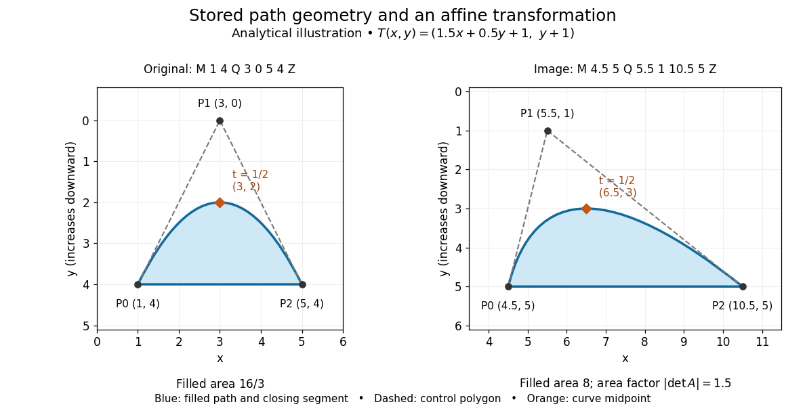
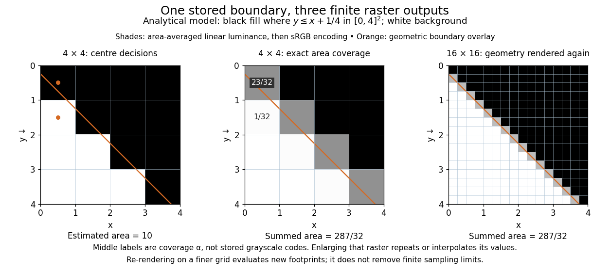

# Vector graphics

↑ **Parent:** [Computer graphics](computer-graphics-split.md)  
ⓦ [Wiki](https://en.wikipedia.org/wiki/Vector_graphics)

[Vector graphics](vector-graphics.md) represent a picture by geometric objects and instructions for drawing them: positions, shapes, fills, boundary strokes and transformations. A [circle](circle.md) can be stored as a centre and radius; a [rectangle](rectangle.md) as a corner, width and height; a [polygon](polygon.md) as an ordered list of vertices. These geometric primitives describe whole objects rather than assigning a colour to every [pixel](pixel.md). [SVG](svg.md) provides elements for such basic shapes and for paths assembled from [line segments](line-segment.md) and curves.[W3C SVG Working Group, SVG 2, section 10.1: basic shapes and their equivalent paths](https://www.w3.org/TR/SVG2/shapes.html#Introduction)

The useful separation is between the stored geometry and the finite output. A [circle](circle.md) of radius 2 remains the same geometric description whether rendered across twenty or two thousand output [pixels](pixel.md). This is the sense in which [vector graphics](vector-graphics.md) are resolution independent: increasing the output grid can evaluate the original geometry again. The resulting [raster image](raster-graphics.md) still has finite spatial resolution, and numerical coordinates have finite precision. Enlarging a previously rendered [raster image](raster-graphics.md) through [interpolation](interpolation-split.md) instead works with its existing samples. Neither operation guarantees that arbitrarily thin details remain visible at every size.

An [SVG](svg.md) path uses a current point and drawing commands. For example, `M 1 4 L 5 4 L 3 1 Z` moves to $(1,4)$, draws two [line segments](line-segment.md), then closes back to the starting point, giving a [triangle](triangle.md). Uppercase commands use absolute [coordinates](coordinate-linear-algebra.md); the corresponding lowercase commands use offsets from the current point. Thus `M 1 4 l 4 0 l -2 -3 z` describes the same [triangle](triangle.md). The coordinates belong to the current user [Cartesian coordinate system](cartesian-coordinate-system.md), not necessarily to output [pixels](pixel.md).[W3C SVG Working Group, SVG 2, section 9.3: path data, current points and absolute or relative commands](https://www.w3.org/TR/SVG2/paths.html#PathData)

For a curved example, the path `M 1 4 Q 3 0 5 4 Z` uses one quadratic [Bézier curve](bezier-curve.md) followed by a closing [line segment](line-segment.md). With [control points](control-point.md) $P_0=(1,4)$, $P_1=(3,0)$ and $P_2=(5,4)$, its curved boundary is

$$
B(t)=(1-t)^2P_0+2t(1-t)P_1+t^2P_2=(1+4t,\;4-8t+8t^2),\qquad 0\leq t\leq1.
$$

The endpoints are $P_0,P_2$, and $B(1/2)=(3,2)$; the interior [control point](control-point.md) $P_1$ is not a point on the curve. A fill paints the enclosed region, while a stroke paints a band around its boundary with a chosen width. One can use either or both: geometry and paint instructions are distinct.[W3C SVG Working Group, SVG 2, section 9.3.7: quadratic Bézier path commands](https://www.w3.org/TR/SVG2/paths.html#PathDataQuadraticBezierCommands)[W3C SVG Working Group, SVG 2, section 13.1: filling interiors and stroking outlines](https://www.w3.org/TR/SVG2/painting.html#Introduction)

**[Figure 3](#image-analytical-path-illustration-a-quadratic-bezier-boundary-and-its-affine-image). Analytical path illustration: a quadratic Bézier boundary and its affine image**.

The first illustration uses increasing $y$ downward, following the initial [SVG](svg.md) coordinate convention. Its dashed [control polygon](control-polygon.md) guides the eye; it is not part of the filled path. Apply the [affine map](affine-map.md)

$$
T(x,y)=(1.5x+0.5y+1,\;y+1),\qquad A=\begin{pmatrix}1.5&0.5\\0&1\end{pmatrix}.
$$

This combines horizontal scaling, a [shear mapping](shear-mapping.md) and a [translation](translation-geometry.md). The transformed [control points](control-point.md) are $(4.5,5)$, $(5.5,1)$ and $(10.5,5)$, giving the path `M 4.5 5 Q 5.5 1 10.5 5 Z`. Its curved midpoint is $T(3,2)=(6.5,3)$. The [affine equivariance of a geometric basis](affine-equivariance-of-a-geometric-basis.md) explains why transforming only the [control points](control-point.md) transforms the entire [Bézier curve](bezier-curve.md): its weights sum to one, so the [translation](translation-geometry.md) is added exactly once. The enclosed [area](surface-area.md) is $\int_0^1 8t(1-t)\cdot4\,dt=16/3$ before transformation and $|\det A|\cdot16/3=8$ afterwards. These checks concern the filled region, excluding the width of any stroke.

An [SVG](svg.md) `viewBox` specifies a [rectangle](rectangle.md) in user [coordinates](coordinate-linear-algebra.md) to map into a display region. For example, `viewBox="0 0 6 6"` in a square viewport of 120 by 120 display units gives a scale of 20 display units per user unit; in a square viewport of 600 by 600 it gives 100. The path's [control points](control-point.md) need not change. For unequal proportions, `preserveAspectRatio` controls whether the mapping preserves proportions or stretches the axes separately. These display units need not correspond one for one to physical display [pixels](pixel.md).[W3C SVG Working Group, SVG 2, section 8.4: initial axes and user units](https://www.w3.org/TR/SVG2/coords.html#InitialCoordinateSystem)[W3C SVG Working Group, SVG 2, sections 8.6–8.7: viewBox mapping and preserveAspectRatio](https://www.w3.org/TR/SVG2/coords.html#ViewBoxAttribute)

_Rasterization_ converts the geometric drawing into a [raster image](raster-graphics.md) on a chosen grid. Deciding whether each [pixel](pixel.md) centre lies inside a filled region is a simple rule, but a moving diagonal boundary can make entire [pixels](pixel.md) switch abruptly. _Antialiasing_ reduces these sampling artifacts by accounting for a footprint around each sample, rather than treating every [pixel](pixel.md) as a single inside-or-outside decision. This connects [vector graphics](vector-graphics.md) to [raster sampling and reconstruction](raster-sampling-and-reconstruction.md) and [aliasing](aliasing.md); a finer grid and a better sampling rule solve different parts of the problem.

For an exact analytical model, fill the region $R=\{(x,y)\in[0,4]^2:y\leq x+1/4\}$. For a square [pixel](pixel.md) footprint $S$, let

$$
\alpha_S=\frac{\operatorname{area}(R\cap S)}{\operatorname{area}(S)},\qquad L_S=\alpha_S L_{\rm fill}+(1-\alpha_S)L_{\rm background}.
$$

Here $\alpha_S$ is geometric coverage, and $L$ is [relative luminance](relative-luminance.md) for ideal opaque neutral shades, with $L_{\rm fill}=0$ and $L_{\rm background}=1$. The [intersection](set-intersection.md) and [area](surface-area.md) determine how much of the footprint is covered. This is a specified area-average model, not a claim that every [SVG](svg.md) renderer uses exact coverage. The [SVG](svg.md) `shape-rendering` property supplies rendering hints and permits implementation tradeoffs, including disabling antialiasing for some choices.[W3C SVG Working Group, SVG 2, section 13.10.1: shape-rendering hints and antialiasing tradeoffs](https://www.w3.org/TR/SVG2/painting.html#ShapeRenderingProperty)

**[Figure 4](#image-analytical-rasterization-model-pixel-centre-decisions-versus-exact-coverage-on-two-grids). Analytical rasterization model: pixel-centre decisions versus exact coverage on two grids**.

On the $4\times4$ grid of unit squares, $S=[0,1]\times[0,1]$ has coverage $\alpha_S=1-(3/4)^2/2=23/32$, whereas the [pixel](pixel.md) centre $(1/2,1/2)$ lies inside $R$ and gives coverage 1 under the centre rule. The adjacent square $[0,1]\times[1,2]$ has coverage $1/32$ but its centre lies outside. The entire filled [area](surface-area.md) is $16-(15/4)^2/2=287/32$. Summing exact coverage times cell [area](surface-area.md) gives this value on both the $4\times4$ and $16\times16$ grids; the coarse centre rule instead gives 10. Coverage values are displayed after [sRGB](srgb.md) encoding of the modeled [relative luminance](relative-luminance.md). The thin coloured line is a geometry overlay, not an extra sampled stroke. Enlarging the middle panel by [nearest-neighbor interpolation](nearest-neighbor-interpolation.md) would repeat its sixteen values; re-rendering the geometry produces the 256 independently evaluated footprints in the right panel. Antialiasing reduces abrupt edges but cannot make a finite grid preserve every geometric detail.

The attractive feature of [vector graphics](vector-graphics.md) is editability at the level of intent: move one [control point](control-point.md) to bend a boundary, change a [circle](circle.md)'s radius, or transform a whole diagram while keeping its parts aligned. Logos, technical diagrams and [outline fonts](outline-font.md) benefit because their structure can be expressed with relatively few shapes and curves. A complicated photograph may require enormous geometric detail, so [vector graphics](vector-graphics.md) do not imply a smaller file than [raster graphics](raster-graphics.md). Nor does an [SVG](svg.md) container guarantee that every object is vector geometry: its `image` element can embed or reference a [PNG](png.md) [raster image](raster-graphics.md). Transforming that embedded [raster image](raster-graphics.md) changes its placement and reconstruction, but does not recover missing original detail.[W3C SVG Working Group, SVG 2, section 12.3: image elements and embedded raster content](https://www.w3.org/TR/SVG2/embedded.html#ImageElement)

**Table of contents**

- [SVG](svg.md)

## ↑ Ancestors (3)

1. [Computer graphics](computer-graphics-split.md)
2. [Computer science](computer-science-split.md)
3. [Codex Wiki](split.md)

## ← Incoming links (5)

- [Bézier curve](bezier-curve.md)
- [De Casteljau's algorithm](de-casteljau-s-algorithm.md)
- [Raster graphics](raster-graphics.md)
- [SVG](svg.md)
- [Vector graphics](vector-graphics.md)
