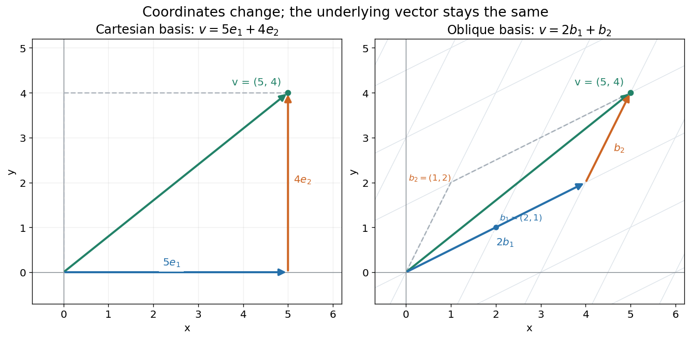

# Vector space

↑ **Parent:** [Linear algebra](linear-algebra-split.md)  
ⓦ [Wiki](https://en.wikipedia.org/wiki/Vector_space)

A vector space over a [field](field.md) $\mathbb F$ is a [set](set-split.md) $V$ equipped with [vector addition](vector-addition.md) and [scalar multiplication](scalar-multiplication.md) satisfying the [vector space axioms](vector-space-axioms.md). Its [vectors](vector.md) can represent directed displacements, lists of measurements, [polynomials](polynomial-split.md), or entire [functions](function-split.md). The common structure is that adding two elements and multiplying an element by a [scalar](scalar.md) remain meaningful operations inside the same space.

For example, $\mathbb R^2$ uses coordinatewise addition and scaling. With

$$
b_1=(2,1),\qquad b_2=(1,2),\qquad v=(5,4),
$$

we have $v=2b_1+b_2$. Moving twice along $b_1$ and once along $b_2$ reaches the same [vector](vector.md) as five horizontal and four vertical steps. The two descriptions refer to different [bases](basis.md) of the same space. A [basis](basis.md) makes such descriptions unique; a [spanning set](spanning-set.md) makes them possible.

**[Figure 1](#image-the-same-vector-has-coordinates-5-4-in-the-cartesian-basis-and-2-1-in-an-oblique-basis). The same vector has coordinates 5,4 in the Cartesian basis and 2,1 in an oblique basis**.

The space $\mathbb R[x]_{\leq2}$ of real [polynomials](polynomial-split.md) of degree at most two has [basis](basis.md) $1,x,x^2$: the [polynomial](polynomial-split.md) $3-2x+x^2$ is the [linear combination](linear-combination.md) with coordinates $(3,-2,1)$. The [zero vector](zero-vector.md) here is the zero [polynomial](polynomial-split.md), and addition combines [coefficients](coefficient.md). A [derivative](derivative.md) is a [linear map](linear-map.md) on this space; its [matrix](matrix.md) records how it acts on the three [basis vectors](basis-vector.md). The same coordinate machinery therefore handles both geometric motion and operations on [functions](function-split.md).

The choice of [field](field.md) matters. The [complex numbers](complex-number.md) form a one-dimensional [vector space](vector-space-split.md) over $\mathbb C$ with [basis](basis.md) $1$, but a two-dimensional [vector space](vector-space-split.md) over $\mathbb R$ with [basis](basis.md) $1,i$. The question "how many independent directions?" has an answer only after the allowed [scalars](scalar.md) are specified. Likewise, polynomials of degree exactly two do not form a [vector space](vector-space-split.md): subtraction can remove the leading term, and the zero [polynomial](polynomial-split.md) is absent.

The usefulness of the abstraction is that a [linear map](linear-map.md) is determined by its values on a [basis](basis.md). Once those images are known, [linear combinations](linear-combination.md) give its action on every [vector](vector.md). The [rank-nullity theorem](rank-nullity-theorem.md) relates the number of attainable outputs to the number of invisible input directions, while [change of basis](change-of-basis.md) lets us choose coordinates suited to the problem. [Eigenvectors](eigenvector.md), for example, choose directions on which repeated application of a [linear operator](linear-operator.md) becomes scalar multiplication.

A historical source is Hermann Grassmann's _Die lineale Ausdehnungslehre_ (1844). Its full title advertises applications to other branches of mathematics, statics, mechanics, magnetism and crystallography; the original edition is digitized by ETH-Bibliothek. This gives an early setting for treating geometric quantities algebraically across different applications, rather than attributing the modern axiom list to that title alone.[Grassmann, Die lineale Ausdehnungslehre, Leipzig, 1844; ETH-Bibliothek Rar 5128](https://www.e-rara.ch/zut/content/titleinfo/1169335)

**Table of contents**

- [Cardinality of a vector space](cardinality-of-a-vector-space.md)
- [Vector space over a division ring](vector-space-over-a-division-ring.md)
- [Complexification of a real vector space](complexification-of-a-real-vector-space.md)
- [Vector space axioms](vector-space-axioms.md)
- [Sequence space](sequence-space.md)
  - [Partial-sum norm on absolutely summable sequences](partial-sum-norm-on-absolutely-summable-sequences.md)
- [Zero vector](zero-vector.md)
- [Vector space over the rational numbers](vector-space-over-the-rational-numbers.md)
- [Antilinear map](antilinear-map.md)
  - [Quaternionic structure on a complex vector space](quaternionic-structure-on-a-complex-vector-space.md)
  - [Antiunitary operator](antiunitary-operator.md)
- [Complex vector space](complex-vector-space.md)
- [Real vector space](real-vector-space.md)
  - [Majorization](majorization.md)
    - [Majorization of summable sequences](majorization-of-summable-sequences.md)
      - [Doubly stochastic realization of summable-sequence majorization](doubly-stochastic-realization-of-summable-sequence-majorization.md)
- [Vector space over a finite field](vector-space-over-a-finite-field.md)
  - [Types of pairs of vectors over a finite field](types-of-pairs-of-vectors-over-a-finite-field.md)
  - [Finite-field Kakeya set](finite-field-kakeya-set.md)
    - [Tangent-line finite-field Kakeya construction](tangent-line-finite-field-kakeya-construction.md)
    - [Finite-field Kakeya polynomial bound](finite-field-kakeya-polynomial-bound.md)
- [Linear span](linear-span.md)
  - [Closed linear span](closed-linear-span.md)
    - [Annihilator of a second-difference span in l2](annihilator-of-a-second-difference-span-in-l2.md)
  - [Spanning set](spanning-set.md)
- [Quotient vector space](quotient-vector-space.md)
  - [Induced linear map on a quotient vector space](induced-linear-map-on-a-quotient-vector-space.md)
  - [Codimension of a vector subspace](codimension-of-a-vector-subspace.md)
  - [Parallel lines as a quotient vector space](parallel-lines-as-a-quotient-vector-space.md)
- [Vector subspace](vector-subspace.md)
  - [Coordinate subspace](coordinate-subspace.md)
  - [Proper vector subspace](proper-vector-subspace.md)
  - [Flag (linear algebra)](flag-linear-algebra.md)
    - [Complete flag](complete-flag.md)
  - [Fixed coordinate subspace](fixed-coordinate-subspace.md)
  - [Intersection of vector subspaces](intersection-of-vector-subspaces.md)
  - [Sum of vector subspaces](sum-of-vector-subspaces.md)
    - [Subspace supplement with a prescribed intersection](subspace-supplement-with-a-prescribed-intersection.md)
    - [Addition map of subspaces](addition-map-of-subspaces.md)
  - [Hyperplane](hyperplane.md)
  - [Closed vector subspace](closed-vector-subspace.md)
    - [Positive distance between a unit sphere and a disjoint finite-dimensional subspace](positive-distance-between-a-unit-sphere-and-a-disjoint-finite-dimensional-subspace.md)
- [Affine subspace](affine-subspace.md)
  - [Affine hull](affine-hull.md)
  - [Affine hyperplane](affine-hyperplane.md)
  - [Affine line in a vector space](affine-line-in-a-vector-space.md)
- [Linear combination](linear-combination.md)
  - [Integer linear combination](integer-linear-combination.md)
  - [Coefficient](coefficient.md)
- [Vector addition](vector-addition.md)
  - [Vector sum](vector-sum.md)
- [Scalar multiplication](scalar-multiplication.md)
  - [Scalar multiple](scalar-multiple.md)
- [Dimension (vector space)](dimension-vector-space.md)
  - [Finite-dimensional vector space](finite-dimensional-vector-space.md)
  - [Infinite-dimensional vector space](infinite-dimensional-vector-space.md)
- [Direct sum](direct-sum.md)
  - [Direct sum basis](direct-sum-basis.md)
  - [Common plane for three pairwise complementary subspaces](common-plane-for-three-pairwise-complementary-subspaces.md)
  - [Orthogonal direct sum](orthogonal-direct-sum.md)
  - [Direct summand](direct-summand.md)
    - [Unimodular basis test for an integer direct summand](unimodular-basis-test-for-an-integer-direct-summand.md)
  - [Dimension formula for a sum of subspaces](dimension-formula-for-a-sum-of-subspaces.md)
  - [Direct-sum complement](direct-sum-complement.md)
- [Linear independence](linear-independence.md)
  - [Independence of a pair is not definable over an infinite field](independence-of-a-pair-is-not-definable-over-an-infinite-field.md)
  - [Random spanning of a binary vector space](random-spanning-of-a-binary-vector-space.md)
  - [Uniqueness of linear combination coefficients](uniqueness-of-linear-combination-coefficients.md)
  - [Minimally dependent vector family](minimally-dependent-vector-family.md)
    - [Distinct diagonal weights break a first column dependence](distinct-diagonal-weights-break-a-first-column-dependence.md)
  - [Linear dependence](linear-dependence.md)
    - [Linear independence depends on the scalar field](linear-independence-depends-on-the-scalar-field.md)
    - [Linear relation](linear-relation.md)
- [Basis](basis.md)
  - [Coordinates relative to a basis](coordinates-relative-to-a-basis.md)
  - [Equal-cardinality basis criterion](equal-cardinality-basis-criterion.md)
  - [Basis matrix](basis-matrix.md)
  - [Ordered basis](ordered-basis.md)
    - [Coordinate vector](coordinate-vector.md)
      - [Coordinate (linear algebra)](coordinate-linear-algebra.md)
  - [Basis vector](basis-vector.md)
  - [Adjacent sums of a cyclic basis](adjacent-sums-of-a-cyclic-basis.md)
  - [Basis extension](basis-extension.md)
  - [Standard basis](standard-basis.md)
  - [Steinitz exchange lemma](steinitz-exchange-lemma.md)
  - [Monomial basis](monomial-basis.md)
- [Vector](vector.md)
  - [Edge vector](edge-vector.md)
  - [Row and column vectors](row-and-column-vectors.md)
  - [Pseudovector](pseudovector.md)
  - [Polar vector](polar-vector.md)
  - [Euclidean vector](euclidean-vector.md)
  - [Unit vector](unit-vector.md)
    - [Vector normalization](vector-normalization.md)
      - [Vector normalization is not linear](vector-normalization-is-not-linear.md)
  - [Cross product](cross-product.md)
    - [Inverse of a scalar plus a cross-product operator](inverse-of-a-scalar-plus-a-cross-product-operator.md)
      - [Cross-product operator with a longitudinal rank-one term](cross-product-operator-with-a-longitudinal-rank-one-term.md)
    - [Cross product equation with a fixed unit vector](cross-product-equation-with-a-fixed-unit-vector.md)
- [Scalar](scalar.md)
- [Linear map](linear-map.md)
  - [Real-linear map](real-linear-map.md)
  - [Rational-linear map](rational-linear-map.md)
    - [One-dimensional extension of a rational-linear map](one-dimensional-extension-of-a-rational-linear-map.md)
  - [Linear change of coordinates](linear-change-of-coordinates.md)
  - [Directional stretch](directional-stretch.md)
  - [Linear left inverse criterion](linear-left-inverse-criterion.md)
  - [Axisymmetric linear map](axisymmetric-linear-map.md)
  - [Zero-composition subspaces of a linear map](zero-composition-subspaces-of-a-linear-map.md)
  - [One-sided inverses of finite-dimensional endomorphisms](one-sided-inverses-of-finite-dimensional-endomorphisms.md)
  - [Rank of a linear map](rank-of-a-linear-map.md)
    - [Rank bounds for a sum of linear maps](rank-bounds-for-a-sum-of-linear-maps.md)
  - [Transvection](transvection.md)
    - [Transvection conjugacy over a finite field](transvection-conjugacy-over-a-finite-field.md)
    - [Elementary transvection matrix](elementary-transvection-matrix.md)
      - [Transvections generate the special linear group](transvections-generate-the-special-linear-group.md)
  - [Shear mapping](shear-mapping.md)
  - [Uniform dilation](uniform-dilation.md)
  - [Complex-linear map](complex-linear-map.md)
  - [Image of a linear map](image-of-a-linear-map.md)
    - [Orthogonality to the image of a matrix](orthogonality-to-the-image-of-a-matrix.md)
    - [Image obstruction by an annihilating functional](image-obstruction-by-an-annihilating-functional.md)
  - [Surjective linear map](surjective-linear-map.md)
  - [First isomorphism theorem for vector spaces](first-isomorphism-theorem-for-vector-spaces.md)
  - [Linear isomorphism](linear-isomorphism.md)
  - [Linear function](linear-function.md)
    - [Affine function](affine-function.md)
      - [Affine expression](affine-expression.md)
  - [Linearity](linearity.md)
  - [Superposition principle](superposition-principle.md)
  - [Linear operator](linear-operator.md)
    - [Accretive operator](accretive-operator.md)
      - [Cayley transform of a bounded accretive operator](cayley-transform-of-a-bounded-accretive-operator.md)
    - [Tripotent linear operator](tripotent-linear-operator.md)
    - [Semisimple linear operator](semisimple-linear-operator.md)
    - [Locally nilpotent operator](locally-nilpotent-operator.md)
      - [Algebraic exponential of a locally nilpotent operator](algebraic-exponential-of-a-locally-nilpotent-operator.md)
    - [Operator commutator](operator-commutator.md)
    - [Multiplication operator](multiplication-operator.md)
      - [Spectrum of a real multiplication operator](spectrum-of-a-real-multiplication-operator.md)
    - [Projection (linear algebra)](projection-linear-algebra.md)
      - [Sum of two linear projections](sum-of-two-linear-projections.md)
        - [Three projections summing to the identity](three-projections-summing-to-the-identity.md)
      - [Minimal polynomial of an affine function of a projection](minimal-polynomial-of-an-affine-function-of-a-projection.md)
      - [Kernel-image identities for complementary projectors](kernel-image-identities-for-complementary-projectors.md)
      - [Trace criterion for a two-by-two idempotent](trace-criterion-for-a-two-by-two-idempotent.md)
      - [Exponential of an idempotent linear map](exponential-of-an-idempotent-linear-map.md)
      - [Norm of a two-endpoint interpolation projection](norm-of-a-two-endpoint-interpolation-projection.md)
      - [Trace of an idempotent equals its rank](trace-of-an-idempotent-equals-its-rank.md)
      - [Kadec-Snobar projection bound](kadec-snobar-projection-bound.md)
      - [Inner product adapted to an idempotent linear map](inner-product-adapted-to-an-idempotent-linear-map.md)
      - [Similarity classification of idempotent linear maps](similarity-classification-of-idempotent-linear-maps.md)
      - [Oblique projection](oblique-projection.md)
        - [Finite-dimensional Hilbert sampling reconstruction](finite-dimensional-hilbert-sampling-reconstruction.md)
    - [Operator domain](operator-domain.md)
      - [Densely defined operator](densely-defined-operator.md)
    - [Identity operator](identity-operator.md)
    - [Composition operator](composition-operator.md)
      - [Invariant functional of a composition operator](invariant-functional-of-a-composition-operator.md)
    - [Unitary operator](unitary-operator.md)
      - [Commuting-involution unitary combination](commuting-involution-unitary-combination.md)
      - [Infinitesimal unitary transformation](infinitesimal-unitary-transformation.md)
      - [Unitary equivalence](unitary-equivalence.md)
      - [Eigenphase](eigenphase.md)
      - [Unitary conjugation](unitary-conjugation.md)
      - [Von Neumann mean ergodic theorem](von-neumann-mean-ergodic-theorem.md)
        - [Orthogonal decomposition for unitary ergodic averages](orthogonal-decomposition-for-unitary-ergodic-averages.md)
    - [Commuting operators](commuting-operators.md)
      - [Centralizer of a nonscalar two by two matrix](centralizer-of-a-nonscalar-two-by-two-matrix.md)
      - [Commuting maps preserve eigenspaces](commuting-maps-preserve-eigenspaces.md)
    - [Anticommutator](anticommutator.md)
      - [Invertible anticommuting matrices have even dimension and zero traces](invertible-anticommuting-matrices-have-even-dimension-and-zero-traces.md)
      - [Two-by-two anticommutator characteristic polynomial](two-by-two-anticommutator-characteristic-polynomial.md)
    - [Conjugate linear operators](conjugate-linear-operators.md)
      - [Conjugation operator on an endomorphism space](conjugation-operator-on-an-endomorphism-space.md)
  - [Matrix](matrix.md)
    - [Monotone matrix](monotone-matrix.md)
    - [Hilbert matrix](hilbert-matrix.md)
      - [Shifted Hilbert quadratic-form bound](shifted-hilbert-quadratic-form-bound.md)
    - [Principal submatrix](principal-submatrix.md)
    - [Matrix polynomial](matrix-polynomial.md)
    - [Data matrix](data-matrix.md)
    - [Real matrix](real-matrix.md)
    - [Nonsymmetric matrix](nonsymmetric-matrix.md)
    - [Matrix addition](matrix-addition.md)
    - [Complex matrix](complex-matrix.md)
    - [Integer matrix](integer-matrix.md)
    - [Cauchy matrix](cauchy-matrix.md)
    - [Matrix norm](matrix-norm.md)
      - [Induced matrix norm](induced-matrix-norm.md)
        - [Row-column bound for the matrix 2-norm](row-column-bound-for-the-matrix-2-norm.md)
        - [Matrix norm induced by an energy norm](matrix-norm-induced-by-an-energy-norm.md)
    - [Matrix pencil](matrix-pencil.md)
    - [Total nonnegativity of a matrix](total-nonnegativity-of-a-matrix.md)
      - [Checkerboard inverse of a totally nonnegative matrix](checkerboard-inverse-of-a-totally-nonnegative-matrix.md)
    - [Elementary column operation](elementary-column-operation.md)
      - [Reduced column echelon form](reduced-column-echelon-form.md)
    - [Hadamard matrix](hadamard-matrix.md)
    - [Square matrix](square-matrix.md)
    - [Realification of a complex matrix](realification-of-a-complex-matrix.md)
      - [Realification determinant identity](realification-determinant-identity.md)
    - [Entrywise matrix L1 norm](entrywise-matrix-l1-norm.md)
    - [Entrywise matrix function](entrywise-matrix-function.md)
    - [Hadamard product](hadamard-product.md)
      - [Hadamard power](hadamard-power.md)
    - [Hermite normal form](hermite-normal-form.md)
      - [Row lattice of an integer matrix](row-lattice-of-an-integer-matrix.md)
      - [Row Hermite normal form in rank two](row-hermite-normal-form-in-rank-two.md)
    - [Doubly stochastic matrix](doubly-stochastic-matrix.md)
      - [Entropy increase under doubly stochastic mixing](entropy-increase-under-doubly-stochastic-mixing.md)
      - [Two-coordinate stochastic averaging](two-coordinate-stochastic-averaging.md)
      - [Birkhoff-von Neumann theorem](birkhoff-von-neumann-theorem.md)
        - [Birkhoff decomposition by support matchings](birkhoff-decomposition-by-support-matchings.md)
        - [Alternating-cycle perturbation of a doubly stochastic matrix](alternating-cycle-perturbation-of-a-doubly-stochastic-matrix.md)
    - [Rational matrix](rational-matrix.md)
    - [Nonnegative matrix](nonnegative-matrix.md)
      - [Irreducible nonnegative matrix](irreducible-nonnegative-matrix.md)
        - [Primitive nonnegative matrix](primitive-nonnegative-matrix.md)
      - [Perron–Frobenius theorem](perron-frobenius-theorem.md)
    - [All-ones matrix](all-ones-matrix.md)
      - [Spectrum of an all-ones matrix](spectrum-of-an-all-ones-matrix.md)
    - [Row and column spaces](row-and-column-spaces.md)
      - [Row space](row-space.md)
      - [Column space](column-space.md)
        - [Column-space basis](column-space-basis.md)
    - [Binary matrix](binary-matrix.md)
    - [Submatrix](submatrix.md)
      - [Minor (linear algebra)](minor-linear-algebra.md)
        - [Principal minor](principal-minor.md)
          - [Leading principal minor](leading-principal-minor.md)
    - [Entrywise maximum norm](entrywise-maximum-norm.md)
    - [Tridiagonal matrix](tridiagonal-matrix.md)
    - [Matrix decomposition](matrix-decomposition.md)
      - [LQ decomposition](lq-decomposition.md)
    - [Block matrix](block-matrix.md)
      - [Saddle-point matrix](saddle-point-matrix.md)
      - [Block diagonal matrix](block-diagonal-matrix.md)
      - [Block tridiagonal matrix](block-tridiagonal-matrix.md)
    - [Diagonally dominant matrix](diagonally-dominant-matrix.md)
      - [Strictly diagonally dominant matrix](strictly-diagonally-dominant-matrix.md)
        - [Inverse infinity-norm bound from diagonal dominance](inverse-infinity-norm-bound-from-diagonal-dominance.md)
    - [Transpose](transpose.md)
      - [Derivative of the Gram matrix map](derivative-of-the-gram-matrix-map.md)
      - [Transpose of a matrix product](transpose-of-a-matrix-product.md)
      - [Symmetrization map in characteristic two](symmetrization-map-in-characteristic-two.md)
      - [Matrix proportional to its transpose](matrix-proportional-to-its-transpose.md)
    - [Matrix logarithm](matrix-logarithm.md)
      - [Analytic determinant square root for accretive symmetric matrices](analytic-determinant-square-root-for-accretive-symmetric-matrices.md)
      - [Diagonal logarithm concavity bound](diagonal-logarithm-concavity-bound.md)
      - [Existence of a logarithm for every invertible complex matrix](existence-of-a-logarithm-for-every-invertible-complex-matrix.md)
      - [Klein's inequality](klein-s-inequality.md)
    - [Matrix power](matrix-power.md)
      - [Cube root of a matrix](cube-root-of-a-matrix.md)
      - [Matrix exponentiation](matrix-exponentiation.md)
      - [Matrix powers for a diagonalizable matrix with two eigenvalues](matrix-powers-for-a-diagonalizable-matrix-with-two-eigenvalues.md)
    - [Matrix element](matrix-element.md)
      - [Hadronic matrix element](hadronic-matrix-element.md)
    - [Sparse matrix](sparse-matrix.md)
      - [Band matrix](band-matrix.md)
      - [Compressed sparse storage](compressed-sparse-storage.md)
        - [Compressed sparse row format](compressed-sparse-row-format.md)
      - [Matrix bandwidth](matrix-bandwidth.md)
    - [Matrix unit](matrix-unit.md)
    - [Matrix rank](matrix-rank.md)
      - [Rank factorization](rank-factorization.md)
      - [Orthogonal null-space completion of a square matrix](orthogonal-null-space-completion-of-a-square-matrix.md)
      - [Rank bound for a matrix product](rank-bound-for-a-matrix-product.md)
      - [Column rank](column-rank.md)
        - [Pivot column](pivot-column.md)
      - [Row rank](row-rank.md)
      - [Rank orbit of a matrix under left-right multiplication](rank-orbit-of-a-matrix-under-left-right-multiplication.md)
      - [Subadditivity of matrix rank](subadditivity-of-matrix-rank.md)
      - [Full column rank](full-column-rank.md)
      - [Full row rank](full-row-rank.md)
    - [Identity matrix](identity-matrix.md)
    - [Rank-one matrix](rank-one-matrix.md)
    - [Bidiagonal matrix](bidiagonal-matrix.md)
      - [Upper bidiagonal matrix](upper-bidiagonal-matrix.md)
    - [Matrix multiplication](matrix-multiplication.md)
      - [Boolean matrix multiplication](boolean-matrix-multiplication.md)
      - [Associativity of matrix multiplication](associativity-of-matrix-multiplication.md)
      - [Strassen's algorithm](strassen-s-algorithm.md)
      - [Matrix-vector product](matrix-vector-product.md)
      - [Matrix product](matrix-product.md)
      - [Outer product](outer-product.md)
    - [Hessenberg matrix](hessenberg-matrix.md)
      - [LU decomposition of an upper Hessenberg matrix](lu-decomposition-of-an-upper-hessenberg-matrix.md)
      - [Hessenberg reduction](hessenberg-reduction.md)
      - [Upper Hessenberg matrix](upper-hessenberg-matrix.md)
    - [Permutation matrix](permutation-matrix.md)
      - [Weighted permutation unitarity criterion](weighted-permutation-unitarity-criterion.md)
      - [Signed permutation matrix](signed-permutation-matrix.md)
    - [Matrix representation of a linear map](matrix-representation-of-a-linear-map.md)
    - [Kronecker product](kronecker-product.md)
      - [Kronecker sum](kronecker-sum.md)
    - [Matrix entry](matrix-entry.md)
      - [Off-diagonal matrix entry](off-diagonal-matrix-entry.md)
      - [Diagonal matrix entry](diagonal-matrix-entry.md)
    - [Matrix dimensions](matrix-dimensions.md)
    - [Zero matrix](zero-matrix.md)

## ↑ Ancestors (5)

1. [Linear algebra](linear-algebra-split.md)
2. [Algebra](algebra-split.md)
3. [Area of mathematics](area-of-mathematics.md)
4. [Mathematics](mathematics-split.md)
5. [Codex Wiki](split.md)

## ← Incoming links (579)

- [Addition map of subspaces](addition-map-of-subspaces.md)
- [Additive identity](additive-identity.md)
- [Adjoint of differentiation on affine polynomials](adjoint-of-differentiation-on-affine-polynomials.md)
- [Affine function](affine-function.md)
- [Affine group](affine-group.md)
- [Affine line in a vector space](affine-line-in-a-vector-space.md)
- [Affine space](affine-space.md)
- [Affine space of solutions of the Hodge Poisson equation](affine-space-of-solutions-of-the-hodge-poisson-equation.md)
- [Affine subspace](affine-subspace.md)
- [Algebra](algebra-split.md)
- [Algebra over a field](algebra-over-a-field-split.md)
- [Algebraic structure](algebraic-structure.md)
- [Alternating bilinear form](alternating-bilinear-form.md)
- [An integrable perturbation cannot repair nonintegrability](an-integrable-perturbation-cannot-repair-nonintegrability.md)
- [Anchored variation norm](anchored-variation-norm.md)
- [Antilinear map](antilinear-map.md)
- [Antipodal-free closed cover from simplex Voronoi cells](antipodal-free-closed-cover-from-simplex-voronoi-cells.md)
- [Antisymmetry of a Lie bracket](antisymmetry-of-a-lie-bracket.md)
- [Automorphism](automorphism.md)
- [Basis](basis.md)
- [Basis extension](basis-extension.md)
- [Basis vector](basis-vector.md)
- [Bilinear form](bilinear-form-split.md)
- [Bilinear map](bilinear-map.md)
- [Bilinearity](bilinearity.md)
- [Block diagonal matrix](block-diagonal-matrix.md)
- [Boolean multilinearization](boolean-multilinearization.md)
- [Burnside matrix-algebra theorem](burnside-matrix-algebra-theorem.md)
- [Cardinality of a vector space](cardinality-of-a-vector-space.md)
- [Cartesian frame](cartesian-frame.md)
- [Category theory](category-theory-split.md)
- [Čech cohomology of the punctured affine plane](cech-cohomology-of-the-punctured-affine-plane.md)
- [Change of basis](change-of-basis.md)
- [Coideal](coideal.md)
- [Commutator](commutator.md)
- [Complete flag](complete-flag.md)
- [Complex bilinear dimension bound](complex-bilinear-dimension-bound.md)
- [Complex Hahn-Banach theorem](complex-hahn-banach-theorem.md)
- [Complex vector space](complex-vector-space.md)
- [Complexification of a real vector space](complexification-of-a-real-vector-space.md)
- [Composition of mixed tensors](composition-of-mixed-tensors.md)
- [Conic Carathéodory theorem](conic-caratheodory-theorem.md)
- [Conjugate representation](conjugate-representation.md)
- [Constant function](constant-function.md)
- [Continuous dual space](continuous-dual-space-split.md)
- [Contraction mapping theorem](contraction-mapping-theorem.md)
- [Convex combination](convex-combination.md)
- [Convex combinations in a triangle](convex-combinations-in-a-triangle.md)
- [Convex cone](convex-cone.md)
- [Convex domination form of the Hahn-Banach theorem](convex-domination-form-of-the-hahn-banach-theorem.md)
- [Convex functional](convex-functional.md)
- [Convex hull](convex-hull.md)
- [Convex set](convex-set-split.md)
- [Cotangent space of a formal power series ring](cotangent-space-of-a-formal-power-series-ring.md)
- [Cotangent space of a local ring](cotangent-space-of-a-local-ring.md)
- [Covector](covector.md)
- [Cross-product Lie algebra](cross-product-lie-algebra.md)
- [Cyclic operator has equal minimal and characteristic polynomials](cyclic-operator-has-equal-minimal-and-characteristic-polynomials.md)
- [Cyclic trace identity between adjacent weight spaces](cyclic-trace-identity-between-adjacent-weight-spaces.md)
- [Cyclic vector](cyclic-vector.md)
- [Decoupled coefficients of orthogonal polynomial projections](decoupled-coefficients-of-orthogonal-polynomial-projections.md)
- [Defining representation of a matrix Lie algebra](defining-representation-of-a-matrix-lie-algebra.md)
- [Degree bound in polynomial Bézout's identity](degree-bound-in-polynomial-bezout-s-identity.md)
- [Determinant of Hermitian congruence](determinant-of-hermitian-congruence.md)
- [Differential form](differential-form-split.md)
- [Differentiation on an exponential-polynomial space](differentiation-on-an-exponential-polynomial-space.md)
- [Dimension of a bounded-total-degree polynomial space](dimension-of-a-bounded-total-degree-polynomial-space.md)
- [Dimension of the preimage of a vector subspace](dimension-of-the-preimage-of-a-vector-subspace.md)
- [Dimension (vector space)](dimension-vector-space.md)
- [Direct sum](direct-sum.md)
- [Discrete sampling inner product on polynomial spaces](discrete-sampling-inner-product-on-polynomial-spaces.md)
- [Double dual](double-dual.md)
- [Dual basis](dual-basis.md)
- [Dual image and kernel annihilator identity](dual-image-and-kernel-annihilator-identity.md)
- [Dual space](dual-space-split.md)
- [Eigenspace](eigenspace.md)
- [Eigenspace decomposition of a linear involution](eigenspace-decomposition-of-a-linear-involution.md)
- [Eigenspaces of a symplectic involution](eigenspaces-of-a-symplectic-involution.md)
- [Eigenvalue](eigenvalue.md)
- [Eigenvector](eigenvector.md)
- [Elementary abelian group](elementary-abelian-group.md)
- [Endomorphism](endomorphism.md)
- [Equivalence of central extensions of a Lie algebra](equivalence-of-central-extensions-of-a-lie-algebra.md)
- [Exposed face](exposed-face.md)
- [Exterior algebra](exterior-algebra.md)
- [Exterior power](exterior-power.md)
- [Exterior square of the defining orthogonal representation](exterior-square-of-the-defining-orthogonal-representation.md)
- [Extreme point](extreme-point.md)
- [Fan in toric geometry](fan-in-toric-geometry.md)
- [Fekete interpolation sites for a continuous function space](fekete-interpolation-sites-for-a-continuous-function-space.md)
- [Finite axiomatizability with infinitely many scalar symbols](finite-axiomatizability-with-infinitely-many-scalar-symbols.md)
- [Finite convex function as supremum of affine minorants](finite-convex-function-as-supremum-of-affine-minorants.md)
- [Finite-dimensional Fitting decomposition](finite-dimensional-fitting-decomposition.md)
- [Finite-dimensional non-Archimedean norm equivalence over a complete field](finite-dimensional-non-archimedean-norm-equivalence-over-a-complete-field.md)
- [Finite-dimensional subspace is an intersection of kernels](finite-dimensional-subspace-is-an-intersection-of-kernels.md)
- [Finite element degree of freedom](finite-element-degree-of-freedom.md)
- [Finite-evaluation inner product on polynomials](finite-evaluation-inner-product-on-polynomials.md)
- [Finite field cardinality is a prime power](finite-field-cardinality-is-a-prime-power.md)
- [Finite greedy basis extension and choice](finite-greedy-basis-extension-and-choice.md)
- [Finitely supported sequence](finitely-supported-sequence.md)
- [Flag (linear algebra)](flag-linear-algebra.md)
- [Formal power series module](formal-power-series-module.md)
- [Free graded Lie algebra](free-graded-lie-algebra.md)
- [Free module](free-module.md)
- [Frobenius monoid](frobenius-monoid.md)
- [Full row rank](full-row-rank.md)
- [Function space](function-space.md)
- [Functional analysis](functional-analysis-split.md)
- [Fundamental system of solutions](fundamental-system-of-solutions.md)
- [General affine group](general-affine-group.md)
- [General linear group](general-linear-group.md)
- [General linear group modulo the unitary group](general-linear-group-modulo-the-unitary-group.md)
- [General linear Lie algebra](general-linear-lie-algebra.md)
- [Global dimension](global-dimension.md)
- [Group algebra](group-algebra.md)
- [Group isomorphism](group-isomorphism.md)
- [Group representation](group-representation.md)
- [Heine-Borel theorem](heine-borel-theorem.md)
- [Hermitian quadratic form](hermitian-quadratic-form.md)
- [Homogeneous function](homogeneous-function.md)
- [Homogeneous linear differential equation](homogeneous-linear-differential-equation.md)
- [Hyperbolic plane (quadratic form)](hyperbolic-plane-quadratic-form.md)
- [Hyperplane separation theorem](hyperplane-separation-theorem.md)
- [Image criterion for a matrix factorization](image-criterion-for-a-matrix-factorization.md)
- [Incompleteness of finitely supported sequences](incompleteness-of-finitely-supported-sequences.md)
- [Induced matrix norm](induced-matrix-norm.md)
- [Initial-form lower bound for ideal generators](initial-form-lower-bound-for-ideal-generators.md)
- [Injections between successive kernel quotients](injections-between-successive-kernel-quotients.md)
- [Inner product adapted to an idempotent linear map](inner-product-adapted-to-an-idempotent-linear-map.md)
- [Inner product determined by a basis](inner-product-determined-by-a-basis.md)
- [Inner product space](inner-product-space.md)
- [Intersection of vector subspaces](intersection-of-vector-subspaces.md)
- [Irreducible representation](irreducible-representation.md)
- [Irreducible traceless matrix Lie algebra is semisimple](irreducible-traceless-matrix-lie-algebra-is-semisimple.md)
- [Isomorphism](isomorphism.md)
- [Joint spectrum](joint-spectrum.md)
- [Kernel-image identities for complementary projectors](kernel-image-identities-for-complementary-projectors.md)
- [Kernel of a linear map](kernel-of-a-linear-map-split.md)
- [Lagrange cardinal polynomial](lagrange-cardinal-polynomial.md)
- [Laplacian eigenspace](laplacian-eigenspace.md)
- [Lie algebra](lie-algebra-split.md)
- [Lie algebra representation](lie-algebra-representation.md)
- [Linear algebra](linear-algebra-split.md)
- [Linear combination](linear-combination.md)
- [Linear dependence](linear-dependence.md)
- [Linear differential equation](linear-differential-equation.md)
- [Linear endomorphism](linear-endomorphism.md)
- [Linear functional](linear-functional.md)
- [Linear independence](linear-independence.md)
- [Linear matroid](linear-matroid.md)
- [Linear operator](linear-operator.md)
- [Linear space (geometry)](linear-space-geometry.md)
- [Linear span](linear-span.md)
- [Mathematics](mathematics-split.md)
- [Matrix addition](matrix-addition.md)
- [Matrix norm](matrix-norm.md)
- [Matrix trace](matrix-trace.md)
- [Matrix unit](matrix-unit.md)
- [Maximum dimension of a totally isotropic subspace](maximum-dimension-of-a-totally-isotropic-subspace.md)
- [Midpoint test for a closed set](midpoint-test-for-a-closed-set.md)
- [Minimal polynomial of a vector under a linear operator](minimal-polynomial-of-a-vector-under-a-linear-operator.md)
- [Minimal polynomial of an affine function of a projection](minimal-polynomial-of-an-affine-function-of-a-projection.md)
- [Minkowski addition](minkowski-addition.md)
- [Module isomorphism](module-isomorphism.md)
- [Module theory](module-theory-split.md)
- [Momentum space](momentum-space.md)
- [Monomial orthonormal basis on the unit torus](monomial-orthonormal-basis-on-the-unit-torus.md)
- [Multilinear map](multilinear-map.md)
- [Nilpotence of commutation by a nilpotent endomorphism](nilpotence-of-commutation-by-a-nilpotent-endomorphism.md)
- [Nilpotent commutator preserves generalized eigenspaces](nilpotent-commutator-preserves-generalized-eigenspaces.md)
- [Noninjective linear measurement](noninjective-linear-measurement.md)
- [Normed vector space](normed-vector-space-split.md)
- [Number field](number-field.md)
- [Oblique symmetry of complementary subspaces](oblique-symmetry-of-complementary-subspaces.md)
- [One-dimensional representation](one-dimensional-representation.md)
- [One-sided inverses of finite-dimensional endomorphisms](one-sided-inverses-of-finite-dimensional-endomorphisms.md)
- [Order of a finite group of exponent two](order-of-a-finite-group-of-exponent-two.md)
- [Orthogonal basis](orthogonal-basis.md)
- [Orthogonal complement dimension for a degenerate bilinear form](orthogonal-complement-dimension-for-a-degenerate-bilinear-form.md)
- [Orthogonal complement for a bilinear form](orthogonal-complement-for-a-bilinear-form.md)
- [Orthogonal transformation in a nonorthonormal basis](orthogonal-transformation-in-a-nonorthonormal-basis.md)
- [Solution](past-exam-of-the-algebra-1-and-differential-equations-1-course-of-the-university-of-oxford/2014/1/a/i/solution.md)
- [Solution](past-exam-of-the-algebra-1-and-differential-equations-1-course-of-the-university-of-oxford/2015/1/a/ii/solution.md)
- [Solution](past-exam-of-the-algebra-1-and-differential-equations-1-course-of-the-university-of-oxford/2015/1/b/iii/solution.md)
- [Solution](past-exam-of-the-algebra-1-and-differential-equations-1-course-of-the-university-of-oxford/2015/1/c/solution.md)
- [Solution](past-exam-of-the-algebra-1-and-differential-equations-1-course-of-the-university-of-oxford/2015/3/a/iii/solution.md)
- [Solution](past-exam-of-the-algebra-analysis-and-differential-equations-1-course-of-the-university-of-oxford/2009/1/solution.md)
- [Solution](past-exam-of-the-algebra-analysis-and-differential-equations-1-course-of-the-university-of-oxford/2012/1/a/solution.md)
- [Solution](past-exam-of-the-algebra-analysis-and-differential-equations-1-course-of-the-university-of-oxford/2012/2/a/solution.md)
- [Solution](past-exam-of-the-algebra-analysis-and-differential-equations-1-course-of-the-university-of-oxford/2013/algebra/1/a/solution.md)
- [Solution](past-exam-of-the-algebra-analysis-and-differential-equations-2-course-of-the-university-of-oxford/2006/algebra/2/solution.md)
- [Solution](past-exam-of-the-algebra-analysis-and-differential-equations-2-course-of-the-university-of-oxford/2010/algebra/2/b/solution.md)
- [Solution](past-exam-of-the-algebra-analysis-and-differential-equations-2-course-of-the-university-of-oxford/2011/algebra/1/b/ii/solution.md)
- [Solution](past-exam-of-the-algebra-analysis-and-differential-equations-2-course-of-the-university-of-oxford/2012/1/a/solution.md)
- [Solution](past-exam-of-the-algebra-and-analysis-i-for-mathematics-and-philosophy-course-of-the-university-of-oxford/2013/algebra/1/a/solution.md)
- [Solution](past-exam-of-the-algebra-and-analysis-ii-for-mathematics-and-philosophy-course-of-the-university-of-oxford/2013/1/a/solution.md)
- [Solution](past-exam-of-the-algebra-and-analysis-ii-for-mathematics-and-philosophy-course-of-the-university-of-oxford/2013/1/e/solution.md)
- [Solution](past-exam-of-the-algebra-course-of-the-university-of-oxford/2007/a/1/1/solution.md)
- [Solution](past-exam-of-the-algebra-course-of-the-university-of-oxford/2008/b/5/solution.md)
- [Solution](past-exam-of-the-algebra-course-of-the-university-of-oxford/2009/a/2/b/solution.md)
- [Solution](past-exam-of-the-algebra-course-of-the-university-of-oxford/2010/a/3/a/i/solution.md)
- [Solution](past-exam-of-the-analysis-course-of-the-university-of-oxford/2009/a/1/i/solution.md)
- [Solution](past-exam-of-the-analysis-course-of-the-university-of-oxford/2010/a/1/a/solution.md)
- [Solution](past-exam-of-the-analysis-course-of-the-university-of-oxford/2011/1/solution.md)
- [Solution](past-exam-of-the-analysis-course-of-the-university-of-oxford/2011/2/solution.md)
- [Solution](past-exam-of-the-approximation-of-functions-course-of-the-university-of-oxford/2011/2/b/solution.md)
- [Solution](past-exam-of-the-computer-science-course-of-the-university-of-oxford/2015/computational-learning-theory/1/c/solution.md)
- [Solution](past-exam-of-the-differential-equations-1-course-of-the-university-of-oxford/2017/2/a/i/solution.md)
- [Solution](past-exam-of-the-finite-element-methods-for-partial-differential-equations-course-of-the-university-of-oxford/2023/2/a/solution.md)
- [Solution](past-exam-of-the-geometry-course-of-the-university-of-oxford/2007/b/5/ii/solution.md)
- [Solution](past-exam-of-the-geometry-course-of-the-university-of-oxford/2009/b/6/iv/solution.md)
- [Solution](past-exam-of-the-geometry-course-of-the-university-of-oxford/2011/6/c/solution.md)
- [Solution](past-exam-of-the-geometry-course-of-the-university-of-oxford/2011/6/e/solution.md)
- [Solution](past-exam-of-the-groups-and-representations-course-of-the-university-of-oxford/2018/1/a/solution.md)
- [Solution](past-exam-of-the-groups-and-representations-course-of-the-university-of-oxford/2019/1/a/solution.md)
- [Solution](past-exam-of-the-groups-and-representations-course-of-the-university-of-oxford/2020/1/a/solution.md)
- [Solution](past-exam-of-the-groups-and-representations-course-of-the-university-of-oxford/2020/1/d/solution.md)
- [Solution](past-exam-of-the-groups-and-representations-course-of-the-university-of-oxford/2020/2/d/solution.md)
- [Solution](past-exam-of-the-groups-and-representations-course-of-the-university-of-oxford/2021/4/b/solution.md)
- [Solution](past-exam-of-the-groups-and-representations-course-of-the-university-of-oxford/2022/3/b/solution.md)
- [Solution](past-exam-of-the-groups-and-representations-course-of-the-university-of-oxford/2023/1/a/solution.md)
- [Solution](past-exam-of-the-groups-and-representations-course-of-the-university-of-oxford/2024/1/a/solution.md)
- [Solution](past-exam-of-the-groups-and-representations-course-of-the-university-of-oxford/2025/1/a/solution.md)
- [Solution](past-exam-of-the-introduction-to-representation-theory-course-of-the-university-of-oxford/2023/1/c/ii/solution.md)
- [Solution](past-exam-of-the-introduction-to-schemes-course-of-the-university-of-oxford/2021/3/a/solution.md)
- [Solution](past-exam-of-the-introduction-to-schemes-course-of-the-university-of-oxford/2021/3/b/solution.md)
- [Solution](past-exam-of-the-introduction-to-schemes-course-of-the-university-of-oxford/2021/3/c/solution.md)
- [Solution](past-exam-of-the-lie-algebras-and-representation-theory-of-symmetric-groups-course-of-the-university-of-oxford/2010/a/3/solution.md)
- [2023](past-exam-of-the-lie-algebras-course-of-part-c-of-the-mathematics-course-of-the-university-of-oxford/2023-split.md)
- [Solution](past-exam-of-the-lie-algebras-course-of-part-c-of-the-mathematics-course-of-the-university-of-oxford/2023/1/c/i/solution.md)
- [Solution](past-exam-of-the-lie-algebras-course-of-part-c-of-the-mathematics-course-of-the-university-of-oxford/2023/1/d/solution.md)
- [Solution](past-exam-of-the-lie-algebras-course-of-part-c-of-the-mathematics-course-of-the-university-of-oxford/2023/3/d/solution.md)
- [Solution](past-exam-of-the-linear-algebra-course-of-the-university-of-oxford/2017/1/a/i/solution.md)
- [Solution](past-exam-of-the-linear-algebra-course-of-the-university-of-oxford/2017/2/a/i/solution.md)
- [Solution](past-exam-of-the-linear-algebra-course-of-the-university-of-oxford/2021/1/a/ii/solution.md)
- [Solution](past-exam-of-the-linear-algebra-course-of-the-university-of-oxford/2021/1/a/iii/solution.md)
- [Solution](past-exam-of-the-linear-algebra-course-of-the-university-of-oxford/2023/1/a/ii/solution.md)
- [Solution](past-exam-of-the-linear-algebra-course-of-the-university-of-oxford/2023/1/b/i/solution.md)
- [Solution](past-exam-of-the-linear-algebra-course-of-the-university-of-oxford/2023/2/a/i/solution.md)
- [Solution](past-exam-of-the-mathematical-methods-i-course-of-the-university-of-oxford/2014/12/iii/solution.md)
- [Solution](past-exam-of-the-mathematical-methods-i-course-of-the-university-of-oxford/2015-resit/7/i/solution.md)
- [Solution](past-exam-of-the-mathematical-methods-i-course-of-the-university-of-oxford/2015-resit/7/iv/solution.md)
- [Solution](past-exam-of-the-mathematical-methods-i-course-of-the-university-of-oxford/2017/10/a/solution.md)
- [Solution](past-exam-of-the-mathematical-methods-i-course-of-the-university-of-oxford/2017/9/a/solution.md)
- [Solution](past-exam-of-the-mathematical-methods-i-course-of-the-university-of-oxford/2019/11/c/i/solution.md)
- [Solution](past-exam-of-the-mathematical-methods-i-course-of-the-university-of-oxford/2021-resit/8/a/solution.md)
- [Solution](past-exam-of-the-mathematical-methods-i-course-of-the-university-of-oxford/2022/7/ii/solution.md)
- [Solution](past-exam-of-the-mathematics-course-of-the-university-of-cambridge/2001/ib/paper-3/17c/solution.md)
- [Solution](past-exam-of-the-mathematics-course-of-the-university-of-cambridge/2001/ib/paper-3/1a/solution.md)
- [Solution](past-exam-of-the-mathematics-course-of-the-university-of-cambridge/2001/iii/paper-3/6/b/solution.md)
- [Solution](past-exam-of-the-mathematics-course-of-the-university-of-cambridge/2001/iii/paper-6/2/solution.md)
- [Solution](past-exam-of-the-mathematics-course-of-the-university-of-cambridge/2002/ia/paper-1/8d/solution.md)
- [Solution](past-exam-of-the-mathematics-course-of-the-university-of-cambridge/2002/ib/paper-1/14g/a/solution.md)
- [Solution](past-exam-of-the-mathematics-course-of-the-university-of-cambridge/2002/ib/paper-3/7f/d/solution.md)
- [Solution](past-exam-of-the-mathematics-course-of-the-university-of-cambridge/2002/iii/paper-11/1/i/solution.md)
- [Solution](past-exam-of-the-mathematics-course-of-the-university-of-cambridge/2002/iii/paper-14/1/solution.md)
- [Solution](past-exam-of-the-mathematics-course-of-the-university-of-cambridge/2002/iii/paper-14/4/solution.md)
- [Solution](past-exam-of-the-mathematics-course-of-the-university-of-cambridge/2002/iii/paper-15/2/b/solution.md)
- [Solution](past-exam-of-the-mathematics-course-of-the-university-of-cambridge/2002/iii/paper-3/5/a/solution.md)
- [Solution](past-exam-of-the-mathematics-course-of-the-university-of-cambridge/2002/iii/paper-3/5/c/solution.md)
- [Solution](past-exam-of-the-mathematics-course-of-the-university-of-cambridge/2002/iii/paper-4/5/solution.md)
- [Solution](past-exam-of-the-mathematics-course-of-the-university-of-cambridge/2002/iii/paper-6/2/solution.md)
- [Solution](past-exam-of-the-mathematics-course-of-the-university-of-cambridge/2003/ib/paper-3/1f/solution.md)
- [Solution](past-exam-of-the-mathematics-course-of-the-university-of-cambridge/2003/ib/paper-3/7g/solution.md)
- [Solution](past-exam-of-the-mathematics-course-of-the-university-of-cambridge/2003/iii/paper-10/1/solution.md)
- [Solution](past-exam-of-the-mathematics-course-of-the-university-of-cambridge/2003/iii/paper-15/1/solution.md)
- [Solution](past-exam-of-the-mathematics-course-of-the-university-of-cambridge/2003/iii/paper-23/4/solution.md)
- [Solution](past-exam-of-the-mathematics-course-of-the-university-of-cambridge/2003/iii/paper-24/1/solution.md)
- [Solution](past-exam-of-the-mathematics-course-of-the-university-of-cambridge/2003/iii/paper-36/2/solution.md)
- [Solution](past-exam-of-the-mathematics-course-of-the-university-of-cambridge/2003/iii/paper-47/3/solution.md)
- [Solution](past-exam-of-the-mathematics-course-of-the-university-of-cambridge/2003/iii/paper-79/3/b/solution.md)
- [Solution](past-exam-of-the-mathematics-course-of-the-university-of-cambridge/2004/iii/paper-1/4/solution.md)
- [Solution](past-exam-of-the-mathematics-course-of-the-university-of-cambridge/2004/iii/paper-2/3/a/solution.md)
- [Solution](past-exam-of-the-mathematics-course-of-the-university-of-cambridge/2004/iii/paper-2/4/d/solution.md)
- [Solution](past-exam-of-the-mathematics-course-of-the-university-of-cambridge/2004/iii/paper-20/1/i/solution.md)
- [Solution](past-exam-of-the-mathematics-course-of-the-university-of-cambridge/2004/iii/paper-22/3/solution.md)
- [Solution](past-exam-of-the-mathematics-course-of-the-university-of-cambridge/2004/iii/paper-3/1/ii/solution.md)
- [Solution](past-exam-of-the-mathematics-course-of-the-university-of-cambridge/2004/iii/paper-4/2/solution.md)
- [Solution](past-exam-of-the-mathematics-course-of-the-university-of-cambridge/2005/ia/paper-2/5b/solution.md)
- [Solution](past-exam-of-the-mathematics-course-of-the-university-of-cambridge/2005/ib/paper-1/1c/solution.md)
- [Solution](past-exam-of-the-mathematics-course-of-the-university-of-cambridge/2005/ib/paper-1/9c/solution.md)
- [Solution](past-exam-of-the-mathematics-course-of-the-university-of-cambridge/2005/ii/paper-1/16f/solution.md)
- [Solution](past-exam-of-the-mathematics-course-of-the-university-of-cambridge/2005/iii/paper-1/6/solution.md)
- [Solution](past-exam-of-the-mathematics-course-of-the-university-of-cambridge/2005/iii/paper-15/5/solution.md)
- [Solution](past-exam-of-the-mathematics-course-of-the-university-of-cambridge/2005/iii/paper-24/1/solution.md)
- [Solution](past-exam-of-the-mathematics-course-of-the-university-of-cambridge/2005/iii/paper-24/3/solution.md)
- [Solution](past-exam-of-the-mathematics-course-of-the-university-of-cambridge/2005/iii/paper-33/4/b/solution.md)
- [Solution](past-exam-of-the-mathematics-course-of-the-university-of-cambridge/2006/ib/paper-4/1h/solution.md)
- [Solution](past-exam-of-the-mathematics-course-of-the-university-of-cambridge/2006/ii/paper-1/22g/solution.md)
- [Solution](past-exam-of-the-mathematics-course-of-the-university-of-cambridge/2006/iii/paper-15/3/solution.md)
- [Solution](past-exam-of-the-mathematics-course-of-the-university-of-cambridge/2006/iii/paper-4/1/solution.md)
- [Solution](past-exam-of-the-mathematics-course-of-the-university-of-cambridge/2006/iii/paper-56/2/solution.md)
- [Solution](past-exam-of-the-mathematics-course-of-the-university-of-cambridge/2007/ib/paper-2/10g/ii/solution.md)
- [Solution](past-exam-of-the-mathematics-course-of-the-university-of-cambridge/2007/ii/paper-1/18f/solution.md)
- [Solution](past-exam-of-the-mathematics-course-of-the-university-of-cambridge/2007/iii/paper-15/1/a/solution.md)
- [Solution](past-exam-of-the-mathematics-course-of-the-university-of-cambridge/2007/iii/paper-15/1/c/solution.md)
- [Solution](past-exam-of-the-mathematics-course-of-the-university-of-cambridge/2007/iii/paper-2/5/a/solution.md)
- [Solution](past-exam-of-the-mathematics-course-of-the-university-of-cambridge/2007/iii/paper-2/6/d/solution.md)
- [Solution](past-exam-of-the-mathematics-course-of-the-university-of-cambridge/2007/iii/paper-27/3/a/solution.md)
- [Solution](past-exam-of-the-mathematics-course-of-the-university-of-cambridge/2007/iii/paper-52/2/i/solution.md)
- [Solution](past-exam-of-the-mathematics-course-of-the-university-of-cambridge/2007/iii/paper-58/1/c/solution.md)
- [Solution](past-exam-of-the-mathematics-course-of-the-university-of-cambridge/2007/iii/paper-60/1/a/solution.md)
- [Solution](past-exam-of-the-mathematics-course-of-the-university-of-cambridge/2007/iii/paper-60/2/b/solution.md)
- [Solution](past-exam-of-the-mathematics-course-of-the-university-of-cambridge/2007/iii/paper-89/4/iii/solution.md)
- [Solution](past-exam-of-the-mathematics-course-of-the-university-of-cambridge/2007/iii/paper-89/5/solution.md)
- [Solution](past-exam-of-the-mathematics-course-of-the-university-of-cambridge/2008/ia/paper-1/7c/solution.md)
- [Solution](past-exam-of-the-mathematics-course-of-the-university-of-cambridge/2008/ib/paper-2/1e/solution.md)
- [Solution](past-exam-of-the-mathematics-course-of-the-university-of-cambridge/2008/iii/paper-20/1/solution.md)
- [Solution](past-exam-of-the-mathematics-course-of-the-university-of-cambridge/2008/iii/paper-60/4/solution.md)
- [Solution](past-exam-of-the-mathematics-course-of-the-university-of-cambridge/2008/iii/paper-8/5/solution.md)
- [Solution](past-exam-of-the-mathematics-course-of-the-university-of-cambridge/2009/ib/paper-1/9g/solution.md)
- [Solution](past-exam-of-the-mathematics-course-of-the-university-of-cambridge/2009/ib/paper-2/1g/solution.md)
- [Solution](past-exam-of-the-mathematics-course-of-the-university-of-cambridge/2009/ib/paper-3/10g/solution.md)
- [Solution](past-exam-of-the-mathematics-course-of-the-university-of-cambridge/2009/ib/paper-4/13e/solution.md)
- [Solution](past-exam-of-the-mathematics-course-of-the-university-of-cambridge/2009/ii/paper-4/19f/a/solution.md)
- [Solution](past-exam-of-the-mathematics-course-of-the-university-of-cambridge/2009/ii/paper-4/20h/solution.md)
- [Solution](past-exam-of-the-mathematics-course-of-the-university-of-cambridge/2009/iii/paper-14/4/solution.md)
- [Solution](past-exam-of-the-mathematics-course-of-the-university-of-cambridge/2009/iii/paper-17/1/a/solution.md)
- [Solution](past-exam-of-the-mathematics-course-of-the-university-of-cambridge/2009/iii/paper-17/2/c/solution.md)
- [Solution](past-exam-of-the-mathematics-course-of-the-university-of-cambridge/2009/iii/paper-2/2/solution.md)
- [Solution](past-exam-of-the-mathematics-course-of-the-university-of-cambridge/2009/iii/paper-21/1/b/solution.md)
- [Solution](past-exam-of-the-mathematics-course-of-the-university-of-cambridge/2009/iii/paper-21/1/d/solution.md)
- [Solution](past-exam-of-the-mathematics-course-of-the-university-of-cambridge/2009/iii/paper-21/4/solution.md)
- [Solution](past-exam-of-the-mathematics-course-of-the-university-of-cambridge/2009/iii/paper-5/5/solution.md)
- [Solution](past-exam-of-the-mathematics-course-of-the-university-of-cambridge/2009/iii/paper-6/3/ii/solution.md)
- [Solution](past-exam-of-the-mathematics-course-of-the-university-of-cambridge/2010/iii/paper-1/5/a/solution.md)
- [Solution](past-exam-of-the-mathematics-course-of-the-university-of-cambridge/2010/iii/paper-15/2/a/solution.md)
- [Solution](past-exam-of-the-mathematics-course-of-the-university-of-cambridge/2010/iii/paper-15/2/solution.md)
- [Solution](past-exam-of-the-mathematics-course-of-the-university-of-cambridge/2010/iii/paper-16/2/iv/solution.md)
- [Solution](past-exam-of-the-mathematics-course-of-the-university-of-cambridge/2010/iii/paper-19/1/solution.md)
- [Solution](past-exam-of-the-mathematics-course-of-the-university-of-cambridge/2010/iii/paper-2/2/solution.md)
- [Solution](past-exam-of-the-mathematics-course-of-the-university-of-cambridge/2010/iii/paper-24/2/a/solution.md)
- [Solution](past-exam-of-the-mathematics-course-of-the-university-of-cambridge/2010/iii/paper-3/1/solution.md)
- [Solution](past-exam-of-the-mathematics-course-of-the-university-of-cambridge/2010/iii/paper-4/1/ii/solution.md)
- [Solution](past-exam-of-the-mathematics-course-of-the-university-of-cambridge/2010/iii/paper-4/1/iii/solution.md)
- [Solution](past-exam-of-the-mathematics-course-of-the-university-of-cambridge/2010/iii/paper-4/4/ii/solution.md)
- [Solution](past-exam-of-the-mathematics-course-of-the-university-of-cambridge/2010/iii/paper-4/4/iv/solution.md)
- [Solution](past-exam-of-the-mathematics-course-of-the-university-of-cambridge/2010/iii/paper-4/5/solution.md)
- [Solution](past-exam-of-the-mathematics-course-of-the-university-of-cambridge/2010/iii/paper-6/1/solution.md)
- [Solution](past-exam-of-the-mathematics-course-of-the-university-of-cambridge/2010/iii/paper-7/1/solution.md)
- [Solution](past-exam-of-the-mathematics-course-of-the-university-of-cambridge/2012/iii/paper-19/4/solution.md)
- [Solution](past-exam-of-the-mathematics-course-of-the-university-of-cambridge/2012/iii/paper-21/1/3/solution.md)
- [Solution](past-exam-of-the-mathematics-course-of-the-university-of-cambridge/2012/iii/paper-21/3/solution.md)
- [Solution](past-exam-of-the-mathematics-course-of-the-university-of-cambridge/2012/iii/paper-4/4/a/solution.md)
- [Solution](past-exam-of-the-mathematics-course-of-the-university-of-cambridge/2013/ib/paper-2/10e/solution.md)
- [Solution](past-exam-of-the-mathematics-course-of-the-university-of-cambridge/2013/ib/paper-4/1e/solution.md)
- [Solution](past-exam-of-the-mathematics-course-of-the-university-of-cambridge/2013/iii/paper-1/5/solution.md)
- [Solution](past-exam-of-the-mathematics-course-of-the-university-of-cambridge/2013/iii/paper-13/3/solution.md)
- [Solution](past-exam-of-the-mathematics-course-of-the-university-of-cambridge/2013/iii/paper-15/1/solution.md)
- [Solution](past-exam-of-the-mathematics-course-of-the-university-of-cambridge/2013/iii/paper-36/4/b/solution.md)
- [Solution](past-exam-of-the-mathematics-course-of-the-university-of-cambridge/2013/iii/paper-5/1/a/solution.md)
- [Solution](past-exam-of-the-mathematics-course-of-the-university-of-cambridge/2013/iii/paper-7/1/solution.md)
- [Solution](past-exam-of-the-mathematics-course-of-the-university-of-cambridge/2013/iii/paper-8/3/b/solution.md)
- [Solution](past-exam-of-the-mathematics-course-of-the-university-of-cambridge/2014/ib/paper-1/1g/solution.md)
- [Solution](past-exam-of-the-mathematics-course-of-the-university-of-cambridge/2014/ib/paper-4/10g/solution.md)
- [Solution](past-exam-of-the-mathematics-course-of-the-university-of-cambridge/2014/ib/paper-4/1g/solution.md)
- [Solution](past-exam-of-the-mathematics-course-of-the-university-of-cambridge/2014/iii/paper-1/1/solution.md)
- [Solution](past-exam-of-the-mathematics-course-of-the-university-of-cambridge/2014/iii/paper-1/4/solution.md)
- [Solution](past-exam-of-the-mathematics-course-of-the-university-of-cambridge/2014/iii/paper-15/2/solution.md)
- [Solution](past-exam-of-the-mathematics-course-of-the-university-of-cambridge/2014/iii/paper-24/4/solution.md)
- [Solution](past-exam-of-the-mathematics-course-of-the-university-of-cambridge/2014/iii/paper-3/1/solution.md)
- [Solution](past-exam-of-the-mathematics-course-of-the-university-of-cambridge/2014/iii/paper-4/5/solution.md)
- [Solution](past-exam-of-the-mathematics-course-of-the-university-of-cambridge/2014/iii/paper-41/1/solution.md)
- [Solution](past-exam-of-the-mathematics-course-of-the-university-of-cambridge/2015/ii/paper-2/19g/a/solution.md)
- [Solution](past-exam-of-the-mathematics-course-of-the-university-of-cambridge/2015/ii/paper-4/26k/i/solution.md)
- [Solution](past-exam-of-the-mathematics-course-of-the-university-of-cambridge/2015/iii/paper-1/2/i/solution.md)
- [Solution](past-exam-of-the-mathematics-course-of-the-university-of-cambridge/2015/iii/paper-1/3/ii/solution.md)
- [Solution](past-exam-of-the-mathematics-course-of-the-university-of-cambridge/2015/iii/paper-1/6/solution.md)
- [Solution](past-exam-of-the-mathematics-course-of-the-university-of-cambridge/2015/iii/paper-11/4/solution.md)
- [Solution](past-exam-of-the-mathematics-course-of-the-university-of-cambridge/2015/iii/paper-12/5/solution.md)
- [Solution](past-exam-of-the-mathematics-course-of-the-university-of-cambridge/2015/iii/paper-17/1/solution.md)
- [Solution](past-exam-of-the-mathematics-course-of-the-university-of-cambridge/2015/iii/paper-18/2/b/solution.md)
- [Solution](past-exam-of-the-mathematics-course-of-the-university-of-cambridge/2015/iii/paper-40/3/b/solution.md)
- [Solution](past-exam-of-the-mathematics-course-of-the-university-of-cambridge/2015/iii/paper-6/1/solution.md)
- [Solution](past-exam-of-the-mathematics-course-of-the-university-of-cambridge/2015/iii/paper-6/3/solution.md)
- [Solution](past-exam-of-the-mathematics-course-of-the-university-of-cambridge/2015/iii/paper-6/5/solution.md)
- [Solution](past-exam-of-the-mathematics-course-of-the-university-of-cambridge/2016/ib/paper-1/9f/a/solution.md)
- [Solution](past-exam-of-the-mathematics-course-of-the-university-of-cambridge/2016/ib/paper-2/10f/b/solution.md)
- [Solution](past-exam-of-the-mathematics-course-of-the-university-of-cambridge/2016/ib/paper-2/12g/a/solution.md)
- [Solution](past-exam-of-the-mathematics-course-of-the-university-of-cambridge/2016/iii/paper-101/1/solution.md)
- [Solution](past-exam-of-the-mathematics-course-of-the-university-of-cambridge/2016/iii/paper-101/2/solution.md)
- [Solution](past-exam-of-the-mathematics-course-of-the-university-of-cambridge/2016/iii/paper-101/6/solution.md)
- [Solution](past-exam-of-the-mathematics-course-of-the-university-of-cambridge/2016/iii/paper-102/1/solution.md)
- [Solution](past-exam-of-the-mathematics-course-of-the-university-of-cambridge/2016/iii/paper-109/4/solution.md)
- [Solution](past-exam-of-the-mathematics-course-of-the-university-of-cambridge/2016/iii/paper-111/1/solution.md)
- [Solution](past-exam-of-the-mathematics-course-of-the-university-of-cambridge/2016/iii/paper-115/2/solution.md)
- [Solution](past-exam-of-the-mathematics-course-of-the-university-of-cambridge/2016/iii/paper-122/5/b/solution.md)
- [Solution](past-exam-of-the-mathematics-course-of-the-university-of-cambridge/2016/iii/paper-122/5/c/solution.md)
- [Solution](past-exam-of-the-mathematics-course-of-the-university-of-cambridge/2016/iii/paper-205/2/solution.md)
- [Solution](past-exam-of-the-mathematics-course-of-the-university-of-cambridge/2016/iii/paper-302/1/solution.md)
- [Solution](past-exam-of-the-mathematics-course-of-the-university-of-cambridge/2016/iii/paper-302/2/solution.md)
- [Solution](past-exam-of-the-mathematics-course-of-the-university-of-cambridge/2016/iii/paper-313/2/solution.md)
- [Solution](past-exam-of-the-mathematics-course-of-the-university-of-cambridge/2017/ib/paper-1/1f/i/solution.md)
- [Solution](past-exam-of-the-mathematics-course-of-the-university-of-cambridge/2017/ib/paper-1/9f/ii/solution.md)
- [Solution](past-exam-of-the-mathematics-course-of-the-university-of-cambridge/2017/ib/paper-4/11e/a/solution.md)
- [Solution](past-exam-of-the-mathematics-course-of-the-university-of-cambridge/2017/ii/paper-3/16i/a/solution.md)
- [Solution](past-exam-of-the-mathematics-course-of-the-university-of-cambridge/2017/iii/paper-109/4/solution.md)
- [Solution](past-exam-of-the-mathematics-course-of-the-university-of-cambridge/2017/iii/paper-115/1/a/solution.md)
- [Solution](past-exam-of-the-mathematics-course-of-the-university-of-cambridge/2017/iii/paper-115/2/a/solution.md)
- [Solution](past-exam-of-the-mathematics-course-of-the-university-of-cambridge/2017/iii/paper-128/3/solution.md)
- [Solution](past-exam-of-the-mathematics-course-of-the-university-of-cambridge/2017/iii/paper-128/5/solution.md)
- [Solution](past-exam-of-the-mathematics-course-of-the-university-of-cambridge/2017/iii/paper-134/1/ii/solution.md)
- [Solution](past-exam-of-the-mathematics-course-of-the-university-of-cambridge/2017/iii/paper-339/1/c/solution.md)
- [Solution](past-exam-of-the-mathematics-course-of-the-university-of-cambridge/2017/iii/paper-339/1/f/solution.md)
- [Solution](past-exam-of-the-mathematics-course-of-the-university-of-cambridge/2018/ib/paper-2/1e/solution.md)
- [Solution](past-exam-of-the-mathematics-course-of-the-university-of-cambridge/2018/ib/paper-4/1e/solution.md)
- [Solution](past-exam-of-the-mathematics-course-of-the-university-of-cambridge/2019/ib/paper-1/1f/solution.md)
- [Solution](past-exam-of-the-mathematics-course-of-the-university-of-cambridge/2019/ib/paper-2/12e/a/i/solution.md)
- [Solution](past-exam-of-the-mathematics-course-of-the-university-of-cambridge/2019/iii/paper-115/3/solution.md)
- [Solution](past-exam-of-the-mathematics-course-of-the-university-of-cambridge/2019/iii/paper-302/1/solution.md)
- [Solution](past-exam-of-the-mathematics-course-of-the-university-of-cambridge/2020/ib/paper-1/8f/solution.md)
- [Solution](past-exam-of-the-mathematics-course-of-the-university-of-cambridge/2022/iii/paper-115/1/a/solution.md)
- [Solution](past-exam-of-the-mathematics-course-of-the-university-of-cambridge/2023/ii/paper-1/30k/a/solution.md)
- [Solution](past-exam-of-the-mathematics-course-of-the-university-of-cambridge/2023/ii/paper-4/19h/solution.md)
- [Solution](past-exam-of-the-mathematics-course-of-the-university-of-cambridge/2023/iii/paper-101/1/b/solution.md)
- [Solution](past-exam-of-the-mathematics-course-of-the-university-of-cambridge/2024/ib/paper-1/8g/a/solution.md)
- [Solution](past-exam-of-the-mathematics-course-of-the-university-of-cambridge/2024/ib/paper-4/9e/a/solution.md)
- [Solution](past-exam-of-the-mathematics-course-of-the-university-of-cambridge/2024/ii/paper-1/19h/solution.md)
- [Solution](past-exam-of-the-mathematics-course-of-the-university-of-cambridge/2024/ii/paper-2/18h/a/i/solution.md)
- [Solution](past-exam-of-the-mathematics-course-of-the-university-of-cambridge/2025/ia/paper-1/8a/a/solution.md)
- [Solution](past-exam-of-the-mathematics-course-of-the-university-of-cambridge/2025/ib/paper-4/1f/solution.md)
- [Solution](past-exam-of-the-mathematics-course-of-the-university-of-cambridge/2025/ii/paper-1/22i/a/i/solution.md)
- [Solution](past-exam-of-the-mathematics-course-of-the-university-of-cambridge/2025/iii/paper-101/1/iv/b/solution.md)
- [Solution](past-exam-of-the-mathematics-course-of-the-university-of-cambridge/2026/ii/paper-1/31k/d/solution.md)
- [Solution](past-exam-of-the-mathematics-course-of-the-university-of-cambridge/2026/iii/paper-102/1/ii/solution.md)
- [Solution](past-exam-of-the-mathematics-course-of-the-university-of-cambridge/2026/iii/paper-111/2/a/solution.md)
- [Solution](past-exam-of-the-mathematics-course-of-the-university-of-oxford/2014/prelims/mathematics-i/1/a/solution.md)
- [Solution](past-exam-of-the-mathematics-course-of-the-university-of-oxford/2015/prelims/mathematics-i/4/b/iii/solution.md)
- [Solution](past-exam-of-the-mathematics-course-of-the-university-of-oxford/2017/prelims/mathematics-i/1/a/ii/solution.md)
- [Solution](past-exam-of-the-mathematics-course-of-the-university-of-oxford/2017/prelims/mathematics-i/4/a/iii/solution.md)
- [Solution](past-exam-of-the-mathematics-course-of-the-university-of-oxford/2021/prelims/mathematics-i/2/a/iv/solution.md)
- [Solution](past-exam-of-the-mathematics-course-of-the-university-of-oxford/2021/prelims/mathematics-i/3/c/i/solution.md)
- [Solution](past-exam-of-the-mathematics-course-of-the-university-of-oxford/2023/prelims/mathematics-i/2/a/i/solution.md)
- [Solution](past-exam-of-the-mathematics-course-of-the-university-of-oxford/2023/prelims/mathematics-i/2/a/ii/solution.md)
- [Solution](past-exam-of-the-mathematics-course-of-the-university-of-oxford/2023/prelims/mathematics-i/2/b/i/solution.md)
- [Solution](past-exam-of-the-mathematics-course-of-the-university-of-oxford/2023/prelims/mathematics-i/4/c/iii/solution.md)
- [Solution](past-exam-of-the-mathematics-course-of-the-year-1-of-the-natural-sciences-course-of-the-university-of-cambridge/2019/paper-2/11/a/ii/solution.md)
- [Solution](past-exam-of-the-mathematics-course-of-the-year-1-of-the-natural-sciences-course-of-the-university-of-cambridge/2023/paper-2/19/a/solution.md)
- [Solution](past-exam-of-the-mathematics-course-of-the-year-2-of-the-natural-sciences-course-of-the-university-of-cambridge/2016/paper-1/6/a/solution.md)
- [Solution](past-exam-of-the-mathematics-course-of-the-year-2-of-the-natural-sciences-course-of-the-university-of-cambridge/2018/paper-1/6/a/solution.md)
- [Solution](past-exam-of-the-mathematics-course-of-the-year-2-of-the-natural-sciences-course-of-the-university-of-cambridge/2019/paper-2/10/a/solution.md)
- [Solution](past-exam-of-the-metric-spaces-and-complex-analysis-course-of-the-university-of-oxford/2021/2/a/i/solution.md)
- [Solution](past-exam-of-the-metric-spaces-and-complex-analysis-course-of-the-university-of-oxford/2021/2/a/ii/solution.md)
- [Solution](past-exam-of-the-model-theory-and-godel-s-incompleteness-theorems-course-of-the-university-of-oxford/2009/b/5/c/ii/solution.md)
- [Solution](past-exam-of-the-model-theory-and-godel-s-incompleteness-theorems-course-of-the-university-of-oxford/2009/b/5/c/iv/solution.md)
- [Solution](past-exam-of-the-model-theory-and-godel-s-incompleteness-theorems-course-of-the-university-of-oxford/2009/b/5/c/v/solution.md)
- [Solution](past-exam-of-the-model-theory-and-godel-s-incompleteness-theorems-course-of-the-university-of-oxford/2009/b/5/c/vi/solution.md)
- [Solution](past-exam-of-the-model-theory-and-godel-s-incompleteness-theorems-course-of-the-university-of-oxford/2009/b/5/d/solution.md)
- [Solution](past-exam-of-the-model-theory-and-godel-s-incompleteness-theorems-course-of-the-university-of-oxford/2010/b/5/c/ii/solution.md)
- [Solution](past-exam-of-the-numerical-analysis-course-of-the-university-of-oxford/2017/3/b/iii/solution.md)
- [Solution](past-exam-of-the-numerical-analysis-course-of-the-university-of-oxford/2021/1/b/i/solution.md)
- [Solution](past-exam-of-the-numerical-solutions-of-partial-differential-equations-course-of-the-university-of-oxford/2023/1/d/solution.md)
- [Solution](past-exam-of-the-options-i-course-of-the-university-of-oxford/2004/b/b1/i/solution.md)
- [Solution](past-exam-of-the-options-i-course-of-the-university-of-oxford/2006/b/b1/i/solution.md)
- [Solution](past-exam-of-the-options-i-course-of-the-university-of-oxford/2006/b/b1/ii/solution.md)
- [Solution](past-exam-of-the-options-i-course-of-the-university-of-oxford/2012/a/a1/a/solution.md)
- [Solution](past-exam-of-the-options-i-course-of-the-university-of-oxford/2013/a/1/a/solution.md)
- [Solution](past-exam-of-the-options-i-course-of-the-university-of-oxford/2013/a/1/b/solution.md)
- [Solution](past-exam-of-the-options-i-for-mathematics-and-philosophy-course-of-the-university-of-oxford/2013/a/1/a/solution.md)
- [Solution](past-exam-of-the-options-i-for-mathematics-and-philosophy-course-of-the-university-of-oxford/2013/a/1/b/solution.md)
- [Solution](past-exam-of-the-options-ii-course-of-the-university-of-oxford/2006/p/4/solution.md)
- [Solution](past-exam-of-the-options-ii-course-of-the-university-of-oxford/2009/a/a2/b/solution.md)
- [Solution](past-exam-of-the-options-ii-course-of-the-university-of-oxford/2010/a/a2/1/solution.md)
- [Solution](past-exam-of-the-probability-statistics-and-options-i-course-of-the-university-of-oxford/2007/b/1/solution.md)
- [Solution](past-exam-of-the-probability-statistics-and-options-ii-course-of-the-university-of-oxford/2007/a/2/solution.md)
- [Solution](past-exam-of-the-probability-statistics-and-options-ii-course-of-the-university-of-oxford/2008/a/2/b/i/solution.md)
- [Solution](past-exam-of-the-probability-statistics-and-options-ii-course-of-the-university-of-oxford/2009/a/a2/b/solution.md)
- [Solution](past-exam-of-the-probability-statistics-and-options-ii-course-of-the-university-of-oxford/2010/a/a2/1/solution.md)
- [Solution](past-exam-of-the-rings-and-modules-course-of-the-university-of-oxford/2017/1/b/v/solution.md)
- [Solution](past-exam-of-the-rings-and-modules-course-of-the-university-of-oxford/2023/2/a/ii/solution.md)
- [Solution](past-exam-of-the-short-options-course-of-the-university-of-oxford/2014/3/c/solution.md)
- [Solution](past-exam-of-the-short-options-course-of-the-university-of-oxford/2014/4/d/solution.md)
- [Solution](past-exam-of-the-short-options-course-of-the-university-of-oxford/2014/4/e/i/solution.md)
- [Solution](past-exam-of-the-short-options-course-of-the-university-of-oxford/2023/4/b/i/solution.md)
- [Solution](past-exam-of-the-year-1-of-the-computer-science-course-of-the-university-of-oxford/2014/digital-systems-linear-algebra-introduction-to-formal-proof/5/a/solution.md)
- [Solution](past-exam-of-the-year-1-of-the-computer-science-course-of-the-university-of-oxford/2018/digital-systems-linear-algebra-introduction-to-formal-proof/5/a/i/solution.md)
- [Solution](past-exam-of-the-year-1-of-the-computer-science-course-of-the-university-of-oxford/2018/digital-systems-linear-algebra-introduction-to-formal-proof/5/c/ii/solution.md)
- [Solution](past-exam-of-the-year-1-of-the-computer-science-course-of-the-university-of-oxford/2019/digital-systems-linear-algebra-introduction-to-formal-proof/4/a/i/solution.md)
- [Solution](past-exam-of-the-year-1-of-the-computer-science-course-of-the-university-of-oxford/2022/digital-systems-linear-algebra-introduction-to-formal-proof/6/a/solution.md)
- [Solution](past-exam-of-the-year-1-of-the-computer-science-course-of-the-university-of-oxford/2023/digital-systems-linear-algebra-and-introduction-to-formal-proof/6/a/solution.md)
- [Solution](past-exam-of-the-year-2-of-the-earth-sciences-geology-course-of-the-university-of-oxford/2024/paper-3/6/c/solution.md)
- [Pauli operator basis](pauli-operator-basis.md)
- [Pencil of conics through four points](pencil-of-conics-through-four-points.md)
- [Perfect pairing](perfect-pairing.md)
- [Petrov-Galerkin method](petrov-galerkin-method.md)
- [Polynomial evaluation](polynomial-evaluation.md)
- [Polynomial module from a linear operator](polynomial-module-from-a-linear-operator.md)
- [Polynomial vector space](polynomial-vector-space.md)
- [Positivity (linear maps)](positivity-linear-maps.md)
- [Power iteration failure cases](power-iteration-failure-cases.md)
- [Powers of a rank-one operator](powers-of-a-rank-one-operator.md)
- [Prime field](prime-field.md)
- [Projective representation](projective-representation.md)
- [Proper vector subspace](proper-vector-subspace.md)
- [Quadratic constant extension of a q-squared linearized splitting field](quadratic-constant-extension-of-a-q-squared-linearized-splitting-field.md)
- [Quadratic form](quadratic-form-split.md)
- [Quantifier elimination for infinite underlying vector spaces](quantifier-elimination-for-infinite-underlying-vector-spaces.md)
- [Quantifier elimination for torsion-free divisible Abelian groups](quantifier-elimination-for-torsion-free-divisible-abelian-groups.md)
- [Quasi-norm](quasi-norm.md)
- [Quotient Lie algebra](quotient-lie-algebra.md)
- [Radially open convex set](radially-open-convex-set.md)
- [Random spanning of a binary vector space](random-spanning-of-a-binary-vector-space.md)
- [Rank bound for a nonsingular complex bilinear map](rank-bound-for-a-nonsingular-complex-bilinear-map.md)
- [Rank-nullity theorem](rank-nullity-theorem.md)
- [Rank of a vector bundle](rank-of-a-vector-bundle.md)
- [Rational canonical form](rational-canonical-form.md)
- [Rational canonical form under an affine change](rational-canonical-form-under-an-affine-change.md)
- [Rational-linear map](rational-linear-map.md)
- [Rational space](rational-space.md)
- [Real matrix](real-matrix.md)
- [Real square roots of operators with simple real spectrum](real-square-roots-of-operators-with-simple-real-spectrum.md)
- [Real vector space](real-vector-space.md)
- [Rectangular kernel and solution-fibre example](rectangular-kernel-and-solution-fibre-example.md)
- [Representation of a Banach algebra](representation-of-a-banach-algebra.md)
- [Representation of an associative algebra](representation-of-an-associative-algebra.md)
- [Representation over the rational numbers](representation-over-the-rational-numbers.md)
- [Representation theory](representation-theory-split.md)
- [Right inverse](right-inverse.md)
- [Row rank](row-rank.md)
- [Scalar](scalar.md)
- [Scalar action obstructs a cyclic module generator](scalar-action-obstructs-a-cyclic-module-generator.md)
- [Scalar multiplication](scalar-multiplication.md)
- [Schur functor](schur-functor.md)
- [Schur module](schur-module.md)
- [Section of a vector bundle](section-of-a-vector-bundle.md)
- [Seminorm](seminorm.md)
- [Seminorm topology](seminorm-topology.md)
- [Sequence space](sequence-space.md)
- [Similarity classification of idempotent linear maps](similarity-classification-of-idempotent-linear-maps.md)
- [Singular endomorphism has a nonzero two-sided annihilator](singular-endomorphism-has-a-nonzero-two-sided-annihilator.md)
- [Solution space of a homogeneous linear differential equation](solution-space-of-a-homogeneous-linear-differential-equation.md)
- [Spanning set](spanning-set.md)
- [Spectrum of a bounded operator](spectrum-of-a-bounded-operator.md)
- [Splitting criterion for a cyclic algebra](splitting-criterion-for-a-cyclic-algebra.md)
- [Square-class group of a field](square-class-group-of-a-field.md)
- [Square-free minimal polynomial criterion for polynomial kernel stabilization](square-free-minimal-polynomial-criterion-for-polynomial-kernel-stabilization.md)
- [Square matrix](square-matrix.md)
- [Square-zero element](square-zero-element.md)
- [Stabilization of images of powers of a linear map](stabilization-of-images-of-powers-of-a-linear-map.md)
- [Standard basis](standard-basis.md)
- [Steinitz exchange lemma](steinitz-exchange-lemma.md)
- [Subspace supplement with a prescribed intersection](subspace-supplement-with-a-prescribed-intersection.md)
- [Super vector space](super-vector-space.md)
- [Symmetric bilinear diagonal-parallel lemma](symmetric-bilinear-diagonal-parallel-lemma.md)
- [Symplectic adjoint](symplectic-adjoint.md)
- [Symplectic group over a field](symplectic-group-over-a-field.md)
- [Symplectic vector space](symplectic-vector-space.md)
- [Tangent plane](tangent-plane.md)
- [Tangent space](tangent-space.md)
- [Tensor algebra](tensor-algebra.md)
- [Tensor product](tensor-product.md)
- [Tensor-product coefficient matrix](tensor-product-coefficient-matrix.md)
- [Topological quantum field theory](topological-quantum-field-theory.md)
- [Topological vector space](topological-vector-space-split.md)
- [Topology determines norm equivalence](topology-determines-norm-equivalence.md)
- [Torsion-free module](torsion-free-module.md)
- [Total weight of a full-support binary linear code](total-weight-of-a-full-support-binary-linear-code.md)
- [Translated vector-space structure](translated-vector-space-structure.md)
- [Translation (geometry)](translation-geometry.md)
- [Triangular decomposition of a Lie algebra](triangular-decomposition-of-a-lie-algebra.md)
- [Tripotent linear operator](tripotent-linear-operator.md)
- [Trivial representation](trivial-representation.md)
- [Unimodular change of lattice basis](unimodular-change-of-lattice-basis.md)
- [Union of three incomparable nonprime ideals](union-of-three-incomparable-nonprime-ideals.md)
- [Universal property of a tensor product](universal-property-of-a-tensor-product.md)
- [VC dimension of a vector space](vc-dimension-of-a-vector-space.md)
- [Vector](vector.md)
- [Vector addition](vector-addition.md)
- [Vector space](vector-space-split.md)
- [Vector space bases from Zorn's lemma](vector-space-bases-from-zorn-s-lemma.md)
- [Vector-space freeness from maximal independence](vector-space-freeness-from-maximal-independence.md)
- [Vector space of univariate polynomials](vector-space-of-univariate-polynomials.md)
- [Vector space over a division ring](vector-space-over-a-division-ring.md)
- [Vector space over the rational numbers](vector-space-over-the-rational-numbers.md)
- [Vector subspace](vector-subspace.md)
- [Vector-valued function](vector-valued-function.md)
- [Vertex operator algebra](vertex-operator-algebra.md)
- [Zero polynomial](zero-polynomial.md)
- [Zero vector](zero-vector.md)
