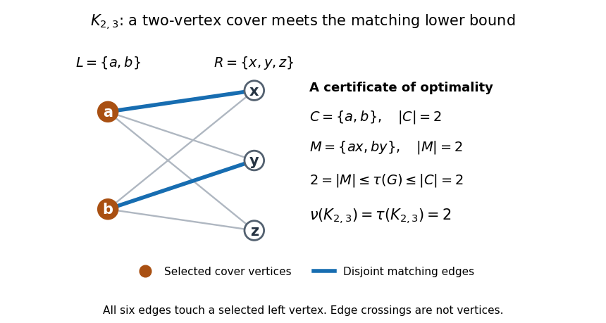

# Vertex cover number

↑ **Parent:** [Minimum vertex cover](minimum-vertex-cover.md)

The [vertex cover number](vertex-cover-number.md) records the size of a [minimum vertex cover](minimum-vertex-cover.md):

$$
\tau(G)=\min\{|C|:C\subseteq V(G),\ C\text{ is a vertex cover of }G\}.
$$

The [vertex cover number](vertex-cover-number.md) is a number, while a [minimum vertex cover](minimum-vertex-cover.md) is a [set](set-split.md) attaining it. For the [cycle graph](cycle-graph.md) $C_5$, the [independence number](independence-number.md) is $2$, so the complement correspondence gives $\tau(C_5)=5-2=3$. The [vertex cover](vertex-cover.md) $\{1,3,4\}$ above attains this size.

Every [matching in a graph](matching-graph-theory-split.md) gives a lower bound on the [vertex cover number](vertex-cover-number.md). Its [edges](edge-of-a-graph.md) have no shared endpoints, so covering each selected [edge](edge-of-a-graph.md) requires a different [vertex](vertex-graph-theory.md). Thus, for any [matching in a graph](matching-graph-theory-split.md) $M$ and any [vertex cover](vertex-cover.md) $C$,

$$
|M|\leq |C|,\qquad \nu(G)\leq\tau(G),
$$

where $\nu(G)$ is the [matching number](matching-number.md). Exhibiting a [matching in a graph](matching-graph-theory-split.md) and a [vertex cover](vertex-cover.md) of the same size certifies that both are optimum. [Kőnig's theorem for bipartite matching](konig-s-theorem-graph-theory.md) says that every finite [bipartite graph](bipartite-graph-split.md) admits this equality: $\nu(G)=\tau(G)$.[Diestel, Graph Theory, Section 2.1, Theorem 2.1.1 and its lower-bound argument](graph-theory-by-reinhard-diestel.md)

For the [complete bipartite graph](complete-bipartite-graph.md) $K_{2,3}$, let the left [vertices](vertex-graph-theory.md) be $L=\{a,b\}$ and the right [vertices](vertex-graph-theory.md) be $R=\{x,y,z\}$. All six [edges](edge-of-a-graph.md) join $L$ to $R$. Selecting $C=L$ covers every [edge](edge-of-a-graph.md); selecting $M=\{ax,by\}$ gives a [matching in a graph](matching-graph-theory-split.md) of size two. The lower bound and this [vertex cover](vertex-cover.md) give $2\leq\tau(K_{2,3})\leq2$, so $\tau(K_{2,3})=\nu(K_{2,3})=2$. The remaining [vertices](vertex-graph-theory.md) $R$ form a largest [independent set](independent-set-graph-theory.md) of size three. Crossings of drawn [edges](edge-of-a-graph.md) are not extra [vertices](vertex-graph-theory.md).

**[Figure 12](#image-two-disjoint-matching-edges-certify-that-the-two-left-vertices-are-a-minimum-cover-of-k₂-₃). Two disjoint matching edges certify that the two left vertices are a minimum cover of K₂,₃**.

The [bipartite graph](bipartite-graph-split.md) hypothesis matters. In a [triangle in a graph](triangle-in-a-graph.md), any two [vertices](vertex-graph-theory.md) form a [minimum vertex cover](minimum-vertex-cover.md), while any two [edges](edge-of-a-graph.md) share an endpoint. Hence $\tau(K_3)=2$ and $\nu(K_3)=1$. Similarly, the [cycle graph](cycle-graph.md) $C_5$ has $\tau(C_5)=3$ and $\nu(C_5)=2$. The inequality for the [matching number](matching-number.md) remains valid, but equality can fail.

## ↑ Ancestors (7)

1. [Minimum vertex cover](minimum-vertex-cover.md)
2. [Vertex cover](vertex-cover.md)
3. [Graph theory](graph-theory-split.md)
4. [Foundations of mathematics](foundations-of-mathematics-split.md)
5. [Area of mathematics](area-of-mathematics.md)
6. [Mathematics](mathematics-split.md)
7. [Codex Wiki](split.md)

## ← Incoming links (2)

- [Minimum vertex cover](minimum-vertex-cover.md)
- [Vertex cover number](vertex-cover-number.md)
