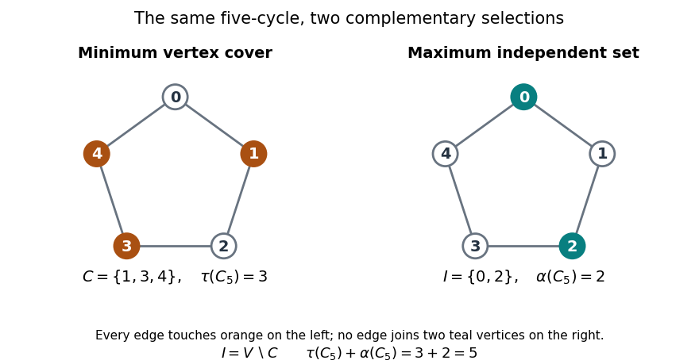

# Vertex cover

↑ **Parent:** [Graph theory](graph-theory-split.md)  
ⓦ [Wiki](https://en.wikipedia.org/wiki/Vertex_cover)

A [vertex cover](vertex-cover.md) chooses [vertices](vertex-graph-theory.md) that collectively touch every [edge](edge-of-a-graph.md) of a [graph](graph-split.md). Think of placing monitors at junctions: if a monitor watches every connection incident to its junction, a [vertex cover](vertex-cover.md) watches all connections. The [minimum vertex cover](minimum-vertex-cover.md) asks how few monitors suffice. This is a model of covering connections through their endpoints, rather than of monitoring distances in the drawing.

For a finite [simple graph](simple-graph.md) $G=(V,E)$, a [vertex cover](vertex-cover.md) is a [subset](subset.md) $C\subseteq V$ satisfying

$$
\{u,v\}\in E\Longrightarrow u\in C\ \text{or}\ v\in C.
$$

Both endpoints may be selected; the condition requires at least one. An [isolated vertex](isolated-vertex.md) covers no [edge](edge-of-a-graph.md), so a [minimum vertex cover](minimum-vertex-cover.md) never needs it.[Diestel, Graph Theory, fourth electronic edition, Section 2.1, definition of vertex cover](https://diestel-graph-theory.com/Sample.pdf)

Take the [cycle graph](cycle-graph.md) $C_5$ with [vertices](vertex-graph-theory.md) $0,1,2,3,4$ and [edges](edge-of-a-graph.md) $01,12,23,34,40$. The [set](set-split.md) $C=\{1,3,4\}$ is a [vertex cover](vertex-cover.md): [vertex](vertex-graph-theory.md) $1$ covers $01$ and $12$, [vertex](vertex-graph-theory.md) $3$ covers $23$ and $34$, and [vertex](vertex-graph-theory.md) $4$ covers $40$ as well as $34$. In particular, the closing [edge](edge-of-a-graph.md) $40$ is covered even though [vertex](vertex-graph-theory.md) $0$ is unselected.

The unselected [vertices](vertex-graph-theory.md) $I=V\setminus C=\{0,2\}$ form an [independent set](independent-set-graph-theory.md). This is the key connection: an [edge](edge-of-a-graph.md) missed by $C$ would have both endpoints in $I$, precisely what an [independent set](independent-set-graph-theory.md) forbids. For every [subset](subset.md) $C\subseteq V$,

$$
C\text{ is a vertex cover}\quad\Longleftrightarrow\quad V\setminus C\text{ is an independent set}.
$$

Here $V\setminus C$ is the [complement of a set](complement-of-a-set.md) within $V$; the [graph](graph-split.md) itself keeps all its [edges](edge-of-a-graph.md). The [complement graph](complement-graph.md) is a different construction.[Barak, Introduction to Theoretical Computer Science, Chapter 14, vertex-cover exercise](https://introtcs.org/public/lec_12_NP.html)

**[Figure 14](#image-a-minimum-vertex-cover-and-its-maximum-independent-complement-on-the-same-five-cycle). A minimum vertex cover and its maximum independent complement on the same five-cycle**.

The endpoints of any [maximal matching](maximal-matching.md) form a [vertex cover](vertex-cover.md): an [edge](edge-of-a-graph.md) avoiding all endpoints would enlarge that [matching in a graph](matching-graph-theory.md). Consequently a [graph](graph-split.md) with no [matching in a graph](matching-graph-theory.md) of size $s$ has a [vertex cover](vertex-cover.md) of size at most $2(s-1)$. This supplies a convenient [vertex cover](vertex-cover.md), but it need not be a [minimum vertex cover](minimum-vertex-cover.md).

**Table of contents**

- [Minimum vertex cover](minimum-vertex-cover.md)
  - [Vertex cover number](vertex-cover-number.md)
- [3-SAT reduction to vertex cover](3-sat-reduction-to-vertex-cover.md)

## ↑ Ancestors (5)

1. [Graph theory](graph-theory-split.md)
2. [Foundations of mathematics](foundations-of-mathematics-split.md)
3. [Area of mathematics](area-of-mathematics.md)
4. [Mathematics](mathematics-split.md)
5. [Codex Wiki](split.md)

## ← Incoming links (11)

- [3-SAT reduction to vertex cover](3-sat-reduction-to-vertex-cover.md)
- [Bipartite vertex cover](bipartite-vertex-cover.md)
- [Independence number](independence-number.md)
- [Independent set (graph theory)](independent-set-graph-theory.md)
- [Minimum vertex cover](minimum-vertex-cover.md)
- [Solution](past-exam-of-the-mathematics-course-of-the-university-of-cambridge/2006/ii/paper-2/17f/solution.md)
- [Solution](past-exam-of-the-mathematics-course-of-the-university-of-cambridge/2013/iii/paper-38/4/a/solution.md)
- [Solution](past-exam-of-the-mathematics-course-of-the-university-of-cambridge/2013/iii/paper-38/4/b/solution.md)
- [Solution](past-exam-of-the-mathematics-course-of-the-university-of-cambridge/2018/iii/paper-110/1/solution.md)
- [Vertex cover](vertex-cover.md)
- [Vertex cover number](vertex-cover-number.md)
