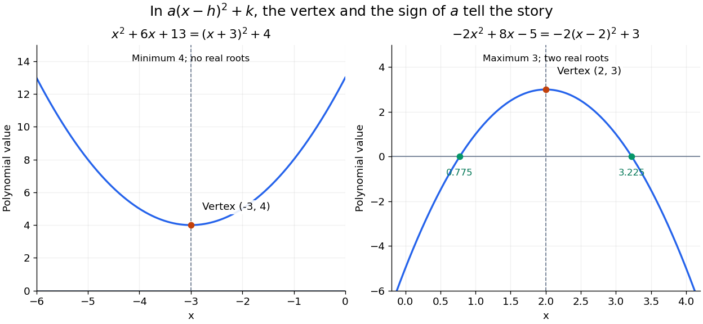

# Vertex form of a quadratic

↑ **Parent:** [Completing the square](completing-the-square.md)

Write the [quadratic polynomial](quadratic-polynomial.md) as

$$
p(x)=a(x-h)^2+k,\qquad h=-\frac b{2a},\qquad k=c-\frac{b^2}{4a}.
$$

Its [function graph](graph-of-a-function.md) is a [parabola](parabola.md) with [vertex of a parabola](vertex-of-a-parabola.md) $(h,k)$. Equal offsets from $h$ give equal values, since $p(h+t)=p(h-t)=at^2+k$. If $a>0$, the [minimum](minimum-of-a-subset-of-a-total-order.md) is $k$; if $a<0$, the [maximum](maximum-of-a-subset-of-a-total-order.md) is $k$. In both cases it is attained only at $x=h$.

For the nonmonic [quadratic polynomial](quadratic-polynomial.md)

$$
-2x^2+8x-5=-2(x^2-4x)-5
=\boxed{-2(x-2)^2+3},
$$

the negative [leading coefficient](leading-coefficient-of-a-polynomial.md) reverses the [inequality](inequality-mathematics.md): $-2(x-2)^2\leq0$. Its [maximum](maximum-of-a-subset-of-a-total-order.md) is $3$ at $x=2$. Its [coefficients](coefficient.md) are different from those of the positive example, but the same form exposes the shape of both [function graphs](graph-of-a-function.md).

**[Figure 6](#image-completed-squares-reveal-a-quadratic-s-vertex-extremum-and-real-roots). Completed squares reveal a quadratic's vertex, extremum and real roots**. Original [function graphs](graph-of-a-function.md) of the two stipulated [quadratic polynomials](quadratic-polynomial.md). On the left, $(x+3)^2+4$ stays above zero. On the right, $-2(x-2)^2+3$ opens downward and has [roots of a polynomial](root-of-a-polynomial.md) $2\pm\sqrt{3/2}$; the green labels round these values to three decimal places. The dashed lines pass through the [vertices of parabolas](vertex-of-a-parabola.md).

Completing the square also simplifies an [integral](integral-split.md) containing the [exponential function](exponential-function.md):

$$
\int_{-\infty}^{\infty}e^{-(x^2+6x+13)}\,dx
=e^{-4}\int_{-\infty}^{\infty}e^{-(x+3)^2}\,dx
=e^{-4}\sqrt\pi.
$$

The substitution $u=x+3$ removes the linear term and leaves the standard [Gaussian integral](gaussian-integral.md). The same shift that locates the [minimum](minimum-of-a-subset-of-a-total-order.md) makes this [integral](integral-split.md) recognizable.

**Table of contents**

- [Roots from a completed square](roots-from-a-completed-square.md)

## ↑ Ancestors (6)

1. [Completing the square](completing-the-square.md)
2. [Polynomial](polynomial-split.md)
3. [Algebra](algebra-split.md)
4. [Area of mathematics](area-of-mathematics.md)
5. [Mathematics](mathematics-split.md)
6. [Codex Wiki](split.md)
