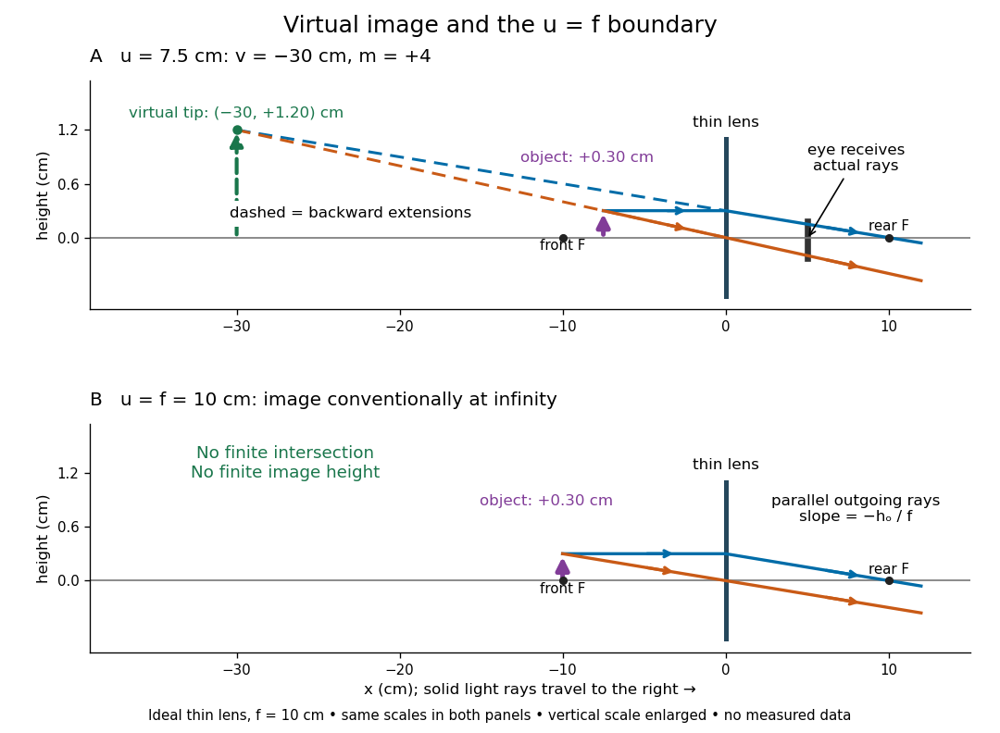

# Virtual image

↑ **Parent:** [Image formation](image-formation.md)  
ⓦ [Wiki](https://en.wikipedia.org/wiki/Virtual_image)

A [virtual image](virtual-image.md) is the apparent origin of an outgoing diverging bundle: the backward extensions of its [light rays](light-ray.md) intersect at the image point. Those extensions are geometric constructions, not backward-travelling [light](light.md). A screen placed there cannot intercept the outgoing bundle to display that [virtual image](virtual-image.md). An eye or a second [optical lens](lens-optics.md) receiving the actual outgoing [light rays](light-ray.md) can nevertheless form a subsequent [real image](real-image.md). “Virtual” describes this imaging stage, not whether the image can be seen or photographed. [PASCO, Basic Optics System manual, Experiment 14, pp. 41–43: viewing and reimaging virtual images](https://tecnoedu.com/recursos/UNLCHidrologia/ManualesOriginalesPasco/Basic-Optics-System-Manual-OS-8515C.pdf).

For a converging [thin lens](thin-lens.md) with $0<u<f$, the same equations give $v<0$ and $m=f/(f-u)>1$: the [virtual image](virtual-image.md) is upright and enlarged. For the illustrative choice $f=10\,\mathrm{cm}$, $u=7.5\,\mathrm{cm}$, $h_o=0.30\,\mathrm{cm}$,

$$
v=-30\,\mathrm{cm},\qquad m=4,\qquad h_i=1.20\,\mathrm{cm}.
$$

The image appears farther from the [optical lens](lens-optics.md) than the object. A diverging [thin lens](thin-lens.md) with a real object instead has $v<0$ and $0<m<1$, so a [virtual image](virtual-image.md) need not be enlarged. A plane mirror provides another [virtual image](virtual-image.md), located behind the reflecting surface by backward extensions of the reflected [light rays](light-ray.md). [Urone and Hinrichs, College Physics 2e, §25.7: Plane-mirror images](https://openstax.org/books/college-physics-2e/pages/25-7-image-formation-by-mirrors).

**[Figure 10](#image-backward-ray-extensions-locate-a-virtual-image-u-f-gives-parallel-outgoing-light-rays). Backward ray extensions locate a virtual image; $u=f$ gives parallel outgoing light rays**. Original ideal-model diagrams for a converging [thin lens](thin-lens.md) with $f=10\,\mathrm{cm}$ and $h_o=0.30\,\mathrm{cm}$. Above, solid [light rays](light-ray.md) travel rightward while dashed backward extensions meet at $(-30,1.20)\,\mathrm{cm}$. Below, each object point at $u=f$ sends out a parallel bundle, so there is no finite image position. Vertical distances are enlarged; both panels share coordinate scales. These are predictions, not measurements.

For a direct viewing test, bring the target to $u=7.5\,\mathrm{cm}$, search for a sharp screen image on the outgoing side, then remove the screen and look through the [optical lens](lens-optics.md) toward the target. Expect an upright enlarged view if the eye receives the bundle and can focus. Record the eye position: $5\,\mathrm{cm}$ beyond the [optical lens](lens-optics.md) gives a predicted apparent distance $35\,\mathrm{cm}$. This adapts the Northern Virginia laboratory's comparison. [Northern Virginia Community College, Physics 242 Lab 11, pp. 4–5: Virtual images with a converging lens](https://sites.nvcc.edu/alphy/_files/Manuals/Physics%20242%20Lab%2011%20-%20Thin%20Lenses.pdf).

For a position measurement, use [parallax localization of a virtual image](parallax-localization-of-a-virtual-image.md). Place a movable pencil tip or narrow comparison marker beside the apparent image, and view that marker directly beside or above the [optical lens](lens-optics.md), while viewing the image through it. Move the head a little sideways and move the marker along the bench until relative lateral motion vanishes. Read its coordinate $x_m$; the estimate is $v=x_m<0$. Deliberately place the marker nearer and farther to check that relative motion reverses on opposite sides of the match. This follows Orhan Aytür's lens laboratory, which uses a pencil to locate a [virtual image](virtual-image.md). [Orhan Aytür, Bilkent University, Experiment 2: Imaging with mirrors and lenses, §2](https://www.ee.bilkent.edu.tr/~ee428/manual/html/node6.html).

Keep target and [optical lens](lens-optics.md) fixed, use one eye and the central image detail, and ensure the marker itself is not viewed through the [optical lens](lens-optics.md). A marker blocked by the target, or a head movement that loses the bundle through the [aperture](aperture.md), invalidates that trial. Repeat the match from both directions and record its depth range. This measures apparent depth; comparing apparent sizes at different depths does not directly measure [transverse magnification](transverse-magnification.md). Near $u=f$, apparent depth becomes very large and the match is poorly constrained. A failed screen search alone therefore needs the distance check and the viewing test.

**Table of contents**

- [Parallax localization of a virtual image](parallax-localization-of-a-virtual-image.md)

## ↑ Ancestors (5)

1. [Image formation](image-formation.md)
2. [Optics](optics-split.md)
3. [Branches of physics](branches-of-physics.md)
4. [Physics](physics-split.md)
5. [Codex Wiki](split.md)

## ← Incoming links (15)

- [Angular magnification](angular-magnification.md)
- [Apparent depth](apparent-depth.md)
- [Holographic wavefront reconstruction](holographic-wavefront-reconstruction.md)
- [Image formation](image-formation.md)
- [Magnification](magnification.md)
- [Microscope eyepiece](microscope-eyepiece.md)
- [Parallax localization of a virtual image](parallax-localization-of-a-virtual-image.md)
- [Solution](past-exam-of-the-physics-course-of-the-year-1-of-the-natural-sciences-course-of-the-university-of-cambridge/2021/section-b/9/d/solution.md)
- [Real image](real-image.md)
- [Specular reflection](specular-reflection.md)
- [Thin lens](thin-lens.md)
- [Transverse magnification](transverse-magnification.md)
- [Twin image in holography](twin-image-in-holography.md)
- [Virtual image](virtual-image.md)
- [Virtual object](virtual-object.md)
