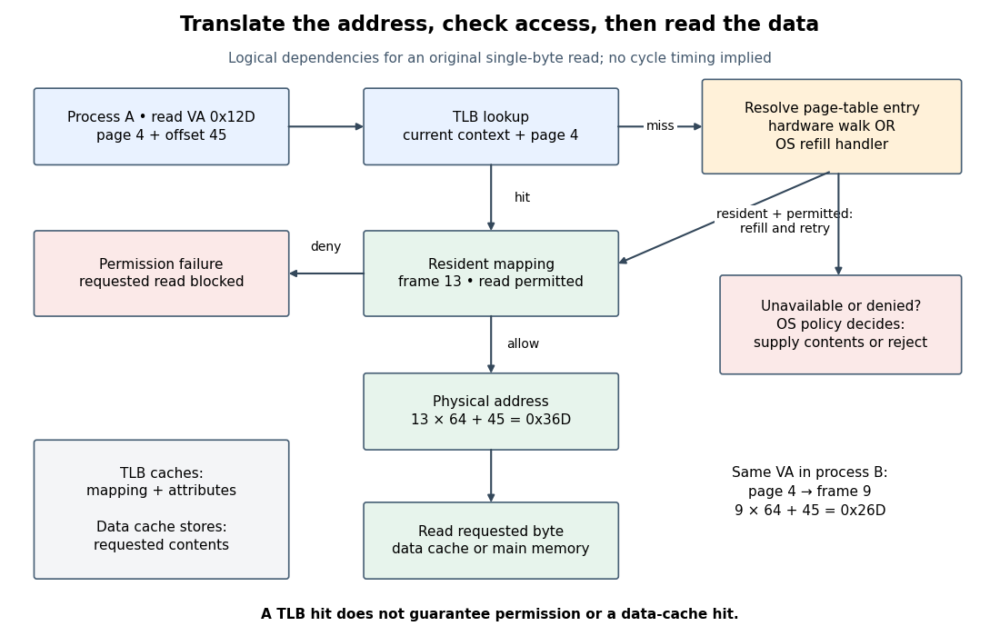
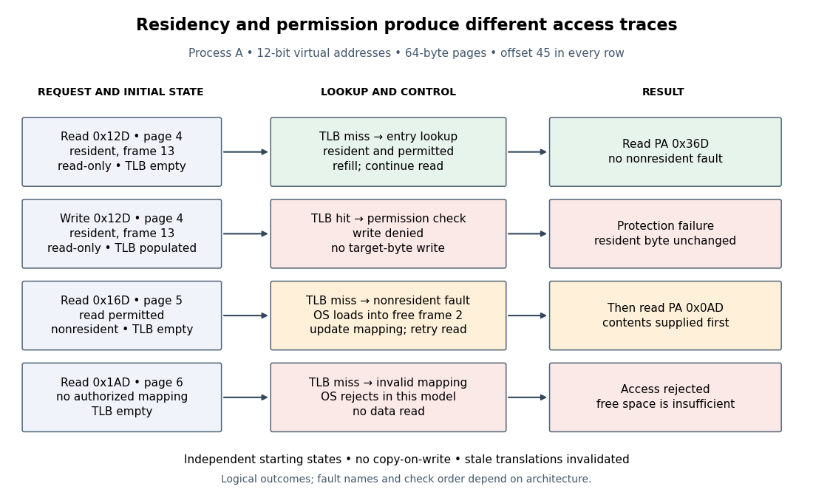
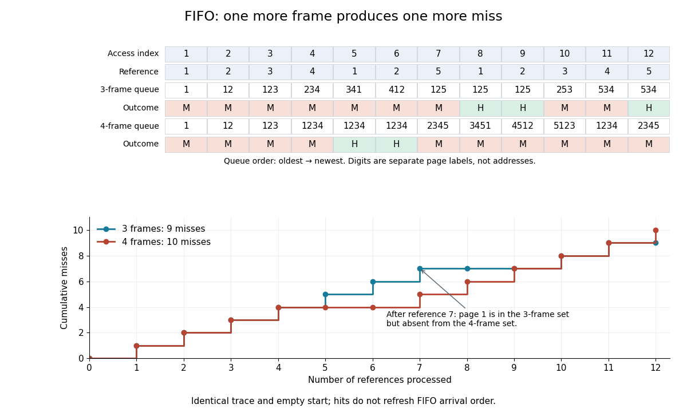

# Virtual memory

↑ **Parent:** [Operating system](operating-system.md)  
ⓦ [Wiki](https://en.wikipedia.org/wiki/Virtual_memory)

[Virtual memory](virtual-memory.md) gives an [operating-system process](operating-system.md#process-computing) an [address space](#address-space) whose [virtual addresses](#virtual-address) are translated to [physical addresses](computer-science.md#physical-address) under [operating system](operating-system.md) control. In a system using [paging](#paging), each resident [memory page](#memory-page) maps to a [page frame](#page-frame); [page tables](#page-table) describe the mappings and access permissions, while the [memory management unit](#memory-management-unit) enforces them. The same [virtual address](#virtual-address) in two [operating-system processes](operating-system.md#process-computing) can refer to different [page frames](#page-frame). A deliberate shared mapping can instead make different [virtual addresses](#virtual-address) refer to the same [page frame](#page-frame). [Arpaci-Dusseau and Arpaci-Dusseau, OSTEP chapter 13: Address Spaces](https://pages.cs.wisc.edu/~remzi/OSTEP/vm-intro.pdf)

For example, with 256-[byte](computer-science.md#byte) [memory pages](#memory-page), let process A map virtual page `0x12` to [page frame](#page-frame) `0x07`, and process B map virtual page `0x12` to [page frame](#page-frame) `0x09`. Their identical [virtual address](#virtual-address) `0x1234` then denotes [physical address](computer-science.md#physical-address) `0x0734` in A and `0x0934` in B. The address acquires meaning from the current [address space](#address-space), not just its numerical value. See [paging](#paging) for the calculation.

This separation makes programs easier to place in [computer memory](computer-science.md#computer-memory): consecutive [virtual addresses](#virtual-address) need not occupy consecutive [page frames](#page-frame). It also provides isolation and controlled sharing. [Virtual memory](virtual-memory.md) does not require secondary storage: a system can translate and protect [virtual addresses](#virtual-address) while keeping every allocated [memory page](#memory-page) resident in [computer memory](computer-science.md#computer-memory). [Demand paging](#demand-paging) adds allocation or loading on first use, and can support an [address space](#address-space) larger than available [computer memory](computer-science.md#computer-memory); the amount that can be used at once is still limited. Keeping a [working set](#working-set) resident avoids [memory thrashing](#thrashing-computer-science).

An early concrete implementation was Manchester's Atlas. Kilburn, Edwards, Lanigan and Sumner's April 1962 paper describes automatically combining fast core storage with drum storage, transferring 512-word blocks and translating their addresses through page address registers. Its attraction was to spare programmers explicit transfers between these storage levels. This historical use of secondary storage is one application of [virtual memory](virtual-memory.md), rather than a requirement of every [virtual memory](virtual-memory.md) system. The accessible text below is a reprint of the paper. [Kilburn et al., One-Level Storage System, 1962, sections 1 and 3](https://www.dcs.gla.ac.uk/~wpc/grcs/kilburn.pdf)

**Table of contents**

- [Address space](#address-space)
  - [Virtual address](#virtual-address)
- [Address translation](#address-translation)
- [Memory management unit](#memory-management-unit)
- [Memory protection](#memory-protection)
- [Copy-on-write](#copy-on-write)
  - [Copy-on-write fault handling](#copy-on-write-fault-handling)
  - [Copy-on-write page accounting](#copy-on-write-page-accounting)
- [Thrashing (computer science)](#thrashing-computer-science)
- [Working set](#working-set)
  - [Working set size](#working-set-size)
- [Resident set](#resident-set)
- [Memory-mapped file](#memory-mapped-file)
  - [Backing file](#backing-file)
  - [mmap](#mmap)
    - [munmap](#munmap)
  - [Memory-mapped file offset translation](#memory-mapped-file-offset-translation)
  - [Shared file mapping](#shared-file-mapping)
  - [Private file mapping](#private-file-mapping)
  - [Memory-mapped file synchronization](#memory-mapped-file-synchronization)
    - [msync](#msync)
- [Memory segmentation](#memory-segmentation)
- [Paging](#paging)
  - [Memory page](#memory-page)
  - [Page frame](#page-frame)
  - [Demand paging](#demand-paging)
  - [Page replacement](#page-replacement)
    - [CLOCK page replacement](#clock-page-replacement)
    - [LRU replacement](#lru-replacement)
      - [LRU cache](#lru-cache)
      - [LRU stack property](#lru-stack-property)
    - [FIFO page replacement](#fifo-page-replacement)
      - [FIFO cache](#fifo-cache)
    - [Page-reference trace](#page-reference-trace)
    - [Optimal page replacement](#optimal-page-replacement)
    - [Bélády's anomaly](#belady-s-anomaly)
    - [Dirty memory page](#dirty-memory-page)
      - [Page writeback](#page-writeback)
    - [Page-replacement cost accounting](#page-replacement-cost-accounting)
  - [Page fault](#page-fault)
    - [Page fault rate](#page-fault-rate)
  - [Translation lookaside buffer](#translation-lookaside-buffer)
    - [TLB hit](#tlb-hit)
    - [TLB miss](#tlb-miss)
    - [Address space identifier](#address-space-identifier)
  - [Page table](#page-table)
    - [Page table entry](#page-table-entry)
    - [Multi-level page table](#multi-level-page-table)
      - [Two-level address translation](#two-level-address-translation)
      - [Sparse page table allocation](#sparse-page-table-allocation)
      - [Sv39 page table](#sv39-page-table)
    - [Page table walk](#page-table-walk)

## Address space

↑ **Parent:** [Virtual memory](virtual-memory.md)  
ⓦ [Wiki](https://en.wikipedia.org/wiki/Address_space)

The collection of addresses interpreted in a particular context. An [operating-system process](operating-system.md#process-computing)'s [address space](#address-space) includes addresses that may be unmapped or inaccessible; belonging to its numerical range does not imply permission to access them.

### Virtual address

↑ **Parent:** [Address space](#address-space)

An address interpreted within an [address space](#address-space), before [address translation](#address-translation) determines the corresponding [physical address](computer-science.md#physical-address).

## Address translation

↑ **Parent:** [Virtual memory](virtual-memory.md)

Converting a [virtual address](#virtual-address) to a [physical address](computer-science.md#physical-address) using the current [address space](#address-space)'s mapping, with access checks. In [paging](#paging), the [memory page](#memory-page) number changes while the offset within it stays fixed.

[Address translation](#address-translation) answers where an access would go; [memory protection](#memory-protection) answers whether that access may proceed. Neither answer is the stored value. Reading the requested [bytes](computer-science.md#byte) is a subsequent logical operation, served by a [memory cache](computer-science.md#cache-computing) or main [computer memory](computer-science.md#computer-memory). The [operating system](operating-system.md) establishes the mapping context used by the [memory management unit](#memory-management-unit).[Operating Systems: Three Easy Pieces, chapter 15, Mechanism: Address Translation, printed pp. 1–2: hardware mechanism and operating-system control](computer-science-bibliography.md#operating-systems-three-easy-pieces-by-remzi-h-arpaci-dusseau-and-others/mechanism-address-translation)

Consider an original toy model with unsigned 12-[bit](information-theory.md#bit) [virtual addresses](#virtual-address), [byte](computer-science.md#byte) addressing, and 64-[byte](computer-science.md#byte) [memory pages](#memory-page) and [page frames](#page-frame). Assume single-[byte](computer-science.md#byte) reads, one [memory page](#memory-page) size, no concurrent mapping changes, and resident readable mappings for virtual page 4 in both [address spaces](#address-space). The [virtual address](#virtual-address) $v=\mathtt{0x12D}=301$ has six page-number [bits](information-theory.md#bit) and six offset [bits](information-theory.md#bit), rather than a split between [hexadecimal](programming-language.md#hexadecimal) digits. By [Euclidean division](integer.md#euclidean-division),

$$
301=4\cdot64+45,\qquad q=4,\qquad d=45=\mathtt{0x2D}.
$$

Process A maps virtual page 4 to [page frame](#page-frame) 13; process B maps it to [page frame](#page-frame) 9. Thus the identical [virtual address](#virtual-address) denotes

$$
a_A=13\cdot64+45=877=\mathtt{0x36D},\qquad a_B=9\cdot64+45=621=\mathtt{0x26D}.
$$

These are addresses, not the [bytes](computer-science.md#byte) read there. If the example's contents at those [physical addresses](computer-science.md#physical-address) are respectively 7 and 99, the two reads return 7 and 99. The mapping calculation alone cannot determine either value.

A [translation lookaside buffer](#translation-lookaside-buffer) can cache these mappings and permissions. In a tagged version of this model, its lookup key includes the [address space identifier](#address-space-identifier) as well as virtual page 4. An untagged version must remove conflicting cached mappings when changing the [address space](#address-space). Which tags and invalidation operations are available depends on the architecture; a [context switch](operating-system.md#context-switch) need not universally clear the whole [translation lookaside buffer](#translation-lookaside-buffer).[Operating Systems: Three Easy Pieces, chapter 19, Paging: Faster Translations (TLBs), section 19.5, printed pp. 9–10: flushing and address-space identifiers](computer-science-bibliography.md#operating-systems-three-easy-pieces-by-remzi-h-arpaci-dusseau-and-others/paging-faster-translations-tlbs)

The arithmetic explains the beauty of [paging](#paging): a mapping can move an entire [memory page](#memory-page) without changing its internal positions. Indeed, for two offsets $d_1,d_2$ in the same mapped [memory page](#memory-page),

$$
(fP+d_2)-(fP+d_1)=d_2-d_1.
$$

For process A, virtual page 4 spans `0x100`–`0x13F` and maps to `0x340`–`0x37F`. Crossing from `0x13F` to `0x140` selects virtual page 5 and requires its own mapping and [memory protection](#memory-protection) checks. A multi-[byte](computer-science.md#byte) access crossing that boundary cannot be justified by checking only its first [byte](computer-science.md#byte).

## Memory management unit

↑ **Parent:** [Virtual memory](virtual-memory.md)  
ⓦ [Wiki](https://en.wikipedia.org/wiki/Memory_management_unit)

The hardware that performs [address translation](#address-translation) and access checks. Whether a [TLB miss](#tlb-miss) is resolved entirely by hardware or with [operating system](operating-system.md) assistance depends on the architecture.

For [paging](#paging), the [memory management unit](#memory-management-unit) uses the active [address space](#address-space) and the kind of access: reading, writing, or fetching an instruction. [Processor privilege level](operating-system.md#processor-privilege-level) can also affect permission. A [TLB hit](#tlb-hit) supplies cached translation attributes; it does not bypass [memory protection](#memory-protection). On a [TLB miss](#tlb-miss), some architectures perform a hardware [page table walk](#page-table-walk), while others enter an [operating system](operating-system.md) refill handler. Both can resolve a resident mapping without a nonresident [page fault](#page-fault).[Operating Systems: Three Easy Pieces, chapter 19, Paging: Faster Translations (TLBs), sections 19.1, 19.3–19.4, printed pp. 2, 6, 8: permission checks, refill ownership, and cached attributes](computer-science-bibliography.md#operating-systems-three-easy-pieces-by-remzi-h-arpaci-dusseau-and-others/paging-faster-translations-tlbs)

**[Figure 1](#image-logical-address-translation-control-path-a-cached-mapping-refill-permission-check-and-separate-data-read). Logical address translation control path: a cached mapping, refill, permission check, and separate data read**.

This diagram is a logical dependency model for the toy single-[byte](computer-science.md#byte) read, rather than a timing diagram for a particular [CPU](computer-science.md#central-processing-unit). A [translation lookaside buffer](#translation-lookaside-buffer) caches translations and access attributes; a data [memory cache](computer-science.md#cache-computing) caches contents. A [TLB hit](#tlb-hit) can accompany a data [cache miss](computer-science.md#cache-miss), and a [TLB miss](#tlb-miss) can accompany a data [cache hit](computer-science.md#cache-hit) after successful refill. Reading [page table entries](#page-table-entry) during refill is also distinct from reading the requested data. Actual implementations may overlap steps.

Extend process A's toy [address space](#address-space) with these independent starting states. Virtual page 4 is resident in [page frame](#page-frame) 13 and readable but not writable. Virtual page 5 is a permitted readable [memory page](#memory-page) whose old contents are in backing storage and which is initially nonresident. Virtual page 6 has no mapping authorized by the [operating system](operating-system.md). Assume permission changes and eviction always invalidate affected cached translations before later accesses, no [copy-on-write](#copy-on-write) policy, and a free [page frame](#page-frame) 2 for loading virtual page 5.

- Read `0x12D` with an empty [translation lookaside buffer](#translation-lookaside-buffer): a [TLB miss](#tlb-miss) discovers resident virtual page 4, caches its attributes, and reads [physical address](computer-science.md#physical-address) `0x36D`. There is no nonresident [page fault](#page-fault).
- Write `0x12D` with that translation already cached: a [TLB hit](#tlb-hit) finds the mapping, but [memory protection](#memory-protection) denies the write. The target [byte](computer-science.md#byte) remains unchanged even though its [page frame](#page-frame) is resident.
- Read `0x16D`: virtual page 5 and offset 45 are permitted but nonresident. A [page fault](#page-fault) lets the [operating system](operating-system.md) load the contents into [page frame](#page-frame) 2, update the [page table](#page-table), and retry. Successful [address translation](#address-translation) then gives $2\cdot64+45=173=\mathtt{0x0AD}$; the requested read occurs only after the contents are ready.
- Read `0x1AD`: virtual page 6 and offset 45 have no authorized mapping. The [operating system](operating-system.md) rejects the access in this model; finding a free [page frame](#page-frame) would not supply authorization.

**[Figure 2](#image-four-original-access-traces-distinguish-tlb-misses-denied-writes-nonresident-memory-pages-and-unauthorized-addresses). Four original access traces distinguish TLB misses, denied writes, nonresident memory pages, and unauthorized addresses**.

A nonresident [memory page](#memory-page) and a forbidden access therefore require different decisions: supplying contents can repair the former, while the latter needs authorization. Fault terminology and the encoding of [page table entries](#page-table-entry) vary by architecture; the model's distinct states do not assert distinct hardware exception names or a universal order of checks.[Operating Systems: Three Easy Pieces, chapter 21, Beyond Physical Memory: Mechanisms, sections 21.2–21.5, printed pp. 3–7, especially the terminology aside and Figures 21.2–21.3](computer-science-bibliography.md#operating-systems-three-easy-pieces-by-remzi-h-arpaci-dusseau-and-others/beyond-physical-memory-mechanisms)

The separation makes [virtual memory](virtual-memory.md) useful: ordinary accesses can reuse cached mappings while the [operating system](operating-system.md) intervenes when policy or residency requires work. It also makes failures easier to diagnose. A lost cached translation, unavailable contents, and denied permission are three different obstacles, even when all interrupt the same requested read.

## Memory protection

↑ **Parent:** [Virtual memory](virtual-memory.md)  
ⓦ [Wiki](https://en.wikipedia.org/wiki/Memory_protection)

Rules controlling access to [computer memory](computer-science.md#computer-memory). In [paging](#paging), [page table entries](#page-table-entry) and the [memory management unit](#memory-management-unit) enforce permissions; [copy-on-write](#copy-on-write) temporarily denies writes to logically writable private [memory pages](#memory-page) so a write enters [copy-on-write fault handling](#copy-on-write-fault-handling).

## Copy-on-write

↑ **Parent:** [Virtual memory](virtual-memory.md)  
ⓦ [Wiki](https://en.wikipedia.org/wiki/Copy-on-write)

[Copy-on-write](#copy-on-write) defers copying until a modification needs private storage. With [paging](#paging), separate [address spaces](#address-space) can map their [memory pages](#memory-page) to the same [page frames](#page-frame), using [memory protection](#memory-protection) to prevent writes to the common contents. Reads need no copy. A permitted write to a shared [page frame](#page-frame) first separates the writer's storage, so the other [operating-system process](operating-system.md#process-computing) keeps the old contents. Sharing is safe because the common contents remain unchanged while shared; the logical private copies can still evolve independently.[pp. 7–8: protected sharing, copying on a write, and fork/exec motivation](computer-science-bibliography.md#operating-systems-three-easy-pieces-by-remzi-h-arpaci-dusseau-and-others/complete-virtual-memory-systems)

Consider a [fork](operating-system.md#fork-system-call)-like model with parent A and child B. Each has a separate [page table](#page-table), with three inherited private, logically writable [memory pages](#memory-page). Both initially map virtual page numbers `0x12`, `0x13`, `0x14` to [page frames](#page-frame) F0, F1, F2. The [page table entries](#page-table-entry) temporarily deny writes for [copy-on-write](#copy-on-write); a read of `x` at offset `0x34` in virtual page `0x12` returns 7 in either [address space](#address-space). Separate [page tables](#page-table) do not imply separate stored [bytes](computer-science.md#byte).

**[Figure 3](#image-before-a-write-two-page-tables-map-six-memory-pages-to-three-shared-page-frames). Before a write: two page tables map six memory pages to three shared page frames**.

Now B writes `x = 42`. In this model, [copy-on-write fault handling](#copy-on-write-fault-handling) allocates F3, copies all of F0's contents into F3, redirects only B's [page table entry](#page-table-entry), enables its write, and retries the store. A still reads 7 through F0; B reads 42 through F3 at the same [virtual address](#virtual-address). F1 and F2 remain shared. The [reference counting](computer-science.md#reference-counting) labels count mappings in this example: F0 drops from two to one, while F3 starts at one. Updating one [byte](computer-science.md#byte) can therefore copy a whole [memory page](#memory-page).

**[Figure 4](#image-after-b-writes-one-new-page-frame-one-whole-page-copy-and-independent-contents-at-the-same-virtual-address). After B writes: one new page frame, one whole-page copy, and independent contents at the same virtual address**.

The attraction is avoiding work that may never be needed. If B only reads, this model makes no data copies; if B replaces its program and discards these mappings, copying them beforehand would have been wasted. [Copy-on-write](#copy-on-write) trades eager copying for protected sharing and later [page faults](#page-fault). The [page tables](#page-table), [reference counting](computer-science.md#reference-counting), and [operating-system process](operating-system.md#process-computing) records still cost time and [computer memory](computer-science.md#computer-memory).[pp. 7–8: a subsequent exec can discard most of the inherited address space](computer-science-bibliography.md#operating-systems-three-easy-pieces-by-remzi-h-arpaci-dusseau-and-others/complete-virtual-memory-systems)

For a concrete [operating system](operating-system.md) contract, the `fork(2)` manual for the [Linux kernel](operating-system.md#linux-kernel) documents [copy-on-write](#copy-on-write), while its `mmap(2)` manual distinguishes `MAP_PRIVATE` from `MAP_SHARED`. Writes through `MAP_PRIVATE` are not propagated to other mappings or the underlying [file](file-system.md#computer-file); writes through `MAP_SHARED` are visible to other [operating-system processes](operating-system.md#process-computing) mapping that region. An inherited shared mapping therefore retains shared-write behavior. For a private [memory-mapped file](#memory-mapped-file), visibility of later changes to the underlying [file](file-system.md#computer-file) is unspecified: private writes alone do not guarantee a frozen snapshot of the [file](file-system.md#computer-file). [fork(2) — Linux manual page](computer-science-bibliography.md#fork-2-linux-manual-page)[mmap(2) — Linux manual page](computer-science-bibliography.md#mmap-2-linux-manual-page)

Nor does [fork](operating-system.md#fork-system-call) make every resource independent. With the [Linux kernel](operating-system.md#linux-kernel), inherited [file descriptors](operating-system.md#file-descriptor) refer to the same [open file descriptions](operating-system.md#open-file-description), including shared file positions. Special mapping policies can omit a region from inheritance or zero it in the child. Thus the diagrams describe ordinary inherited private [memory pages](#memory-page), not every resource reachable by a parent. [fork(2) — Linux manual page](computer-science-bibliography.md#fork-2-linux-manual-page)

### Copy-on-write fault handling

↑ **Parent:** [Copy-on-write](#copy-on-write)

The [operating-system kernel](operating-system.md#kernel-operating-system) must distinguish a temporarily protected [copy-on-write](#copy-on-write) mapping from one whose writes are forbidden. The teaching procedure in MIT's xv6 lab protects both [page tables](#page-table), copies the shared [page frame](#page-frame) on a valid write [page fault](#page-fault), and installs a writable [page table entry](#page-table-entry). Originally read-only code remains read-only. Its [reference counting](computer-science.md#reference-counting) increments on sharing and decrements on removal; storage is freed only after the last reference disappears. The lab also requires kernel writes into user storage to respect [copy-on-write](#copy-on-write), and specifies failure if no free storage remains. [Lab: Copy-on-Write Fork for xv6](computer-science-bibliography.md#6-1810-and-fall-2022/lab-copy-on-write-fork-for-xv6)

Every write must respect the sharing policy, but every write need not copy. Repeated writes to B's already private writable F3 need no further [copy-on-write](#copy-on-write) [page fault](#page-fault). If A later writes F0, an implementation can reuse F0 when it establishes exclusive, writable ownership; A's remaining read-only [page table entry](#page-table-entry) may still need a [page fault](#page-fault) to enable the write. This exclusive-reuse rule is an assumption of [copy-on-write page accounting](#copy-on-write-page-accounting) below, not a promise that every [operating system](operating-system.md) uses that path. A count of one alone is not a universal permission to alter storage belonging to a [memory-mapped file](#memory-mapped-file) or another owner.

Changing mappings or permissions must also make cached [address translations](#address-translation) consistent. [Cache and TLB Flushing Under Linux by David S. Miller](computer-science-bibliography.md#cache-and-tlb-flushing-under-linux-by-david-s-miller) Concurrent [software threads](operating-system.md#thread-computing) require [synchronization](operating-system.md#synchronization-computing) around ownership checks, copying, and installation to prevent a [race condition](operating-system.md#race-condition); neither diagrams nor counts specify a production [operating-system kernel](operating-system.md#kernel-operating-system)'s locking or hardware invalidation protocol.

### Copy-on-write page accounting

↑ **Parent:** [Copy-on-write](#copy-on-write)

Assume exactly two [operating-system processes](operating-system.md#process-computing), $N$ initially resident private [memory pages](#memory-page) of $P$ [bytes](computer-science.md#byte) each, initially distinct [page frames](#page-frame) shared by A and B. Neither unmaps, exits, forks again, or encounters [page replacement](#page-replacement); no other owner exists, allocation succeeds, and a first write copies one whole shared [memory page](#memory-page). Once a [page frame](#page-frame) is exclusively owned it is reused on writes, without another copy; writable mappings remain writable. Count data storage only, excluding [page tables](#page-table) and other bookkeeping. With B as the only writer, writing $k$ distinct [memory pages](#memory-page) gives

$$
\text{new allocations}=\text{whole-page copies}=k,\qquad \text{resident data bytes}=(N+k)P.
$$

This depends on distinct written [memory pages](#memory-page), not the number of store instructions or reads. For the diagrams, take $N=3$ and an illustrative $P=4096$ [bytes](computer-science.md#byte):

| Access pattern | New [page frames](#page-frame) | Whole-page copies | Resident data [bytes](computer-science.md#byte) |
| --- | --- | --- | --- |
| Both only read | 0 | 0 | 12288 |
| B writes [memory page](#memory-page) `0x12` once | 1 | 1 | 16384 |
| B writes [memory page](#memory-page) `0x12` one hundred times | 1 | 1 | 16384 |
| B writes [memory pages](#memory-page) `0x12` and `0x14` | 2 | 2 | 20480 |
| B writes all three [memory pages](#memory-page) | 3 | 3 | 24576 |
| B then A each write [memory page](#memory-page) `0x12` | 1 | 1 | 16384 |

For both writers, let $S_A,S_B$ be the [sets](set.md) of initial [memory page](#memory-page) numbers written by A and B. Under these assumptions, new allocations and copies both equal $|S_A\cup S_B|$, the [cardinality](cardinal-number.md#cardinality) of their [set union](set.md#set-union), while resident data storage is $(N+|S_A\cup S_B|)P$. Each initially shared [page frame](#page-frame) needs at most one split: after the first writer copies it, the other owns the original exclusively. Both writing the same [memory page](#memory-page) therefore produces two versions with one copy, even if the final values happen to match. The last row can incur two protection [page faults](#page-fault), one for each writer, while making only one copy. A handler that always allocates on a protected write can make a second copy and free the now-unreferenced original: allocation counts and final resident storage are different observables.

These are model counts, not measured Linux costs or a guaranteed bound on total [computer memory](computer-science.md#computer-memory). More descendants, other owners, [demand paging](#demand-paging), [page replacement](#page-replacement), different [memory page](#memory-page) sizes, and different exclusive-ownership rules change the accounting. The useful claim is conditional: deferred data copying can cost in proportion to the distinct shared [memory pages](#memory-page) that are written, while creating separate [page tables](#page-table) has its own cost.

// Target: computer-science.bigb

## Thrashing (computer science)

↑ **Parent:** [Virtual memory](virtual-memory.md)  
ⓦ [Wiki](https://en.wikipedia.org/wiki/Thrashing_(computer_science))

[Memory thrashing](#thrashing-computer-science) is repeated costly cycling of [memory pages](#memory-page) out of and back into [computer memory](computer-science.md#computer-memory), leaving little useful computation between [page faults](#page-fault). Active demand can exceed the available [page frames](#page-frame), especially when [multiprogramming](operating-system.md#multiprogramming) admits too many [operating-system processes](operating-system.md#process-computing). A high [page fault rate](#page-fault-rate) during initial loading alone does not establish [memory thrashing](#thrashing-computer-science). [Arpaci-Dusseau and Arpaci-Dusseau, OSTEP chapter 22, section 22.11: Thrashing](computer-science-bibliography.md#operating-systems-three-easy-pieces-by-remzi-h-arpaci-dusseau-and-others/beyond-physical-memory-policies)

Consider one [operating-system process](operating-system.md#process-computing) making the 20 [memory references](computer-science.md#memory-reference) $1,2,3,4,1,2,3,4,\ldots,1,2,3,4$: five repetitions of four [memory pages](#memory-page). Start with an empty [resident set](#resident-set), use [demand paging](#demand-paging) and exact [LRU replacement](#lru-replacement), and assume no prefetching or competing [operating-system processes](operating-system.md#process-computing). A hit finds the requested [memory page](#memory-page) resident; a miss requires a nonresident [page fault](#page-fault). With three [page frames](#page-frame), references 1–3 load pages 1–3. Reference 4 evicts page 1, reference 5 reloads page 1 and evicts page 2, and the cycle continues: every return finds its [memory page](#memory-page) evicted. With four [page frames](#page-frame), only the first four references miss; all four [memory pages](#memory-page) then remain resident.

| Available [page frames](#page-frame) | Misses in all 20 [memory references](computer-science.md#memory-reference) | Overall [page fault rate](#page-fault-rate) | Misses in references 5–20 | [Page fault rate](#page-fault-rate) in references 5–20 | 3 | 20 | 100% | 16 | 100% | 4 | 4 | 20% | 0 | 0% |
| --- | --- | --- | --- | --- | --- | --- | --- | --- | --- | --- | --- | --- | --- | --- |

The four initial misses with four [page frames](#page-frame) are compulsory first-use misses from the empty [resident set](#resident-set). They are startup work; the three-[page frame](#page-frame) case keeps faulting after startup. This makes the difference between [memory thrashing](#thrashing-computer-science) and loading a new [working set](#working-set) visible. For the three-[page frame](#page-frame) trace, each reused [memory page](#memory-page) has three distinct intervening [memory pages](#memory-page), so [LRU replacement](#lru-replacement) has already evicted it before its next use.

**[Figure 5](#image-the-same-20-memory-references-under-lru-replacement-three-page-frames-miss-every-time-four-miss-only-during-startup). The same 20 memory references under LRU replacement: three page frames miss every time, four miss only during startup**.

To quantify the cost, assume each hit takes 100 nanoseconds and each miss incurs an additional 1 millisecond of [page fault](#page-fault) service, followed by the same 100-nanosecond memory access. These are toy latencies, not measurements. With miss [probability](probability-theory.md#probability) $p$, the [expected value](expected-value.md) of access time is

$$
E[T]=100\,\mathrm{ns}+p\,(1\,\mathrm{ms}).
$$

The service cost is additional: it does not include the final 100 nanoseconds. Thus $p=1$ gives $1{,}000{,}100\,\mathrm{ns}$ and $p=0.2$ gives $200{,}100\,\mathrm{ns}$, approximately a fivefold ratio over the complete trace. Over references 5–20, the corresponding ratio is $1{,}000{,}100/100=10{,}001$: repeated [page faults](#page-fault) dominate the useful accesses. The [expected value](expected-value.md) model follows the additive miss-penalty convention of OSTEP chapter 22, section 22.1. [Arpaci-Dusseau and Arpaci-Dusseau, OSTEP chapter 22, equation 22.1: average memory access time](computer-science-bibliography.md#operating-systems-three-easy-pieces-by-remzi-h-arpaci-dusseau-and-others/beyond-physical-memory-policies)

Not every [page fault](#page-fault) performs disk [input-output](computer-science.md#input-output): [demand paging](#demand-paging) can allocate zero-filled [memory pages](#memory-page), and [copy-on-write](#copy-on-write) can copy an existing [page frame](#page-frame). The toy service cost models expensive misses; the miss trace alone establishes residency behavior, while [memory thrashing](#thrashing-computer-science) additionally concerns repeated costly cycling. [Arpaci-Dusseau and Arpaci-Dusseau, OSTEP chapter 23, section 23.1, Other Neat Tricks: demand zeroing and copy-on-write](https://pages.cs.wisc.edu/~remzi/OSTEP/vm-complete.pdf)

Possible remedies are more resident [page frames](#page-frame), less [multiprogramming](operating-system.md#multiprogramming), or reorganizing accesses to improve [temporal locality](computer-science.md#temporal-locality). For this toy [sequence](sequence-and-series.md#sequence), one extra [page frame](#page-frame) suffices under [LRU replacement](#lru-replacement); that is not a universal threshold or policy. [Page replacement](#page-replacement) alone cannot make every simultaneously needed [memory page](#memory-page) fit.

// Target: computer-science.bigb

## Working set

↑ **Parent:** [Virtual memory](virtual-memory.md)  
ⓦ [Wiki](https://en.wikipedia.org/wiki/Working_set)

An [operating-system process](operating-system.md#process-computing)'s [working set](#working-set) is the [set](set.md) of distinct [memory pages](#memory-page) used in a declared recent window. Here the window counts [memory references](computer-science.md#memory-reference), not clock time: let $r_i$ identify the [memory page](#memory-page) accessed by the $i$th [memory reference](computer-science.md#memory-reference), and let the positive [integer](integer.md) $\Delta$ be the window length. Immediately after reference $t$,

$$
W(t,\Delta)=\{r_i:\max(1,t-\Delta+1)\leq i\leq t\},\qquad W(0,\Delta)=\varnothing.
$$

Repeated [memory references](computer-science.md#memory-reference) to the same [memory page](#memory-page) contribute only one [set element](set.md#element-of-a-set). The [working set size](#working-set-size) is the [cardinality](cardinal-number.md#cardinality) $|W(t,\Delta)|$. This recent footprint estimates current demand; it cannot guarantee which [memory pages](#memory-page) future [memory references](computer-science.md#memory-reference) will need. The [resident set](#resident-set) instead records which [memory pages](#memory-page) are actually present in [computer memory](computer-science.md#computer-memory).

For the 20-reference [sequence](sequence-and-series.md#sequence) in [memory thrashing](#thrashing-computer-science) and $\Delta=4$, the successive [working sets](#working-set) begin $\{1\}$, $\{1,2\}$, $\{1,2,3\}$ and $\{1,2,3,4\}$. At $t=5$, the window is references 2–5, namely $2,3,4,1$, so $W(5,4)=\{1,2,3,4\}$ again. Every later four-reference window contains all four [memory pages](#memory-page). Under three-[page frame](#page-frame) [LRU replacement](#lru-replacement), however, the [resident set](#resident-set) at $t=5$ is $\{1,3,4\}$: page 2 was evicted. Consequently the [working set size](#working-set-size) is four even though only three [memory pages](#memory-page) are resident. Under four-[page frame](#page-frame) [LRU replacement](#lru-replacement), the [resident set](#resident-set) contains the complete [working set](#working-set) after reference 4.

**[Figure 6](#image-a-four-reference-working-set-remains-four-pages-while-a-three-frame-resident-set-contains-only-three). A four-reference working set remains four pages while a three-frame resident set contains only three**.

Window choice matters: on this same [sequence](sequence-and-series.md#sequence), $\Delta=2$ reports only two distinct [memory pages](#memory-page) after reference 2, despite the recurring four-page cycle. A short window forgets useful [memory pages](#memory-page) sooner; a long window retains evidence from older phases. Enlarging the window can only enlarge or preserve the [working set](#working-set) at fixed $t$, because the shorter window is contained in the longer one. No single window is best for every workload.

For a concrete [multiprogramming](operating-system.md#multiprogramming) budget, suppose three [operating-system processes](operating-system.md#process-computing) each have a four-page [working set](#working-set), no shared [page frames](#page-frame), and only eight [page frames](#page-frame) are available for their data. Their combined demand is 12 [page frames](#page-frame); all three [working sets](#working-set) cannot be resident together. Letting two [operating-system processes](operating-system.md#process-computing) run while the third waits makes their eight-page demand fit in this simplified model. Real budgets also reserve [computer memory](computer-science.md#computer-memory) for the [operating system](operating-system.md) and other uses; shared [memory pages](#memory-page) must not be counted repeatedly as different physical copies.

Peter J. Denning's [The Working Set Model for Program Behavior, Communications of the ACM, May 1968, sections 3–4](https://denninginstitute.com/pjd/PUBS/WSModel_1968.pdf) formalized the [working set](#working-set) using recent process execution time, rather than this article's reference count. Its central insight connected memory demand to [process scheduling](operating-system.md#process-scheduling): deciding which [operating-system processes](operating-system.md#process-computing) run also decides which [working sets](#working-set) need room. [Temporal locality](computer-science.md#temporal-locality) makes recent use informative, without making it a promise about the future. The beautiful distinction is between a large possible [address space](#address-space) and the smaller footprint of the current activity.

### Working set size

↑ **Parent:** [Working set](#working-set)

The number of distinct [memory pages](#memory-page) in a [working set](#working-set), measured by its [cardinality](cardinal-number.md#cardinality). It depends on both the current [memory reference](computer-science.md#memory-reference) index $t$ and the declared window $\Delta$, not just on the [resident set](#resident-set) capacity.

## Resident set

↑ **Parent:** [Virtual memory](virtual-memory.md)

The [set](set.md) of an [operating-system process](operating-system.md#process-computing)'s [memory pages](#memory-page) currently present in main [computer memory](computer-science.md#computer-memory). A [resident set](#resident-set) may omit recently used [memory pages](#memory-page) after [page replacement](#page-replacement), or retain [memory pages](#memory-page) that have left the chosen [working set](#working-set) window.

// Target: computer-science.bigb

## Memory-mapped file

↑ **Parent:** [Virtual memory](virtual-memory.md)  
ⓦ [Wiki](https://en.wikipedia.org/wiki/Memory-mapped_file)

A [memory-mapped file](#memory-mapped-file) makes a range of a [file](file-system.md#computer-file) accessible through an [operating-system process](operating-system.md#process-computing)'s [virtual memory](virtual-memory.md) [address space](#address-space). Once the mapping exists, ordinary loads and stores address its contents instead of explicitly reading them into a separate application buffer. This is attractive for jumping between records in a large [file](file-system.md#computer-file): an offset becomes an address calculation, and [demand paging](#demand-paging) can supply the needed [memory pages](#memory-page). It removes the application's explicit read-and-copy step; it does not promise that every access avoids copying, [input-output](computer-science.md#input-output), [page faults](#page-fault) or overhead, or that mapping is universally faster.

The [backing file](#backing-file), [page cache](file-system.md#page-cache) contents and each [operating-system process](operating-system.md#process-computing)'s [page table](#page-table) play different roles. For ordinary buffered [Linux kernel](operating-system.md#linux-kernel) mappings, the [page cache](file-system.md#page-cache) holds reusable [file](file-system.md#computer-file) contents; normal reads and writes also use it. A valid mapping can exist before this [operating-system process](operating-system.md#process-computing) has a usable [page table entry](#page-table-entry). A first load can therefore trigger a [page fault](#page-fault) even when another reader has already brought the contents into [computer memory](computer-science.md#computer-memory). If the contents are absent, servicing the [page fault](#page-fault) can require [input-output](computer-science.md#input-output); if present, the handler can install an [address translation](#address-translation) without that read. Special paths that bypass the [page cache](file-system.md#page-cache) are outside this explanation.[Page Cache, opening paragraph: normal reads, writes and mmaps go through the page cache; bypass paths exist](computer-science-bibliography.md#page-cache-by-the-kernel-development-community)

The following example and diagrams are an original toy model, not an actual benchmark or a trace of a running [operating system](operating-system.md). They assume ordinary buffered [file](file-system.md#computer-file) mappings, successful accesses, two cooperating [operating-system processes](operating-system.md#process-computing), no concurrent resizing, and explicitly ordered actions. [Memory-mapped file offset translation](#memory-mapped-file-offset-translation) explains where the accesses land; [shared file mappings](#shared-file-mapping) and [private file mappings](#private-file-mapping) explain whose contents change; [memory-mapped file synchronization](#memory-mapped-file-synchronization) explains the separate persistence boundary.

### Backing file

↑ **Parent:** [Memory-mapped file](#memory-mapped-file)

The [file](file-system.md#computer-file) supplying a [memory-mapped file](#memory-mapped-file)'s initial contents. Its logical [file offsets](file-system.md#file-offset) identify data independently of the [virtual addresses](#virtual-address) chosen by different [operating-system processes](operating-system.md#process-computing). Modified [private file mapping](#private-file-mapping) contents have private storage; they are not updates waiting to be written to the [backing file](#backing-file).

### mmap

↑ **Parent:** [Memory-mapped file](#memory-mapped-file)

The [POSIX](operating-system.md#posix) mapping interface. Ordinary [Linux kernel](operating-system.md#linux-kernel) [file](file-system.md#computer-file) mappings require a positive length and an aligned [file offset](file-system.md#file-offset). A null address lets the [operating-system kernel](operating-system.md#kernel-operating-system) choose an aligned base; length need not be aligned. Check for `MAP_FAILED`. After success the [file descriptor](operating-system.md#file-descriptor) may be closed without invalidating the mapping; [munmap](#munmap) or process termination removes it.[DESCRIPTION: address, length, offset and descriptor lifetime; munmap; RETURN VALUE](computer-science-bibliography.md#mmap-2-linux-manual-page)

Mapping does not extend the [backing file](#backing-file). Under [POSIX](operating-system.md#posix), for an initially partial last [memory page](#memory-page), the tail beyond the [file](file-system.md#computer-file)'s end is zero-filled and is not written back as [file](file-system.md#computer-file) data; accesses to whole mapped [memory pages](#memory-page) beyond the end raise `SIGBUS`. [POSIX](operating-system.md#posix) leaves access to portions added or removed by later resizing unspecified. Establish the required [file](file-system.md#computer-file) size first and coordinate resizing with readers; a mapping's length is not proof that those [bytes](computer-science.md#byte) exist in the [file](file-system.md#computer-file).[POSIX.1-2024, DESCRIPTION: partial end page, whole pages beyond the object, and changed file size; RATIONALE: references beyond the end do not extend the object](computer-science-bibliography.md#the-open-group-base-specifications-issue-8-ieee-std-1003-1-2024-by-ieee-and-others/mmap-posix-1-2024)

The [Linux kernel](operating-system.md#linux-kernel) documents a tail-cache exception: modified beyond-end [bytes](computer-science.md#byte) can survive in the [page cache](file-system.md#page-cache) and appear in later mappings, although never written to the [file](file-system.md#computer-file). Do not use that tail as reliable storage.[BUGS: modified contents beyond the object end can remain in the page cache](computer-science-bibliography.md#mmap-2-linux-manual-page)

#### munmap

↑ **Parent:** [mmap](#mmap)

Removes a mapping from an [operating-system process](operating-system.md#process-computing)'s [address space](#address-space). Mapping lifetime is separate from [file descriptor](operating-system.md#file-descriptor) lifetime; removal also does not supply the completed writeback promised by [memory-mapped file synchronization](#memory-mapped-file-synchronization).

### Memory-mapped file offset translation

↑ **Parent:** [Memory-mapped file](#memory-mapped-file)

Let $P$ be the [memory page](#memory-page) size, $O$ the aligned starting [file offset](file-system.md#file-offset), $L$ the mapping length and $B$ its base [virtual address](#virtual-address). A valid displacement $r=v-B$ with $0\leq r<L$ corresponds to [file offset](file-system.md#file-offset)

$$
o=O+r,\qquad j=\left\lfloor\frac{r}{P}\right\rfloor,\qquad d=r\bmod P.
$$

Here $j$ is the relative [memory page](#memory-page) index, the [floor function](calculus.md#floor-function) selects its [integer](integer.md) part, and [Euclidean division](integer.md#euclidean-division) gives the within-page displacement $d$. The backing page begins at $O+jP$. This identifies [file](file-system.md#computer-file) contents; the [page table](#page-table) separately selects a resident [page frame](#page-frame) and enforces permissions.

Take $P=4096$, $O=4096$ and $L=8192$ [bytes](computer-science.md#byte) in a [file](file-system.md#computer-file) of at least 12288 [bytes](computer-science.md#byte). A has a [shared file mapping](#shared-file-mapping) at $B_A=\mathtt{0x10000000}$. B has a [shared file mapping](#shared-file-mapping) at $B_B=\mathtt{0x20000000}$ and a [private file mapping](#private-file-mapping) at $B_C=\mathtt{0x30000000}$. These bases are illustrative chosen results, not requested fixed addresses. All three mappings cover the same two backing pages: [file offsets](file-system.md#file-offset) 4096–8191 and 8192–12287. Displacement $r=4133=4096+37$ selects relative page 1, within-page displacement 37 and [file offset](file-system.md#file-offset) $o=8229=\mathtt{0x2025}$. Thus A's `0x10001025`, B's shared `0x20001025` and B's private `0x30001025` initially identify the same [byte](computer-science.md#byte). The adjacent displacement 4134 identifies [file offset](file-system.md#file-offset) 8230. Different [virtual addresses](#virtual-address) can reach the same backing contents.

**[Figure 7](#image-two-operating-system-processes-map-two-backing-pages-at-different-virtual-addresses-displacement-4133-identifies-file-offset-8229). Two operating-system processes map two backing pages at different virtual addresses; displacement 4133 identifies file offset 8229**.

To access a requested [file offset](file-system.md#file-offset) $q$ that is not aligned, choose $O=P\lfloor q/P\rfloor$ and displacement $q-O$. Mapping enough [bytes](computer-science.md#byte) to cover that displacement plus the requested length makes the desired data start inside the aligned mapping. Do not pass the unaligned $q$ directly as the [Linux kernel](operating-system.md#linux-kernel) `mmap` offset. For example, $q=8229$ uses $O=8192$ and displacement 37; that one-page start differs from our two-page mapping's $O=4096$.

### Shared file mapping

↑ **Parent:** [Memory-mapped file](#memory-mapped-file)

With `MAP_SHARED`, updates are visible to other [operating-system processes](operating-system.md#process-computing) mapping the same region and are carried through to the [backing file](#backing-file). With `MAP_PRIVATE`, updates instead stay private, and later [backing file](#backing-file) changes have unspecified visibility in that mapping.[DESCRIPTION, The flags argument: MAP\_SHARED and MAP\_PRIVATE](computer-science-bibliography.md#mmap-2-linux-manual-page)

In the toy model, both [shared file mappings](#shared-file-mapping) initially read backing [bytes](computer-science.md#byte) $x=7,y=8$ at [file offsets](file-system.md#file-offset) 8229 and 8230. Both [memory pages](#memory-page) have been accessed, so their translations are installed. A shared store changes the common [page cache](file-system.md#page-cache) contents and creates a [dirty memory page](#dirty-memory-page) eligible for [page writeback](#page-writeback). That change can be observed before it reaches persistent storage. Cooperating readers need [synchronization](operating-system.md#synchronization-computing) to know when an update is ready; `MAP_SHARED` alone supplies no [mutual exclusion](operating-system.md#mutual-exclusion) or indivisible multi-field update.

### Private file mapping

↑ **Parent:** [Memory-mapped file](#memory-mapped-file)

With `MAP_PRIVATE`, [copy-on-write](#copy-on-write) initially reuses backing [page cache](file-system.md#page-cache) contents. In our model, a private store raises a protection [page fault](#page-fault), copies the affected [memory page](#memory-page) to a private [page frame](#page-frame), installs a writable [page table entry](#page-table-entry) and retries. The other [memory page](#memory-page) can remain shared. This [page fault](#page-fault) needs no storage read.

In B's [private file mapping](#private-file-mapping), storing $x=99$ copies relative page 1, including its neighbor $y=8$. Next, A stores $x=11,y=12$ through its [shared file mapping](#shared-file-mapping). After coordination outside the mapped data, B's shared reads give $(11,12)$, while its detached private page gives $(99,8)$. The untouched first [memory page](#memory-page) remains backed by the [file](file-system.md#computer-file); this is not a frozen snapshot of the whole [file](file-system.md#computer-file). Neither [page writeback](#page-writeback) of shared contents nor [msync](#msync) publishes B's private 99. To save those private contents, the application needs a separate explicit [file](file-system.md#computer-file) update.

**[Figure 8](#image-toy-shared-file-mapping-and-copy-on-write-timeline-visible-shared-changes-precede-the-chosen-durable-completion-private-changes-remain-separate). Toy shared file mapping and copy-on-write timeline: visible shared changes precede the chosen durable completion; private changes remain separate**.

### Memory-mapped file synchronization

↑ **Parent:** [Memory-mapped file](#memory-mapped-file)

There are two distinct questions: whether another [operating-system process](operating-system.md#process-computing) can observe shared contents, and whether those contents survive a crash. In the timeline, persistent storage deliberately remains $(7,8)$ while the shared [page cache](file-system.md#page-cache) contains $(11,12)$. No background [page writeback](#page-writeback) occurs in this toy interval. Real [page writeback](#page-writeback) may persist some contents earlier; shared visibility alone cannot tell the reader which contents are durable.

For the covered shared range, `msync(base, length, MS_SYNC)` requests [page writeback](#page-writeback) and waits for completion; check its return value. `MS_ASYNC` is not a durable completion acknowledgment, and on modern [Linux kernel](operating-system.md#linux-kernel) versions it is a no-op because dirty contents are already tracked. The address must be aligned, so synchronizing our changed second page uses `base + 4096`, length 4096, rather than `base + 4133`. Unmapping alone is not a guarantee of completed writeback.[DESCRIPTION, RETURN VALUE, ERRORS and VERSIONS: covered range, MS\_SYNC versus MS\_ASYNC, page-aligned address, and Linux MS\_ASYNC behavior since 2.6.19](computer-science-bibliography.md#msync-2-linux-manual-page-by-linux-man-pages-project)

For persistence of the [file](file-system.md#computer-file) and associated [file metadata](file-system.md#file-metadata), [fsync](file-system.md#fsync) on an open [file descriptor](operating-system.md#file-descriptor) is a broader interface; a new [directory entry](file-system.md#directory-entry) needs separate synchronization of its [file-system directory](file-system.md#file-system-directory). Retain a suitable [file descriptor](operating-system.md#file-descriptor) if the persistence protocol needs it after mapping. Successful storage completion still relies on the [file system](file-system.md) and device honoring their persistence contracts.[DESCRIPTION, RETURN VALUE and ERRORS: file data and metadata, directory entry, completion and reported failures](computer-science-bibliography.md#fsync-2-linux-manual-page-by-linux-man-pages-project)

Neither [fsync](file-system.md#fsync) nor [msync](#msync) supplies [mutual exclusion](operating-system.md#mutual-exclusion), an [atomic storage write](file-system.md#atomic-storage-write) for several [memory pages](#memory-page), or an application-wide [file-system transaction](file-system.md#file-system-transaction). Stop or coordinate writers before deciding which update a completion acknowledges. A crash during [page writeback](#page-writeback) can leave a mixture of old and new contents unless a separate recovery protocol provides [file-system crash consistency](file-system.md#file-system-crash-consistency). The last timeline row assumes successful synchronous completion, honored [storage flush](file-system.md#storage-flush) semantics and no subsequent writer; it illustrates a persistence boundary, not a promise about arbitrary hardware failures.

#### msync

↑ **Parent:** [Memory-mapped file synchronization](#memory-mapped-file-synchronization)

A mapping-range synchronization interface used by [memory-mapped file synchronization](#memory-mapped-file-synchronization). Its `MS_SYNC` mode concerns completed updates to a [backing file](#backing-file); it does not merge [private file mapping](#private-file-mapping) changes into that [file](file-system.md#computer-file) or coordinate competing readers and writers.

// Target: computer-science.bigb

## Memory segmentation

↑ **Parent:** [Virtual memory](virtual-memory.md)  
ⓦ [Wiki](https://en.wikipedia.org/wiki/Memory_segmentation)

// Target: computer-science.bigb

## Paging

↑ **Parent:** [Virtual memory](virtual-memory.md)  
ⓦ [Wiki](https://en.wikipedia.org/wiki/Paging)

[Paging](#paging) divides an [address space](#address-space) into fixed-size [memory pages](#memory-page) and main [computer memory](computer-science.md#computer-memory) into equally sized [page frames](#page-frame). Here assume [byte](computer-science.md#byte) addressing, one [memory page](#memory-page) size $P=2^b$ [bytes](computer-science.md#byte), and an unsigned [virtual address](#virtual-address) $v$. Its virtual page number $q$ and offset $d$ are

$$
q=\left\lfloor\frac{v}{P}\right\rfloor,\qquad d=v\bmod P,\qquad 0\leq d<P.
$$

The brackets denote the [floor function](calculus.md#floor-function), and $\bmod$ gives the [remainder](integer.md#remainder) in [Euclidean division](integer.md#euclidean-division). If the [page table](#page-table) maps $q$ to physical frame number $f$ and permits the access, the [physical address](computer-science.md#physical-address) is

$$
a=fP+d.
$$

The low $b$ [bits](information-theory.md#bit) are unchanged; the other [bits](information-theory.md#bit) select the [memory page](#memory-page) or [page frame](#page-frame). A [bit shift](programming-language.md#bit-shift) and [bit mask](programming-language.md#bit-mask) can extract these fields. [Arpaci-Dusseau and Arpaci-Dusseau, OSTEP chapter 18: Paging, Introduction, sections 18.1–18.2](https://pages.cs.wisc.edu/~remzi/OSTEP/vm-paging.pdf)

For a 16-[bit](information-theory.md#bit) [virtual address](#virtual-address) and $P=256=2^8$ [bytes](computer-science.md#byte), take $v=\mathtt{0x1234}=4660$ in [hexadecimal](programming-language.md#hexadecimal). Then $q=18=\mathtt{0x12}$ and $d=52=\mathtt{0x34}$. A mapping to $f=7=\mathtt{0x07}$ gives

$$
a=7\cdot256+52=1844=\mathtt{0x0734}.
$$

Thus the eight high [bits](information-theory.md#bit) choose a mapping; the eight low [bits](information-theory.md#bit) choose the same position in the resulting [page frame](#page-frame). The 256-[byte](computer-science.md#byte) size is for illustration, not a claim about an actual architecture's supported [memory page](#memory-page) sizes.

**[Figure 9](#image-translating-0x1234-through-an-illustrative-page-table-with-a-separate-offset-and-access-check). Translating 0x1234 through an illustrative page table, with a separate offset and access check**.

The useful freedom is that adjacent [memory pages](#memory-page) can occupy unrelated [page frames](#page-frame). In the diagram, virtual pages `0x12` and `0x13` occupy [page frames](#page-frame) `0x07` and `0x02`; [virtual addresses](#virtual-address) `0x12ff` and `0x1300` are consecutive, but translate to [physical addresses](computer-science.md#physical-address) `0x07ff` and `0x0200`. Uniform units simplify placement and [page replacement](#page-replacement), at the cost of [page table](#page-table) storage and unused [bytes](computer-science.md#byte) within partly filled [memory pages](#memory-page). For example, placing 300 [bytes](computer-science.md#byte) in exclusive 256-[byte](computer-science.md#byte) [page frames](#page-frame) requires two [page frames](#page-frame), leaving $512-300=212$ [bytes](computer-science.md#byte) unused.

### Memory page

↑ **Parent:** [Paging](#paging)  
ⓦ [Wiki](https://en.wikipedia.org/wiki/Page_(computer_memory))

A contiguous unit of an [address space](#address-space) used for [paging](#paging). In the example, virtual page `0x12` consists of [virtual addresses](#virtual-address) `0x1200` through `0x12ff`.

### Page frame

↑ **Parent:** [Paging](#paging)

A slot in main [computer memory](computer-science.md#computer-memory) that can hold one [memory page](#memory-page) of the selected size. Physical frame number `0x07` with 256-[byte](computer-science.md#byte) [page frames](#page-frame) starts at [physical address](computer-science.md#physical-address) `0x0700`.

### Demand paging

↑ **Parent:** [Paging](#paging)  
ⓦ [Wiki](https://en.wikipedia.org/wiki/Demand_paging)

Making a [memory page](#memory-page) resident when it is first accessed, using a [page fault](#page-fault) to request the work. It can involve loading stored contents or allocating newly initialized contents.

// Target: computer-science.bigb

### Page replacement

↑ **Parent:** [Paging](#paging)

Choosing a resident [memory page](#memory-page) to evict when another [memory page](#memory-page) needs an occupied [page frame](#page-frame). An unused [page frame](#page-frame) needs no eviction. A [dirty memory page](#dirty-memory-page) requires preservation before reuse, accounted for separately as [page writeback](#page-writeback). A [page replacement](#page-replacement) policy balances likely future reuse against the overhead of tracking past [memory references](computer-science.md#memory-reference).

The opportunity comes from [temporal locality](computer-science.md#temporal-locality): retaining a recently accessed [memory page](#memory-page) can spare a later nonresident [page fault](#page-fault). [Spatial locality](computer-science.md#spatial-locality) helps consecutive accesses reuse the same [memory page](#memory-page) until they cross its boundary. A [working set](#working-set) describes recent demand, while the [resident set](#resident-set) describes what is actually present. A small active footprint can fit in the available [page frames](#page-frame) even when the whole [address space](#address-space) cannot. These are useful workload tendencies, not guarantees about future [memory references](computer-science.md#memory-reference).[Section 22.5, pp. 7–8, and the Types of Locality aside on p. 8: recent use motivates retention, but locality is a heuristic](computer-science-bibliography.md#operating-systems-three-easy-pieces-by-remzi-h-arpaci-dusseau-and-others/beyond-physical-memory-policies)

The [page-reference trace](#page-reference-trace) below uses the counterexample discussed in [Operating Systems: Three Easy Pieces by Remzi H. Arpaci-Dusseau and others](computer-science-bibliography.md#operating-systems-three-easy-pieces-by-remzi-h-arpaci-dusseau-and-others) (chapter 22, p. 5) and makes the decisions explicit. [FIFO page replacement](#fifo-page-replacement) ranks arrival time, [LRU replacement](#lru-replacement) ranks last access, [CLOCK page replacement](#clock-page-replacement) samples recent use, and [optimal page replacement](#optimal-page-replacement) knows the remaining [sequence](sequence-and-series.md#sequence) in advance. Count misses first; [page-replacement cost accounting](#page-replacement-cost-accounting) separately counts [page writeback](#page-writeback) and explains why fewer misses need not mean less total service time.

// Destination: computer-science.bigb

#### CLOCK page replacement

↑ **Parent:** [Page replacement](#page-replacement)

Keep [page frames](#page-frame) in a circular list with a reference [bit](information-theory.md#bit) and a scanning hand. Clear set reference [bits](information-theory.md#bit) while scanning; choose the first eligible [page frame](#page-frame) with a clear reference [bit](information-theory.md#bit). This second chance approximates [LRU replacement](#lru-replacement) with cheaper tracking. When hardware reference flags are absent, revoking a mapping and handling its first later [page fault](#page-fault) can supply a software reference observation.

For the [page-reference trace](#page-reference-trace), number the three [page frames](#page-frame) 1–3 and initially point the hand at 1. Every access sets the referenced [page frame](#page-frame)'s reference [bit](information-theory.md#bit) to 1. On a miss, scan from the hand: stop at an empty [page frame](#page-frame) or a resident one with reference [bit](information-theory.md#bit) 0; otherwise clear its reference [bit](information-theory.md#bit) and advance cyclically. Install the requested [memory page](#memory-page) with reference [bit](information-theory.md#bit) 1 and advance the hand to the next [page frame](#page-frame). Hits leave the hand where it is. This fixes a particular variant; clean-victim preference is excluded.[Section 22.8, p. 12: reference bits and the circular-hand algorithm; section 22.9, p. 13: dirty-page preference is an additional modification](computer-science-bibliography.md#operating-systems-three-easy-pieces-by-remzi-h-arpaci-dusseau-and-others/beyond-physical-memory-policies)

After the first three accesses, all reference [bits](information-theory.md#bit) are 1 and the hand is back at [page frame](#page-frame) 1. Access 4 clears all three reference [bits](information-theory.md#bit), returns to [page frame](#page-frame) 1, evicts [memory page](#memory-page) 1, installs [memory page](#memory-page) 4, and leaves the hand at [page frame](#page-frame) 2 with reference [bits](information-theory.md#bit) $(1,0,0)$. This variant gives nine misses for three [page frames](#page-frame) and ten for four on the displayed [sequence](sequence-and-series.md#sequence). Approximating [LRU replacement](#lru-replacement) therefore does not inherit the [LRU stack property](#lru-stack-property).

// Destination: computer-science.bigb

#### LRU replacement

↑ **Parent:** [Page replacement](#page-replacement)

Evict the least recently accessed eligible item. Exact recency tracking on every [memory reference](computer-science.md#memory-reference) can be expensive, whereas accesses to a [buffer cache](file-system.md#buffer-cache) already pass through software. Recency captures [temporal locality](computer-science.md#temporal-locality) but a long scan can evict frequently reused items before their next use.

For [page replacement](#page-replacement), update recency on hits as well as misses; evict only when a miss requires a [page frame](#page-frame) and all eligible [page frames](#page-frame) are occupied. The four-page cycle in [memory thrashing](#thrashing-computer-science) shows how exact [LRU replacement](#lru-replacement) behaves at capacities three and four.[Chapter 22, section 22.5, pp. 7–8: least-recently-used eviction; section 22.7, p. 11: update recency on every access](computer-science-bibliography.md#operating-systems-three-easy-pieces-by-remzi-h-arpaci-dusseau-and-others/beyond-physical-memory-policies)

The [LRU stack property](#lru-stack-property) compares different capacities on one fixed [page-reference trace](#page-reference-trace); it does not say that [LRU replacement](#lru-replacement) always beats [FIFO page replacement](#fifo-page-replacement). On the displayed [sequence](sequence-and-series.md#sequence), three-[page frame](#page-frame) [LRU replacement](#lru-replacement) has ten misses, versus nine for [FIFO page replacement](#fifo-page-replacement), while four-[page frame](#page-frame) [LRU replacement](#lru-replacement) has only eight.

##### LRU cache

↑ **Parent:** [LRU replacement](#lru-replacement)

A finite-capacity cache using [LRU replacement](#lru-replacement): accessing an item makes it most recent, and a miss evicts the least recently used item when the cache is full.

##### LRU stack property

↑ **Parent:** [LRU replacement](#lru-replacement)

For exact [LRU replacement](#lru-replacement), let $R_k(t)$ be the [resident set](#resident-set) after the first $t$ accesses of a fixed [page-reference trace](#page-reference-trace) with capacity $k$. With empty starts, identical access order, freely placeable [memory pages](#memory-page), and all resident [memory pages](#memory-page) eligible for eviction,

$$
R_k(t)\subseteq R_{k+1}(t)\qquad\text{for every }t\geq0.
$$

Here $\subseteq$ means [subset](set.md#subset). At every time, form one capacity-independent ordered list of distinct [memory pages](#memory-page), most recently accessed first. An access moves its [memory page](#memory-page) to the front, preserving the order of the others. Exact [LRU replacement](#lru-replacement) with $k$ [page frames](#page-frame) retains the first $k$ entries, or all entries if fewer than $k$ have appeared. The first $k$ entries are contained in the first $k+1$, proving the property. This recency list is not the push/pop interface of a [LIFO stack](data-structure.md#stack-data-structure).[Belady's Anomaly aside, p. 5: stack-property inclusion and its consequence for LRU; section 22.7, p. 11: exact recency must be updated on every access](computer-science-bibliography.md#operating-systems-three-easy-pieces-by-remzi-h-arpaci-dusseau-and-others/beyond-physical-memory-policies)

Apply inclusion immediately before an access: a hit with $k$ [page frames](#page-frame) must also hit with $k+1$. Thus cumulative misses with $k+1$ cannot exceed those with $k$, at any prefix of the same [page-reference trace](#page-reference-trace). On the displayed [sequence](sequence-and-series.md#sequence), the counts decrease from ten to eight when capacity increases from three to four. Arbitrary initial contents, different access orders, protected victims, or clean-victim preference fall outside the proof. Nor does it prove monotonic [page writeback](#page-writeback) costs, or apply automatically to [CLOCK page replacement](#clock-page-replacement) just because that policy approximates [LRU replacement](#lru-replacement).

// Destination: computer-science.bigb

#### FIFO page replacement

↑ **Parent:** [Page replacement](#page-replacement)

Evict the [memory page](#memory-page) loaded earliest among currently resident [memory pages](#memory-page), without refreshing its position on access. It is simple but ignores [temporal locality](computer-science.md#temporal-locality) and can evict a frequently accessed [memory page](#memory-page).

Implement this ranking with a [FIFO queue](data-structure.md#fifo-queue) of resident [memory pages](#memory-page): append on loading, remove the oldest on eviction, and leave the queue unchanged on a hit. [Belady anomaly](#belady-s-anomaly) shows why preserving arrival order can give more misses with more [page frames](#page-frame). The comparison uses the same [page-reference trace](#page-reference-trace) and empty initial [resident sets](#resident-set) in both runs.[Section 22.3, pp. 4–5: FIFO ordering; Belady's Anomaly aside, p. 5: the twelve-reference counterexample and contrast with stack policies](computer-science-bibliography.md#operating-systems-three-easy-pieces-by-remzi-h-arpaci-dusseau-and-others/beyond-physical-memory-policies)

##### FIFO cache

↑ **Parent:** [FIFO page replacement](#fifo-page-replacement)

A finite-capacity cache that evicts the oldest inserted item when full. A hit leaves the insertion order unchanged, so its behavior differs from an [LRU cache](#lru-cache).

#### Page-reference trace

↑ **Parent:** [Page replacement](#page-replacement)

A [memory access trace](computer-science.md#memory-access-trace) reduced to the ordered [sequence](sequence-and-series.md#sequence) of accessed [memory page](#memory-page) identities, retaining repetitions. An address-only reduction loses read/write information, so annotate writes when studying [dirty memory pages](#dirty-memory-page). Use the following classic [Belady anomaly](#belady-s-anomaly) [sequence](sequence-and-series.md#sequence), where the numbers label [memory pages](#memory-page), not [physical addresses](computer-science.md#physical-address):

$$
1,2,3,4,1,2,5,1,2,3,4,5.
$$

Start with three empty, equal-sized [page frames](#page-frame) allocated to one [operating-system process](operating-system.md#process-computing). Every [memory page](#memory-page) can occupy any [page frame](#page-frame), and every resident [memory page](#memory-page) is eligible for eviction. Use [demand paging](#demand-paging): a hit finds the requested [memory page](#memory-page) in the [resident set](#resident-set); a miss causes exactly one nonresident [page fault](#page-fault) and loads it before the next access. Fill the lowest-numbered empty [page frame](#page-frame), then reuse the victim's [page frame](#page-frame). Assume only reads, no fetching ahead of requests, no competing [operating-system processes](operating-system.md#process-computing), and no external removal of [memory pages](#memory-page). [CLOCK page replacement](#clock-page-replacement) uses its declared hand rule, which fills the same initial [page frames](#page-frame) here. The [memory page](#memory-page) labels alone do not determine the result without these assumptions.

**[Figure 10](#image-all-twelve-accesses-with-three-page-frames-fifo-page-replacement-exact-lru-replacement-offline-optimal-page-replacement-and-the-stated-clock-page-replacement-variant). All twelve accesses with three page frames: FIFO page replacement, exact LRU replacement, offline optimal page replacement and the stated CLOCK page replacement variant**.

Each column shows the state after servicing that access. Rows keep physical [page frame](#page-frame) positions fixed, rather than silently sorting the [resident set](#resident-set). The [CLOCK page replacement](#clock-page-replacement) entries also show reference [bits](information-theory.md#bit) and the next hand position. The independently computed totals are:

| Policy | Miss indices, counted from 1 | Misses | Hits |
| --- | --- | --- | --- |
| [FIFO page replacement](#fifo-page-replacement) | 1, 2, 3, 4, 5, 6, 7, 10, 11 | 9 | 3 |
| [LRU replacement](#lru-replacement) | 1, 2, 3, 4, 5, 6, 7, 10, 11, 12 | 10 | 2 |
| [Optimal page replacement](#optimal-page-replacement) | 1, 2, 3, 4, 7, 10, 11 | 7 | 5 |
| [CLOCK page replacement](#clock-page-replacement) | 1, 2, 3, 4, 5, 6, 7, 10, 11 | 9 | 3 |

The first three misses fill unused [page frames](#page-frame); the fourth miss needs eviction. At access 4, [FIFO page replacement](#fifo-page-replacement) and [LRU replacement](#lru-replacement) evict [memory page](#memory-page) 1. [Optimal page replacement](#optimal-page-replacement) instead evicts [memory page](#memory-page) 3: the next uses of resident [memory pages](#memory-page) 1, 2 and 3 are at indices 5, 6 and 10. At access 10, [FIFO page replacement](#fifo-page-replacement) evicts [memory page](#memory-page) 1 while [LRU replacement](#lru-replacement) evicts [memory page](#memory-page) 5. Consequently the last access to [memory page](#memory-page) 5 hits under [FIFO page replacement](#fifo-page-replacement) but misses under [LRU replacement](#lru-replacement). Matching totals for [FIFO page replacement](#fifo-page-replacement) and [CLOCK page replacement](#clock-page-replacement) on this [sequence](sequence-and-series.md#sequence) do not make the policies equivalent. The generators compute every displayed state; a separate search over all legal victims confirms the seven-miss [optimal page replacement](#optimal-page-replacement) bound for three [page frames](#page-frame).

#### Optimal page replacement

↑ **Parent:** [Page replacement](#page-replacement)

On a miss with all [page frames](#page-frame) occupied, evict the resident [memory page](#memory-page) whose next access is farthest in the remaining [page-reference trace](#page-reference-trace). Treat no further access as farther than any finite next-use index; in the diagram, ties choose the lowest-numbered [page frame](#page-frame). This is an offline, clairvoyant benchmark: a general [operating system](operating-system.md) cannot know its future [memory references](computer-science.md#memory-reference). It minimizes miss count in the stated fixed-capacity [demand paging](#demand-paging) model, rather than predicting the future from [temporal locality](computer-science.md#temporal-locality).[Section 22.2, pp. 2–4: farthest-future MIN policy, minimum misses, and the unavailable-future limitation](computer-science-bibliography.md#operating-systems-three-easy-pieces-by-remzi-h-arpaci-dusseau-and-others/beyond-physical-memory-policies)

In the [page-reference trace](#page-reference-trace), seven misses with three [page frames](#page-frame) is therefore a lower bound for any policy using the same assumptions; with four [page frames](#page-frame) the corresponding minimum is six. The benchmark is useful for judging how much improvement is possible on a recorded workload. Its objective counts each miss equally. Different [page writeback](#page-writeback) costs or unequal loading costs require a different objective; minimum misses alone does not prove minimum elapsed time.

<h4 id="belady-s-anomaly">Bélády's anomaly</h4>

↑ **Parent:** [Page replacement](#page-replacement)  
ⓦ [Wiki](https://en.wikipedia.org/wiki/Bélády's_anomaly)

Increasing the number of [page frames](#page-frame) can increase misses under a given [page replacement](#page-replacement) policy on the same [page-reference trace](#page-reference-trace). For [FIFO page replacement](#fifo-page-replacement) on the displayed twelve-reference [sequence](sequence-and-series.md#sequence), an empty start with three [page frames](#page-frame) gives nine misses, while an empty start with four gives ten. The larger run hits only at indices 5 and 6; it misses at 1–4 and 7–12. These are miss counts, not observed running times.[Belady's Anomaly aside, p. 5: the reference sequence and increasing capacity from three to four](computer-science-bibliography.md#operating-systems-three-easy-pieces-by-remzi-h-arpaci-dusseau-and-others/beyond-physical-memory-policies)

**[Figure 11](#image-fifo-page-replacement-queue-states-and-cumulative-misses-four-page-frames-give-ten-misses-versus-nine-with-three). FIFO page replacement queue states and cumulative misses: four page frames give ten misses versus nine with three**.

The explanation is visible before the final count. After access 6, the three-[page frame](#page-frame) queue is $(4,1,2)$ and the four-[page frame](#page-frame) queue is $(1,2,3,4)$, both oldest first. Loading [memory page](#memory-page) 5 at access 7 removes [memory page](#memory-page) 4 in the smaller run but [memory page](#memory-page) 1 in the larger. Their resulting [resident sets](#resident-set) are $\{1,2,5\}$ and $\{2,3,4,5\}$. The smaller [resident set](#resident-set) is not a [subset](set.md#subset) of the larger: its next access to [memory page](#memory-page) 1 hits while the larger run misses. Different earlier evictions create different histories; an extra [page frame](#page-frame) is not simply an extra unchanged slot. [FIFO page replacement](#fifo-page-replacement) can improve on other [sequences](sequence-and-series.md#sequence); the anomaly is an existence claim, not a claim that more [page frames](#page-frame) usually hurt.

#### Dirty memory page

↑ **Parent:** [Page replacement](#page-replacement)

A resident [memory page](#memory-page) with modifications that must be preserved in its backing storage before its [page frame](#page-frame) can be reused. In the simple model here, a write sets its dirty flag, and successful [page writeback](#page-writeback) clears it. A clean [memory page](#memory-page) with a recoverable backing copy can be discarded without an outgoing data write.[Section 22.9, p. 13: modified/dirty bit and the outgoing I/O difference between dirty and clean eviction](computer-science-bibliography.md#operating-systems-three-easy-pieces-by-remzi-h-arpaci-dusseau-and-others/beyond-physical-memory-policies)

##### Page writeback

↑ **Parent:** [Dirty memory page](#dirty-memory-page)

Preserving the modified contents of a [dirty memory page](#dirty-memory-page) in its backing storage. The reference model waits for successful [page writeback](#page-writeback) before reusing the victim's [page frame](#page-frame); failure cannot authorize losing its modifications. A reference [bit](information-theory.md#bit) records recent access, while the dirty flag records a write obligation: reading can set the first without setting the second. [Buffer cache writeback](file-system.md#buffer-cache-writeback) concerns the analogous obligation for a [buffered device block](file-system.md#buffered-device-block).

#### Page-replacement cost accounting

↑ **Parent:** [Page replacement](#page-replacement)

Let $n$ be the number of accesses, $M$ the miss count and $D$ the number of dirty-victim [page writebacks](#page-writeback). Assume every requested [memory page](#memory-page) has a backing copy, every miss reads it, writes modify only part of its contents, transfers succeed and occur serially, and there is no background or final flushing. With common access cost $h$, additional load cost $r$ per miss, and additional outgoing write cost $w$ per dirty victim, an illustrative total service time is

$$
T=nh+Mr+Dw.
$$

Bookkeeping and other [operating system](operating-system.md) costs are omitted. The two transfer directions are separate: a miss can require a read with no write, or both a victim write and a requested-page read. A retained [dirty memory page](#dirty-memory-page) contributes no outgoing write to this finite-[page-reference trace](#page-reference-trace) count until evicted. Future flushing would need its own accounting boundary.

For three-[page frame](#page-frame) [FIFO page replacement](#fifo-page-replacement) on the displayed [page-reference trace](#page-reference-trace), all reads give $(n,M,D)=(12,9,0)$. Change only access 1 to a partial write of [memory page](#memory-page) 1. Its initial miss still loads the old contents, the write marks it dirty, and eviction at access 4 adds exactly one [page writeback](#page-writeback). Later loads of [memory page](#memory-page) 1 are clean because the remaining accesses read. The result is $(12,9,1)$: identical residency and nine misses, but one extra outgoing write. With illustrative $h=100$ nanoseconds, $r=1$ millisecond and $w=2$ milliseconds, total service time changes from $9.0012$ to $11.0012$ milliseconds. These are model costs, not hardware measurements.

Preferring a clean victim can save an immediate [page writeback](#page-writeback), but evicting a soon-needed clean [memory page](#memory-page) can add later misses. This tradeoff is why a miss-minimizing [optimal page replacement](#optimal-page-replacement) benchmark and a minimum-cost policy are different questions. Real [page faults](#page-fault) can also initialize a new [memory page](#memory-page) or perform [copy-on-write](#copy-on-write) without reading backing storage; those cases require different load costs.

// Destination: computer-science.bigb

### Page fault

↑ **Parent:** [Paging](#paging)  
ⓦ [Wiki](https://en.wikipedia.org/wiki/Page_fault)

A [page fault](#page-fault) transfers control to the [operating system](operating-system.md) when an access cannot proceed under the current [paging](#paging) translation or protection rules. The term includes both unavailable translations and forbidden accesses on [x86](computer-science.md#x86). Intel's manual distinguishes these causes; AMD's error code likewise distinguishes ordinary not-present faults from protection violations. Other architectural causes, including malformed [page table entries](#page-table-entry), also exist. [Intel SDM, volume 3A, section 4.7: Page-Fault Exceptions](https://cdrdv2-public.intel.com/671200/325462-sdm-vol-1-2abcd-3abcd.pdf)[AMD64 Architecture Programmer's Manual, volume 2, revision 3.44, section 8.4.2: Page-Fault Error Code](https://docs.amd.com/api/khub/documents/sD1_QL~h4Afq2_tvzxqqSQ/content)

The illustrative [page table](#page-table) in [paging](#paging) separates three situations:
- A read at [virtual address](#virtual-address) `0x1434` targets a permitted but nonresident [memory page](#memory-page). The [operating system](operating-system.md) may supply it and retry the access.
- A write at [virtual address](#virtual-address) `0x1234` targets a resident, read-only [memory page](#memory-page). The [page fault](#page-fault) is caused by missing write permission, not by missing contents.
- A read at [virtual address](#virtual-address) `0x1534` targets an unmapped part of the [address space](#address-space). The [operating system](operating-system.md) must reject it unless its policy authorizes creating a mapping.

A [page fault](#page-fault) is not necessarily a program error or a storage-device read. [Demand paging](#demand-paging) can allocate a zero-filled [page frame](#page-frame) without reading secondary storage. A [copy-on-write](#copy-on-write) write deliberately encounters read-only permissions; the [operating system](operating-system.md) supplies a private copy and enables the write. A truly forbidden access may instead terminate the [operating-system process](operating-system.md#process-computing). The handler interprets the fault using both architectural fault information and its own mapping policy. [Arpaci-Dusseau and Arpaci-Dusseau, OSTEP chapter 23: demand zeroing and copy-on-write](https://pages.cs.wisc.edu/~remzi/OSTEP/vm-complete.pdf)

For a nonresident [memory page](#memory-page) whose contents must be loaded, the handler obtains a [page frame](#page-frame), possibly invokes [page replacement](#page-replacement), supplies the contents, updates the [page table](#page-table), arranges any necessary [translation lookaside buffer](#translation-lookaside-buffer) invalidation, and resumes the operation. If no mapping or permission can legally be supplied, it reports failure. This mechanism lets ordinary accesses request work only when it becomes necessary. [Operating Systems: Three Easy Pieces by Remzi H. Arpaci-Dusseau and others; Arpaci-Dusseau and Arpaci-Dusseau, OSTEP chapter 21: Beyond Physical Memory, Mechanisms, sections 21.3–21.5](computer-science-bibliography.md#operating-systems-three-easy-pieces-by-remzi-h-arpaci-dusseau-and-others/beyond-physical-memory-mechanisms)

// Target: computer-science.bigb

#### Page fault rate

↑ **Parent:** [Page fault](#page-fault)

For a specified interval of [memory references](computer-science.md#memory-reference), the number causing a [page fault](#page-fault) divided by the total number of [memory references](computer-science.md#memory-reference). In the nonresident-only toy model in [memory thrashing](#thrashing-computer-science), this equals the miss fraction used as [probability](probability-theory.md#probability) $p$ in the [expected value](expected-value.md) calculation. Startup and later intervals can have very different [page fault rates](#page-fault-rate).

### Translation lookaside buffer

↑ **Parent:** [Paging](#paging)  
ⓦ [Wiki](https://en.wikipedia.org/wiki/Translation_lookaside_buffer)

A [translation lookaside buffer](#translation-lookaside-buffer) is a small hardware [memory cache](computer-science.md#cache-computing) of [virtual address](#virtual-address) to [physical address](computer-science.md#physical-address) mappings and their access attributes. A [TLB hit](#tlb-hit) finds a usable cached mapping for the current [address space](#address-space); access permissions still apply. A [TLB miss](#tlb-miss) means that mapping is absent from the [translation lookaside buffer](#translation-lookaside-buffer). It says nothing by itself about whether the [memory page](#memory-page) is resident. Evicting a [translation lookaside buffer](#translation-lookaside-buffer) entry removes a cached translation, not the [memory page](#memory-page)'s contents. [AMD64 Architecture Programmer's Manual, volume 2, revision 3.44, section 5.5: Translation-Lookaside Buffer](https://docs.amd.com/api/khub/documents/sD1_QL~h4Afq2_tvzxqqSQ/content)

For the 256-[byte](computer-science.md#byte) example, a cached virtual page `0x12` to physical frame `0x07` mapping covers every offset from `0x00` to `0xff`. Reads at [virtual addresses](#virtual-address) `0x1234` and `0x1235` can reuse it to reach [physical addresses](computer-science.md#physical-address) `0x0734` and `0x0735`. If the [translation lookaside buffer](#translation-lookaside-buffer) is initially empty, the first read instead requires a [page table walk](#page-table-walk); with a resident, readable mapping, it completes without a [page fault](#page-fault). A write can fault even on a [TLB hit](#tlb-hit) because cached permissions deny it.

**[Figure 12](#image-a-tlb-miss-can-refill-a-resident-translation-without-a-page-fault-permission-failures-can-fault-on-a-tlb-hit). A TLB miss can refill a resident translation without a page fault; permission failures can fault on a TLB hit**.

The diagrams show an ordinary [x86](computer-science.md#x86) model with hardware [page table walks](#page-table-walk). Some architectures use an [operating system](operating-system.md) handler to refill the [translation lookaside buffer](#translation-lookaside-buffer) after a [TLB miss](#tlb-miss); that refill event alone is not a nonresident [page fault](#page-fault). [Temporal locality](computer-science.md#temporal-locality) helps a small [translation lookaside buffer](#translation-lookaside-buffer) serve repeated accesses, and one entry can cover many [bytes](computer-science.md#byte). [Operating Systems: Three Easy Pieces by Remzi H. Arpaci-Dusseau and others; Arpaci-Dusseau and Arpaci-Dusseau, OSTEP chapter 19: Paging, Faster Translations, sections 19.1 and 19.3](computer-science-bibliography.md#operating-systems-three-easy-pieces-by-remzi-h-arpaci-dusseau-and-others/paging-faster-translations-tlbs)

A [context switch](operating-system.md#context-switch) does not universally flush the whole [translation lookaside buffer](#translation-lookaside-buffer). An [address space identifier](#address-space-identifier) can distinguish translations with the same virtual page number in different [address spaces](#address-space); Intel's PCIDs support retaining translations across appropriate switches. The [operating system](operating-system.md) must still invalidate stale translations when mappings or permissions change, following the architecture's rules, including coordination with other processors that could use them. [Intel SDM, volume 3A, sections 4.10.1 and 4.10.4–4.10.5: PCIDs and translation invalidation](https://cdrdv2-public.intel.com/825743/325462-sdm-vol-1-2abcd-3abcd-4.pdf)

#### TLB hit

↑ **Parent:** [Translation lookaside buffer](#translation-lookaside-buffer)

A lookup that finds a valid cached [address translation](#address-translation) for the relevant [address space](#address-space). The access can still cause a [page fault](#page-fault) if the cached permissions forbid it.

For the 64-[byte](computer-science.md#byte) toy model in [address translation](#address-translation), a cached process A page-4 mapping covers reads at both `0x12D` and `0x12E`, yielding [physical addresses](computer-science.md#physical-address) `0x36D` and `0x36E`. The [TLB hit](#tlb-hit) reuses the mapping; it does not guarantee that either requested [byte](computer-science.md#byte) is in a data [memory cache](computer-science.md#cache-computing).

#### TLB miss

↑ **Parent:** [Translation lookaside buffer](#translation-lookaside-buffer)

A lookup that fails to find the required cached [address translation](#address-translation). A successful refill can leave the [memory page](#memory-page) resident throughout and cause no [page fault](#page-fault).

For process A's resident virtual page 4 in [address translation](#address-translation), discarding only its [translation lookaside buffer](#translation-lookaside-buffer) entry makes the next read a [TLB miss](#tlb-miss) while its contents remain in [page frame](#page-frame) 13. [Page replacement](#page-replacement) would instead remove the resident [memory page](#memory-page); these operations invalidate different kinds of cached information.

#### Address space identifier

↑ **Parent:** [Translation lookaside buffer](#translation-lookaside-buffer)  
ⓦ [Wiki](https://en.wikipedia.org/wiki/Address_space_identifier)

A tag distinguishing cached [address translations](#address-translation) belonging to different [address spaces](#address-space). Tags can be reused, but reusing a tag for a different mapping context requires appropriate invalidation.

// Target: computer-science.bigb

### Page table

↑ **Parent:** [Paging](#paging)  
ⓦ [Wiki](https://en.wikipedia.org/wiki/Page_table)

A [page table](#page-table) is the [data structure](data-structure.md) describing an [address space](#address-space)'s mappings from virtual page numbers to [page frames](#page-frame), together with access and status information. A [page table entry](#page-table-entry) can describe a resident [memory page](#memory-page) and its permissions. Nonresident or unmapped [memory pages](#memory-page) require a representation that lets the [operating system](operating-system.md) distinguish them; a hardware not-present flag alone need not make that distinction. On [x86](computer-science.md#x86), additional [operating system](operating-system.md) information determines whether a not-present mapping is legitimate. [Arpaci-Dusseau and Arpaci-Dusseau, OSTEP chapter 18, section 18.3: page-table contents and the x86 present bit](https://pages.cs.wisc.edu/~remzi/OSTEP/vm-paging.pdf)

The four rows drawn under [paging](#paging) are an illustrative model, combining [page table](#page-table) and [operating system](operating-system.md) information: virtual page `0x12` is resident in physical frame `0x07` with read-only permission; `0x13` is resident in `0x02` with read/write permission; `0x14` is mapped read/write but nonresident; `0x15` is unmapped. The labels deliberately separate mapping policy, residency and permission. They are not a literal [x86](computer-science.md#x86) entry layout. A [translation lookaside buffer](#translation-lookaside-buffer) valid flag is a fourth, independent notion: it says that a cached translation can be considered, not that every resident [memory page](#memory-page) has a cached translation.

A flat [array](data-structure.md#array-data-structure) with one [page table entry](#page-table-entry) per virtual page would have $2^{16}/256=256$ entries in this example. At an assumed four [bytes](computer-science.md#byte) per entry, it occupies $256\cdot4=1024$ [bytes](computer-science.md#byte), whether one [memory page](#memory-page) or all 256 [memory pages](#memory-page) are mapped. A [multi-level page table](#multi-level-page-table) saves space in sparse [address spaces](#address-space) by allocating lower-level tables only for the regions that need them. The tradeoff is extra dependent lookups during a [page table walk](#page-table-walk); a [translation lookaside buffer](#translation-lookaside-buffer) avoids repeating those lookups on a hit. [Arpaci-Dusseau and Arpaci-Dusseau, OSTEP chapter 20: Paging, Smaller Tables, section 20.3](https://pages.cs.wisc.edu/~remzi/OSTEP/vm-smalltables.pdf)

#### Page table entry

↑ **Parent:** [Page table](#page-table)

One record in a [page table](#page-table), holding a [page frame](#page-frame) number or a next-level table reference together with architecture-dependent flags. Effective permissions in a [multi-level page table](#multi-level-page-table) can depend on several entries, not just the final one.

#### Multi-level page table

↑ **Parent:** [Page table](#page-table)

A hierarchy of [page tables](#page-table) indexed by successive groups of virtual page number [bits](information-theory.md#bit). Unused regions can omit lower-level tables.

The useful omission is an entire lower-level [array](data-structure.md#array-data-structure), not merely an invalid [page table entry](#page-table-entry). One absent upper-level entry can represent a large unmapped interval of the [address space](#address-space). The [Linux kernel](operating-system.md#linux-kernel)'s documented hierarchy uses this idea to avoid allocating tables for unused regions; its software levels can also be folded to match the hardware. [Page Tables: opening hierarchy discussion, paragraph beginning "One could of course imagine"; Page Table Folding](computer-science-bibliography.md#page-tables-by-the-kernel-development-community)

##### Two-level address translation

↑ **Parent:** [Multi-level page table](#multi-level-page-table)

Choose an original teaching model with 16-[bit](information-theory.md#bit) [virtual addresses](#virtual-address), 16-[bit](information-theory.md#bit) [physical addresses](computer-science.md#physical-address), and 256-[byte](computer-science.md#byte) [memory pages](#memory-page) and [page frames](#page-frame). The eight high [bits](information-theory.md#bit) identify a virtual [memory page](#memory-page); divide these into two four-[bit](information-theory.md#bit) indices. The eight low [bits](information-theory.md#bit) are the offset within the [memory page](#memory-page). Thus each [page table](#page-table) has 16 entries: the root selects a lower-level [page table](#page-table), and that table selects a data [page frame](#page-frame). Every [page table entry](#page-table-entry) is four [bytes](computer-science.md#byte), including its reference and flags. These are chosen model parameters, not a hardware entry encoding.

For a [virtual address](#virtual-address) $v$, extract the root index $i$, lower-level index $j$, and offset $d$ by [Euclidean division](integer.md#euclidean-division):

$$
i=\left\lfloor\frac{v}{4096}\right\rfloor,\qquad
j=\left\lfloor\frac{v}{256}\right\rfloor\bmod16,\qquad
d=v\bmod256,\qquad
v=4096i+256j+d.
$$

Here $\lfloor\cdot\rfloor$ is the [floor function](calculus.md#floor-function) and $\bmod$ denotes the remainder in [Euclidean division](integer.md#euclidean-division). Each index ranges from 0 to 15, and $d$ ranges from 0 to 255. In [hexadecimal](programming-language.md#hexadecimal), [virtual address](#virtual-address) `0x1234` splits into $i=1$, $j=2$, and $d=\mathtt{0x34}=52$; its [binary numeral system](integer.md#binary-numeral-system) representation is `0001 | 0010 | 00110100`.

Fix the requested operation to be a one-[byte](computer-science.md#byte) user read. Assume both table nodes and the data [page frame](#page-frame) are resident, table reads are allowed, and no mapping changes during the [page table walk](#page-table-walk). The model requires presence at both levels and takes the [set intersection](set.md#set-intersection) of the two entries' read, write, execute, and user-access permissions. This is an explicit [memory protection](#memory-protection) rule for this model; [Sv39 page tables](#sv39-page-table) use different rules. The root's [physical address](computer-science.md#physical-address) is `0x8000`; the relevant entries are:

| Record | [Physical address](computer-science.md#physical-address) of record | Reference held in the [page table entry](#page-table-entry) | Presence and permissions |
| --- | --- | --- | --- |
| Root entry 1 | `0x8000 + 1*4 = 0x8004` | Lower-level table at `0x9000` | Present; user; read/write; no execute |
| Lower-level entry 2 | `0x9000 + 2*4 = 0x9008` | Data [page frame](#page-frame) `0x07`, base `0x0700` | Present; user; read-only; no execute |

The first lookup obtains a table reference, not the final data [physical address](computer-science.md#physical-address). The second lookup obtains [page frame](#page-frame) number 7. Both entries permit a user read, so the original offset is added to the data [page frame](#page-frame) base:

$$
a=7\cdot256+52=1844=\mathtt{0x0734}.
$$

The [page table walk](#page-table-walk) therefore reads records at `0x8004` and `0x9008`, then the requested read accesses data at `0x0734`. All three are distinct [physical addresses](computer-science.md#physical-address). These are two dependent table lookups followed by one data access, not a claim of three accesses to main [computer memory](computer-science.md#computer-memory): a [memory cache](computer-science.md#cache-computing) can satisfy table lookups, and cached intermediate translations can skip them.

**[Figure 13](#image-the-model-s-4-plus-4-plus-8-bit-address-split-and-complete-read-translation-from-0x1234-to-0x0734). The model's 4+4+8-bit address split and complete read translation from 0x1234 to 0x0734**.

Under the same [memory protection](#memory-protection) rule, a user write at `0x1234` fails because lower-level entry 2 denies writes, even though root entry 1 allows them. Clearing either entry's presence flag also prevents the access. An absent root entry stops the [page table walk](#page-table-walk) before any lower-level lookup. A [page fault](#page-fault) then requires the [operating system](operating-system.md) to determine whether a permitted mapping needs storage or the access is invalid; absence alone does not establish [demand paging](#demand-paging) eligibility.

With an empty [translation lookaside buffer](#translation-lookaside-buffer), the permitted read causes a [TLB miss](#tlb-miss) and this successful [page table walk](#page-table-walk), with no [page fault](#page-fault). If the resulting mapping and permissions are cached for the current [address space](#address-space), a later read at `0x1235` can use a [TLB hit](#tlb-hit) to reach `0x0735`. A later write can cause a protection [page fault](#page-fault) on a [TLB hit](#tlb-hit) because the cached mapping remains read-only. Assume cached permissions are current; changing them requires the architecture's prescribed invalidation. A [TLB miss](#tlb-miss) describes a missing cached translation, while a [page fault](#page-fault) describes an access that cannot proceed under the translation or protection rules. [MMU, TLB, and Page Faults: translation caches, page walks, and faults for missing or forbidden mappings](computer-science-bibliography.md#page-tables-by-the-kernel-development-community)

##### Sparse page table allocation

↑ **Parent:** [Multi-level page table](#multi-level-page-table)

Use the [two-level address translation](#two-level-address-translation) model and map exactly four resident virtual [memory pages](#memory-page), numbered `0x12`, `0x13`, `0xa0`, and `0xa1`. Assign their data [page frames](#page-frame) to `0x07`, `0x02`, `0x05`, and `0x06`, respectively. Only two root indices occur: 1 and 10. Allocate exactly three table nodes: the root at `0x8000`, the lower-level table for root index 1 at `0x9000`, and the lower-level table for root index 10 at `0xa000`. Root entries 1 and 10 reference those tables; all other root entries are absent. Lower-level entries 2 and 3 in the first table and entries 0 and 1 in the second table hold the four mappings; every other lower-level entry is absent. Use the read-only permissions already specified for virtual [memory page](#memory-page) `0x12`; let the other three mappings permit user reads and writes, with no execution, and let both populated root entries permit user reads and writes.

Each root index covers 16 virtual [memory pages](#memory-page), hence $16\cdot256=4096$ [bytes](computer-science.md#byte) of the [address space](#address-space). A compact table node occupies $16\cdot4=64$ [bytes](computer-science.md#byte). The three nodes therefore require $3\cdot64=192$ [bytes](computer-science.md#byte) of table storage, including the root and all absent entry slots in the allocated nodes. A single-level [array](data-structure.md#array-data-structure) requires $256\cdot4=1024$ [bytes](computer-science.md#byte) for the same [address space](#address-space), saving $1024-192=832$ [bytes](computer-science.md#byte) in the compact model. Four data [page frames](#page-frame) occupy another $4\cdot256=1024$ [bytes](computer-science.md#byte); those contents are separate from table storage.

If instead the allocator dedicates a whole 256-[byte](computer-science.md#byte) [page frame](#page-frame) to every table node, the three nodes consume 768 [bytes](computer-science.md#byte), leaving $3(256-64)=576$ [bytes](computer-science.md#byte) unused within those allocations. The single-level table fills four such [page frames](#page-frame) and still consumes 1024 [bytes](computer-science.md#byte). Thus this example saves 256 [bytes](computer-science.md#byte) of allocated table storage under that alternative policy. Neither accounting includes allocator metadata, [operating-system process](operating-system.md#process-computing) records, or [translation lookaside buffer](#translation-lookaside-buffer) storage; data allocations are the same in both designs.

**[Figure 14](#image-all-table-nodes-for-four-mapped-pages-and-the-footprint-change-when-the-same-four-pages-occupy-four-root-regions). All table nodes for four mapped pages, and the footprint change when the same four pages occupy four root regions**.

Placement matters as well as mapping count. Four virtual [memory pages](#memory-page) `0x12`, `0x42`, `0x72`, and `0xa2` require the root plus four lower-level tables: five nodes, 320 compact [bytes](computer-science.md#byte), or 1280 [bytes](computer-science.md#byte) with a dedicated [page frame](#page-frame) per node. Only four data [page frames](#page-frame) are still required. Let $g$ be the number of distinct root indices represented by the mappings. With no retained empty lower-level tables, table storage is $64(1+g)$ compact [bytes](computer-science.md#byte) or $256(1+g)$ allocated [bytes](computer-science.md#byte) under the dedicated-[page frame](#page-frame) policy. Even an empty [address space](#address-space) retains the root in this accounting, so $g=0$ costs 64 or 256 [bytes](computer-science.md#byte).

For a fully populated [address space](#address-space), $g=16$: 17 nodes cost 1088 compact [bytes](computer-science.md#byte) or 4352 allocated [bytes](computer-science.md#byte). The single-level table remains 1024 [bytes](computer-science.md#byte). Sparse allocation is therefore a conditional space benefit; scattered mappings, node allocation granularity, and the root's overhead can reverse it. Additional dependent lookups on a [TLB miss](#tlb-miss) also have a cost, but node counts alone establish no universal execution-time ordering.

##### Sv39 page table

↑ **Parent:** [Multi-level page table](#multi-level-page-table)

The actual [Sv39 page table](#sv39-page-table) geometry uses three nine-[bit](information-theory.md#bit) indices and a twelve-[bit](information-theory.md#bit) offset for base 4096-[byte](computer-science.md#byte) [memory pages](#memory-page). Each table contains 512 eight-[byte](computer-science.md#byte) [page table entries](#page-table-entry), exactly one 4096-[byte](computer-science.md#byte) [memory page](#memory-page); the `satp` [processor register](computer-science.md#processor-register) identifies the root. A 64-[bit](information-theory.md#bit) [virtual address](#virtual-address) must repeat bit 38 in bits 63 through 39. Higher-level terminal entries can also map aligned larger [memory pages](#memory-page), shortening the [page table walk](#page-table-walk). These rules differ from the 16-[bit](information-theory.md#bit), four-[byte](computer-science.md#byte)-entry [two-level address translation](#two-level-address-translation) model. [Version 20260120, section 12.4.1, printed pp. 136–137, Figures 68–70: address fields, entry sizes, root, and larger pages](computer-science-bibliography.md#the-risc-v-instruction-set-manual-volume-ii-privileged-architecture-by-risc-v-international)

For ordinary [Sv39 page tables](#sv39-page-table), valid nonterminal [page table entries](#page-table-entry) reference the next table with read, write, and execute flags clear; those clear flags do not prohibit reading the eventual data. The terminal entry supplies access permissions, with additional [processor privilege level](operating-system.md#processor-privilege-level) and status checks. An invalid entry, malformed encoding, or denied access can cause a [page fault](#page-fault). Thus the model's [set intersection](set.md#set-intersection) of read/write permissions at both levels must not be applied mechanically to [Sv39 page tables](#sv39-page-table). [Version 20260120, section 12.3.2, printed p. 134, steps 2–8; section 12.4.1, printed p. 137: Sv39 uses the same algorithm with LEVELS=3 and PTESIZE=8](computer-science-bibliography.md#the-risc-v-instruction-set-manual-volume-ii-privileged-architecture-by-risc-v-international)

In [xv6 RISC-V source code](computer-science-bibliography.md#xv6-risc-v-source-code), root allocation is separate from lower-level allocation: `uvmcreate()` allocates and clears a root [page table](#page-table), while `walk()` with allocation enabled allocates and clears missing lower-level tables and installs valid references to them. With allocation disabled, a missing table makes `walk()` return failure. This software routine finds a [page table entry](#page-table-entry) for the [operating system](operating-system.md); it is not the hardware's complete permission-checking [page table walk](#page-table-walk). [walk(): three-level index comment and alloc-controlled creation; uvmcreate(): root allocation and initialization](computer-science-bibliography.md#xv6-risc-v-source-code/vm-c)

#### Page table walk

↑ **Parent:** [Page table](#page-table)

Looking up [page table entries](#page-table-entry) to obtain a [page frame](#page-frame) number and effective access attributes. On ordinary [x86](computer-science.md#x86) hardware [paging](#paging), a [TLB miss](#tlb-miss) can initiate this lookup without entering the [operating system](operating-system.md).

// Target: computer-science.bigb

## ↑ Ancestors (3)

1. [Operating system](operating-system.md)
2. [Computer science](computer-science.md)
3. [Codex Wiki](README.md)

## ← Incoming links (8)

- [Direct memory access](computer-science.md#direct-memory-access)
- [Kernel (operating system)](operating-system.md#kernel-operating-system)
- [Memory management unit](#memory-management-unit)
- [Memory-mapped file](#memory-mapped-file)
- [Operating system](operating-system.md)
- [Solution](past-exam-of-the-mathematics-course-of-the-university-of-cambridge/2007/ia/paper-5.md#7/d/solution)
- [Process (computing)](operating-system.md#process-computing)
- [Virtual memory](virtual-memory.md)
