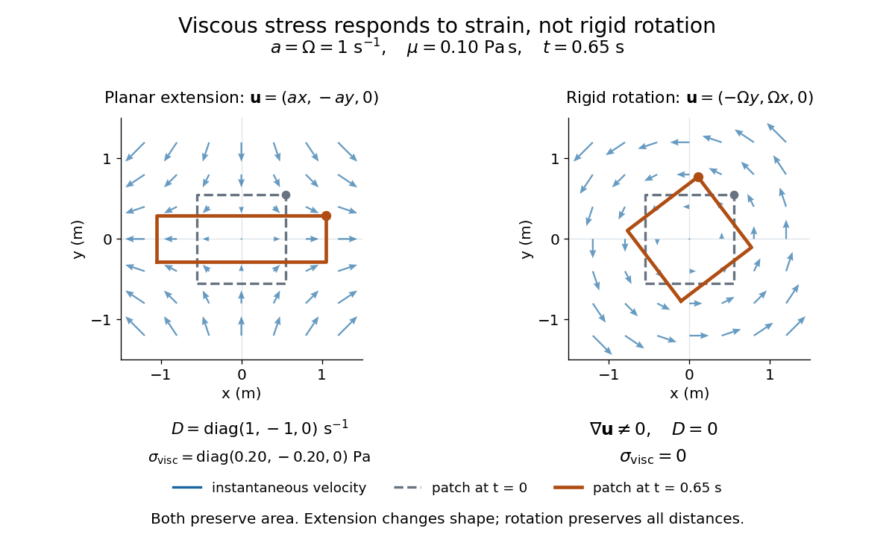

# Viscous stress tensor

↑ **Parent:** [Dynamic viscosity](dynamic-viscosity.md)

The [viscous stress tensor](viscous-stress-tensor.md) is the part of the [Cauchy stress tensor](cauchy-stress-tensor.md) associated with deformation rates. For an isotropic [Newtonian fluid](newtonian-fluid.md) in [incompressible flow](incompressible-flow.md),

$$
\boldsymbol\sigma=-pI+\boldsymbol\sigma_{\mathrm{visc}},\qquad
\boldsymbol\sigma_{\mathrm{visc}}=2\mu D,\qquad
D=\frac12\left[\nabla\mathbf u+(\nabla\mathbf u)^T\right],\qquad
\operatorname{tr}D=\nabla\cdot\mathbf u=0.
$$

Here $p$ is [pressure](pressure.md), $I$ is the [identity matrix](identity-matrix.md), $\mu$ is [dynamic viscosity](dynamic-viscosity.md), and $D$ is the [strain-rate tensor](strain-rate-tensor.md). The convention is $(\nabla\mathbf u)_{ij}=\partial_j u_i$; $T$ denotes [transpose](transpose.md) and $\operatorname{tr}$ denotes [trace](matrix-trace.md). Across a plane with unit [normal vector](normal-vector.md) $\mathbf n$, the viscous [traction](traction.md) is $\boldsymbol\sigma_{\mathrm{visc}}\mathbf n$. The [tensor](tensor.md) makes this rule work for any plane orientation. [David Tong, Fluid Mechanics, section 3.1.1, equations (3.5)–(3.6)](https://www.damtp.cam.ac.uk/user/tong/fluids/fluids.pdf)

In the worked [Couette flow](couette-flow.md), $\mathbf u=(Uy/h,0,0)$, so

$$
D=\frac{U}{2h}\begin{pmatrix}0&1&0\\1&0&0\\0&0&0\end{pmatrix},\qquad
\boldsymbol\sigma_{\mathrm{visc}}
=\begin{pmatrix}0&2&0\\2&0&0\\0&0&0\end{pmatrix}\,\mathrm{Pa}.
$$

In particular, $D_{xy}=10\,\mathrm{s^{-1}}$ while the [shear rate](shear-rate.md) is $20\,\mathrm{s^{-1}}$; the factor $2$ in $2\mu D$ recovers $\tau_{xy}=2\,\mathrm{Pa}$. On the upper face of a fluid slice, $\mathbf n=\mathbf e_y$ gives viscous [traction](traction.md) $+2\mathbf e_x\,\mathrm{Pa}$; on the lower face it is $-2\mathbf e_x\,\mathrm{Pa}$. Constant [stress](stress.md) can therefore transmit a [force](force.md) between the plates even though its [divergence](divergence.md), and the net viscous [force](force.md) on each slice, vanish.

Compare planar extension $\mathbf u=(ax,-ay,0)$ with [solid-body rotation](solid-body-rotation.md) $\mathbf u=(-\Omega y,\Omega x,0)$:

$$
D_{\mathrm{extension}}=\begin{pmatrix}a&0&0\\0&-a&0\\0&0&0\end{pmatrix},\qquad
\nabla\mathbf u_{\mathrm{rotation}}=\begin{pmatrix}0&-\Omega&0\\\Omega&0&0\\0&0&0\end{pmatrix},\qquad
D_{\mathrm{rotation}}=0.
$$

Extension changes lengths and produces viscous [normal stresses](normal-stress.md) $\pm2\mu a$. Rotation preserves distances and gives zero [viscous stress](viscous-stress-tensor.md), despite its nonzero [velocity gradient](velocity-gradient.md) and [vorticity](vorticity.md) $2\Omega\mathbf e_z$. For $a=\Omega=1\,\mathrm{s^{-1}}$ and $\mu=0.10\,\mathrm{Pa\,s}$, extension gives $\sigma_{\mathrm{visc},xx}=0.20\,\mathrm{Pa}$ and $\sigma_{\mathrm{visc},yy}=-0.20\,\mathrm{Pa}$; rotation gives zero. A rotating fluid may still have a [pressure gradient](pressure-gradient.md) supplying its centripetal [acceleration](acceleration.md).

**[Figure 15](#image-deformation-produces-newtonian-viscous-stress-rigid-rotation-does-not). Deformation produces Newtonian viscous stress; rigid rotation does not**. Blue arrows show instantaneous velocity. The dashed square is a material patch at $t=0$; its orange outline at $t=0.65\,\mathrm s$ is obtained from the exact trajectories of planar extension and solid-body rotation, with $a=\Omega=1\,\mathrm{s^{-1}}$. The marked corner makes rotation visible. Both motions preserve area, but only extension changes the patch's shape.

For an isotropic [Newtonian fluid](newtonian-fluid.md) in three-dimensional [compressible flow](compressible-flow-split.md), separate shape change from [volume](volume.md) change:

$$
\boldsymbol\sigma_{\mathrm{visc}}
=2\mu\left(D-\frac{\nabla\cdot\mathbf u}{3}I\right)
+\zeta(\nabla\cdot\mathbf u)I.
$$

The first term is [deviatoric stress](deviatoric-stress.md), with zero [trace](matrix-trace.md); $\zeta$ is [volume viscosity](volume-viscosity.md), also called [bulk viscosity](volume-viscosity.md). For uniform expansion $\mathbf u=b\mathbf x$, $D=bI$ and $\nabla\cdot\mathbf u=3b$, so the shear contribution vanishes and the viscous [stress](stress.md) is $3\zeta bI$. Thus [dynamic viscosity](dynamic-viscosity.md) and [volume viscosity](volume-viscosity.md) describe distinct responses, and [incompressible flow](incompressible-flow.md) removes only the volume-change term. [Shreyas Mandre, Fluid Dynamics Lecture Notes, section 2.11.3, equation (2.49)](https://notes.shreyasmandre.com/fluid-dynamics-notes/Ch2.html)

## ↑ Ancestors (5)

1. [Dynamic viscosity](dynamic-viscosity.md)
2. [Fluid mechanics](fluid-mechanics-split.md)
3. [Branches of physics](branches-of-physics.md)
4. [Physics](physics-split.md)
5. [Codex Wiki](split.md)

## ← Incoming links (9)

- [Dynamic viscosity](dynamic-viscosity.md)
- [Lift (force)](lift-force.md)
- [Solution](past-exam-of-the-mathematics-course-of-the-university-of-cambridge/2012/iii/paper-78/1/solution.md)
- [Solution](past-exam-of-the-mathematics-course-of-the-university-of-cambridge/2016/iii/paper-333/1/solution.md)
- [Solution](past-exam-of-the-mathematics-course-of-the-university-of-cambridge/2017/ii/paper-3/37b/solution.md)
- [Solution](past-exam-of-the-mathematics-course-of-the-university-of-cambridge/2018/ii/paper-1/38c/solution.md)
- [Solution](past-exam-of-the-mathematics-course-of-the-university-of-cambridge/2023/iii/paper-321/1/b/solution.md)
- [Pressure coefficient](pressure-coefficient.md)
- [Viscous stress tensor](viscous-stress-tensor.md)
