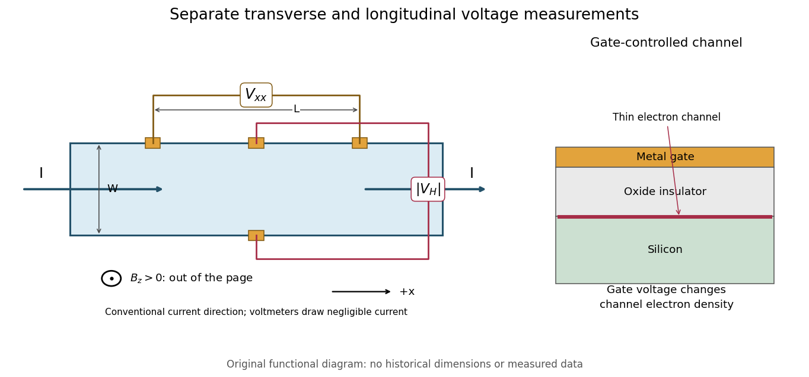

# von Klitzing-Dorda-Pepper quantum Hall experiment

↑ **Parent:** [Integer quantum Hall effect](integer-quantum-hall-effect.md)

[Klaus von Klitzing](klaus-von-klitzing.md), [G. Dorda](gerhard-e-dorda.md) and [M. Pepper](michael-pepper.md) reported a silicon [MOSFET](mosfet.md) measurement in 1980. Its gate controlled an [semiconductor inversion layer](semiconductor-inversion-layer.md); transverse contacts measured the Hall voltage and separate longitudinal contacts measured dissipation. One sweep held $B=18\,\mathrm T$, $T=1.5\,\mathrm K$ and $I=1\,\mu\mathrm A$ fixed while varying gate voltage. Hall plateaus accompanied small longitudinal voltages. Device-geometry comparisons and high-input-impedance voltage measurements helped test whether contact placement or electrical loading produced the result.[pp. 494–496, Fig. 1 and precision-measurement discussion](new-method-for-high-accuracy-determination-of-the-fine-structure-constant-based-on-quantized-hall-resistance-by-klaus-von-klitzing-and-others.md)

**[Figure 8](#image-hall-bar-contacts-and-gate-controlled-channel). Hall-bar contacts and gate-controlled channel**.

This original functional diagram separates transverse and longitudinal readouts; it does not reproduce the historical device's dimensions. The gate inset explains how a [field-effect transistor](field-effect-transistor.md) provides an adjustable [two-dimensional electron gas](two-dimensional-electron-gas.md). A longitudinal voltage close to zero is a useful check because accidental longitudinal separation between Hall contacts can otherwise contaminate the transverse measurement.

**Table of contents**

- [Hall bar](hall-bar.md)
  - [Longitudinal resistance in a Hall bar](longitudinal-resistance-in-a-hall-bar.md)

## ↑ Ancestors (11)

1. [Integer quantum Hall effect](integer-quantum-hall-effect.md)
2. [Quantum Hall effect](quantum-hall-effect.md)
3. [Hall effect](hall-effect.md)
4. [Lorentz force](lorentz-force.md)
5. [Electromagnetic field tensor](electromagnetic-field-tensor.md)
6. [Electromagnetic four-potential](electromagnetic-four-potential.md)
7. [Relativistic electromagnetism](relativistic-electromagnetism-split.md)
8. [Electromagnetism](electromagnetism-split.md)
9. [Branches of physics](branches-of-physics.md)
10. [Physics](physics-split.md)
11. [Codex Wiki](split.md)

## ← Incoming links (1)

- [Solution](past-exam-of-the-quantum-condensed-matter-course-of-the-university-of-cambridge/2006/section-b/b4/d/solution.md)
