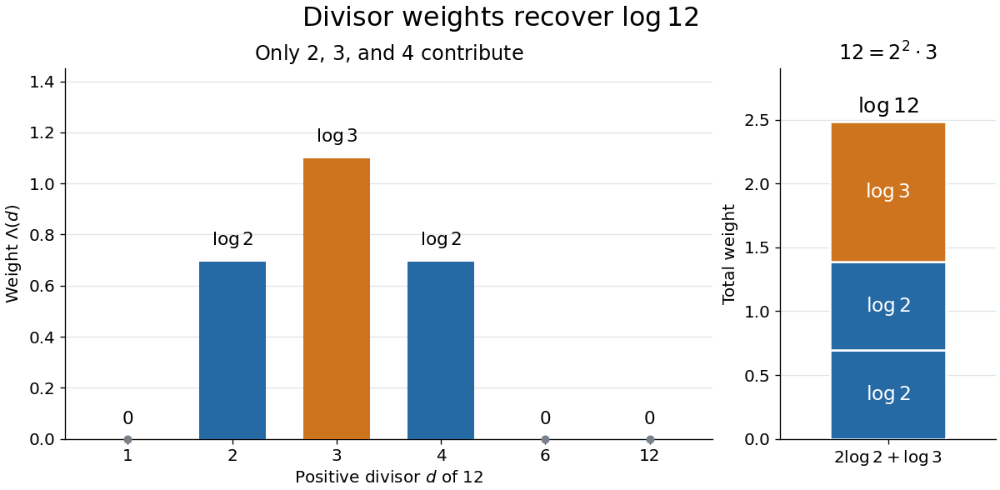

# Von Mangoldt divisor identity

↑ **Parent:** [Von Mangoldt function](von-mangoldt-function.md)

For every [positive integer](positive-integer.md) $n$, the [divisor sum](divisor-sum.md) of its [Von Mangoldt function](von-mangoldt-function.md) weights recovers its [natural logarithm](natural-logarithm.md):

$$
\sum_{d\mid n}\Lambda(d)=\log n.
$$

The sum runs over the positive [integer divisors](divisor.md) of $n$. For $n=1$, its only term is $\Lambda(1)=0=\log1$. Equivalently, if $L(n)=\log n$ and $\mathbf1$ is the [constant-one arithmetic function](constant-one-arithmetic-function.md), then $\mathbf1*\Lambda=L$, where $*$ is [Dirichlet convolution](dirichlet-convolution.md). [254A, Notes 1: Elementary multiplicative number theory](254a-analytic-prime-number-theory/254a-notes-1-elementary-multiplicative-number-theory.md)

For $12=2^2\cdot3$, the positive [integer divisors](divisor.md) are $1,2,3,4,6,12$. Only $2,3,4$ contribute:

$$
\Lambda(1)+\Lambda(2)+\Lambda(3)+\Lambda(4)+\Lambda(6)+\Lambda(12)
=0+\log2+\log3+\log2+0+0
=\log12.
$$

Thus the vanishing of $\Lambda(12)$ loses no information here: the [divisor sum](divisor-sum.md) retrieves both copies of the [prime factor](prime-factor.md) $2$ from the [integer divisors](divisor.md) $2$ and $4$.

**[Figure 19](#image-von-mangoldt-divisor-contributions). The Von Mangoldt divisor identity assembles $\log12$ from three nonzero divisor weights**. The six positive [integer divisors](divisor.md) of $12$ appear in increasing order. Blue bars contribute $\log2$ at $2$ and $4$; the orange bar contributes $\log3$ at $3$. The remaining three weights are zero. The adjacent stacked bar shows the total $2\log2+\log3=\log12$.

Proof outline: by the [fundamental theorem of arithmetic](fundamental-theorem-of-arithmetic.md), write $n=\prod_{i=1}^r p_i^{a_i}$ with distinct [prime numbers](prime-number.md) $p_i$ and positive exponents $a_i$. Among the positive [integer divisors](divisor.md), the ones with nonzero [Von Mangoldt function](von-mangoldt-function.md) weights are exactly $p_i,p_i^2,\ldots,p_i^{a_i}$. Consequently

$$
\sum_{d\mid n}\Lambda(d)=\sum_{i=1}^r\sum_{j=1}^{a_i}\log p_i
=\sum_{i=1}^r a_i\log p_i
=\log\!\left(\prod_{i=1}^r p_i^{a_i}\right)=\log n.
$$

The [natural logarithm](natural-logarithm.md) turns the [prime factorization](fundamental-theorem-of-arithmetic.md) product into a sum, and the [prime powers](prime-power.md) greater than one supply exactly the required multiplicities.

## ↑ Ancestors (6)

1. [Von Mangoldt function](von-mangoldt-function.md)
2. [Arithmetic function](arithmetic-function.md)
3. [Number theory](number-theory-split.md)
4. [Area of mathematics](area-of-mathematics.md)
5. [Mathematics](mathematics-split.md)
6. [Codex Wiki](split.md)

## ← Incoming links (13)

- [Integrated Chebyshev sum](integrated-chebyshev-sum.md)
- [Solution](past-exam-of-the-mathematics-course-of-the-university-of-cambridge/2002/iii/paper-25/1/solution.md)
- [Solution](past-exam-of-the-mathematics-course-of-the-university-of-cambridge/2006/iii/paper-28/1/solution.md)
- [Solution](past-exam-of-the-mathematics-course-of-the-university-of-cambridge/2015/iii/paper-27/4/a/solution.md)
- [Solution](past-exam-of-the-mathematics-course-of-the-university-of-cambridge/2015/iii/paper-27/5/b/solution.md)
- [Solution](past-exam-of-the-mathematics-course-of-the-university-of-cambridge/2019/iii/paper-150/1/a/solution.md)
- [Solution](past-exam-of-the-mathematics-course-of-the-university-of-cambridge/2021/iii/paper-150/1/a/solution.md)
- [Solution](past-exam-of-the-mathematics-course-of-the-university-of-cambridge/2026/iii/paper-150/1/a/solution.md)
- [Solution](past-exam-of-the-mathematics-course-of-the-university-of-cambridge/2026/iii/paper-150/3/c/solution.md)
- [Prime number asymptotic from Mertens cancellation](prime-number-asymptotic-from-mertens-cancellation.md)
- [Second Chebyshev function](second-chebyshev-function.md)
- [Von Mangoldt divisor identity](von-mangoldt-divisor-identity.md)
- [Von Mangoldt function](von-mangoldt-function.md)
