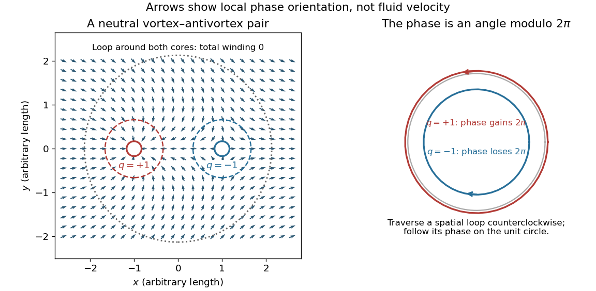

# Vortex-antivortex binding

↑ **Parent:** [Berezinskii–Kosterlitz–Thouless transition](berezinskii-kosterlitz-thouless-transition.md)

In the phase with [quasi-long-range order](quasi-long-range-order.md), [vortex](phase-vortex.md) defects of opposite winding remain bound in pairs. Their unbinding produces the disordered phase with a finite [correlation length](correlation-length.md).

For two unit [vortices](phase-vortex.md) of opposite charge separated by $R$, the [vortex Coulomb gas](vortex-coulomb-gas.md) gives $E_{+-}(R)\simeq2E_c+2\pi\rho_s\log(R/a)$ before screening. At distances much greater than $R$, their phase gradients cancel at leading order: the pair field decays as $R/r^2$, whereas a lone [phase vortex](phase-vortex.md) has a $1/r$ gradient. A neutral pair therefore has finite energy as $L\to\infty$ at fixed $R$. Bound does not mean absent: small pairs remain thermally excited and reduce the [phase stiffness](phase-stiffness.md) through their response to a twist.

**[Figure 2](#image-opposite-phase-windings-and-the-geometry-of-a-neutral-vortex-pair). Opposite phase windings and the geometry of a neutral vortex pair**. Original phase field $\theta=\arg(x+1+iy)-\arg(x-1+iy)$. Each arrow is the unit vector $(\cos\theta,\sin\theta)$, not the superfluid velocity. Counterclockwise loops around the left and right cores have winding $+1$ and $-1$; a loop enclosing both has zero winding. The circles on the right show the corresponding motion in phase space.

## ↑ Ancestors (7)

1. [Berezinskii–Kosterlitz–Thouless transition](berezinskii-kosterlitz-thouless-transition.md)
2. [Lower critical dimension](lower-critical-dimension.md)
3. [Critical phenomenon](critical-phenomenon-split.md)
4. [Statistical physics](statistical-physics-split.md)
5. [Branches of physics](branches-of-physics.md)
6. [Physics](physics-split.md)
7. [Codex Wiki](split.md)

## ← Incoming links (6)

- [Berezinskii–Kosterlitz–Thouless transition](berezinskii-kosterlitz-thouless-transition.md)
- [Solution](past-exam-of-the-mathematics-course-of-the-university-of-cambridge/2001/iii/paper-72/1/c/solution.md)
- [Solution](past-exam-of-the-mathematics-course-of-the-university-of-cambridge/2002/iii/paper-69/3/b/solution.md)
- [Solution](past-exam-of-the-mathematics-course-of-the-university-of-cambridge/2008/iii/paper-50/3/c/solution.md)
- [Solution](past-exam-of-the-mathematics-course-of-the-university-of-cambridge/2018/iii/paper-303/3/c/solution.md)
- [Phase vortex](phase-vortex.md)
