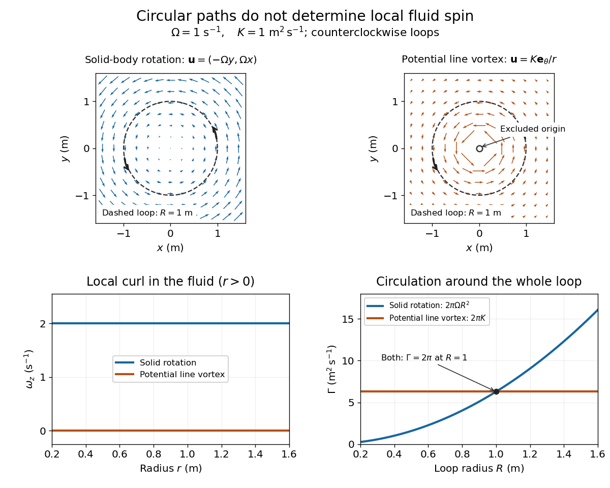
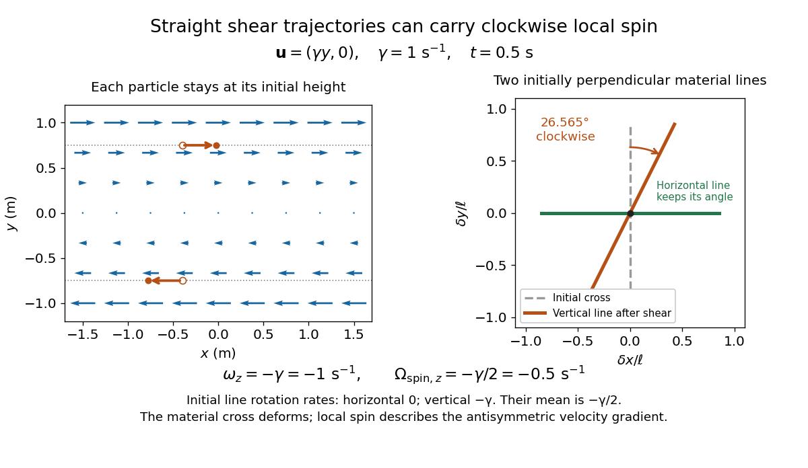

# Vorticity

↑ **Parent:** [Fluid mechanics](fluid-mechanics.md)  
ⓦ [Wiki](https://en.wikipedia.org/wiki/Vorticity)

Use [vorticity](vorticity.md) to distinguish the local spin of a [fluid element](continuum-mechanics.md#fluid-element) from the motion of its center along a [pathline](fluid-mechanics.md#pathline). Circular [streamlines](fluid-mechanics.md#streamline) can occur both with and without [vorticity](vorticity.md): the two [velocity fields](fluid-mechanics.md#velocity-field) below even have the same [circulation](#circulation-physics) around the unit [circle](topology.md#circle).

**[Figure 1](#image-solid-body-rotation-and-a-potential-line-vortex-equal-unit-circle-circulation-different-local-vorticity). Solid-body rotation and a potential line vortex: equal unit-circle circulation, different local vorticity**.

For a continuously differentiable [velocity field](fluid-mechanics.md#velocity-field) $\mathbf u=(u_x,u_y,u_z)$, [vorticity](vorticity.md) is the [curl](multivariable-calculus.md#curl) vector

$$
\boldsymbol\omega=\nabla\times\mathbf u=\left(\frac{\partial u_z}{\partial y}-\frac{\partial u_y}{\partial z},\frac{\partial u_x}{\partial z}-\frac{\partial u_z}{\partial x},\frac{\partial u_y}{\partial x}-\frac{\partial u_x}{\partial y}\right).
$$

Each [partial derivative](multivariable-calculus.md#partial-derivative) divides [velocity](classical-mechanics.md#velocity) by distance, so [vorticity](vorticity.md) has units $\mathrm{s^{-1}}$. In a planar [velocity field](fluid-mechanics.md#velocity-field) independent of $z$, only $\omega_z=\partial_xu_y-\partial_yu_x$ survives. Positive $\omega_z$ points along $+\mathbf e_z$: the [right-hand rule](electromagnetism.md#right-hand-rule) associates it with counterclockwise spin viewed from positive $z$ toward the plane. [David Tong, Fluid Mechanics, section 2.2](https://davidtong.org/pdfs/teaching/fluid-mechanics/fluids1.pdf)

The local rotational [angular velocity](rigid-body-dynamics.md#angular-velocity) is half the [vorticity](vorticity.md), $\boldsymbol\Omega_{\rm spin}=\boldsymbol\omega/2$. To see the factor, split the [velocity gradient](continuum-mechanics.md#velocity-gradient) $L_{ij}=\partial_ju_i$ into its symmetric [rate-of-strain tensor](viscous-fluid-flow.md#strain-rate-tensor) $E=(L+L^T)/2$ and antisymmetric [spin tensor](viscous-fluid-flow.md#spin-tensor) $W=(L-L^T)/2$. A nearby displacement $\delta\mathbf x$ has relative [velocity](classical-mechanics.md#velocity) $L\delta\mathbf x$; its rotational part satisfies $W\delta\mathbf x=(\boldsymbol\omega/2)\times\delta\mathbf x$. This is a proof outline of the local spin interpretation. The [rate-of-strain tensor](viscous-fluid-flow.md#strain-rate-tensor) can also change the angle of a particular [material line](fluid-mechanics.md#material-curve), so that line's [angular velocity](rigid-body-dynamics.md#angular-velocity) need not equal $\boldsymbol\omega/2$.

For [solid-body rotation](rigid-body-dynamics.md#solid-body-rotation), $\mathbf u=(-\Omega y,\Omega x,0)$ gives $\boldsymbol\omega=(0,0,2\Omega)$ and $\boldsymbol\Omega_{\rm spin}=(0,0,\Omega)$. Taking $\Omega=1\ \mathrm{s^{-1}}$, the [vorticity](vorticity.md) is $2\mathbf e_z\ \mathrm{s^{-1}}$, although the [angular velocity](rigid-body-dynamics.md#angular-velocity) is only $1\mathbf e_z\ \mathrm{s^{-1}}$. For the potential [line vortex](#line-vortex), $\mathbf u=K\mathbf e_\theta/r$, the planar [curl](multivariable-calculus.md#curl) is $r^{-1}\partial_r(ru_\theta)=r^{-1}\partial_rK=0$ wherever $r>0$. Its circular [pathlines](fluid-mechanics.md#pathline) therefore coexist with zero local spin.

This distinction makes [vorticity](vorticity.md) useful for recognizing [shear flow](fluid-mechanics.md#shear-flow) as well as swirling motion; taking the [curl](multivariable-calculus.md#curl) of the [Euler equations](euler-equations-for-an-inviscid-fluid.md) also removes a [pressure gradient](fluid-mechanics.md#pressure-gradient) and leads to the [vorticity equation](mathematical-physics.md#vorticity-equation). A historical landmark is Hermann von Helmholtz's 1858 paper on [fluid vortex](#vortex-fluid-mechanics) motion, an early study devoted to [vortex dynamics](#vortex-dynamics). [H. Helmholtz, Über Integrale der hydrodynamischen Gleichungen, welche den Wirbelbewegungen entsprechen (1858)](https://zenodo.org/records/1448878)

**Table of contents**

- [Vorticity of a linear shear flow](#vorticity-of-a-linear-shear-flow)
- [Vortex line](#vortex-line)
- [Vortex (fluid mechanics)](#vortex-fluid-mechanics)
  - [Vortex dynamics](#vortex-dynamics)
    - [Slow-drain angular-momentum amplification](#slow-drain-angular-momentum-amplification)
    - [Nonrotating layerwise-two-dimensional vortex dynamics](#nonrotating-layerwise-two-dimensional-vortex-dynamics)
    - [Two-dimensional vortex dynamics](#two-dimensional-vortex-dynamics)
      - [Steady planar vorticity as a local function of stream function](#steady-planar-vorticity-as-a-local-function-of-stream-function)
  - [Line vortex](#line-vortex)
    - [Motion of two point vortices](#motion-of-two-point-vortices)
    - [Image vortex at a plane wall](#image-vortex-at-a-plane-wall)
      - [Line-vortex trajectory in a quarter-plane](#line-vortex-trajectory-in-a-quarter-plane)
- [Hydrodynamic Biot-Savart kernel](#hydrodynamic-biot-savart-kernel)
- [Hydrodynamic impulse](#hydrodynamic-impulse)
  - [Dipolar velocity field of a localized eddy](#dipolar-velocity-field-of-a-localized-eddy)
- [Vortex tube](#vortex-tube)
  - [Vortex filament](#vortex-filament)
  - [Vortex ring](#vortex-ring)
    - [Velocity field of a dense coaxial vortex-ring array](#velocity-field-of-a-dense-coaxial-vortex-ring-array)
- [Enstrophy](#enstrophy)
  - [Mean enstrophy balance](#mean-enstrophy-balance)
- [Planar vorticity velocity kernel](#planar-vorticity-velocity-kernel)
- [Uniform-vorticity circular flow in an annulus](#uniform-vorticity-circular-flow-in-an-annulus)
- [Vorticity cross-product identity](#vorticity-cross-product-identity)
  - [Convective acceleration identity](#convective-acceleration-identity)
- [Hydrodynamical helicity](#hydrodynamical-helicity)
  - [Kinetic helicity density](#kinetic-helicity-density)
    - [Helicity vector of a solenoidal Fourier mode](#helicity-vector-of-a-solenoidal-fourier-mode)
    - [Kinetic helicity conservation law](#kinetic-helicity-conservation-law)
      - [Material conservation of kinetic helicity density](#material-conservation-of-kinetic-helicity-density)
- [Absolute vorticity](#absolute-vorticity)
  - [Planetary vorticity](#planetary-vorticity)
  - [Absolute-vorticity flux tensor](#absolute-vorticity-flux-tensor)
    - [Radial vorticity conservation in a shearing sheet](#radial-vorticity-conservation-in-a-shearing-sheet)
- [Relative vorticity](#relative-vorticity)
- [Circulation (physics)](#circulation-physics)
  - [Kelvin's circulation theorem](#kelvin-s-circulation-theorem)
    - [Irrotational circulation in an exterior domain](#irrotational-circulation-in-an-exterior-domain)
- [Irrotational flow](#irrotational-flow)

## Vorticity of a linear shear flow

↑ **Parent:** [Vorticity](vorticity.md)

Use a [linear shear flow](fluid-mechanics.md#linear-shear-flow) to see why straight [pathlines](fluid-mechanics.md#pathline) can still carry local spin. Faster layers pull past slower ones, and a small symmetric paddle can turn clockwise while its center travels straight ahead.

**[Figure 2](#image-straight-particle-paths-in-linear-shear-coexist-with-clockwise-local-spin-and-material-line-deformation). Straight particle paths in linear shear coexist with clockwise local spin and material-line deformation**.

For the planar [simple shear flow](viscous-fluid-flow.md#simple-shear-flow) $\mathbf u=(\gamma y,0,0)$ with constant signed [shear rate](viscous-fluid-flow.md#shear-rate) $\gamma$, direct [differentiation](calculus.md#differentiation) gives

$$
\omega_z=\partial_xu_y-\partial_yu_x=-\gamma,\qquad\Omega_{{\rm spin},z}=-\frac\gamma2.
$$

With $\gamma=1\ \mathrm{s^{-1}}$, these are $-1\ \mathrm{s^{-1}}$ and $-0.5\ \mathrm{s^{-1}}$: both signs indicate clockwise orientation under the [right-hand rule](electromagnetism.md#right-hand-rule). Yet a particle initially at $(x_0,y_0)$ follows the straight [pathline](fluid-mechanics.md#pathline) $x(t)=x_0+\gamma y_0t$, $y(t)=y_0$. The [curl](multivariable-calculus.md#curl) measures differences of [velocity](classical-mechanics.md#velocity) between neighboring particles, rather than bending of one particle's [pathline](fluid-mechanics.md#pathline).

The [velocity gradient](continuum-mechanics.md#velocity-gradient) has $L_{xy}=\gamma$ as its only nonzero entry. Its [spin tensor](viscous-fluid-flow.md#spin-tensor) supplies clockwise rotation, while its [rate-of-strain tensor](viscous-fluid-flow.md#strain-rate-tensor) supplies simultaneous deformation. For a [material line](fluid-mechanics.md#material-curve) making angle $\alpha$ to the horizontal, the equation $\dot{\delta\mathbf x}=L\delta\mathbf x$ gives $\dot\alpha=-\gamma\sin^2\alpha$. Initially horizontal and vertical [material lines](fluid-mechanics.md#material-curve) therefore have [angular velocities](rigid-body-dynamics.md#angular-velocity) $0$ and $-\gamma$; their mean is $-\gamma/2$. At $t=0.5\ \mathrm{s}$ with $\gamma=1\ \mathrm{s^{-1}}$, an initially vertical displacement becomes $(0.5,1)$ times its original length and has angle $\arctan 2\approx63.435^\circ$, a clockwise change of $26.565^\circ$. The plotted cross deforms; an actual paddle's response also depends on its shape and interaction with the fluid. The exact local spin statement concerns the [spin tensor](viscous-fluid-flow.md#spin-tensor), rather than every tracer's orientation.

## Vortex line

↑ **Parent:** [Vorticity](vorticity.md)

A [vortex line](#vortex-line) is an [integral](integral.md) curve of the [vorticity](vorticity.md) vector field: its tangent is parallel to $\boldsymbol\omega=\nabla\times\mathbf u$. In a two-dimensional [incompressible flow](fluid-mechanics.md#incompressible-flow), these lines are perpendicular to the flow plane and the [vorticity equation](mathematical-physics.md#vorticity-equation) gives $D\omega/Dt=0$. Since material cross-sectional area is preserved, the flux of [vorticity](vorticity.md) through a material [vortex tube](#vortex-tube), equal to its [circulation](#circulation-physics), is constant.

## Vortex (fluid mechanics)

↑ **Parent:** [Vorticity](vorticity.md)  
ⓦ [Wiki](https://en.wikipedia.org/wiki/Vortex)

A fluid vortex is a region in which [velocity field](fluid-mechanics.md#velocity-field) circulates about an axis or center. [Vorticity](vorticity.md) measures local rotation, while [circulation](#circulation-physics) measures the integral of velocity around a closed path. A [phase vortex](critical-phenomenon.md#phase-vortex) is instead a [topological defect](critical-phenomenon.md#topological-defect) defined by winding of an order parameter; superfluid examples connect the two notions.

### Vortex dynamics

↑ **Parent:** [Vortex (fluid mechanics)](#vortex-fluid-mechanics)

The evolution of a [vorticity](vorticity.md) distribution together with the [velocity field](fluid-mechanics.md#velocity-field) it induces. A transport equation advances [vorticity](vorticity.md); diagnostic inversion recovers [velocity](classical-mechanics.md#velocity) from it and the specified [boundary conditions](differential-equation.md#boundary-condition).

#### Slow-drain angular-momentum amplification

↑ **Parent:** [Vortex dynamics](#vortex-dynamics)

Axisymmetric [inviscid flow](fluid-mechanics.md#inviscid-flow) has no azimuthal pressure torque, so each parcel conserves specific axial [angular momentum](momentum.md#angular-momentum) $j=ru_\theta=r^2\omega$. If late draining fluid originally lay near the rim $R$ of a uniformly rotating pool, then $j\simeq\omega_0R^2$ and $\omega\simeq\omega_0R^2/r^2$. The late-origin assumption is essential; torque conservation alone gives $j=\omega_0r_0^2$ for each parcel's own initial radius $r_0$. Quasistatic radial and vertical pressure balance then gives free-surface depression $h(r)=\omega_0^2R^4(r^{-2}-R^{-2})/(2g)$. The singular profile applies outside a finite drain or vortex core, not at the rotation axis.

#### Nonrotating layerwise-two-dimensional vortex dynamics

↑ **Parent:** [Vortex dynamics](#vortex-dynamics)

In the limiting model of infinitely strong stable [density stratification](gravity-wave.md#density-stratification), small [Froude number](reduced-gravity.md#froude-number) and fixed vertical scales suppress vertical displacement. Each horizontal level evolves by [two-dimensional vortex dynamics](#two-dimensional-vortex-dynamics); $z$ labels independent copies of the horizontal [Poisson equation](partial-differential-equation.md#poisson-s-equation). The leading normalized [Ertel potential vorticity](geophysical-fluid-dynamics.md#ertel-potential-vorticity) is $Q/N^2=\zeta$. This is a constrained asymptotic model: finite [buoyancy frequency](gravity-wave.md#buoyancy-frequency) restores vertical motion and coupling, and arbitrarily short vertical scales invalidate the independent-layer limit. [McIntyre's discussion of potential-vorticity inversion](https://pordlabs.ucsd.edu/wryoung/theorySeminar/pdf14/McIntyrePV.pdf) explains the limiting independent-layer picture.

#### Two-dimensional vortex dynamics

↑ **Parent:** [Vortex dynamics](#vortex-dynamics)

For inviscid planar [incompressible flow](fluid-mechanics.md#incompressible-flow), write [velocity](classical-mechanics.md#velocity) as $(-\psi_y,\psi_x)$ and [vorticity](vorticity.md) as $\zeta=\nabla^2\psi$. Taking [curl](multivariable-calculus.md#curl) of the [Euler equations for an inviscid fluid](euler-equations-for-an-inviscid-fluid.md) removes [pressure](pressure.md) and gives the displayed transport equation, with $J(\psi,\zeta)=\psi_x\zeta_y-\psi_y\zeta_x$. The [Poisson equation](partial-differential-equation.md#poisson-s-equation) then recovers the [streamfunction](fluid-mechanics.md#stream-function) at each instant. A velocity tangent to the plane cannot stretch its perpendicular [vorticity](vorticity.md) vector.

##### Steady planar vorticity as a local function of stream function

↑ **Parent:** [Two-dimensional vortex dynamics](#two-dimensional-vortex-dynamics)

In a steady inviscid planar [incompressible flow](fluid-mechanics.md#incompressible-flow), [vorticity](vorticity.md) is constant along [streamlines](fluid-mechanics.md#streamline). A regular [stream function](fluid-mechanics.md#stream-function) supplies a local transverse coordinate, so locally $\Delta\psi$ depends only on $\psi$. A global single-valued function needs the same value on every component of each level set. This can fail: $\psi=x^3-x$ gives the steady Euler shear $(u,v)=(0,1-3x^2)$ with constant pressure, but $\psi(0)=\psi(1)=0$ while $\Delta\psi$ is respectively $0$ and $6$.

### Line vortex

↑ **Parent:** [Vortex (fluid mechanics)](#vortex-fluid-mechanics)

An ideal straight [line vortex](#line-vortex) in a two-dimensional [incompressible flow](fluid-mechanics.md#incompressible-flow) has [circulation](#circulation-physics) $\Gamma$ and induces velocity

$$
\mathbf u(\mathbf r)=\frac{\Gamma}{2\pi}\frac{\mathbf e_z\times(\mathbf r-\mathbf r_0)}{|\mathbf r-\mathbf r_0|^2}.
$$

Its [stream function](fluid-mechanics.md#stream-function), with $\mathbf u=(\psi_y,-\psi_x)$, is $\psi=-\Gamma\log|\mathbf r-\mathbf r_0|/(2\pi)$. Positive $\Gamma$ means counterclockwise [circulation](#circulation-physics). In an ideal point-vortex description, the vortex position is advected by the regular velocity produced by the other vortices and the boundaries; its own singular velocity is excluded.

#### Motion of two point vortices

↑ **Parent:** [Line vortex](#line-vortex)

Take vortex strength to mean circulation and $J(x,y)=(-y,x)$. Each [point vortex](#line-vortex) moves with the [velocity](classical-mechanics.md#velocity) induced by the other, so for $\mathbf d=\mathbf x_1-\mathbf x_2$ the displayed equation holds. Since $\mathbf d\cdot J\mathbf d=0$, separation is constant; weighting the two velocities also gives $d(\kappa_1\mathbf x_1+\kappa_2\mathbf x_2)/dt=0$. Equal strengths at opposite points of a circle of radius $a$ rotate with angular speed $\kappa/(4\pi a^2)$.

#### Image vortex at a plane wall

↑ **Parent:** [Line vortex](#line-vortex)

The [method of images](mathematics.md#method-of-images) enforces impermeability at a plane wall by reflecting a [line vortex](#line-vortex) across it and reversing its [circulation](#circulation-physics). The two logarithmic [stream functions](fluid-mechanics.md#stream-function) cancel on the wall, which is consequently a [streamline](fluid-mechanics.md#streamline). For a vortex of [circulation](#circulation-physics) $\Gamma$ at $(0,b)$ above $y=0$, the image of [circulation](#circulation-physics) $-\Gamma$ at $(0,-b)$ induces velocity $(\Gamma/(4\pi b),0)$ at the real vortex. The signed drift parallel to the wall is therefore $\Gamma/(4\pi b)$.

##### Line-vortex trajectory in a quarter-plane

↑ **Parent:** [Image vortex at a plane wall](#image-vortex-at-a-plane-wall)

In the quadrant $x,y>0$, a [line vortex](#line-vortex) of [circulation](#circulation-physics) $\Gamma$ at $(x,y)$ has three images: circulations $-\Gamma$ at $(-x,y)$ and $(x,-y)$, and $+\Gamma$ at $(-x,-y)$. Their induced velocity is

$$
\dot x=\frac{\Gamma x^2}{4\pi y(x^2+y^2)},\qquad\dot y=-\frac{\Gamma y^2}{4\pi x(x^2+y^2)}.
$$

In [polar coordinates](multivariable-calculus.md#polar-coordinates), these equations give $\dot r=\Gamma\cot(2\theta)/(2\pi r)$ and $\dot\theta=-\Gamma/(4\pi r^2)$. Direct [differentiation](calculus.md#differentiation) yields $\frac d{dt}(r\sin2\theta)=0$, so the trajectory obeys $r\sin2\theta=\text{constant}$.

## Hydrodynamic Biot-Savart kernel

↑ **Parent:** [Vorticity](vorticity.md)

In an unbounded incompressible fluid with localized [vorticity](vorticity.md) and no added harmonic background, velocity is reconstructed by $\mathbf u(\mathbf x)=(4\pi)^{-1}\int\boldsymbol\omega(\mathbf y)\times(\mathbf x-\mathbf y)/|\mathbf x-\mathbf y|^3\,d^3y$. Its multipole expansion relates [hydrodynamic impulse](#hydrodynamic-impulse) to a dipolar far-field velocity.

## Hydrodynamic impulse

↑ **Parent:** [Vorticity](vorticity.md)

[Hydrodynamic impulse](#hydrodynamic-impulse) per unit density is $\mathbf I=\tfrac12\int\mathbf x\times\boldsymbol\omega\,dV$ for localized [vorticity](vorticity.md). In unforced all-space [incompressible flow](fluid-mechanics.md#incompressible-flow) its derivative vanishes when far-field fluxes vanish. For a spherical all-space limit, $\mathbf I=(3/2)\lim_R\int_{V_R}\mathbf u\,dV$; a dipolar velocity tail makes the distinction from a bare [momentum](momentum.md) integral important.

### Dipolar velocity field of a localized eddy

↑ **Parent:** [Hydrodynamic impulse](#hydrodynamic-impulse)

A localized [vorticity](vorticity.md) distribution with nonzero [hydrodynamic impulse](#hydrodynamic-impulse) induces $\mathbf u\sim[3\mathbf n(\mathbf I\cdot\mathbf n)-\mathbf I]/(4\pi r^3)$. This [curl](multivariable-calculus.md#curl)-free exterior velocity can remain long-ranged even when the [vorticity](vorticity.md) is localized. In a random ensemble it produces dipolar longitudinal and transverse correlation tails.

## Vortex tube

↑ **Parent:** [Vorticity](vorticity.md)

A [vortex tube](#vortex-tube) is a bundle of vortex lines bounded by a surface to which [vorticity](vorticity.md) is tangent. [Circulation](#circulation-physics) measures its [vorticity](vorticity.md) flux. Stretching a nearly incompressible tube reduces its cross-sectional area and increases its [vorticity](vorticity.md). The [Burgers vortex](continuum-mechanics.md#burgers-vortex) is a local model in which this concentration balances viscous diffusion.

### Vortex filament

↑ **Parent:** [Vortex tube](#vortex-tube)

A [vortex filament](#vortex-filament) is the ideal thin-core limit of a [vortex tube](#vortex-tube), concentrating a finite [circulation](#circulation-physics) on a curve. In an unbounded incompressible [fluid](fluid-mechanics.md#fluid) with [velocity](classical-mechanics.md#velocity) tending to zero at infinity, its induced [velocity field](fluid-mechanics.md#velocity-field) follows the [vorticity](vorticity.md) version of the [Biot-Savart law](electromagnetism.md#biot-savart-law). The ideal field is singular on the filament; finite-core models are needed there. A closed circular filament is a thin [vortex ring](#vortex-ring).

### Vortex ring

↑ **Parent:** [Vortex tube](#vortex-tube)  
ⓦ [Wiki](https://en.wikipedia.org/wiki/Vortex_ring)

A [vortex ring](#vortex-ring) is a [vortex tube](#vortex-tube) bent into a closed loop, often approximately a [circle](topology.md#circle). Its [vorticity](vorticity.md) runs around the loop, while the induced [velocity field](fluid-mechanics.md#velocity-field) passes through the centre and returns outside. For a thin ring of radius $r$ and [circulation](#circulation-physics) $\Gamma$, the [Biot-Savart law](electromagnetism.md#biot-savart-law) for incompressible [vorticity](vorticity.md) gives an axial [velocity](classical-mechanics.md#velocity) $u_z(z)=\Gamma r^2/[2(r^2+z^2)^{3/2}]$, measured relative to the ring centre, with its sign set by the [circulation](#circulation-physics) orientation. A [vortex ring](#vortex-ring) is not a loop of [fluid](fluid-mechanics.md#fluid) whose [velocity](classical-mechanics.md#velocity) everywhere merely follows the circular [vortex line](#vortex-line).

#### Velocity field of a dense coaxial vortex-ring array

↑ **Parent:** [Vortex ring](#vortex-ring)

A long array of equal co-oriented [vortex rings](#vortex-ring), spaced by $l\ll r$, approximates an azimuthal [vortex sheet](fluid-mechanics.md#vortex-sheet) on a cylinder of radius $r$. The [circulation](#circulation-physics) per unit axial [length](physics.md#length) is $\Gamma/l$. The conditions $\nabla\cdot\mathbf u=0$ and $\nabla\times\mathbf u=\boldsymbol\omega$ are mathematically analogous to the magnetostatic equations for a [solenoid](magnetic-field.md#solenoid). Away from its ends, an array long compared with $r$ produces nearly uniform axial flow $\Gamma/l$ inside and weak flow outside. A finite array has return flow outside connecting its two ends. The uniform-core approximation fails close to individual vortex cores and near the ends, and the field requires a stated [circulation](#circulation-physics) orientation and background flow.

## Enstrophy

↑ **Parent:** [Vorticity](vorticity.md)  
ⓦ [Wiki](https://en.wikipedia.org/wiki/Enstrophy)

[Enstrophy](#enstrophy) measures squared [vorticity](vorticity.md): a local density is $\omega^2/2$, and its spatial integral or ensemble mean gives a global measure. In homogeneous [incompressible flow](fluid-mechanics.md#incompressible-flow), [viscous dissipation](stokes-flow.md#viscous-dissipation) satisfies $\epsilon=\nu\langle\omega^2\rangle$. [Vortex stretching](mathematical-physics.md#vortex-stretching) can produce [enstrophy](#enstrophy) in three dimensions; [kinematic viscosity](dynamic-viscosity.md#kinematic-viscosity) destroys it.

### Mean enstrophy balance

↑ **Parent:** [Enstrophy](#enstrophy)

For unforced homogeneous [incompressible flow](fluid-mechanics.md#incompressible-flow), the [vorticity equation](mathematical-physics.md#vorticity-equation) gives $\dot Z=\langle\omega_i\omega_jS_{ij}\rangle-\nu\langle|\nabla\times\boldsymbol\omega|^2\rangle$. [Curl](multivariable-calculus.md#curl) and full-gradient squared averages agree because the [vorticity](vorticity.md) is divergence free and boundary divergences average to zero. In established high-Reynolds-number [turbulence](turbulence.md), slow integral-time evolution makes production and destruction nearly balance.

## Planar vorticity velocity kernel

↑ **Parent:** [Vorticity](vorticity.md)

The [velocity](classical-mechanics.md#velocity) induced by planar [vorticity](vorticity.md) is a [convolution](fourier-analysis.md#convolution) with this kernel, whose sign depends on the [stream function](fluid-mechanics.md#stream-function) and vorticity conventions. Its magnitude is $(2\pi|z|)^{-1}$ and its derivative is bounded by $C|z|^{-2}$. Splitting the convolution at radius $R$ gives $\|K*\omega\|_\infty\leq R\|\omega\|_\infty+\|\omega\|_1/(2\pi R)$. The same singularity yields a [log-Lipschitz modulus](topological-analysis.md#log-lipschitz-modulus), enough for a [Yudovich characteristic flow](euler-equations-for-an-inviscid-fluid.md#yudovich-characteristic-flow).

## Uniform-vorticity circular flow in an annulus

↑ **Parent:** [Vorticity](vorticity.md)

Circular streamlines and constant [vorticity](vorticity.md) imply $u_\phi=\omega r/2+C/r$. Zero velocity at $2a$ and positive azimuthal velocity $V$ at $a$ give

$$
u_\phi=\frac V{3a}(4a^2/r-r),\qquad \omega=-\frac{2V}{3a}.
$$

The radial [Euler equations for an inviscid fluid](euler-equations-for-an-inviscid-fluid.md) give $p_r=\rho u_\phi^2/r$, yielding outer-minus-inner pressure $(15-16\log2)\rho V^2/18$. The pressure difference is independent of circulation orientation.

## Vorticity cross-product identity

↑ **Parent:** [Vorticity](vorticity.md)

For differentiable vector fields, the displayed identity relates [vorticity](vorticity.md) to the antisymmetric part of the [velocity gradient](continuum-mechanics.md#velocity-gradient). Together with the [curl of a cross product](multivariable-calculus.md#curl-of-a-cross-product), it converts the [adjoint linearized Navier-Stokes evolution](hydrodynamic-stability.md#adjoint-linearized-navier-stokes-evolution) between component and rotational forms.

### Convective acceleration identity

↑ **Parent:** [Vorticity cross-product identity](#vorticity-cross-product-identity)

The local vector-calculus identity

$$
(\mathbf u\cdot\nabla)\mathbf u=\nabla(\tfrac12|\mathbf u|^2)-\mathbf u\times(\nabla\times\mathbf u)
$$

separates the convective [acceleration](classical-mechanics.md#acceleration) into a kinetic-energy gradient and a [vorticity](vorticity.md) cross-product contribution. Substitution into the steady [Euler equations for an inviscid fluid](euler-equations-for-an-inviscid-fluid.md) yields the vorticity form of the [Bernoulli equation](euler-equations-for-an-inviscid-fluid.md#bernoulli-equation).

## Hydrodynamical helicity

↑ **Parent:** [Vorticity](vorticity.md)  
ⓦ [Wiki](https://en.wikipedia.org/wiki/Hydrodynamical_helicity)

Kinetic helicity measures the alignment and linking of a [velocity field](fluid-mechanics.md#velocity-field) and its [vorticity](vorticity.md). It is the volume integral of $\mathbf u\cdot\boldsymbol\omega$, with boundary conditions needed for its conservation.

The integral measures linkage and twisting of [vortex lines](#vortex-line) through the [velocity](classical-mechanics.md#velocity) and [vorticity](vorticity.md) fields.

### Kinetic helicity density

↑ **Parent:** [Hydrodynamical helicity](#hydrodynamical-helicity)

The local density of [kinetic helicity](#hydrodynamical-helicity) is $q=\mathbf u\cdot\boldsymbol\omega$. Conservation of its volume integral does not imply that $q$ is a materially advected scalar.

#### Helicity vector of a solenoidal Fourier mode

↑ **Parent:** [Kinetic helicity density](#kinetic-helicity-density)

For a transverse complex velocity amplitude $\hat{\mathbf u}$ and real nonzero [wavevector](elasticity-physics.md#wavevector) $\mathbf k$, write $\hat{\mathbf u}=\mathbf a+i\mathbf c$. Solenoidality makes both real vectors perpendicular to $\mathbf k$, so $\tfrac12\operatorname{Re}(i\hat{\mathbf u}^*\times\hat{\mathbf u})=-\mathbf a\times\mathbf c=H\mathbf k$. The corresponding spatial average of [kinetic helicity density](#kinetic-helicity-density) is $-Hk^2$. Cross-product order determines this sign.

#### Kinetic helicity conservation law

↑ **Parent:** [Kinetic helicity density](#kinetic-helicity-density)

For smooth inviscid [barotropic fluid](fluid-mechanics.md#barotropic-fluid) motion without gravity or magnetic forces, let $w$ be the [specific enthalpy](enthalpy.md#specific-enthalpy) with $\nabla w=\rho^{-1}\nabla p$, and set $q=\mathbf u\cdot\boldsymbol\omega$. Then

$$
\partial_tq+\nabla\cdot\left[q\mathbf u+\left(w-\frac{u^2}{2}\right)\boldsymbol\omega\right]=0.
$$

This follows by dotting the [barotropic vorticity transport](fluid-mechanics.md#barotropic-vorticity-transport) equation with $\mathbf u$ and using the [divergence of a cross product](multivariable-calculus.md#divergence-of-a-cross-product). A volume integral is constant when the resulting boundary flux vanishes.

##### Material conservation of kinetic helicity density

↑ **Parent:** [Kinetic helicity conservation law](#kinetic-helicity-conservation-law)

The [kinetic helicity conservation law](#kinetic-helicity-conservation-law) implies

$$
\frac{Dq}{Dt}=\boldsymbol\omega\cdot\nabla\left(\frac{u^2}{2}-w\right)-q\nabla\cdot\mathbf u.
$$

Therefore $q$ is materially constant exactly when the right side vanishes. [Incompressible flow](fluid-mechanics.md#incompressible-flow) together with constancy of $w-u^2/2$ along vortex lines is sufficient. In compressible flow, the density-normalized quantity satisfies $D(q/\rho)/Dt=-(\boldsymbol\omega/\rho)\cdot\nabla(w-u^2/2)$.

## Absolute vorticity

↑ **Parent:** [Vorticity](vorticity.md)  
ⓦ [Wiki](https://en.wikipedia.org/wiki/Absolute_vorticity)

Absolute vorticity is the vorticity measured in an inertial frame. In a frame rotating with angular velocity $\boldsymbol\Omega$, it is $\boldsymbol\omega+2\boldsymbol\Omega$.

### Planetary vorticity

↑ **Parent:** [Absolute vorticity](#absolute-vorticity)

The planetary contribution to absolute [vorticity](vorticity.md) is supplied by the rotating frame. Its local vertical component is the [Coriolis parameter](geophysical-fluid-dynamics.md#coriolis-parameter) $f=2\Omega\sin\phi$. On a [beta plane](geophysical-fluid-dynamics.md#beta-plane), motion with northward velocity $v$ changes this contribution at the rate $\beta v$.

### Absolute-vorticity flux tensor

↑ **Parent:** [Absolute vorticity](#absolute-vorticity)

For a flow satisfying [incompressibility](fluid-mechanics.md#incompressible-flow), this antisymmetric tensor writes advection and [vortex stretching](mathematical-physics.md#vortex-stretching) in conservative form. With its first index as transport direction, $(\nabla\cdot T)_j=\partial_iT_{ij}$.

#### Radial vorticity conservation in a shearing sheet

↑ **Parent:** [Absolute-vorticity flux tensor](#absolute-vorticity-flux-tensor)

When the only nonpotential force points radially, its [curl](multivariable-calculus.md#curl) has no radial component. The radial [absolute vorticity](#absolute-vorticity) therefore obeys a local flux [conservation law](mathematical-physics.md#conservation-law), although [vortex stretching](mathematical-physics.md#vortex-stretching) can change it along a fluid trajectory.

## Relative vorticity

↑ **Parent:** [Vorticity](vorticity.md)

Relative vorticity is the curl of velocity measured in the chosen rotating frame. Adding the planetary vorticity gives [absolute vorticity](#absolute-vorticity).

## Circulation (physics)

↑ **Parent:** [Vorticity](vorticity.md)  
ⓦ [Wiki](https://en.wikipedia.org/wiki/Circulation_(physics))

Use [circulation](#circulation-physics) to summarize how much a [velocity field](fluid-mechanics.md#velocity-field) runs along an oriented [closed curve](topology.md#closed-curve) $C$, such as a [circle](topology.md#circle) around a [fluid vortex](#vortex-fluid-mechanics). Its definition is the [line integral](multivariable-calculus.md#line-integral)

$$
\Gamma_C=\oint_C\mathbf u\cdot d\mathbf l,
$$

where $d\mathbf l$ is tangent to $C$ in the chosen direction. Reversing that direction reverses the sign of [circulation](#circulation-physics). Its units are $\mathrm{m^2\,s^{-1}}$, because [velocity](classical-mechanics.md#velocity) is multiplied by a length. Counterclockwise [circulation](#circulation-physics) in the horizontal plane is positive when the chosen [unit normal vector](differential-geometry.md#unit-normal) is $+\mathbf e_z$, according to the [right-hand rule](electromagnetism.md#right-hand-rule).

For [solid-body rotation](rigid-body-dynamics.md#solid-body-rotation) $\mathbf u=(-\Omega y,\Omega x,0)$, a counterclockwise [circle](topology.md#circle) of radius $R$ has constant tangential [velocity](classical-mechanics.md#velocity) $\Omega R$. Multiplying by its circumference gives

$$
\Gamma_C=2\pi\Omega R^2.
$$

For the potential [line vortex](#line-vortex) $\mathbf u=K\mathbf e_\theta/r$, the same [circle](topology.md#circle) instead gives $\Gamma_C=(K/R)(2\pi R)=2\pi K$, independent of $R$. Stipulate $\Omega=1\ \mathrm{s^{-1}}$, $R=1\ \mathrm m$ and $K=1\ \mathrm{m^2\,s^{-1}}$: both [velocity fields](fluid-mechanics.md#velocity-field) have $\Gamma_C=2\pi\ \mathrm{m^2\,s^{-1}}\approx6.283185\ \mathrm{m^2\,s^{-1}}$, although their [vorticities](vorticity.md) in the fluid are $2\mathbf e_z\ \mathrm{s^{-1}}$ and zero respectively. On a [circle](topology.md#circle) of radius $2\ \mathrm m$, their [circulations](#circulation-physics) are $8\pi\ \mathrm{m^2\,s^{-1}}$ and $2\pi\ \mathrm{m^2\,s^{-1}}$. The comparison plot in [vorticity](vorticity.md) shows this difference in radius dependence.

The bridge between [circulation](#circulation-physics) and [vorticity](vorticity.md) is [Stokes theorem](multivariable-calculus.md#stokes-theorem):

$$
\Gamma_{\partial S}=\int_S\boldsymbol\omega\cdot\mathbf n\,dS.
$$

Here the [velocity field](fluid-mechanics.md#velocity-field) must be continuously differentiable on a neighborhood of the entire spanning surface $S$ inside the fluid, and its boundary orientation must match the [unit normal vector](differential-geometry.md#unit-normal) $\mathbf n$. For [solid-body rotation](rigid-body-dynamics.md#solid-body-rotation), the disk is admissible and its [surface integral](multivariable-calculus.md#surface-integral) is $2\Omega\pi R^2$. For the potential [line vortex](#line-vortex), the origin is singular and excluded from the fluid: a disk crossing it is not admissible. On an [annulus](topology.md#annulus-mathematics), [Stokes theorem](multivariable-calculus.md#stokes-theorem) instead gives $\Gamma_{R_{\rm out}}-\Gamma_{R_{\rm in}}=0$, with both [circulations](#circulation-physics) here measured counterclockwise; the induced inner boundary direction is clockwise. Nonzero [circulation](#circulation-physics) therefore does not imply nonzero local [curl](multivariable-calculus.md#curl) in the available fluid. [David Tong, Fluid Mechanics, section 2.2, circular-flow example](https://davidtong.org/pdfs/teaching/fluid-mechanics/fluids1.pdf)

This is useful because [Stokes theorem](multivariable-calculus.md#stokes-theorem) lets a local [vorticity](vorticity.md) measurement determine a loop's [circulation](#circulation-physics) when a suitable surface exists, while [Kelvin's circulation theorem](#kelvin-s-circulation-theorem) tracks [circulation](#circulation-physics) along a moving [material curve](fluid-mechanics.md#material-curve). The beauty is the precise link between a local [derivative](calculus.md#derivative) and a global [line integral](multivariable-calculus.md#line-integral), with the domain deciding which conclusions are valid.

<h3 id="kelvin-s-circulation-theorem">Kelvin's circulation theorem</h3>

↑ **Parent:** [Circulation (physics)](#circulation-physics)  
ⓦ [Wiki](https://en.wikipedia.org/wiki/Kelvin's_circulation_theorem)

In an inviscid barotropic fluid subject to conservative body force, the [circulation](#circulation-physics) of a material loop is constant. For constant density, parameterize that loop by $\mathbf r(s,t)$ with $\mathbf r_t=\mathbf u$. Differentiating $\Gamma=\int\mathbf u\cdot\mathbf r_s\,ds$ gives an integral of $(D\mathbf u/Dt)\cdot d\mathbf r$ plus $\int\partial_s(|\mathbf u|^2/2)ds$. The latter vanishes on a closed loop, and the [Euler equations](euler-equations-for-an-inviscid-fluid.md) make the former the integral of a gradient, also zero. For a barotropic density, $\nabla p/\rho$ is still a gradient of specific enthalpy. Constant circulation is consistent with changing local [vorticity](vorticity.md) when a vortex tube changes its cross-sectional area.

#### Irrotational circulation in an exterior domain

↑ **Parent:** [Kelvin's circulation theorem](#kelvin-s-circulation-theorem)

In smooth barotropic inviscid flow with conservative [body force](fluid-mechanics.md#body-force), [Kelvin's circulation theorem](#kelvin-s-circulation-theorem) preserves circulation of [material curves](fluid-mechanics.md#material-curve). Initially zero [vorticity](vorticity.md) therefore gives zero circulation on contractible loops for all times. A loop winding around an excluded obstacle can have a nonzero constant circulation: the planar field $\mathbf u=\Gamma\mathbf e_\theta/(2\pi r)$ is [irrotational](multivariable-calculus.md#irrotational-vector-field) outside the origin but has circulation $\Gamma$ on a positively oriented enclosing loop.

## Irrotational flow

↑ **Parent:** [Vorticity](vorticity.md)  
ⓦ [Wiki](https://en.wikipedia.org/wiki/Irrotational_flow)

Use [irrotational flow](#irrotational-flow) to identify where a [velocity potential](fluid-mechanics.md#velocity-potential) can describe the [velocity field](fluid-mechanics.md#velocity-field) locally. An [irrotational flow](#irrotational-flow) has $\boldsymbol\omega=\nabla\times\mathbf u=\mathbf0$ throughout the fluid region. For a continuously differentiable [velocity field](fluid-mechanics.md#velocity-field), the [Poincaré lemma](differential-form.md#poincare-lemma) supplies a [velocity potential](fluid-mechanics.md#velocity-potential) on sufficiently small neighborhoods. A global single-valued [velocity potential](fluid-mechanics.md#velocity-potential) requires zero [circulation](#circulation-physics) around every [closed curve](topology.md#closed-curve); a [simply connected domain](complex-analysis.md#simply-connected-domain) is a sufficient domain assumption.

The potential [line vortex](#line-vortex) $\mathbf u=K\mathbf e_\theta/r$ is an [irrotational flow](#irrotational-flow) on the punctured plane, or on an [annulus](topology.md#annulus-mathematics) $a<r<b$ with $a>0$, even though its [pathlines](fluid-mechanics.md#pathline) are circular. Every sufficiently small loop bounding a disk in that fluid has zero [circulation](#circulation-physics), by [Stokes theorem](multivariable-calculus.md#stokes-theorem). A loop winding once counterclockwise around the excluded origin has [circulation](#circulation-physics) $2\pi K$. Thus local [irrotational flow](#irrotational-flow) and nonzero [circulation](#circulation-physics) around a hole are compatible: the enclosing disk passes outside the domain of the [velocity field](fluid-mechanics.md#velocity-field).

An [irrotational flow](#irrotational-flow) is a kinematic condition on a [velocity field](fluid-mechanics.md#velocity-field), independent of whether a particular model neglects [viscosity](dynamic-viscosity.md) or assumes [incompressible flow](fluid-mechanics.md#incompressible-flow). Adding [incompressible flow](fluid-mechanics.md#incompressible-flow) makes the local [velocity potential](fluid-mechanics.md#velocity-potential) satisfy the [Laplace equation](partial-differential-equation.md#laplace-equation). This reduces the number of unknowns and makes [potential flow](fluid-mechanics.md#potential-flow) a powerful starting point for flow around bodies and for [gravity waves](gravity-wave.md). [A. H. Techet, MIT Hydrodynamics reading 4, pp. 1–2](https://ocw.mit.edu/courses/2-016-hydrodynamics-13-012-fall-2005/c472432debcf6ee250209b68cf18cc12_2005reading4.pdf)

## ↑ Ancestors (4)

1. [Fluid mechanics](fluid-mechanics.md)
2. [Branches of physics](physics.md#branches-of-physics)
3. [Physics](physics.md)
4. [Codex Wiki](README.md)

## ← Incoming links (186)

- [Alfvén-resonant vorticity in a parallel magnetic shear flow](ideal-magnetohydrodynamics.md#alfven-resonant-vorticity-in-a-parallel-magnetic-shear-flow)
- [Barotropic vorticity transport](fluid-mechanics.md#barotropic-vorticity-transport)
- [Bernoulli function for planar constant-vorticity flow](euler-equations-for-an-inviscid-fluid.md#bernoulli-function-for-planar-constant-vorticity-flow)
- [Bottom-heavy spherical-cell orientation dynamics](biological-fluid-dynamics.md#bottom-heavy-spherical-cell-orientation-dynamics)
- [Brinkman equation](stokes-flow.md#brinkman-equation)
- [Circular topographic anticyclone](geophysical-fluid-dynamics.md#circular-topographic-anticyclone)
- [Circulation (physics)](#circulation-physics)
- [Convective acceleration](continuum-mechanics.md#convective-acceleration)
- [Convective acceleration identity](#convective-acceleration-identity)
- [Curl](multivariable-calculus.md#curl)
- [Deflection and spin in a distant sphere encounter](stokes-flow.md#deflection-and-spin-in-a-distant-sphere-encounter)
- [Dipolar velocity field of a localized eddy](#dipolar-velocity-field-of-a-localized-eddy)
- [Enstrophy](#enstrophy)
- [Faxén's rotational law](stokes-flow.md#faxen-s-rotational-law)
- [Finite-amplitude stationary channel internal waves](gravity-wave.md#finite-amplitude-stationary-channel-internal-waves)
- [Geostrophic contour](geophysical-fluid-dynamics.md#geostrophic-contour)
- [Gravity-vorticity interface wave](gravity-wave.md#gravity-vorticity-interface-wave)
- [Gyrotaxis](biological-fluid-dynamics.md#gyrotaxis)
- [Hydrodynamic Biot-Savart kernel](#hydrodynamic-biot-savart-kernel)
- [Hydrodynamic impulse](#hydrodynamic-impulse)
- [Hydrodynamic transfield equation for an axisymmetric wind](stellar-astrophysics.md#hydrodynamic-transfield-equation-for-an-axisymmetric-wind)
- [Hydrodynamical helicity](#hydrodynamical-helicity)
- [Inertial-wave vorticity equation](geophysical-fluid-dynamics.md#inertial-wave-vorticity-equation)
- [Irrotational circulation in an exterior domain](#irrotational-circulation-in-an-exterior-domain)
- [Kelvin's circulation theorem](#kelvin-s-circulation-theorem)
- [Linear inviscid damping in unbounded Couette flow](hydrodynamic-stability.md#linear-inviscid-damping-in-unbounded-couette-flow)
- [Log-pressure quasi-geostrophic potential vorticity](geophysical-fluid-dynamics.md#log-pressure-quasi-geostrophic-potential-vorticity)
- [Mean enstrophy balance](#mean-enstrophy-balance)
- [Nonlinear exactness test for a stratified streamfunction mode](gravity-wave.md#nonlinear-exactness-test-for-a-stratified-streamfunction-mode)
- [Orr mechanism](hydrodynamic-stability.md#orr-mechanism)
- [Particle attraction in an elliptical shearing-sheet vortex](gravitational-instability-of-an-astrophysical-disk.md#particle-attraction-in-an-elliptical-shearing-sheet-vortex)
- [Solution](past-exam-of-the-astrophysical-fluid-dynamics-course-of-the-university-of-cambridge/2016/paper-1.md#3/b/solution)
- [Solution](past-exam-of-the-astrophysical-fluid-dynamics-course-of-the-university-of-cambridge/2017.md#4/a/solution)
- [Solution](past-exam-of-the-astrophysical-fluid-dynamics-course-of-the-university-of-cambridge/2019.md#section-b/4/solution)
- [Solution](past-exam-of-the-atmospheric-physics-course-of-the-university-of-cambridge/2013/paper-1.md#3/a/solution)
- [Solution](past-exam-of-the-mathematics-course-of-the-university-of-cambridge/2001/ib/paper-4.md#7g/solution)
- [Solution](past-exam-of-the-mathematics-course-of-the-university-of-cambridge/2001/iii/paper-36.md#3/b/solution)
- [Solution](past-exam-of-the-mathematics-course-of-the-university-of-cambridge/2001/iii/paper-45.md#2/solution)
- [Solution](past-exam-of-the-mathematics-course-of-the-university-of-cambridge/2001/iii/paper-45.md#3/solution)
- [Solution](past-exam-of-the-mathematics-course-of-the-university-of-cambridge/2001/iii/paper-48.md#1/solution)
- [Solution](past-exam-of-the-mathematics-course-of-the-university-of-cambridge/2001/iii/paper-48.md#2/solution)
- [Solution](past-exam-of-the-mathematics-course-of-the-university-of-cambridge/2001/iii/paper-48.md#3/solution)
- [Solution](past-exam-of-the-mathematics-course-of-the-university-of-cambridge/2002/ib/paper-3.md#8c/i/solution)
- [Solution](past-exam-of-the-mathematics-course-of-the-university-of-cambridge/2002/ib/paper-3.md#8c/ii/solution)
- [Solution](past-exam-of-the-mathematics-course-of-the-university-of-cambridge/2002/ib/paper-4.md#16c/solution)
- [Solution](past-exam-of-the-mathematics-course-of-the-university-of-cambridge/2002/iii/paper-43.md#3/solution)
- [Solution](past-exam-of-the-mathematics-course-of-the-university-of-cambridge/2002/iii/paper-47.md#1/c/solution)
- [Solution](past-exam-of-the-mathematics-course-of-the-university-of-cambridge/2002/iii/paper-49.md#4/solution)
- [Solution](past-exam-of-the-mathematics-course-of-the-university-of-cambridge/2003/ib/paper-3.md#8c/solution)
- [Solution](past-exam-of-the-mathematics-course-of-the-university-of-cambridge/2003/iii/paper-64.md#3/solution)
- [Solution](past-exam-of-the-mathematics-course-of-the-university-of-cambridge/2003/iii/paper-72.md#2/solution)
- [Solution](past-exam-of-the-mathematics-course-of-the-university-of-cambridge/2003/iii/paper-74.md#2/solution)
- [Solution](past-exam-of-the-mathematics-course-of-the-university-of-cambridge/2004/iii/paper-64.md#3/solution)
- [Solution](past-exam-of-the-mathematics-course-of-the-university-of-cambridge/2004/iii/paper-74.md#1/solution)
- [Solution](past-exam-of-the-mathematics-course-of-the-university-of-cambridge/2004/iii/paper-77.md#3/i/solution)
- [Solution](past-exam-of-the-mathematics-course-of-the-university-of-cambridge/2004/iii/paper-77.md#3/ii/solution)
- [Solution](past-exam-of-the-mathematics-course-of-the-university-of-cambridge/2005/ii/paper-4.md#38e/solution)
- [Solution](past-exam-of-the-mathematics-course-of-the-university-of-cambridge/2005/iii/paper-73.md#2/iii/solution)
- [Solution](past-exam-of-the-mathematics-course-of-the-university-of-cambridge/2005/iii/paper-80.md#1/solution)
- [Solution](past-exam-of-the-mathematics-course-of-the-university-of-cambridge/2005/iii/paper-80.md#2/solution)
- [Solution](past-exam-of-the-mathematics-course-of-the-university-of-cambridge/2005/iii/paper-80.md#3/solution)
- [Solution](past-exam-of-the-mathematics-course-of-the-university-of-cambridge/2006/ib/paper-1.md#5a/solution)
- [Solution](past-exam-of-the-mathematics-course-of-the-university-of-cambridge/2006/iii/paper-77.md#2/solution)
- [Solution](past-exam-of-the-mathematics-course-of-the-university-of-cambridge/2006/iii/paper-77.md#3/solution)
- [Solution](past-exam-of-the-mathematics-course-of-the-university-of-cambridge/2006/iii/paper-77.md#4/ii/solution)
- [Solution](past-exam-of-the-mathematics-course-of-the-university-of-cambridge/2006/iii/paper-77.md#4/v/solution)
- [Solution](past-exam-of-the-mathematics-course-of-the-university-of-cambridge/2006/iii/paper-79.md#2/i/solution)
- [Solution](past-exam-of-the-mathematics-course-of-the-university-of-cambridge/2006/iii/paper-79.md#2/iii/solution)
- [Solution](past-exam-of-the-mathematics-course-of-the-university-of-cambridge/2006/iii/paper-79.md#2/iv/solution)
- [Solution](past-exam-of-the-mathematics-course-of-the-university-of-cambridge/2007/ib/paper-1.md#5d/i/solution)
- [Solution](past-exam-of-the-mathematics-course-of-the-university-of-cambridge/2007/ib/paper-4.md#18d/solution)
- [Solution](past-exam-of-the-mathematics-course-of-the-university-of-cambridge/2007/iii/paper-68.md#2/i/solution)
- [Solution](past-exam-of-the-mathematics-course-of-the-university-of-cambridge/2007/iii/paper-77.md#2/solution)
- [Solution](past-exam-of-the-mathematics-course-of-the-university-of-cambridge/2008/ib/paper-2.md#8b/i/solution)
- [Solution](past-exam-of-the-mathematics-course-of-the-university-of-cambridge/2008/ib/paper-2.md#8b/ii/solution)
- [Solution](past-exam-of-the-mathematics-course-of-the-university-of-cambridge/2008/ib/paper-3.md#18b/iii/solution)
- [Solution](past-exam-of-the-mathematics-course-of-the-university-of-cambridge/2008/ib/paper-4.md#18b/i/solution)
- [Solution](past-exam-of-the-mathematics-course-of-the-university-of-cambridge/2008/ii/paper-3.md#36a/solution)
- [Solution](past-exam-of-the-mathematics-course-of-the-university-of-cambridge/2008/iii/paper-69.md#2/a/solution)
- [Solution](past-exam-of-the-mathematics-course-of-the-university-of-cambridge/2008/iii/paper-69.md#2/b/solution)
- [Solution](past-exam-of-the-mathematics-course-of-the-university-of-cambridge/2008/iii/paper-74.md#2/solution)
- [Solution](past-exam-of-the-mathematics-course-of-the-university-of-cambridge/2008/iii/paper-81.md#3/solution)
- [Solution](past-exam-of-the-mathematics-course-of-the-university-of-cambridge/2008/iii/paper-84.md#4/c/solution)
- [Solution](past-exam-of-the-mathematics-course-of-the-university-of-cambridge/2009/ib/paper-1.md#5d/solution)
- [Solution](past-exam-of-the-mathematics-course-of-the-university-of-cambridge/2009/iii/paper-76.md#4/solution)
- [Solution](past-exam-of-the-mathematics-course-of-the-university-of-cambridge/2009/iii/paper-79.md#5/c/solution)
- [Solution](past-exam-of-the-mathematics-course-of-the-university-of-cambridge/2009/iii/paper-81.md#3/a/solution)
- [Solution](past-exam-of-the-mathematics-course-of-the-university-of-cambridge/2009/iii/paper-81.md#4/solution)
- [Solution](past-exam-of-the-mathematics-course-of-the-university-of-cambridge/2010/ii/paper-4.md#37a/solution)
- [Solution](past-exam-of-the-mathematics-course-of-the-university-of-cambridge/2012/iii/paper-61.md#2/i/solution)
- [Solution](past-exam-of-the-mathematics-course-of-the-university-of-cambridge/2012/iii/paper-61.md#3/iii/solution)
- [Solution](past-exam-of-the-mathematics-course-of-the-university-of-cambridge/2012/iii/paper-7.md#2/a/solution)
- [Solution](past-exam-of-the-mathematics-course-of-the-university-of-cambridge/2012/iii/paper-7.md#2/g/solution)
- [Solution](past-exam-of-the-mathematics-course-of-the-university-of-cambridge/2012/iii/paper-73.md#1/i/solution)
- [Solution](past-exam-of-the-mathematics-course-of-the-university-of-cambridge/2012/iii/paper-73.md#1/iv/solution)
- [Solution](past-exam-of-the-mathematics-course-of-the-university-of-cambridge/2012/iii/paper-73.md#1/v/solution)
- [Solution](past-exam-of-the-mathematics-course-of-the-university-of-cambridge/2012/iii/paper-73.md#3/i/solution)
- [Solution](past-exam-of-the-mathematics-course-of-the-university-of-cambridge/2012/iii/paper-73.md#3/iv/solution)
- [Solution](past-exam-of-the-mathematics-course-of-the-university-of-cambridge/2013/iii/paper-65.md#2/b/i/solution)
- [Solution](past-exam-of-the-mathematics-course-of-the-university-of-cambridge/2013/iii/paper-65.md#2/b/iii/solution)
- [Solution](past-exam-of-the-mathematics-course-of-the-university-of-cambridge/2014/iii/paper-73.md#1/b/v/solution)
- [Solution](past-exam-of-the-mathematics-course-of-the-university-of-cambridge/2014/iii/paper-76.md#3/solution)
- [Solution](past-exam-of-the-mathematics-course-of-the-university-of-cambridge/2014/iii/paper-77.md#2/c/solution)
- [Solution](past-exam-of-the-mathematics-course-of-the-university-of-cambridge/2014/iii/paper-77.md#3/c/solution)
- [Solution](past-exam-of-the-mathematics-course-of-the-university-of-cambridge/2014/iii/paper-77.md#3/g/solution)
- [Solution](past-exam-of-the-mathematics-course-of-the-university-of-cambridge/2015/ii/paper-1.md#8c/solution)
- [Solution](past-exam-of-the-mathematics-course-of-the-university-of-cambridge/2015/iii/paper-73.md#1/b/solution)
- [Solution](past-exam-of-the-mathematics-course-of-the-university-of-cambridge/2015/iii/paper-79.md#3/i/solution)
- [Solution](past-exam-of-the-mathematics-course-of-the-university-of-cambridge/2016/ib/paper-1.md#17c/a/solution)
- [Solution](past-exam-of-the-mathematics-course-of-the-university-of-cambridge/2016/ib/paper-1.md#5c/a/solution)
- [Solution](past-exam-of-the-mathematics-course-of-the-university-of-cambridge/2016/ib/paper-4.md#18c/a/solution)
- [Solution](past-exam-of-the-mathematics-course-of-the-university-of-cambridge/2016/iii/paper-314.md#4/solution)
- [Solution](past-exam-of-the-mathematics-course-of-the-university-of-cambridge/2016/iii/paper-331.md#2/b/solution)
- [Solution](past-exam-of-the-mathematics-course-of-the-university-of-cambridge/2017/ib/paper-1.md#5d/i/solution)
- [Solution](past-exam-of-the-mathematics-course-of-the-university-of-cambridge/2017/ib/paper-1.md#5d/ii/solution)
- [Solution](past-exam-of-the-mathematics-course-of-the-university-of-cambridge/2017/iii/paper-329.md#1/b/solution)
- [Solution](past-exam-of-the-mathematics-course-of-the-university-of-cambridge/2017/iii/paper-337.md#4/solution)
- [Solution](past-exam-of-the-mathematics-course-of-the-university-of-cambridge/2018/iii/paper-314.md#1/b/solution)
- [Solution](past-exam-of-the-mathematics-course-of-the-university-of-cambridge/2018/iii/paper-314.md#1/c/solution)
- [Solution](past-exam-of-the-mathematics-course-of-the-university-of-cambridge/2018/iii/paper-329.md#1/solution)
- [Solution](past-exam-of-the-mathematics-course-of-the-university-of-cambridge/2018/iii/paper-331.md#3/a/solution)
- [Solution](past-exam-of-the-mathematics-course-of-the-university-of-cambridge/2018/iii/paper-331.md#3/d/ii/solution)
- [Solution](past-exam-of-the-mathematics-course-of-the-university-of-cambridge/2018/iii/paper-333.md#2/solution)
- [Solution](past-exam-of-the-mathematics-course-of-the-university-of-cambridge/2019/ib/paper-2.md#7c/solution)
- [Solution](past-exam-of-the-mathematics-course-of-the-university-of-cambridge/2019/iii/paper-345.md#1/a/solution)
- [Solution](past-exam-of-the-mathematics-course-of-the-university-of-cambridge/2021/ib/paper-3.md#7a/a/solution)
- [Solution](past-exam-of-the-mathematics-course-of-the-university-of-cambridge/2022/iii/paper-329.md#1/c/ii/solution)
- [Solution](past-exam-of-the-mathematics-course-of-the-university-of-cambridge/2023/ib/paper-2.md#5c/a/ii/solution)
- [Solution](past-exam-of-the-mathematics-course-of-the-university-of-cambridge/2023/ii/paper-1.md#39c/a/solution)
- [Solution](past-exam-of-the-mathematics-course-of-the-university-of-cambridge/2023/iii/paper-312.md#4/i/solution)
- [Solution](past-exam-of-the-mathematics-course-of-the-university-of-cambridge/2023/iii/paper-321.md#2/b/solution)
- [Solution](past-exam-of-the-mathematics-course-of-the-university-of-cambridge/2024/ib/paper-2.md#5d/solution)
- [Solution](past-exam-of-the-mathematics-course-of-the-university-of-cambridge/2024/iii/paper-312.md#3/i/solution)
- [Solution](past-exam-of-the-mathematics-course-of-the-university-of-cambridge/2024/iii/paper-355.md#3/b/solution)
- [Solution](past-exam-of-the-mathematics-course-of-the-university-of-cambridge/2026/ib/paper-1.md#15a/b/ii/solution)
- [Solution](past-exam-of-the-mathematics-course-of-the-university-of-cambridge/2026/ib/paper-1.md#15a/b/iii/solution)
- [Solution](past-exam-of-the-mathematics-course-of-the-university-of-cambridge/2026/iii/paper-310.md#4/a/solution)
- [Solution](past-exam-of-the-mathematics-course-of-the-year-1-of-the-natural-sciences-course-of-the-university-of-cambridge/2015/paper-1.md#20/c/solution)
- [Solution](past-exam-of-the-mathematics-course-of-the-year-2-of-the-natural-sciences-course-of-the-university-of-cambridge/2005/paper-2.md#6/ii/solution)
- [Solution](past-exam-of-the-mathematics-course-of-the-year-2-of-the-natural-sciences-course-of-the-university-of-cambridge/2010/paper-1.md#1/b/solution)
- [Solution](past-exam-of-the-physics-b-course-of-the-university-of-cambridge/2010/paper-1.md#section-b/b8/a/solution)
- [Solution](past-exam-of-the-physics-b-course-of-the-university-of-cambridge/2011/paper-1.md#section-b/b9/solution)
- [Solution](past-exam-of-the-physics-b-course-of-the-university-of-cambridge/2012/paper-2.md#section-b/b9/solution)
- [Solution](past-exam-of-the-physics-b-course-of-the-university-of-cambridge/2016/paper-1.md#section-c/c13/solution)
- [Solution](past-exam-of-the-physics-b-course-of-the-university-of-cambridge/2017/paper-2.md#section-a/a5/solution)
- [Solution](past-exam-of-the-physics-b-course-of-the-university-of-cambridge/2017/paper-2.md#section-b/b9/solution)
- [Solution](past-exam-of-the-physics-b-course-of-the-university-of-cambridge/2019/paper-1.md#section-c/c12/solution)
- [Phototaxis](biological-fluid-dynamics.md#phototaxis)
- [Planar vorticity velocity kernel](#planar-vorticity-velocity-kernel)
- [Planetary vorticity](#planetary-vorticity)
- [Potential dipole](fluid-mechanics.md#potential-dipole)
- [Potential vorticity](geophysical-fluid-dynamics.md#potential-vorticity)
- [Potential-vorticity gradient](geophysical-fluid-dynamics.md#potential-vorticity-gradient)
- [Rapid-rotation mean gyrotactic orientation](biological-fluid-dynamics.md#rapid-rotation-mean-gyrotactic-orientation)
- [Rate of strain and vorticity of a Stokeslet](stokes-flow.md#rate-of-strain-and-vorticity-of-a-stokeslet)
- [Rotating-convection growth-rate polynomial](viscous-fluid-flow.md#rotating-convection-growth-rate-polynomial)
- [Rotating Rayleigh-Bénard convection](viscous-fluid-flow.md#rotating-rayleigh-benard-convection)
- [Small-vorticity phototactic orientation response](biological-fluid-dynamics.md#small-vorticity-phototactic-orientation-response)
- [Squire equation](hydrodynamic-stability.md#squire-equation)
- [Squire mode](hydrodynamic-stability.md#squire-mode)
- [Squirmer reflection from a held sphere](stokes-flow.md#squirmer-reflection-from-a-held-sphere)
- [Stationary vorticity mode in linear acoustics](linear-acoustics.md#stationary-vorticity-mode-in-linear-acoustics)
- [Steady planar vorticity as a local function of stream function](#steady-planar-vorticity-as-a-local-function-of-stream-function)
- [Suppressed spin from a force-free distant sphere](stokes-flow.md#suppressed-spin-from-a-force-free-distant-sphere)
- [Surface-induced yaw of a rotlet dipole](stokes-flow.md#surface-induced-yaw-of-a-rotlet-dipole)
- [Three-layer stratified piecewise-linear shear flow](hydrodynamic-stability.md#three-layer-stratified-piecewise-linear-shear-flow)
- [Townsend-Betchov cascade cartoon](turbulence.md#townsend-betchov-cascade-cartoon)
- [Two-dimensional vortex dynamics](#two-dimensional-vortex-dynamics)
- [Two-layer quasi-geostrophic potential vorticity](geophysical-fluid-dynamics.md#two-layer-quasi-geostrophic-potential-vorticity)
- [Two-layer Sverdrup interior](geophysical-fluid-dynamics.md#two-layer-sverdrup-interior)
- [Unbounded piecewise-linear shear layer](hydrodynamic-stability.md#unbounded-piecewise-linear-shear-layer)
- [Uniform flow](fluid-mechanics.md#uniform-flow)
- [Uniform-vorticity circular flow in an annulus](#uniform-vorticity-circular-flow-in-an-annulus)
- [Vector calculus](multivariable-calculus.md#vector-calculus)
- [Velocity potential](fluid-mechanics.md#velocity-potential)
- [Viscous stress tensor](dynamic-viscosity.md#viscous-stress-tensor)
- [Vortex dynamics](#vortex-dynamics)
- [Vortex filament](#vortex-filament)
- [Vortex (fluid mechanics)](#vortex-fluid-mechanics)
- [Vortex line](#vortex-line)
- [Vortex ring](#vortex-ring)
- [Vortex tube](#vortex-tube)
- [Vorticity](vorticity.md)
- [Vorticity cross-product identity](#vorticity-cross-product-identity)
- [Vorticity dilution in a shallow draining layer](geophysical-fluid-dynamics.md#vorticity-dilution-in-a-shallow-draining-layer)
- [Vorticity-jump matching for an inviscid shear flow](hydrodynamic-stability.md#vorticity-jump-matching-for-an-inviscid-shear-flow)
