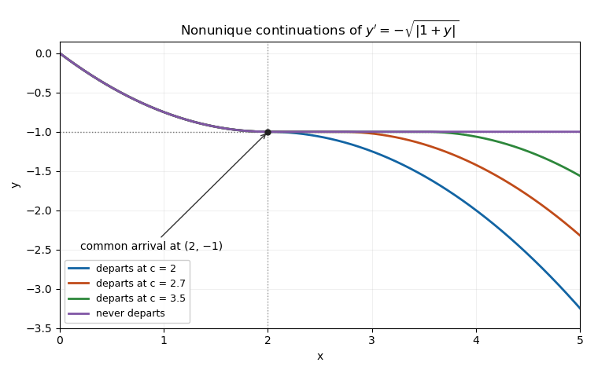

# Waiting-time continuation at a non-Lipschitz equilibrium

↑ **Parent:** [Picard-Lindelöf theorem](picard-lindelof-theorem.md)

For the [autonomous differential equation](autonomous-system-mathematics.md) $y'=-|y-y_*|^p$, the displayed family stays at $y_*$ until time $c$ and then decreases below it. Here $[z]_+=\max(z,0)$. Direct [differentiation](differentiation.md) verifies the equation on each side; since $1/(1-p)>1$, the derivative tends to zero at departure, making the joined function continuously differentiable. Distinct departure times give different solutions from the same equilibrium [initial condition](initial-condition.md). The ratio $|f(y_*+\varepsilon)-f(y_*)|/\varepsilon=\varepsilon^{p-1}$ is unbounded, so the local [Lipschitz continuity](lipschitz-continuity.md) hypothesis of the [Picard-Lindelöf theorem](picard-lindelof-theorem.md) fails.

A solution starting above $y_*$ reaches it in finite time. It can then use any of these continuations. For $p=1/2$, $y_*=-1$, and initial value $y(0)=0$, arrival occurs at time two; departure at $c\geq2$ gives $y=-1-(t-c)^2/4$ afterwards. [Waiting-time solutions of a sublinear Bernoulli equation](waiting-time-solutions-of-a-sublinear-bernoulli-equation.md) give a related mechanism for departures in the opposite direction.

**[Figure 14](#image-different-waiting-time-continuations-at-a-non-lipschitz-equilibrium-share-the-same-earlier-trajectory). Different waiting-time continuations at a non-Lipschitz equilibrium share the same earlier trajectory**.

## ↑ Ancestors (7)

1. [Picard-Lindelöf theorem](picard-lindelof-theorem.md)
2. [Ordinary differential equation](ordinary-differential-equation.md)
3. [Differential equation](differential-equation-split.md)
4. [Analysis](analysis-split.md)
5. [Area of mathematics](area-of-mathematics.md)
6. [Mathematics](mathematics-split.md)
7. [Codex Wiki](split.md)

## ← Incoming links (1)

- [Solution](past-exam-of-the-differential-equations-1-course-of-the-university-of-oxford/2017/2/b/ii/solution.md)
