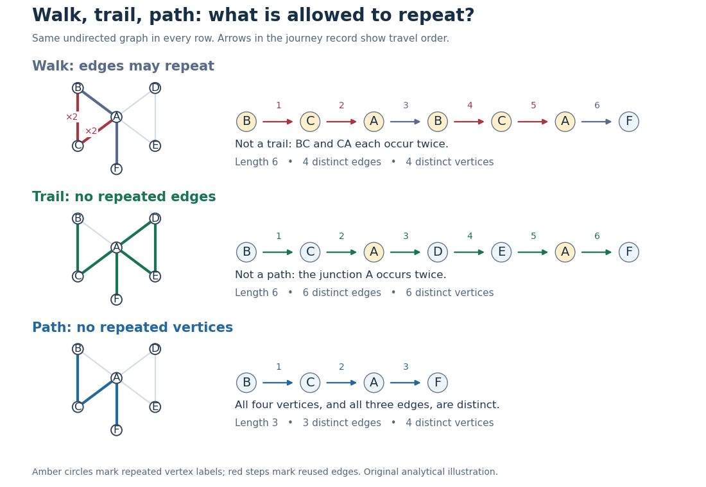

# Walk in a graph

↑ **Parent:** [Graph theory](graph-theory-split.md)

A [walk](walk-in-a-graph.md) records a journey through a [graph](graph-split.md) as a finite alternating [sequence](sequence.md)

$$
W=(v_0,e_1,v_1,\ldots,e_m,v_m),\qquad m\geq0,
$$

where each [edge](edge-of-a-graph.md) $e_i$ joins the consecutive [vertices](vertex-graph-theory.md) $v_{i-1}$ and $v_i$. Both [vertices](vertex-graph-theory.md) and [edges](edge-of-a-graph.md) may repeat. Its length is $m$, counting [edge](edge-of-a-graph.md) traversals with repetitions, rather than counting different [edges](edge-of-a-graph.md) or measuring the drawing. Here a [graph path](path-in-a-graph.md) means a [walk](walk-in-a-graph.md) with no repeated [vertices](vertex-graph-theory.md); a [trail](trail-in-a-graph.md) instead forbids repeated [edges](edge-of-a-graph.md). These conventions distinguish a journey's record from the [subgraph](subgraph.md) consisting of the connections it used.[Paul Johnson, MAS341, Lecture 3: walks and trails](https://ptwiddle.github.io/MAS341-Graph-Theory-2017/lecturenotes/lecture3.html)

Unless stated otherwise, the examples below use a finite [simple graph](simple-graph.md) that is an [undirected graph](undirected-graph.md), so an [edge](edge-of-a-graph.md) may be traversed in either direction. In a [multigraph](multigraph.md), retain each [edge](edge-of-a-graph.md)'s individual identity as well as its endpoint [vertices](vertex-graph-theory.md): two parallel [edges](edge-of-a-graph.md) are different choices for the same step. If [self-loops](loop-graph-theory.md) are allowed, traversing one leaves the current [vertex](vertex-graph-theory.md) unchanged but adds one to the length. In a [directed graph](directed-graph.md), each step must follow its [directed edge](directed-edge.md) from its initial to its terminal [vertex](vertex-graph-theory.md), giving a [directed walk](directed-walk.md); reversing a journey need not be possible.[Thomas Zaslavsky, Supplementary Notes for Graduate Graph Theory: edge identities and walks](https://people.math.binghamton.edu/zaslav/Oldcourses/581.S99/notes.html)

We allow the zero-length [walk](walk-in-a-graph.md) $(v)$ at every [vertex](vertex-graph-theory.md) $v$. It uses no [edges](edge-of-a-graph.md), so it is also a [trail](trail-in-a-graph.md) and a [graph path](path-in-a-graph.md), and its coinciding endpoints make it a [closed walk](closed-walk.md). This means staying put is a legitimate journey; a [graph](graph-split.md) with no [vertices](vertex-graph-theory.md) has no such [walk](walk-in-a-graph.md). Positive-length restrictions will be stated explicitly.[Lehman, Leighton and Meyer, Mathematics for Computer Science, §11.8.1: length-zero convention](mathematics-for-computer-science-by-eric-lehman-and-others.md)

Use the same constructed [graph](graph-split.md) throughout these three sections:

$$
V=\{A,B,C,D,E,F\},\qquad E=\{AB,BC,CA,AD,DE,EA,AF\}.
$$

Here $AB$ denotes the [unordered pair](unordered-pair.md) $\{A,B\}$, and $CA=AC$. Two [triangles in a graph](triangle-in-a-graph.md), $ABC$ and $ADE$, share $A$, with one extra [edge](edge-of-a-graph.md) $AF$. These are schematic connections, not measured roads; the highlighted connections in the diagram show which [edges](edge-of-a-graph.md) are used, while the numbered [sequence](sequence.md) records their order.

**[Figure 9](#image-one-constructed-graph-repeated-edges-in-a-walk-repeated-vertices-in-a-trail-and-a-graph-path). One constructed graph: repeated edges in a walk, repeated vertices in a trail, and a graph path**.

The length-six [walk](walk-in-a-graph.md) $B,C,A,B,C,A,F$ uses $BC$ and $CA$ twice, so it is not a [trail](trail-in-a-graph.md). The length-six [trail](trail-in-a-graph.md) $B,C,A,D,E,A,F$ returns to $A$ but uses six different [edges](edge-of-a-graph.md), so it is not a [graph path](path-in-a-graph.md). The length-three [graph path](path-in-a-graph.md) $B,C,A,F$ repeats neither [vertices](vertex-graph-theory.md) nor [edges](edge-of-a-graph.md). Thus

$$
\{\text{graph paths}\}\subsetneq\{\text{trails}\}\subsetneq\{\text{walks}\}
$$

for this particular [graph](graph-split.md). The restrictions answer different routing questions: revisiting a junction is harmless for many journeys, whereas reusing a serviced road segment can matter for an inspection route. Travel costs require a [weighted graph](weighted-graph.md); a [walk](walk-in-a-graph.md)'s cost adds the weight of each traversal, even when an [edge](edge-of-a-graph.md) is used again.

Every finite [walk](walk-in-a-graph.md) from $s$ to $t$ contains a [graph path](path-in-a-graph.md) from $s$ to $t$ after deleting detours. For a proof outline, if $v_i=v_j$ with $i<j$, delete the intervening [closed walk](closed-walk.md). The retained steps still meet at the same [vertex](vertex-graph-theory.md), and the length strictly decreases. Repeating terminates with no repeated [vertices](vertex-graph-theory.md), or with the zero-length [graph path](path-in-a-graph.md) when $s=t$. This explains why [reachability](reachability-in-a-graph.md) can be formulated using either [walks](walk-in-a-graph.md) or [graph paths](path-in-a-graph.md). With nonnegative [edge](edge-of-a-graph.md) weights, deletion also cannot increase cost, connecting the argument to the [shortest path problem](shortest-path-problem.md); with negative weights that cost conclusion fails.[Paul Johnson, MAS341, Lecture 3: deleting repeated-vertex detours](https://ptwiddle.github.io/MAS341-Graph-Theory-2017/lecturenotes/lecture3.html)

**Table of contents**

- [Trail in a graph](trail-in-a-graph.md)
- [Closed walk](closed-walk.md)

## ↑ Ancestors (5)

1. [Graph theory](graph-theory-split.md)
2. [Foundations of mathematics](foundations-of-mathematics-split.md)
3. [Area of mathematics](area-of-mathematics.md)
4. [Mathematics](mathematics-split.md)
5. [Codex Wiki](split.md)
