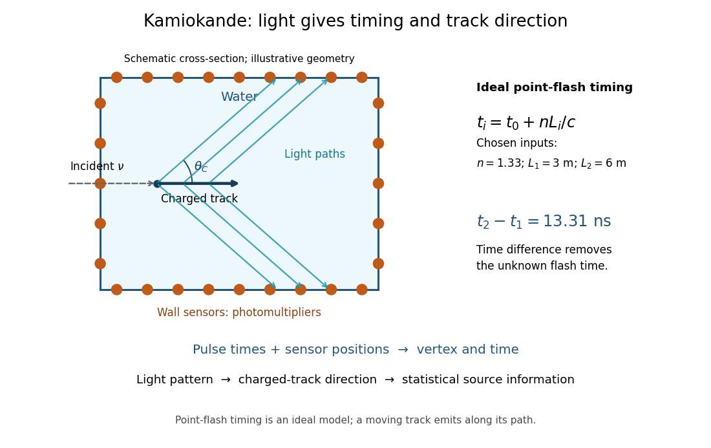

# Water Cherenkov neutrino reconstruction

↑ **Parent:** [Kamiokande](kamiokande.md)

[Water Cherenkov neutrino reconstruction](water-cherenkov-neutrino-reconstruction.md) infers a vertex, time and [charged particle](charged-particle.md) direction from [photomultiplier](photomultiplier.md) pulses. The 1987 analysis recorded charge and timing, calibrated with decaying [muons](muon.md) and source-produced [gamma rays](gamma-ray.md), and rejected outer-detector activity and events following [muons](muon.md).[pp. 1490–1491; Fig. 1 and event-selection criteria](observation-of-a-neutrino-burst-from-the-supernova-sn1987a-by-k-hirata-and-others.md)

**[Figure 1](#image-water-cherenkov-readout-light-paths-timing-and-direction). Water Cherenkov readout: light paths, timing and direction**. Functional schematic of [Kamiokande](kamiokande.md); dimensions and light paths are illustrative. The ideal timing calculation is an original point-flash example.

In an ideal point-flash approximation, a light source at $\mathbf r_0$ and time $t_0$ gives the displayed travel-time relation at sensor $\mathbf r_i$ in a medium of [refractive index](refractive-index.md) $n$. Subtracting two times eliminates $t_0$. With a chosen constant $n=1.33$ and path lengths $3\,\mathrm m$ and $6\,\mathrm m$, the arrival-time difference is $n(3\,\mathrm m)/c\simeq13.31\,\mathrm{ns}$. These are synthetic inputs, not detector measurements. Several sensors constrain the vertex; an extended moving track requires the light-emission position and time along that track as well.

For a [charged particle](charged-particle.md) moving at $v=\beta c$, the [Cherenkov cone angle](cherenkov-cone-angle.md) satisfies $\cos\theta_C=1/(n\beta)$ when $n\beta>1$. With $\beta\simeq1$ and the illustrative $n=1.33$, $\theta_C\simeq41.25^\circ$. The geometrical cone carries track-direction information; [electron](electron.md) deflections and the spread of emission positions broaden the observed pattern. The [neutrino](neutrino.md) itself does not draw the light cone.

A [Cherenkov radiation](cherenkov-radiation.md) threshold and an analysis threshold are different constraints. For a fixed $n$, an [electron](electron.md) must exceed $T_C=m_ec^2[(1-n^{-2})^{-1/2}-1]$. With $m_ec^2=0.511\,\mathrm{MeV}$ and the chosen $n=1.33$, this gives about $0.264\,\mathrm{MeV}$. Recording and selecting a useful event requires much more light: the 1987 detector's trigger accepted $8.5\,\mathrm{MeV}$ [electrons](electron.md) with 50% efficiency.[p. 1491: trigger acceptance](observation-of-a-neutrino-burst-from-the-supernova-sn1987a-by-k-hirata-and-others.md)

## ↑ Ancestors (7)

1. [Kamiokande](kamiokande.md)
2. [Neutrino astronomy](neutrino-astronomy.md)
3. [Stellar astrophysics](stellar-astrophysics-split.md)
4. [Astrophysics](astrophysics-split.md)
5. [Branches of physics](branches-of-physics.md)
6. [Physics](physics-split.md)
7. [Codex Wiki](split.md)

## ← Incoming links (3)

- [Homestake experiment](homestake-experiment.md)
- [Kajita-McDonald neutrino flavor-conversion experiments](kajita-mcdonald-neutrino-flavor-conversion-experiments.md)
- [Water Cherenkov neutrino reconstruction](water-cherenkov-neutrino-reconstruction.md)
