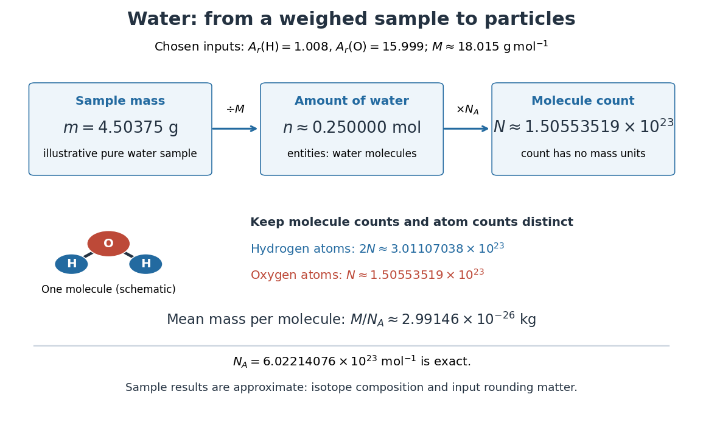

# Water mass to molecular count

↑ **Parent:** [Molar mass](molar-mass.md)

Choose approximate [atomic weights](relative-atomic-mass.md) $A_{\rm r}(\mathrm H)=1.008$ and $A_{\rm r}(\mathrm O)=15.999$, and use $M_{\rm u}\approx1\,\mathrm{g\,mol^{-1}}$. The [chemical formula](chemical-formula.md) $\mathrm{H_2O}$ then gives [water](water.md) [molar mass](molar-mass.md)

$$
M(\mathrm{H_2O})\approx\bigl(2(1.008)+15.999\bigr)\,\mathrm{g\,mol^{-1}}=18.015\,\mathrm{g\,mol^{-1}}.
$$

These are deliberately chosen rounded inputs, not exact [atomic weights](relative-atomic-mass.md) or a universal value for every [water](water.md) sample. Different [isotopic abundances](isotopic-abundance.md), notably those in [heavy water](heavy-water.md), change the mean [molar mass](molar-mass.md); [chemical formula](chemical-formula.md) alone does not specify them. Adding [atomic weights](relative-atomic-mass.md) also neglects the tiny [mass](mass.md) change associated with [chemical bond](chemical-bond-split.md) [energies](energy-split.md), immaterial at this rounding precision.

For an illustrative pure [water](water.md) sample of [mass](mass.md) $4.50375\,\mathrm g$, this convention gives

$$
n\approx\frac{4.50375\,\mathrm g}{18.015\,\mathrm{g\,mol^{-1}}}=0.250000\,\mathrm{mol},\qquad N\approx1.50553519\times10^{23}.
$$

The count refers to [water](water.md) [molecules](molecule-split.md). Their [hydrogen](hydrogen.md) [chemical atom](atom-physics.md) count is approximately $2N=3.01107038\times10^{23}$, and their [oxygen](oxygen.md) [chemical atom](atom-physics.md) count is approximately $N$. The mean [mass](mass.md) per [water](water.md) [molecule](molecule-split.md) is $M/N_{\mathrm A}\approx2.99146\times10^{-26}\,\mathrm{kg}$. Extra displayed digits expose the arithmetic; they do not imply that the sample composition or [mass](mass.md) was measured that precisely.

**[Figure 5](#molar-mass-water-particle-map). Mapping water mass through amount of substance to molecule and chemical atom counts using chosen approximate atomic weights**.

The same conversion makes [stoichiometry](stoichiometry.md) a [mass](mass.md) calculation. For the [chemical equation](chemical-equation.md) $2\mathrm{H_2}+\mathrm{O_2}\to2\mathrm{H_2O}$, complete conversion of $0.250000\,\mathrm{mol}$ of [molecular hydrogen](molecular-hydrogen.md) and $0.125000\,\mathrm{mol}$ of [molecular oxygen](molecular-oxygen.md) gives $0.250000\,\mathrm{mol}$ of [water](water.md). With the chosen approximate [atomic weights](relative-atomic-mass.md), the reactant [masses](mass.md) are $0.50400\,\mathrm g$ and $3.99975\,\mathrm g$, summing to $4.50375\,\mathrm g$. The $2:1:2$ ratio belongs to [molecule](molecule-split.md) counts and [amount of substance](amount-of-substance.md), not to [masses](mass.md); this bookkeeping neglects the much smaller reaction [energy](energy-split.md) contribution to [mass](mass.md).

## ↑ Ancestors (3)

1. [Molar mass](molar-mass.md)
2. [Chemistry](chemistry-split.md)
3. [Codex Wiki](split.md)

## ← Incoming links (1)

- [Molecule bookkeeping](molecule-bookkeeping.md)
