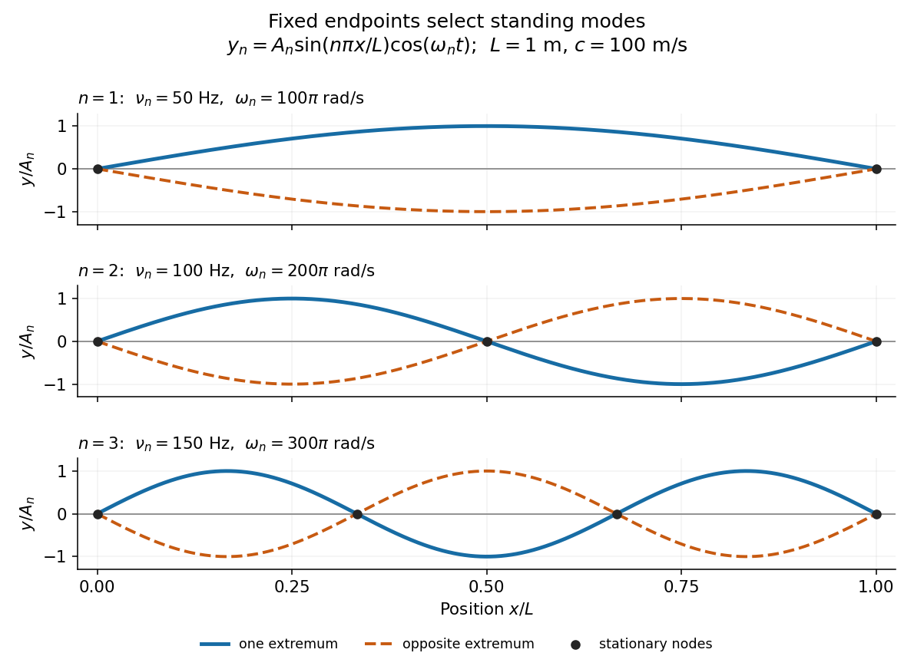
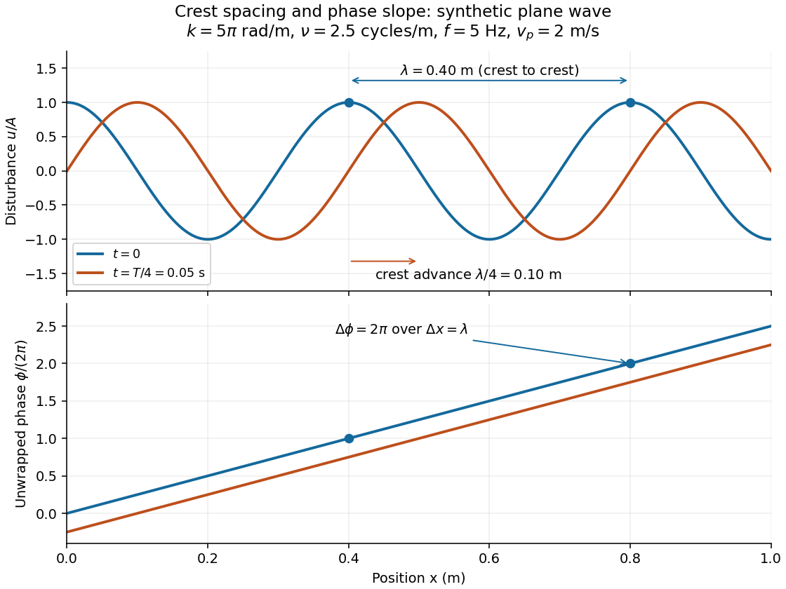

# Wave equation

↑ **Parent:** [Partial differential equation](partial-differential-equation.md)  
ⓦ [Wiki](https://en.wikipedia.org/wiki/Wave_equation)

The wave equation is a second-order [linear partial differential equation](partial-differential-equation.md#linear-partial-differential-equation) describing [waves](wave.md) with [finite propagation speed](#finite-propagation-speed). In one spatial dimension its homogeneous, constant-coefficient form is

$$
u_{tt}=c^2u_{xx},\qquad c>0.
$$

Here $x$ is position, $t$ is time, $u(x,t)$ is the disturbance, and subscripts denote [partial derivatives](multivariable-calculus.md#partial-derivative). For a [wave equation on a string](#wave-equation-on-a-string), $u$ is transverse displacement; in [linear acoustics](linear-acoustics.md), it can be a pressure perturbation. In several spatial dimensions, $u_{xx}$ becomes the [Laplacian](multivariable-calculus.md#laplacian) $\Delta u$. The same mathematical structure connects vibrating strings and [acoustic waves](fluid-mechanics.md#acoustic-wave), although their physical assumptions and [wave speeds](#wave-speed) differ. [MIT, Wave Propagation, Chapter 1](https://ocw.mit.edu/courses/2-062j-wave-propagation-spring-2017/2f9f71f7f386b36c9c42f48c03aecfe6_MIT2_062J_S17_Chap1.pdf)

For the whole-line [Cauchy problem](partial-differential-equation.md#cauchy-problem), prescribe both displacement $u(x,0)=f(x)$ and [velocity](classical-mechanics.md#velocity) $u_t(x,0)=g(x)$. A [classical solution](partial-differential-equation.md#classical-solution) has continuous [partial derivatives](multivariable-calculus.md#partial-derivative) through order two; $f\in C^2(\mathbb R)$ and $g\in C^1(\mathbb R)$ suffice for [D'Alembert's formula](#d-alembert-s-formula) to produce one. A finite string additionally needs [boundary conditions](differential-equation.md#boundary-condition). These statements concern the unforced model with constant $c$; [damping](#damping), spatially varying coefficients and nonlinear terms change the solution formula.

A [travelling wave](analysis.md#travelling-wave) $F(x-ct)$ carries its entire profile to the right at [wave speed](#wave-speed) $c$; $G(x+ct)$ travels left. Their sum is again a solution by the [superposition principle](vector-space.md#superposition-principle). A [standing wave](mathematical-physics.md#standing-wave) instead has a fixed [mode shape](#mode-shape) whose size and sign oscillate: in $\sin(kx)\cos(ckt)$, each [node of a standing wave](#node-physics) stays stationary. The distinction is especially clear in the pulse and string diagrams below. For this ideal model, the [dispersion relation](dispersion-relation.md) is $\omega^2=c^2k^2$: each propagation branch is [nondispersive](dispersion-relation.md#nondispersive-wave), so a localized profile translates without spreading. This makes the equation a useful reference against which to understand [wave dispersion](dispersion-relation.md#wave-dispersion) and [damping](#damping).

The appealing combination is local interaction with global predictability: neighbouring displacements determine [acceleration](classical-mechanics.md#acceleration) through $u_{xx}$, yet [D'Alembert's formula](#d-alembert-s-formula) explicitly identifies exactly which initial locations can influence a later observation. [Finite propagation speed](#finite-propagation-speed) turns that observation into a [domain of dependence](partial-differential-equation.md#domain-of-dependence), rather than requiring knowledge of the entire initial string.

**Table of contents**

- [Elastic energy of a small-slope string](#elastic-energy-of-a-small-slope-string)
- [Vibrating membrane](#vibrating-membrane)
  - [Rectangular membrane normal mode](#rectangular-membrane-normal-mode)
    - [Energy in a rectangular membrane mode](#energy-in-a-rectangular-membrane-mode)
- [Midpoint-plucked fixed-end string](#midpoint-plucked-fixed-end-string)
- [Radial vibrations of a circular membrane](#radial-vibrations-of-a-circular-membrane)
  - [Power-law variational bound for a circular membrane](#power-law-variational-bound-for-a-circular-membrane)
- [Damped wave equation](#damped-wave-equation)
  - [Fourier-mode Green function of the telegraph equation](#fourier-mode-green-function-of-the-telegraph-equation)
    - [Diffusion limit of the damped heat-transmission equation](#diffusion-limit-of-the-damped-heat-transmission-equation)
- [Exponentially conjugated wave equation](#exponentially-conjugated-wave-equation)
- [Causal Fourier resolvent of a point-driven fixed string](#causal-fourier-resolvent-of-a-point-driven-fixed-string)
- [Membrane waveguide](#membrane-waveguide)
  - [Membrane-guide phase and energy speeds](#membrane-guide-phase-and-energy-speeds)
  - [Bending stiffness in a membrane waveguide](#bending-stiffness-in-a-membrane-waveguide)
  - [Cutoff frequency of a membrane waveguide](#cutoff-frequency-of-a-membrane-waveguide)
    - [Nonpropagating mode at waveguide cutoff](#nonpropagating-mode-at-waveguide-cutoff)
- [Neumann cosine modes of a one-dimensional wave equation](#neumann-cosine-modes-of-a-one-dimensional-wave-equation)
- [Regular time-harmonic spherical wave](#regular-time-harmonic-spherical-wave)
- [Retarded acoustic Green function](#retarded-acoustic-green-function)
- [All-time boundedness of a wave equation with a reaction term](#all-time-boundedness-of-a-wave-equation-with-a-reaction-term)
- [Vector field method for wave equations](#vector-field-method-for-wave-equations)
  - [Commuted wave energy](#commuted-wave-energy)
  - [Klainerman-Sobolev inequality](#klainerman-sobolev-inequality)
  - [Commutation vector field for the wave equation](#commutation-vector-field-for-the-wave-equation)
    - [Scaling vector field](#scaling-vector-field)
    - [Lorentz boost vector field](#lorentz-boost-vector-field)
    - [Spatial rotation vector field](#spatial-rotation-vector-field)
    - [Spacetime translation vector field](#spacetime-translation-vector-field)
- [Wave energy](#wave-energy)
- [Reflected-step solution of the wave equation](#reflected-step-solution-of-the-wave-equation)
- [Wave speed](#wave-speed)
  - [Acoustic time-of-flight speed measurement](#acoustic-time-of-flight-speed-measurement)
    - [Timing calibration for acoustic speed measurements](#timing-calibration-for-acoustic-speed-measurements)
    - [Microphone](#microphone)
    - [Sampling rate](#sampling-rate)
  - [Slowness](#slowness)
- [Kirchhoff formula](#kirchhoff-formula)
  - [Method of descent for the wave equation](#method-of-descent-for-the-wave-equation)
  - [Strong Huygens principle](#strong-huygens-principle)
- [Finite propagation speed](#finite-propagation-speed)
  - [Causal cone for the constant-speed wave equation](#causal-cone-for-the-constant-speed-wave-equation)
  - [Support widening for the wave equation](#support-widening-for-the-wave-equation)
  - [Weak Huygens principle](#weak-huygens-principle)
  - [Shrinking cone energy argument](#shrinking-cone-energy-argument)
  - [Characteristic diamond for speed one minus y squared](#characteristic-diamond-for-speed-one-minus-y-squared)
- [Radiation field](#radiation-field)
  - [Scattering map](#scattering-map)
- [One-dimensional wave equation](#one-dimensional-wave-equation)
  - [One-dimensional retarded wave Green function](#one-dimensional-retarded-wave-green-function)
  - [Characteristic line for the one-dimensional wave equation](#characteristic-line-for-the-one-dimensional-wave-equation)
  - [Countertravelling decomposition of the one-dimensional wave equation](#countertravelling-decomposition-of-the-one-dimensional-wave-equation)
- [d'Alembert operator](#d-alembert-operator)
- [Semilinear wave equation](#semilinear-wave-equation)
  - [Wave map](#wave-map)
    - [Small data global regularity for wave maps](#small-data-global-regularity-for-wave-maps)
    - [Global regularity for one-dimensional wave maps](#global-regularity-for-one-dimensional-wave-maps)
    - [Stationary wave map](#stationary-wave-map)
    - [Wave map energy](#wave-map-energy)
      - [Wave map energy and criticality](#wave-map-energy-and-criticality)
    - [Wave map Cauchy data](#wave-map-cauchy-data)
  - [Null form for wave equations](#null-form-for-wave-equations)
    - [Classical null condition for wave equations](#classical-null-condition-for-wave-equations)
  - [Focusing semilinear wave equation](#focusing-semilinear-wave-equation)
    - [Localized ordinary differential equation blowup for a wave equation](#localized-ordinary-differential-equation-blowup-for-a-wave-equation)
  - [Smooth continuation criterion for semilinear wave equations](#smooth-continuation-criterion-for-semilinear-wave-equations)
  - [Almost global existence for wave equations](#almost-global-existence-for-wave-equations)
  - [Defocusing semilinear wave equation](#defocusing-semilinear-wave-equation)
    - [H2 bound for the defocusing cubic wave equation](#h2-bound-for-the-defocusing-cubic-wave-equation)
    - [Morawetz identity for the defocusing wave equation](#morawetz-identity-for-the-defocusing-wave-equation)
      - [Distributional bilaplacian of the radial coordinate in three dimensions](#distributional-bilaplacian-of-the-radial-coordinate-in-three-dimensions)
      - [Morawetz estimate for the defocusing wave equation](#morawetz-estimate-for-the-defocusing-wave-equation)
    - [Radial reduction of the three-dimensional wave equation](#radial-reduction-of-the-three-dimensional-wave-equation)
      - [Outgoing shell source estimate for a radial wave](#outgoing-shell-source-estimate-for-a-radial-wave)
      - [Outgoing-energy identity for a radial defocusing wave](#outgoing-energy-identity-for-a-radial-defocusing-wave)
  - [Local weak solution by contraction for a semilinear wave equation](#local-weak-solution-by-contraction-for-a-semilinear-wave-equation)
- [Elastic wave](#elastic-wave)
  - [Seismic mode conversion](#seismic-mode-conversion)
  - [Seismic head wave](#seismic-head-wave)
    - [Seismic critical angle](#seismic-critical-angle)
    - [First-arrival crossover distance](#first-arrival-crossover-distance)
  - [Torsional waves in a solid circular rod](#torsional-waves-in-a-solid-circular-rod)
    - [Energy flux of a torsional wave](#energy-flux-of-a-torsional-wave)
    - [Torsional wave equation in a circular shaft](#torsional-wave-equation-in-a-circular-shaft)
  - [Characteristic crossing in a boundary-generated elastic simple wave](#characteristic-crossing-in-a-boundary-generated-elastic-simple-wave)
  - [Elastic slowness surface](#elastic-slowness-surface)
    - [Vertical slowness sextic of an anisotropic solid](#vertical-slowness-sextic-of-an-anisotropic-solid)
    - [Elastic wave surface](#elastic-wave-surface)
      - [Slowness curvature and wave-surface cusps](#slowness-curvature-and-wave-surface-cusps)
    - [Elastic energy velocity](#elastic-energy-velocity)
      - [Elastic mode classification by vertical energy flux](#elastic-mode-classification-by-vertical-energy-flux)
        - [Free-surface anisotropic reflection amplitudes](#free-surface-anisotropic-reflection-amplitudes)
  - [Elastodynamic Green tensor](#elastodynamic-green-tensor)
    - [Far-field P and S radiation from a point force](#far-field-p-and-s-radiation-from-a-point-force)
    - [Elastodynamic surface-jump representation](#elastodynamic-surface-jump-representation)
    - [Point-moment elastodynamic displacement](#point-moment-elastodynamic-displacement)
  - [Seismic moment tensor](#seismic-moment-tensor)
    - [Seismic moment](#seismic-moment)
    - [Double-couple seismic source](#double-couple-seismic-source)
    - [Normal-mode response to a step seismic moment](#normal-mode-response-to-a-step-seismic-moment)
    - [Stress glut tensor](#stress-glut-tensor)
    - [Isotropic explosion source](#isotropic-explosion-source)
    - [Focal mechanism](#focal-mechanism)
      - [Earthquake pressure and tension axes](#earthquake-pressure-and-tension-axes)
      - [Fault-plane ambiguity](#fault-plane-ambiguity)
      - [Focal sphere](#focal-sphere)
      - [P-wave first-motion polarity](#p-wave-first-motion-polarity)
    - [Explosion radiation in an isotropic elastic solid](#explosion-radiation-in-an-isotropic-elastic-solid)
    - [Double-couple fault source](#double-couple-fault-source)
      - [Double-couple radiation pattern](#double-couple-radiation-pattern)
        - [Nodal plane of a double couple](#nodal-plane-of-a-double-couple)
    - [Tensile-crack seismic source](#tensile-crack-seismic-source)
      - [Tensile-crack radiation pattern](#tensile-crack-radiation-pattern)
  - [Energy uniqueness for traction-driven elasticity](#energy-uniqueness-for-traction-driven-elasticity)
    - [Elastic energy uniqueness with restoring boundary springs](#elastic-energy-uniqueness-with-restoring-boundary-springs)
  - [Seismic impedance](#seismic-impedance)
    - [Seismic layer transfer matrix](#seismic-layer-transfer-matrix)
      - [Periodic seismic multilayer stop band](#periodic-seismic-multilayer-stop-band)
    - [Flux-normalized elastic characteristic amplitudes](#flux-normalized-elastic-characteristic-amplitudes)
      - [Zero-frequency scattering through an elastic layer](#zero-frequency-scattering-through-an-elastic-layer)
  - [Love wave](#love-wave)
    - [Anisotropic Love-wave dispersion](#anisotropic-love-wave-dispersion)
    - [Rigid-base approximation to Love waves](#rigid-base-approximation-to-love-waves)
      - [Group-velocity minimum of a high-contrast Love wave](#group-velocity-minimum-of-a-high-contrast-love-wave)
    - [Love-wave cutoff frequencies](#love-wave-cutoff-frequencies)
    - [Love-wave interface reflection phase](#love-wave-interface-reflection-phase)
    - [Strict cutoff of the second Love-wave mode](#strict-cutoff-of-the-second-love-wave-mode)
  - [Rayleigh wave](#rayleigh-wave)
  - [Rigid elastic waveguide mode](#rigid-elastic-waveguide-mode)
    - [Ray asymptotics of a clamped elastic waveguide mode](#ray-asymptotics-of-a-clamped-elastic-waveguide-mode)
  - [Helmholtz separation of elastic waves](#helmholtz-separation-of-elastic-waves)
    - [P-SV displacement potentials](#p-sv-displacement-potentials)
  - [P wave](#p-wave)
    - [P-wavefront discontinuity transport](#p-wavefront-discontinuity-transport)
      - [Transmitted jump at a collimating solid-fluid interface](#transmitted-jump-at-a-collimating-solid-fluid-interface)
      - [Ray-tube conservation for a P-wave jump](#ray-tube-conservation-for-a-p-wave-jump)
    - [Reflection of a P-wave from a rigid plane](#reflection-of-a-p-wave-from-a-rigid-plane)
    - [Longitudinal polarization](#longitudinal-polarization)
  - [S wave](#s-wave)
    - [SH and SV polarizations](#sh-and-sv-polarizations)
    - [Transverse polarization](#transverse-polarization)
    - [SV-wave](#sv-wave)
    - [SH-wave](#sh-wave)
      - [SH-wave travel times in a crustal waveguide](#sh-wave-travel-times-in-a-crustal-waveguide)
        - [Leaking and trapped SH-wave reverberations](#leaking-and-trapped-sh-wave-reverberations)
      - [SH ray-tube amplitude transport](#sh-ray-tube-amplitude-transport)
        - [Refraction of a cylindrical SH wavefront](#refraction-of-a-cylindrical-sh-wavefront)
      - [SH line-source near-field singularity](#sh-line-source-near-field-singularity)
      - [Guided SH modes between rigid and free planes](#guided-sh-modes-between-rigid-and-free-planes)
  - [Elastic-interface boundary conditions](#elastic-interface-boundary-conditions)
    - [P-SV mode conversion at a solid interface](#p-sv-mode-conversion-at-a-solid-interface)
    - [Snell law for elastic waves](#snell-law-for-elastic-waves)
  - [Acoustic reflection and transmission at an interface](#acoustic-reflection-and-transmission-at-an-interface)
    - [Normal-incidence acoustic velocity reflection coefficient](#normal-incidence-acoustic-velocity-reflection-coefficient)
    - [Lossless acoustic membrane scattering](#lossless-acoustic-membrane-scattering)
    - [Equal displacement-amplitude condition at an acoustic interface](#equal-displacement-amplitude-condition-at-an-acoustic-interface)
- [Damping](#damping)
  - [Antidamping](#antidamping)
  - [Critical damping](#critical-damping)
    - [Critical-damping overshoot from initial velocity](#critical-damping-overshoot-from-initial-velocity)
  - [Viscous damping](#viscous-damping)
    - [Damping ratio](#damping-ratio)
      - [Resonance versus oscillatory damping thresholds](#resonance-versus-oscillatory-damping-thresholds)
    - [Oscillator energy dissipation](#oscillator-energy-dissipation)
  - [Underdamping](#underdamping)
    - [Turning points of an underdamped release from rest](#turning-points-of-an-underdamped-release-from-rest)
  - [Overdamping](#overdamping)
  - [Damping measurement from free decay](#damping-measurement-from-free-decay)
    - [Air track](#air-track)
    - [Ultrasonic motion sensor](#ultrasonic-motion-sensor)
    - [Logarithmic decrement](#logarithmic-decrement)
      - [Energy ratio between equal-phase damped crossings](#energy-ratio-between-equal-phase-damped-crossings)
  - [Eddy-current damping](#eddy-current-damping)
- [Wave equation on a string](#wave-equation-on-a-string)
  - [Two-sided string data with zero slope](#two-sided-string-data-with-zero-slope)
    - [Displacement cancellation without slope cancellation in crossing pulses](#displacement-cancellation-without-slope-cancellation-in-crossing-pulses)
  - [Free-end reflection of a transverse string wave](#free-end-reflection-of-a-transverse-string-wave)
  - [Energy flux of a transverse string wave](#energy-flux-of-a-transverse-string-wave)
  - [Driven-string endpoint power](#driven-string-endpoint-power)
  - [String with an endpoint mass](#string-with-an-endpoint-mass)
  - [Characteristic impedance of a stretched string](#characteristic-impedance-of-a-stretched-string)
    - [Amplitude scaling along a slowly tapered string](#amplitude-scaling-along-a-slowly-tapered-string)
    - [Viscous termination of a stretched string](#viscous-termination-of-a-stretched-string)
    - [Reflection at a density step on a string](#reflection-at-a-density-step-on-a-string)
    - [String density ratio for prescribed reflected power](#string-density-ratio-for-prescribed-reflected-power)
  - [Impulsively struck fixed-end string](#impulsively-struck-fixed-end-string)
  - [Modal energy of a localized velocity impulse on a string](#modal-energy-of-a-localized-velocity-impulse-on-a-string)
  - [Periodic reflection for a fixed-end string](#periodic-reflection-for-a-fixed-end-string)
  - [Linearly damped string](#linearly-damped-string)
    - [Velocity-impulse Green function for a damped string](#velocity-impulse-green-function-for-a-damped-string)
    - [Separated solution of the damped string equation](#separated-solution-of-the-damped-string-equation)
    - [Energy dissipation identity for a linearly damped string](#energy-dissipation-identity-for-a-linearly-damped-string)
- [Normal mode](#normal-mode)
  - [Mixed-axis trajectory of a prestressed spring pair](#mixed-axis-trajectory-of-a-prestressed-spring-pair)
  - [Normal modes of a rigid beam on two end springs](#normal-modes-of-a-rigid-beam-on-two-end-springs)
  - [Overtone](#overtone)
    - [First overtone](#first-overtone)
  - [Fundamental mode](#fundamental-mode)
  - [Free three-mass spring chain](#free-three-mass-spring-chain)
  - [Circular modes of a charged isotropic oscillator](#circular-modes-of-a-charged-isotropic-oscillator)
  - [Three-ion axial normal modes](#three-ion-axial-normal-modes)
    - [Breathing excitation after a trap-frequency quench](#breathing-excitation-after-a-trap-frequency-quench)
  - [Mass-weighted elastic normal modes](#mass-weighted-elastic-normal-modes)
    - [Normal-mode impulse projection](#normal-mode-impulse-projection)
  - [Normal modes of inductively coupled LC circuits](#normal-modes-of-inductively-coupled-lc-circuits)
    - [Positive inductance matrix for two identical coils](#positive-inductance-matrix-for-two-identical-coils)
  - [Force constant matrix](#force-constant-matrix)
  - [Dynamical matrix](#dynamical-matrix)
  - [Mass-weighted coordinate](#mass-weighted-coordinate)
  - [Breathing mode](#breathing-mode)
  - [Normal modes of a symmetric three-mass string](#normal-modes-of-a-symmetric-three-mass-string)
  - [Stationary middle mass in a three-mass spring chain](#stationary-middle-mass-in-a-three-mass-spring-chain)
  - [Initial-data decomposition into two normal modes](#initial-data-decomposition-into-two-normal-modes)
  - [Normal modes of a uniformly loaded finite string](#normal-modes-of-a-uniformly-loaded-finite-string)
  - [Degeneracy of normal modes](#degeneracy-of-normal-modes)
  - [Even and odd pendulum-ring modes](#even-and-odd-pendulum-ring-modes)
  - [Normal modes of three freely ended coupled pendulums](#normal-modes-of-three-freely-ended-coupled-pendulums)
  - [Transverse degeneracy of unstretched spring-coupled pendulums](#transverse-degeneracy-of-unstretched-spring-coupled-pendulums)
  - [Axial normal modes of an octahedral spring framework](#axial-normal-modes-of-an-octahedral-spring-framework)
  - [Two-mass three-spring normal modes](#two-mass-three-spring-normal-modes)
  - [Mode shape](#mode-shape)
  - [Countability of elastic eigenfrequencies](#countability-of-elastic-eigenfrequencies)
  - [Eigenfrequency](#eigenfrequency)
  - [Modal energy distribution](#modal-energy-distribution)
  - [Normal-mode energy exchange](#normal-mode-energy-exchange)
  - [Node (physics)](#node-physics)
    - [Wavefunction node](#wavefunction-node)
  - [Antinode](#antinode)
- [Fourier transform method for the wave equation](#fourier-transform-method-for-the-wave-equation)
  - [Low-frequency decomposition of the wave propagator](#low-frequency-decomposition-of-the-wave-propagator)
  - [Entire wave cosine multiplier](#entire-wave-cosine-multiplier)
- [D'Alembert's formula](#d-alembert-s-formula)
  - [Triangular pulse splitting under the wave equation](#triangular-pulse-splitting-under-the-wave-equation)
  - [Gaussian pulse splitting from zero initial velocity](#gaussian-pulse-splitting-from-zero-initial-velocity)
  - [Rectangular pulse splitting under the wave equation](#rectangular-pulse-splitting-under-the-wave-equation)
  - [D'Alembert formula with initial velocity](#d-alembert-formula-with-initial-velocity)
    - [Central zero region for odd compactly supported initial velocity](#central-zero-region-for-odd-compactly-supported-initial-velocity)
- [Wavenumber](#wavenumber)
  - [Complex wavenumber](#complex-wavenumber)
  - [Spectroscopic wavenumber](#spectroscopic-wavenumber)
  - [Spatial sampling of a wave](#spatial-sampling-of-a-wave)
  - [Wavelength](#wavelength)
    - [Acoustic wavelength measurement](#acoustic-wavelength-measurement)
      - [Oscilloscope](#oscilloscope)
        - [Oscilloscope probe](#oscilloscope-probe)
        - [Cathode-ray oscilloscope](#cathode-ray-oscilloscope)
      - [Propagation of uncertainty](#propagation-of-uncertainty)
        - [Background-subtracted radiative temperature uncertainty](#background-subtracted-radiative-temperature-uncertainty)
        - [Ratio-minus-one uncertainty](#ratio-minus-one-uncertainty)
        - [Magnitude uncertainty of a series RL impedance](#magnitude-uncertainty-of-a-series-rl-impedance)
        - [Refractive-index uncertainty from Snell's law](#refractive-index-uncertainty-from-snell-s-law)
        - [Moment-of-inertia uncertainty for an annulus](#moment-of-inertia-uncertainty-for-an-annulus)
        - [Uncertainty in a cosine of a measured angle](#uncertainty-in-a-cosine-of-a-measured-angle)
        - [Monomial uncertainty propagation](#monomial-uncertainty-propagation)
          - [Mass ratio from spring oscillation frequencies](#mass-ratio-from-spring-oscillation-frequencies)
        - [Repeated-timing uncertainty in a pendulum gravity measurement](#repeated-timing-uncertainty-in-a-pendulum-gravity-measurement)
    - [Local wavelength](#local-wavelength)
- [Dispersion relation](dispersion-relation.md)
  - [Dispersive wave](dispersion-relation.md#dispersive-wave)
  - [Weak-stiffness string frequency shift](dispersion-relation.md#weak-stiffness-string-frequency-shift)
  - [Spatial root of a dispersion relation](dispersion-relation.md#spatial-root-of-a-dispersion-relation)
  - [Spatiotemporal wave-packet stability](dispersion-relation.md#spatiotemporal-wave-packet-stability)
    - [Modulational instability](dispersion-relation.md#modulational-instability)
      - [Fibre modulational instability](dispersion-relation.md#fibre-modulational-instability)
        - [Sideband coupling](dispersion-relation.md#sideband-coupling)
      - [Benjamin-Feir instability](dispersion-relation.md#benjamin-feir-instability)
      - [Focusing nonlinear Schrodinger modulation dispersion](dispersion-relation.md#focusing-nonlinear-schrodinger-modulation-dispersion)
    - [Briggs-Bers criterion](dispersion-relation.md#briggs-bers-criterion)
      - [Bounded temporal growth condition for cubic dispersion](dispersion-relation.md#bounded-temporal-growth-condition-for-cubic-dispersion)
      - [Quartic impulse-response Laplace resolvent](dispersion-relation.md#quartic-impulse-response-laplace-resolvent)
        - [Physical-sheet growth rate of a quartic impulse response](dispersion-relation.md#physical-sheet-growth-rate-of-a-quartic-impulse-response)
      - [Spatial pinch point](dispersion-relation.md#spatial-pinch-point)
        - [False complex saddle in dissipative cubic dispersion](dispersion-relation.md#false-complex-saddle-in-dissipative-cubic-dispersion)
        - [False spatial saddle in quartic dispersion](dispersion-relation.md#false-spatial-saddle-in-quartic-dispersion)
    - [Convective wave-packet instability](dispersion-relation.md#convective-wave-packet-instability)
    - [Absolute wave-packet instability](dispersion-relation.md#absolute-wave-packet-instability)
    - [Finite maximum temporal growth rate](dispersion-relation.md#finite-maximum-temporal-growth-rate)
  - [Wave dispersion](dispersion-relation.md#wave-dispersion)
    - [Intermodal dispersion](dispersion-relation.md#intermodal-dispersion)
    - [Nondispersive wave](dispersion-relation.md#nondispersive-wave)
  - [Dispersion diagram](dispersion-relation.md#dispersion-diagram)
  - [Ray tracing](dispersion-relation.md#ray-tracing)
    - [Travel time](dispersion-relation.md#travel-time)
    - [Elastic ray](dispersion-relation.md#elastic-ray)
      - [Spherical elastic ray invariant](dispersion-relation.md#spherical-elastic-ray-invariant)
        - [Herglotz–Wiechert inversion](dispersion-relation.md#herglotz-wiechert-inversion)
          - [Hidden turning-ray zone from nonmonotone spherical slowness](dispersion-relation.md#hidden-turning-ray-zone-from-nonmonotone-spherical-slowness)
        - [Core-reflected travel time](dispersion-relation.md#core-reflected-travel-time)
      - [Hyperbolic interface collimation of P-waves](dispersion-relation.md#hyperbolic-interface-collimation-of-p-waves)
    - [Hamiltonian ray equations for a local dispersion relation](dispersion-relation.md#hamiltonian-ray-equations-for-a-local-dispersion-relation)
      - [Simple turning point of a variable-speed wave](dispersion-relation.md#simple-turning-point-of-a-variable-speed-wave)
        - [Airy scaling at a variable-speed wave turning point](dispersion-relation.md#airy-scaling-at-a-variable-speed-wave-turning-point)
          - [Decaying Airy continuation and ray reflection](dispersion-relation.md#decaying-airy-continuation-and-ray-reflection)
          - [Turning-point enhancement of wave amplitude](dispersion-relation.md#turning-point-enhancement-of-wave-amplitude)
    - [Stationary square-root-dispersion wake](dispersion-relation.md#stationary-square-root-dispersion-wake)
  - [Growth rate](dispersion-relation.md#growth-rate)
  - [Phase velocity and group velocity](dispersion-relation.md#phase-velocity-and-group-velocity)
    - [Klein-Gordon packet velocities](dispersion-relation.md#klein-gordon-packet-velocities)
    - [Phase-group orthogonality for degree-zero dispersion](dispersion-relation.md#phase-group-orthogonality-for-degree-zero-dispersion)
    - [Phase velocity](dispersion-relation.md#phase-velocity)
      - [Horizontal phase velocity](dispersion-relation.md#horizontal-phase-velocity)
      - [Phase speed](dispersion-relation.md#phase-speed)
    - [Group velocity](dispersion-relation.md#group-velocity)
      - [Group velocity from a period-dependent phase velocity](dispersion-relation.md#group-velocity-from-a-period-dependent-phase-velocity)
      - [Group-velocity mismatch](dispersion-relation.md#group-velocity-mismatch)
      - [Group velocity in material and vacuum wavelength coordinates](dispersion-relation.md#group-velocity-in-material-and-vacuum-wavelength-coordinates)
      - [Group velocity dispersion](dispersion-relation.md#group-velocity-dispersion)
        - [Dispersion-limited digital-fibre link length](dispersion-relation.md#dispersion-limited-digital-fibre-link-length)
          - [Digital optical pulse regeneration](dispersion-relation.md#digital-optical-pulse-regeneration)
        - [Dispersion length](dispersion-relation.md#dispersion-length)
    - [Front velocity](dispersion-relation.md#front-velocity)
    - [Information velocity](dispersion-relation.md#information-velocity)
    - [Crest and trough](dispersion-relation.md#crest-and-trough)
      - [Wave crest](dispersion-relation.md#wave-crest)
      - [Wave trough](dispersion-relation.md#wave-trough)
    - [Wave packet](dispersion-relation.md#wave-packet)
      - [Crest crossings through a dispersive wave packet](dispersion-relation.md#crest-crossings-through-a-dispersive-wave-packet)
      - [Envelope (waves)](dispersion-relation.md#envelope-waves)
      - [Carrier wave](dispersion-relation.md#carrier-wave)
      - [Gaussian envelope in a Klein-Gordon medium](dispersion-relation.md#gaussian-envelope-in-a-klein-gordon-medium)
    - [Ninth-order dispersive advection equation](dispersion-relation.md#ninth-order-dispersive-advection-equation)
- [Klein-Gordon equation](#klein-gordon-equation)
  - [Two coupled real Klein-Gordon fields](#two-coupled-real-klein-gordon-fields)
    - [Field-amplitude beating of coupled Klein-Gordon modes](#field-amplitude-beating-of-coupled-klein-gordon-modes)
  - [Klein paradox](#klein-paradox)
    - [Klein-Gordon step amplification](#klein-gordon-step-amplification)
    - [Outgoing analytic branch of Klein-Gordon step momentum](#outgoing-analytic-branch-of-klein-gordon-step-momentum)
  - [Nonlinear Klein-Gordon equation](#nonlinear-klein-gordon-equation)
    - [Power-law nonlinear Klein-Gordon pulse](#power-law-nonlinear-klein-gordon-pulse)
  - [Homogeneous massive-scalar equation in an expanding universe](#homogeneous-massive-scalar-equation-in-an-expanding-universe)
  - [Real bounded Fourier modes of the Klein-Gordon equation](#real-bounded-fourier-modes-of-the-klein-gordon-equation)
  - [Exponential initial-velocity tail for the Klein-Gordon equation](#exponential-initial-velocity-tail-for-the-klein-gordon-equation)
  - [Stationary-phase asymptotic of a Klein-Gordon wave along a subluminal ray](#stationary-phase-asymptotic-of-a-klein-gordon-wave-along-a-subluminal-ray)
    - [Upward zero crossings of an oscillatory stationary-phase tail](#upward-zero-crossings-of-an-oscillatory-stationary-phase-tail)

## Elastic energy of a small-slope string

↑ **Parent:** [Wave equation](wave-equation.md)

A string element has extra length $[\sqrt{1+y_x^2}-1]dx\simeq y_x^2dx/2$. At fixed tension T, work done supplies elastic energy density $Ty_x^2/2$. Transverse velocity supplies kinetic-energy density $\rho y_t^2/2$. For a single travelling profile $y=f(x\pm ct)$ with $c^2=T/\rho$, the two densities agree pointwise. Their sum obeys a local energy balance with flux $-Ty_xy_t$. Standing waves generally exchange kinetic and elastic energy instead of maintaining equality at every instant.

## Vibrating membrane

↑ **Parent:** [Wave equation](wave-equation.md)

A physical sheet under uniform isotropic tension per unit length T and with [mass](classical-mechanics.md#mass) per unit area $\rho$ has small transverse displacement satisfying $\partial_t^2\psi=c^2\nabla^2\psi$, where $c^2=T/\rho$. Fixed edges impose zero displacement. This mechanical membrane model neglects bending stiffness, large slopes and [dissipation](thermodynamics.md#dissipation).

### Rectangular membrane normal mode

↑ **Parent:** [Vibrating membrane](#vibrating-membrane)

For a rectangle of sides a and b with fixed edges, [separation of variables](partial-differential-equation.md#separation-of-variables) gives $\psi=A\sin(p\pi x/a)\sin(q\pi y/b)\cos(\omega t+\phi)$ with positive integers p and q. Its [angular frequency](lagrangian-mechanics.md#angular-frequency) is $\omega=c\pi\sqrt{p^2/a^2+q^2/b^2}$. Zero integers produce the trivial displacement, not a lower [mode](probability-and-statistics.md#mode-statistics). The p−1 and q−1 interior nodal lines divide alternating-sign lobes.

#### Energy in a rectangular membrane mode

↑ **Parent:** [Rectangular membrane normal mode](#rectangular-membrane-normal-mode)

For a rectangular membrane [mode](probability-and-statistics.md#mode-statistics) with peak [antinode](#antinode) displacement A, the integrals of each squared sine factor are half the corresponding side length. Integrating local [kinetic energy](energy.md#kinetic-energy) [density](fluid-mechanics.md#density) $\rho(\partial_t\psi)^2/2$ gives $K=\rho ab\omega^2A^2\sin^2(\omega t+\phi)/8$. The total [energy](energy.md) is $\rho ab\omega^2A^2/8$, and [potential energy](energy.md#potential-energy) has the complementary cosine-squared factor. Its time-averaged [kinetic energy](energy.md#kinetic-energy) is $\rho ab\omega^2A^2/16$. At equal peak displacement, [frequency](wave.md#frequency) and [density](fluid-mechanics.md#density), such mean energies are proportional to area.

## Midpoint-plucked fixed-end string

↑ **Parent:** [Wave equation](wave-equation.md)

A string of length $L$ with fixed endpoints, initially displaced into a triangular tent of height $k$ at its midpoint and released from rest, has a [Fourier sine series](fourier-series.md#fourier-sine-series) with the coefficients in the title. Integrating the two linear halves gives $a_n$, and symmetry cancels the even modes. Each coefficient evolves as $a_n\cos(\omega_nt)$ under the [wave equation](wave-equation.md). The displacement vanishes everywhere at $t=L/(2c)$, reverses sign at $t=L/c$, and returns after $2L/c$. A straight configuration at an intermediate instant does not mean the string is at rest: its [kinetic energy](energy.md#kinetic-energy) is then nonzero. The initial slope corner gives a finite-energy [weak solution](partial-differential-equation.md#weak-solution) whose corner lines propagate and reflect at the ends.

## Radial vibrations of a circular membrane

↑ **Parent:** [Wave equation](wave-equation.md)

A fixed circular [elastic membrane](elasticity-physics.md#elastic-membrane) of radius $a$ has radial [normal modes](#normal-mode) satisfying the displayed [Sturm-Liouville problem](sturm-liouville-theory.md#sturm-liouville-problem), with weight $r$, $R(a)=0$ and regularity at the origin. The regular solutions are [Bessel functions of the first kind](bessel-function.md#bessel-function-of-the-first-kind) $J_0(\sqrt\lambda r)$. Integration by parts gives the positive [Rayleigh quotient](linear-operator-theory.md#rayleigh-quotient) $\lambda=\int_0^a r|R'|^2dr/\int_0^a r|R|^2dr$. Distinct modes are orthogonal in the [weighted inner product](inner-product.md#weighted-inner-product) $\int_0^a r\overline R S\,dr$.

### Power-law variational bound for a circular membrane

↑ **Parent:** [Radial vibrations of a circular membrane](#radial-vibrations-of-a-circular-membrane)

For a fixed circular [elastic membrane](elasticity-physics.md#elastic-membrane), the [Rayleigh-Ritz variational principle](linear-operator-theory.md#rayleigh-ritz-variational-principle) applied to $f(r)=1-(r/a)^p$, $p>0$, gives $\lambda_1\leq(p+3+2/p)/a^2$. The numerator of its [Rayleigh quotient](linear-operator-theory.md#rayleigh-quotient) is $p/2$, and the denominator is $a^2p^2/[2(p+1)(p+2)]$. Minimization gives $p=\sqrt2$, $\lambda_1\leq(3+2\sqrt2)/a^2$, and the displayed upper bound for the ordinary [frequency](wave.md#frequency) $\nu_1=c\sqrt{\lambda_1}/(2\pi)$. Every $p>0$ has finite radial Dirichlet energy, which is the required variational admissibility condition.

## Damped wave equation

↑ **Parent:** [Wave equation](wave-equation.md)

A [wave equation](wave-equation.md) with a linear [damping](#damping) term and positive [wave speed](#wave-speed) $c$ separates into spatial [normal modes](#normal-mode) and [damped harmonic oscillators](analysis.md#damped-harmonic-oscillator). For a spatial [eigenvalue](linear-operator-theory.md#eigenvalue) $k^2$, the time factor obeys $T''+\alpha T'+c^2k^2T=0$. Its characteristic roots are $-\alpha/2\pm\sqrt{\alpha^2/4-c^2k^2}$. Thus [underdamping](#underdamping) requires $|\alpha|<2c|k|$, [critical damping](#critical-damping) gives a repeated root and the second solution $te^{-\alpha t/2}$, and [overdamping](#overdamping) gives two real exponential rates. Negative $\alpha$ amplifies rather than damps the motion.

### Fourier-mode Green function of the telegraph equation

↑ **Parent:** [Damped wave equation](#damped-wave-equation)

For operator $c^{-2}\partial_t^2+2\alpha\partial_t-\partial_x^2$, define $\gamma=\alpha c^2$ and $d_k^2=\gamma^2-c^2k^2$. Retarded support, continuity at zero time and the [derivative](calculus.md#derivative) jump $G_k'(0^+)=c^2$ fix the displayed normalization. Imaginary $d_k$ produces a damped sine; zero $d_k$ gives $c^2\tau e^{-\gamma\tau}$. The spatially uniform mode tends to $1/(2\alpha)$ rather than decaying to zero.

#### Diffusion limit of the damped heat-transmission equation

↑ **Parent:** [Fourier-mode Green function of the telegraph equation](#fourier-mode-green-function-of-the-telegraph-equation)

At small wavenumber compared with $\alpha c$, the slow decay rate of the damped [wave](wave.md) operator is $k^2/(2\alpha)$ and the other root decays on time $1/(2\alpha c^2)$. Long-time, long-wavelength motion therefore approaches [heat](heat.md) diffusion with the displayed [diffusivity](brownian-motion.md#diffusion-coefficient). The original hyperbolic equation nevertheless has finite signal speed $c$, unlike the parabolic diffusion approximation.

## Exponentially conjugated wave equation

↑ **Parent:** [Wave equation](wave-equation.md)

For real constants $\gamma,c$, the substitution $v=e^{\gamma t}u$ turns the displayed equation into the [wave equation](wave-equation.md) $v_{tt}=c^2v_{xx}$. If $u(x,0)=f(x)$ and $u_t(x,0)=g(x)$, then $v(x,0)=f(x)$ and $v_t(x,0)=g(x)+\gamma f(x)$. For $v_0=|c|>0$, [D'Alembert's formula](#d-alembert-s-formula) consequently gives

$$
\boxed{u(x,t)=e^{-\gamma t}\left[\frac{f(x-v_0t)+f(x+v_0t)}2+\frac1{2v_0}\int_{x-v_0t}^{x+v_0t}[g(s)+\gamma f(s)]\,ds\right].}
$$

The extra $\gamma f$ term is necessary even when the original initial velocity is zero. For $c=0$, take the limit to obtain $u=e^{-\gamma t}[f+t(g+\gamma f)]$. The formula gives classical solutions for suitably smooth data and [weak solutions](partial-differential-equation.md#weak-solution) for less regular data. Positive $\gamma$ damps the transformed wave, whereas negative $\gamma$ amplifies it.

## Causal Fourier resolvent of a point-driven fixed string

↑ **Parent:** [Wave equation](wave-equation.md)

For $y_{tt}-y_{xx}=F(t)\delta(x-x_0)$ with zero endpoint displacement, a [Fourier sine series](fourier-series.md#fourier-sine-series) gives $q_n''+k_n^2q_n=2F(t)\sin(k_nx_0)/L$. With the $e^{-i\omega t}$ [Fourier transform](fourier-transform.md) convention, the causal inverse of this oscillator uses the displayed denominator. Its inverse transform is $H(t)\sin(k_nt)/k_n$, giving $q_n(t)=2\sin(k_nx_0)/(Lk_n)\int_{-\infty}^tF(s)\sin[k_n(t-s)]ds$ when the past integral exists. The plain denominator $k_n^2-\omega^2$ requires a pole prescription: its [Cauchy principal value](complex-analysis.md#cauchy-principal-value) gives the time-symmetric kernel $\sin(k_n|t|)/(2k_n)$ instead. Homogeneous sine and cosine modes are additional freedom unless temporal data or causality are specified.

## Membrane waveguide

↑ **Parent:** [Wave equation](wave-equation.md)

A strip of membrane with fixed edges $y=0,b$ supports transverse [normal modes](#normal-mode) proportional to $\sin(n\pi y/b)$, $n\geq1$. Separation of the two-dimensional [wave equation](wave-equation.md) gives the displayed [dispersion relation](dispersion-relation.md). Confinement produces longitudinal [wave dispersion](dispersion-relation.md#wave-dispersion) even when the membrane's underlying [wave speed](#wave-speed) $v$ is independent of [frequency](wave.md#frequency).

### Membrane-guide phase and energy speeds

↑ **Parent:** [Membrane waveguide](#membrane-waveguide)

A fixed-edge membrane strip has dispersion $\omega_n^2=v^2[k_x^2+(n\pi/b)^2]$, n≥1. Differentiating gives $v_{g,x}=v^2k_x/\omega_n$, whereas $v_{p,x}=\omega_n/k_x$. Their product is $v^2$. In this lossless scalar mode the integrated energy flux divided by energy density agrees with group speed. At cutoff the longitudinal group speed vanishes while formal phase speed diverges; an infinite phase speed therefore indicates no superfast energy transport.

### Bending stiffness in a membrane waveguide

↑ **Parent:** [Membrane waveguide](#membrane-waveguide)

For a plate under uniform [tension](force.md#tension) per length $T$, with [surface mass density](fluid-mechanics.md#projected-surface-mass-density) $\sigma$ and [flexural rigidity](elasticity-physics.md#bending-stiffness) $D_b>0$, the small-displacement equation is $\sigma z_{tt}=T\nabla^2z-D_b\nabla^4z$. If the edge conditions admit a transverse sine mode of [wavenumber](#wavenumber) $q_n$, its longitudinal [dispersion relation](dispersion-relation.md) is

$$
\omega^2=\frac T\sigma(k^2+q_n^2)+\frac{D_b}\sigma(k^2+q_n^2)^2.
$$

Bending raises mode [cutoff frequencies of a membrane waveguide](#cutoff-frequency-of-a-membrane-waveguide) and changes large-$k$ behaviour from $\omega\propto|k|$ to $\omega\propto k^2$. A genuinely clamped plate also fixes the edge slope, so its transverse mode shapes need not remain simple sine functions. The qualitative increase in restoring [force](force.md) survives that change of [boundary conditions](differential-equation.md#boundary-condition).

### Cutoff frequency of a membrane waveguide

↑ **Parent:** [Membrane waveguide](#membrane-waveguide)

The [cutoff frequency of a membrane waveguide](#cutoff-frequency-of-a-membrane-waveguide) is the lowest [frequency](wave.md#frequency) at which a specified transverse [normal mode](#normal-mode) can propagate longitudinally. For fixed edges separated by $b$, $\omega_{c,n}=n\pi v/b$ and $f_{c,n}=\omega_{c,n}/(2\pi)$. Below cutoff the longitudinal [wavenumber](#wavenumber) is imaginary and a bounded excitation is an [evanescent wave](elasticity-physics.md#evanescent-wave). Above it, $v_g=v\sqrt{1-(\omega_{c,n}/\omega)^2}$ and $v_pv_g=v^2$.

#### Nonpropagating mode at waveguide cutoff

↑ **Parent:** [Cutoff frequency of a membrane waveguide](#cutoff-frequency-of-a-membrane-waveguide)

For a [membrane waveguide](#membrane-waveguide) branch $\omega^2=v^2[k_x^2+(n\pi/b)^2]$, the exact cutoff has zero longitudinal [wavevector](elasticity-physics.md#wavevector) and zero [group velocity](dispersion-relation.md#group-velocity). It is not a traveling channel carrying finite longitudinal [energy flux](mathematical-physics.md#energy-flux). Modes strictly below cutoff are [evanescent](elasticity-physics.md#evanescent-wave); [amplitudes](wave.md#wave-amplitude) of the permitted above-cutoff modes depend on the transverse excitation profile.

## Neumann cosine modes of a one-dimensional wave equation

↑ **Parent:** [Wave equation](wave-equation.md)

For the [wave equation](wave-equation.md) $\psi_{tt}=c^2\psi_{xx}$ on $0<x<L$, impose homogeneous [Neumann boundary conditions](differential-equation.md#neumann-boundary-condition) $\psi_x(0,t)=\psi_x(L,t)=0$, where $c,L>0$. [Separation of variables](partial-differential-equation.md#separation-of-variables) gives $X''+\lambda X=0$ and $T''+c^2\lambda T=0$. [Integration by parts](calculus.md#integration-by-parts) gives $\int_0^L(X')^2dx=\lambda\int_0^LX^2dx$, so every nontrivial spatial [eigenfunction](linear-operator-theory.md#eigenfunction) has $\lambda\geq0$.

For $\lambda=0$, $X$ is constant and $T=A_0+B_0t$. For $\lambda>0$, the boundary conditions select $\lambda_n=(n\pi/L)^2$ and $X_n=\cos(n\pi x/L)$. The [superposition principle](vector-space.md#superposition-principle) gives the displayed expansion when the initial data have sufficient regularity. The constant [zero mode](linear-operator-theory.md#zero-mode) must be retained: homogeneous [Neumann boundary conditions](differential-equation.md#neumann-boundary-condition) do not force the spatial average of the displacement to vanish.

With zero initial [velocity](classical-mechanics.md#velocity), all $B_n$ vanish, including $B_0$. Initial displacement $a+b\cos(n\pi x/L)$ then evolves as $a+b\cos(cn\pi t/L)\cos(n\pi x/L)$, a [standing wave](mathematical-physics.md#standing-wave) above a constant offset.

## Regular time-harmonic spherical wave

↑ **Parent:** [Wave equation](wave-equation.md)

For a [spherically symmetric function](multivariable-calculus.md#spherically-symmetric-function), $v=ru$ reduces the radial [wave equation](wave-equation.md) to $v_{tt}=c^2v_{rr}$. A time-harmonic separated solution has radial numerator $C\sin(kr)+D\cos(kr)$, with $k=\omega/c$. Finiteness at the origin excludes $D$, and the prescribed finite origin value fixes $C$. This is a standing combination of incoming and outgoing waves. A purely outgoing point-source wave instead has a $1/r$ singularity and must be specified by its source strength, not by a finite value at the origin.

## Retarded acoustic Green function

↑ **Parent:** [Wave equation](wave-equation.md)

This is the causal three-dimensional fundamental solution of $\partial_t^2-c_0^2\nabla^2$. It concentrates on the outgoing sound cone and gives the retarded convolution of acoustic sources.

## All-time boundedness of a wave equation with a reaction term

↑ **Parent:** [Wave equation](wave-equation.md)

For $u_{tt}=\Delta u+\alpha u$ with a homogeneous [Dirichlet boundary condition](differential-equation.md#dirichlet-boundary-condition), let $\lambda_1>0$ be the first [Dirichlet Laplacian eigenvalue](partial-differential-equation.md#dirichlet-laplacian-eigenvalue). On a bounded one-dimensional interval, finite-energy displacement remains bounded for all time and all initial data exactly when $\alpha<\lambda_1$. The conserved energy $\tfrac12(\|u_t\|_2^2+\|\nabla u\|_2^2-\alpha\|u\|_2^2)$ controls the gradient and, by the [Poincaré inequality](sobolev-space.md#poincare-inequality) and one-dimensional integration, the maximum [norm](normed-vector-space.md#norm). At equality a mode can grow linearly; above it a mode can grow exponentially. Bounded oscillations need not have a long-time limit.

## Vector field method for wave equations

↑ **Parent:** [Wave equation](wave-equation.md)

The vector field method commutes a [wave equation](wave-equation.md) with spacetime symmetry generators, estimates the resulting [commuted wave energies](#commuted-wave-energy), and converts weighted [L2 norms](real-analysis.md#l2-norm) to pointwise decay using a [Klainerman-Sobolev inequality](#klainerman-sobolev-inequality). The [commutation vector fields for the wave equation](#commutation-vector-field-for-the-wave-equation) include translations, rotations, [Lorentz boost vector fields](#lorentz-boost-vector-field) and the [scaling vector field](#scaling-vector-field). It is useful for [almost global existence for wave equations](#almost-global-existence-for-wave-equations) and for small-data global existence under the [classical null condition for wave equations](#classical-null-condition-for-wave-equations).

### Commuted wave energy

↑ **Parent:** [Vector field method for wave equations](#vector-field-method-for-wave-equations)

A commuted wave energy controls derivatives of a solution after applying the [commutation vector fields for the wave equation](#commutation-vector-field-for-the-wave-equation). A convenient equivalent norm is $A_m(t)=\sum_{|I|\leq m}\|\partial Z^Iu(t)\|_2$. The [wave energy estimate](partial-differential-equation.md#wave-energy-estimate) controls its growth through commuted sources, while the [Klainerman-Sobolev inequality](#klainerman-sobolev-inequality) gives pointwise decay for low-order derivatives.

### Klainerman-Sobolev inequality

↑ **Parent:** [Vector field method for wave equations](#vector-field-method-for-wave-equations)

In three spatial dimensions, with $Z$ the eleven translations, spatial rotations, boosts and scaling [commutation vector fields for the wave equation](#commutation-vector-field-for-the-wave-equation), a sufficiently decaying [smooth function](analysis.md#smooth-function) satisfies $|u(t,x)|\leq C(1+t+|x|)^{-1}(1+|t-|x||)^{-1/2}\sum_{|I|\leq2}\|Z^Iu(t)\|_2$. This weighted [Sobolev inequality](sobolev-space.md#sobolev-inequality) converts control of [commuted wave energy](#commuted-wave-energy) into decay. It holds independently of any [wave equation](wave-equation.md) satisfied by $u$.

### Commutation vector field for the wave equation

↑ **Parent:** [Vector field method for wave equations](#vector-field-method-for-wave-equations)

A first-order [vector field](multivariable-calculus.md#vector-field) $Z$ is a commutation field for the flat [wave equation](wave-equation.md) when $[\Box,Z]$ is zero or a controlled multiple of $\Box$. Translations, spatial rotations and [Lorentz boost vector fields](#lorentz-boost-vector-field) commute with $\Box$; the [scaling vector field](#scaling-vector-field) satisfies $[\Box,S]=2\Box$. Repeated commutation preserves the differential order of a [semilinear wave equation](#semilinear-wave-equation).

#### Scaling vector field

↑ **Parent:** [Commutation vector field for the wave equation](#commutation-vector-field-for-the-wave-equation)

The [vector field](multivariable-calculus.md#vector-field) $S=t\partial_t+x\cdot\nabla$ generates simultaneous spacetime dilation. For the flat [d'Alembert operator](#d-alembert-operator), $[\Box,S]=2\Box$. Consequently it commutes with the homogeneous [wave equation](wave-equation.md) at the level of its solution set, although its operator [commutator](lie-algebra.md#commutator) is nonzero.

#### Lorentz boost vector field

↑ **Parent:** [Commutation vector field for the wave equation](#commutation-vector-field-for-the-wave-equation)

For [Minkowski spacetime](special-relativity.md#minkowski-spacetime) with unit light speed, $L_i=t\partial_i+x_i\partial_t$ generates a [Lorentz boost](special-relativity.md#lorentz-boost). It commutes with the [d'Alembert operator](#d-alembert-operator) and controls derivatives transverse to time slices in the [vector field method for wave equations](#vector-field-method-for-wave-equations).

#### Spatial rotation vector field

↑ **Parent:** [Commutation vector field for the wave equation](#commutation-vector-field-for-the-wave-equation)

The [vector field](multivariable-calculus.md#vector-field) $\Omega_{ij}=x_i\partial_j-x_j\partial_i$ is an infinitesimal spatial rotation. It commutes with the flat [d'Alembert operator](#d-alembert-operator) and supplies angular derivatives in the [Klainerman-Sobolev inequality](#klainerman-sobolev-inequality).

#### Spacetime translation vector field

↑ **Parent:** [Commutation vector field for the wave equation](#commutation-vector-field-for-the-wave-equation)

The [vector fields](multivariable-calculus.md#vector-field) $\partial_t$ and $\partial_i$ generate time and space translations and commute with the flat [d'Alembert operator](#d-alembert-operator). They form the unweighted part of the [commutation vector fields for the wave equation](#commutation-vector-field-for-the-wave-equation).

## Wave energy

↑ **Parent:** [Wave equation](wave-equation.md)

For a real scalar [wave equation](wave-equation.md), the kinetic and gradient [energy](energy.md) is $E_{\mathrm{lin}}(t)=\frac12\int(|u_t|^2+|\nabla u|^2)\,dx$. A potential term is added for a [semilinear wave equation](#semilinear-wave-equation) $u_{tt}-\Delta u+V^{\prime}(u)=0$, giving the conserved [wave energy](#wave-energy) $E=E_{\mathrm{lin}}+\int V(u)\,dx$.

## Reflected-step solution of the wave equation

↑ **Parent:** [Wave equation](wave-equation.md)

For $y_{tt}=c^2y_{xx}$ on $0<x<L$, initially at rest with zero displacement, apply $y(0,t)=a$ for $t>0$ and keep $y(L,t)=0$. A [geometric series](sequence-and-series.md#geometric-series) in the [Laplace transform](integral-transform.md#laplace-transform) gives

$$
y(x,t)=a\sum_{m\geq0}\left[H\!\left(t-\frac{2mL+x}{c}\right)-H\!\left(t-\frac{(2m+2)L-x}{c}\right)\right].
$$

Here $H$ is the [Heaviside step function](integral-transform.md#heaviside-step-function), $L,c>0$, and only finitely many terms contribute at any finite time. The second step in each pair is a sign-reversed reflection from the fixed endpoint. The formula solves the [wave equation](wave-equation.md) classically away from the fronts and distributionally across them; the midpoint is a square wave of period $2L/c$.

## Wave speed

↑ **Parent:** [Wave equation](wave-equation.md)

For the homogeneous [one-dimensional wave equation](#one-dimensional-wave-equation) $u_{tt}=c^2u_{xx}$ with constant $c>0$, [wave speed](#wave-speed) means the speed at which a [travelling wave](analysis.md#travelling-wave) profile translates. In $F(x-ct)$, a feature initially at $x=s$ follows $x=s+ct$, giving signed [velocity](classical-mechanics.md#velocity) $+c$; in $G(x+ct)$ it follows $x=s-ct$, giving signed [velocity](classical-mechanics.md#velocity) $-c$. The [characteristic lines for the one-dimensional wave equation](#characteristic-line-for-the-one-dimensional-wave-equation) therefore have slopes $dx/dt=\pm c$. The speed of either profile is $c$, even though the [displacement](classical-mechanics.md#displacement) at a fixed point can change sign or pass through zero.[The 1-D Wave Equation](physics-bibliography.md#18-303-linear-partial-differential-equations-fall-2006-by-matthew-j-hancock/the-1-d-wave-equation)

The same $c$ bounds the [causal cone for the constant-speed wave equation](#causal-cone-for-the-constant-speed-wave-equation). For a [wave equation on a string](#wave-equation-on-a-string), $c=\sqrt{T/\mu}$ depends on [tension](force.md#tension) and [linear mass density](fluid-mechanics.md#linear-mass-density); for small [acoustic waves](fluid-mechanics.md#acoustic-wave) in stationary uniform air it is the [speed of sound](compressible-flow.md#speed-of-sound). This interpretation assumes the stated ideal [wave equation](wave-equation.md). In media with [wave dispersion](dispersion-relation.md#wave-dispersion), [phase velocity](dispersion-relation.md#phase-velocity), [group velocity](dispersion-relation.md#group-velocity) and the earliest signal arrival have different meanings: a measured [wave crest](dispersion-relation.md#wave-crest) speed need not be the speed of a [wave envelope](dispersion-relation.md#envelope-waves), and neither alone establishes a [causal cone for the constant-speed wave equation](#causal-cone-for-the-constant-speed-wave-equation).

### Acoustic time-of-flight speed measurement

↑ **Parent:** [Wave speed](#wave-speed)

The experiment in [A time of flight method to measure the speed of sound using a stereo sound card by Carlos C. Carvalho and others](physics-bibliography.md#a-time-of-flight-method-to-measure-the-speed-of-sound-using-a-stereo-sound-card-by-carlos-c-carvalho-and-others) makes [wave speed](#wave-speed) visible as a delay. Two powered [microphones](#microphone) feed separate channels of one stereo line input. A clap beyond one end of their common axis reaches the nearer [microphone](#microphone) first. The displayed [signals](electrical-engineering.md#signal) show two separated onsets when enlarged; count their sample separation $N$ to obtain $\Delta t=N/f_s$ and infer [speed of sound](compressible-flow.md#speed-of-sound) $c=d/\Delta t$ from the measured [microphone](#microphone) spacing $d$. The reported [sampling rate](#sampling-rate) is $44100\,\mathrm{s^{-1}}$. Repeating at different spacings gives a distance-versus-delay plot whose slope estimates [speed of sound](compressible-flow.md#speed-of-sound); dependence on distance helps identify acoustic travel rather than a fixed electronic delay. These are the paper's apparatus and observed readout, not measurements made for this article.[A time of flight method to measure the speed of sound using a stereo sound card by Carlos C. Carvalho and others](physics-bibliography.md#a-time-of-flight-method-to-measure-the-speed-of-sound-using-a-stereo-sound-card-by-carlos-c-carvalho-and-others)

A controlled implementation also needs [timing calibration for acoustic speed measurements](#timing-calibration-for-acoustic-speed-measurements). Put the [microphones](#microphone) side by side to estimate the channel-delay offset $\tau_0$, swap channels to check its sign, and check the acquisition clock against an independent timing reference. Measure spacings between consistent points on the [microphones](#microphone), keep the source outside their span and on their axis, and fit $\Delta t=d/c+\tau_0$ by [linear regression](linear-regression.md) rather than forcing a zero intercept. Repeat pulses and compare the same onset criterion before reflections arrive. These are proposed calibration and control checks, not additional procedures claimed for the paper.

One sample corresponds to $1/f_s\simeq22.7\,\mathrm{\mu s}$ for the reported [sampling rate](#sampling-rate), so a delay of only a few samples has large relative [measurement error](probability-and-statistics.md#measurement-error). Background [measurement noise](probability-and-statistics.md#measurement-noise), different [microphone](#microphone) responses and threshold choice can move the apparent onset; reflections can supply a later competing pulse. Record [temperature](temperature.md), keep air motion small, and compare several spacings. The result estimates [speed of sound](compressible-flow.md#speed-of-sound) under those conditions; it cannot prove an exactly zero precursor below the instrument's sensitivity or establish [finite propagation speed](#finite-propagation-speed) for every real medium. Both new diagrams in these sections show explicitly synthetic ideal [wave equation](wave-equation.md) solutions.[A time of flight method to measure the speed of sound using a stereo sound card by Carlos C. Carvalho and others](physics-bibliography.md#a-time-of-flight-method-to-measure-the-speed-of-sound-using-a-stereo-sound-card-by-carlos-c-carvalho-and-others)

#### Timing calibration for acoustic speed measurements

↑ **Parent:** [Acoustic time-of-flight speed measurement](#acoustic-time-of-flight-speed-measurement)

[Timing calibration for acoustic speed measurements](#timing-calibration-for-acoustic-speed-measurements) separates travel delay from the offset $\tau_0$ between acquisition channels and checks the clock defining the [sampling rate](#sampling-rate). A constant offset changes the intercept of a delay-versus-distance [linear regression](linear-regression.md); a clock-scale error changes the inferred [speed of sound](compressible-flow.md#speed-of-sound) itself.

#### Microphone

↑ **Parent:** [Acoustic time-of-flight speed measurement](#acoustic-time-of-flight-speed-measurement)

A microphone is an [acoustic transducer](physics.md#acoustic-transducer) that converts an [acoustic wave](fluid-mechanics.md#acoustic-wave) into an electrical [signal](electrical-engineering.md#signal). In an [acoustic time-of-flight speed measurement](#acoustic-time-of-flight-speed-measurement), its response affects which recorded feature is identified as arrival.

#### Sampling rate

↑ **Parent:** [Acoustic time-of-flight speed measurement](#acoustic-time-of-flight-speed-measurement)

The sampling rate is the number of recorded samples per unit [time](classical-mechanics.md#time-in-physics). A sample-index difference $N$ represents a delay $N/f_s$ when the acquisition clock is correctly calibrated.

### Slowness

↑ **Parent:** [Wave speed](#wave-speed)

[Slowness](#slowness) is the reciprocal of [phase velocity](dispersion-relation.md#phase-velocity), measured in time per distance. A [plane wave](wave-function.md#plane-wave) with [wavevector](elasticity-physics.md#wavevector) $\mathbf k$ and [angular frequency](lagrangian-mechanics.md#angular-frequency) $\omega$ has vector [slowness](#slowness) $\mathbf p=\mathbf k/\omega$. Its direction is the [wavefront](physical-optics.md#wavefront) normal, which need not be the [group velocity](dispersion-relation.md#group-velocity) direction in an [anisotropic](continuum-mechanics.md#anisotropy) medium.

## Kirchhoff formula

↑ **Parent:** [Wave equation](wave-equation.md)

In three spatial dimensions, the solution with initial position $u_0$ and velocity $u_1$ is

$$
u(t,x)=\partial_t\bigl(tM_tu_0(x)\bigr)+tM_tu_1(x),
$$

where $M_t$ is the spherical mean.

### Method of descent for the wave equation

↑ **Parent:** [Kirchhoff formula](#kirchhoff-formula)

Extend lower-dimensional data independently of an extra coordinate and apply the higher-dimensional [wave equation](wave-equation.md) solution. Projecting a three-dimensional sphere to the planar disk yields the [kernel](kernel-of-a-linear-map.md) $[2\pi\sqrt{t^2-r^2}]^{-1}$ for the two-dimensional solution with zero initial displacement. This [method of descent for the wave equation](#method-of-descent-for-the-wave-equation) explains why three-dimensional wave propagation can depend on a sphere while two-dimensional propagation depends on its interior.

### Strong Huygens principle

↑ **Parent:** [Kirchhoff formula](#kirchhoff-formula)

The strong Huygens principle says that the three-dimensional wave solution at $(t,x)$ depends only on initial data on the sphere $|y-x|=|t|$. A compactly supported disturbance therefore leaves no tail in the interior of its light cone.

## Finite propagation speed

↑ **Parent:** [Wave equation](wave-equation.md)

For the unforced, constant-$c$ [one-dimensional wave equation](#one-dimensional-wave-equation), [finite propagation speed](#finite-propagation-speed) says that changing [Cauchy data](partial-differential-equation.md#cauchy-data) outside $[x_*-ct_*,x_*+ct_*]$ cannot change the solution at $(x_*,t_*)$, where $c>0$ and $t_*\geq0$. This interval is the initial-data [domain of dependence](partial-differential-equation.md#domain-of-dependence). Its endpoints are found by following the two [characteristic lines for the one-dimensional wave equation](#characteristic-line-for-the-one-dimensional-wave-equation) backwards from the observation. [D'Alembert's formula](#d-alembert-s-formula) makes the dependence sharper: initial [displacement](classical-mechanics.md#displacement) is sampled at the endpoints, while initial [velocity](classical-mechanics.md#velocity) is integrated over the entire interval.[5 Wave Equation in R](physics-bibliography.md#math-220a-partial-differential-equations-of-applied-mathematics/5-wave-equation-in-r)

**[Figure 1](#image-synthetic-constant-speed-spacetime-geometry-backward-dependence-and-widening-support). Synthetic constant-speed spacetime geometry: backward dependence and widening support**.

For the synthetic choice $c=1$, $(x_*,t_*)=(0.5,1.5)$ has initial-data [domain of dependence](partial-differential-equation.md#domain-of-dependence) $[-1,2]$. A change confined near $x=3$ is irrelevant to that observation, however large it is. If both [Cauchy data](partial-differential-equation.md#cauchy-data) vanish outside $[-a,a]$, their [compact support](function.md#compact-support) can influence only $[-a-ct,a+ct]$ at $t\geq0$. Thus an observer at $x>a$ sees exactly zero [displacement](classical-mechanics.md#displacement) for $0\leq t<(x-a)/c$. There is no nonzero precursor beyond this [causal cone for the constant-speed wave equation](#causal-cone-for-the-constant-speed-wave-equation) in the ideal model. This is an exact statement about the [partial differential equation](partial-differential-equation.md), stronger than an experimental failure to detect a small [signal](electrical-engineering.md#signal).

[Support widening for the wave equation](#support-widening-for-the-wave-equation) is a bound on possible influence, not a claim that every point inside the expanding interval moves. A [bump function](analysis.md#bump-function) released with zero initial [velocity](classical-mechanics.md#velocity) splits into two separated [travelling waves](analysis.md#travelling-wave); the middle can become empty. An initial kick can instead leave an interior tail, as in the [D'Alembert formula with initial velocity](#d-alembert-formula-with-initial-velocity). Consequently [finite propagation speed](#finite-propagation-speed) does not imply the [Strong Huygens principle](#strong-huygens-principle). A finite string needs [boundary conditions](differential-equation.md#boundary-condition), and the whole-line formula applies locally only until its backward [causal cone for the constant-speed wave equation](#causal-cone-for-the-constant-speed-wave-equation) encounters an endpoint.

### Causal cone for the constant-speed wave equation

↑ **Parent:** [Finite propagation speed](#finite-propagation-speed)

For $c>0$, the backward causal cone at $(x_*,t_*)$ is

$$
\mathcal C^-_c(x_*,t_*)=\{(x,t):0\leq t\leq t_*,\ |x-x_*|\leq c(t_*-t)\}.
$$

Its boundaries are [characteristic lines for the one-dimensional wave equation](#characteristic-line-for-the-one-dimensional-wave-equation); its base on $t=0$ is the initial-data [domain of dependence](partial-differential-equation.md#domain-of-dependence). The forward cone from $(s,0)$ is $t\geq0$, $|x-s|\leq ct$. Here the cone is set by the model's [wave speed](#wave-speed), which may be acoustic or a string [wave speed](#wave-speed); it does not assert propagation at the [speed of light](special-relativity.md#speed-of-light).

### Support widening for the wave equation

↑ **Parent:** [Finite propagation speed](#finite-propagation-speed)

For whole-line [Cauchy data](partial-differential-equation.md#cauchy-data) with [support](function.md#support) contained in $[-a,a]$, the displayed inclusion holds at $t\geq0$. A short check uses [D'Alembert's formula](#d-alembert-s-formula): if $x>a+ct$, both sampled endpoints and the whole [interval](real-analysis.md#interval-mathematics) of [integration](integral.md) lie to the right of $a$, so all contributions vanish; the argument for $x<-a-ct$ is identical. The inclusion can be strict, and a nonzero response at the first permitted arrival is not guaranteed.

### Weak Huygens principle

↑ **Parent:** [Finite propagation speed](#finite-propagation-speed)

The [weak Huygens principle](#weak-huygens-principle) is the domain-of-dependence statement that initial data outside a backward light cone cannot influence its tip. It permits an interior tail and is weaker than the [Strong Huygens principle](#strong-huygens-principle). For $u_{tt}-\Delta u+V(x)u=0$ with $V\ge0$, integrating the local [energy](energy.md) over shrinking balls proves this statement: the boundary contribution is $u_t\partial_\nu u-\tfrac12(u_t^2+|\nabla u|^2+Vu^2)\le0$.

### Shrinking cone energy argument

↑ **Parent:** [Finite propagation speed](#finite-propagation-speed)

For the homogeneous speed-one [wave equation](wave-equation.md), integrate its [wave energy](#wave-energy) density over $B(x_*,T-t)$. The moving boundary contributes $-e$, while the usual flux contributes $u_t\partial_nu$. Their sum is $-\frac12(u_t-\partial_nu)^2-\frac12|\nabla_{\mathrm{tan}}u|^2\leq0$. Zero [Cauchy data](partial-differential-equation.md#cauchy-data) in the initial ball therefore force zero solution in its backward [light cone](special-relativity.md#light-cone).

### Characteristic diamond for speed one minus y squared

↑ **Parent:** [Finite propagation speed](#finite-propagation-speed)

For [Cauchy data](partial-differential-equation.md#cauchy-data) prescribed on $x=0$ over $|y|<a<1$, put $S=\operatorname{artanh}a$. The maximal region determined solely by those data is

$$
\left\{(x,y):|x|+|\operatorname{artanh}y|<S\right\}.
$$

In the [travel-time coordinate for a one-dimensional variable-speed wave equation](partial-differential-equation.md#travel-time-coordinate-for-a-one-dimensional-variable-speed-wave-equation) $(x,s)$ this is the ordinary characteristic diamond $|x|+|s|<S$, as follows from [finite propagation speed](#finite-propagation-speed).

## Radiation field

↑ **Parent:** [Wave equation](wave-equation.md)

A radiation field is the rescaled limit of a wave along null infinity. For a three-dimensional wave, the outgoing field is the limit of $ru(t,r\omega)$ with $t-r$ fixed, while the incoming field fixes $t+r$.

### Scattering map

↑ **Parent:** [Radiation field](#radiation-field)

A scattering map sends incoming asymptotic data to outgoing asymptotic data for the same solution.

## One-dimensional wave equation

↑ **Parent:** [Wave equation](wave-equation.md)

On the whole line, the homogeneous one-dimensional [wave equation](wave-equation.md) with constant [wave speed](#wave-speed) $c>0$ is

$$
u_{tt}-c^2u_{xx}=0,\qquad u(x,0)=f(x),\qquad u_t(x,0)=g(x).
$$

Here $u$ is [displacement](classical-mechanics.md#displacement) in the string interpretation; $f$ is initial [displacement](classical-mechanics.md#displacement) and $g$ is initial [velocity](classical-mechanics.md#velocity). Its two directions of travel give

$$
u(x,t)=F(x-ct)+G(x+ct)=\frac{f(x-ct)+f(x+ct)}2+\frac1{2c}\int_{x-ct}^{x+ct}g(s)\,ds.
$$

This is [D'Alembert's formula](#d-alembert-s-formula), including both [Cauchy data](partial-differential-equation.md#cauchy-data). The [countertravelling decomposition of the one-dimensional wave equation](#countertravelling-decomposition-of-the-one-dimensional-wave-equation) identifies $F(x-ct)$ as the right-moving [travelling wave](analysis.md#travelling-wave) and $G(x+ct)$ as the left-moving [travelling wave](analysis.md#travelling-wave). Their sum is permitted by the [superposition principle](vector-space.md#superposition-principle). For $f\in C^2$ and $g\in C^1$, it is a [classical solution](partial-differential-equation.md#classical-solution). More generally, [travelling waves](analysis.md#travelling-wave) with profiles $F$ and $G$ that are [locally integrable functions](distribution-theory.md#locally-integrable-function) solve the equation as [distributions](distribution-theory.md#distribution-mathematical-analysis), with derivatives interpreted distributionally.[The 1-D Wave Equation](physics-bibliography.md#18-303-linear-partial-differential-equations-fall-2006-by-matthew-j-hancock/the-1-d-wave-equation)

**[Figure 2](#image-synthetic-pulse-solutions-release-from-rest-splits-a-profile-while-matched-initial-velocity-launches-it-rightward). Synthetic pulse solutions: release from rest splits a profile, while matched initial velocity launches it rightward**.

The synthetic diagram uses the smooth [bump function](analysis.md#bump-function) $b$ defined in [D'Alembert's formula](#d-alembert-s-formula), with $f(x)=b(x)$ and $c=1$. Releasing this [displacement](classical-mechanics.md#displacement) from rest, $g=0$, gives $F=G=f/2$. Each emerging [travelling wave](analysis.md#travelling-wave) has half the original peak. Launching the identical initial [displacement](classical-mechanics.md#displacement) solely to the right instead requires $g=-cf'$ and gives $F=f$, $G=0$. At $t=1.5$, the released profiles have peaks $1/2$ at $x=\pm1.5$, while the launched profile has peak $1$ at $x=1.5$. These are calculated model values. A purely left-moving launch requires $g=cf'$. The initial [velocity](classical-mechanics.md#velocity) therefore selects the balance of directions; the initial shape alone does not.

### One-dimensional retarded wave Green function

↑ **Parent:** [One-dimensional wave equation](#one-dimensional-wave-equation)

For $(\partial_t^2-c^2\partial_x^2)G_R=\delta(t)\delta(x)$, zero response before the impulse gives the displayed [retarded fundamental solution](distribution-theory.md#retarded-fundamental-solution). Its initial displacement is zero and its initial velocity is $\delta(x)$. The response fills the interior of the forward [causal cone for the constant-speed wave equation](#causal-cone-for-the-constant-speed-wave-equation), rather than living only on its boundary. Changing the overall sign of the differential operator changes the Green function's sign. Equivalently, the spatial [Fourier transform](fourier-transform.md) is $\Theta(t)\sin(c|k|t)/(c|k|)$, whose inverse is a rectangular profile. Values assigned exactly on the wave fronts do not change the associated [distribution](distribution-theory.md#distribution-mathematical-analysis).

### Characteristic line for the one-dimensional wave equation

↑ **Parent:** [One-dimensional wave equation](#one-dimensional-wave-equation)

These [characteristic curves](transport-equation.md#characteristic-curve) are straight when [wave speed](#wave-speed) $c$ is constant. A right-moving component is constant on $x-ct=s$, and a left-moving component on $x+ct=s$. The full [superposition](vector-space.md#superposition-principle) generally is not constant on either family, because the other component can vary along it. Their backwards intersections with the initial line select the endpoints used in [D'Alembert's formula](#d-alembert-s-formula).

### Countertravelling decomposition of the one-dimensional wave equation

↑ **Parent:** [One-dimensional wave equation](#one-dimensional-wave-equation)

Let $H$ be any [antiderivative](integral.md#antiderivative) of the initial [velocity](classical-mechanics.md#velocity), $H'=g$. One choice of profiles is

$$
F(s)=\frac{f(s)}2-\frac{H(s)}{2c},\qquad G(s)=\frac{f(s)}2+\frac{H(s)}{2c}.
$$

Opposite additive constants in $F$ and $G$ cancel, so the [displacement](classical-mechanics.md#displacement) is independent of the chosen [antiderivative](integral.md#antiderivative). Even for [compact support](function.md#compact-support) of $g$, these separate profiles can approach nonzero constants; cancellation in their sum is essential to [support widening for the wave equation](#support-widening-for-the-wave-equation).

For a short derivation, the [characteristic coordinates](partial-differential-equation.md#characteristic-coordinate) $\xi=x-ct$, $\eta=x+ct$ give $u_{tt}-c^2u_{xx}=-4c^2u_{\xi\eta}$ by the [chain rule](calculus.md#chain-rule). Thus $u=F(\xi)+G(\eta)$, and the [Cauchy data](partial-differential-equation.md#cauchy-data) imply $F+G=f$ and $-cF'+cG'=g$, giving the profiles above.

<h2 id="d-alembert-operator">d'Alembert operator</h2>

↑ **Parent:** [Wave equation](wave-equation.md)  
ⓦ [Wiki](https://en.wikipedia.org/wiki/d'Alembert_operator)

The d'Alembert operator is the Lorentzian wave operator $\Box=\eta^{\mu\nu}\partial_\mu\partial_\nu$ in flat spacetime, or $\Box=\nabla^\mu\nabla_\mu$ on scalar fields in curved spacetime.

## Semilinear wave equation

↑ **Parent:** [Wave equation](wave-equation.md)  
ⓦ [Wiki](https://en.wikipedia.org/wiki/Semilinear_wave_equation)

A semilinear wave equation has the form

$$
u_{tt}-\Delta u=F(u,\nabla u),
$$

so its highest-order part is linear while the forcing may depend nonlinearly on the solution and its lower derivatives.

### Wave map

↑ **Parent:** [Semilinear wave equation](#semilinear-wave-equation)

A wave map is a [harmonic map](differential-geometry.md#harmonic-map) with Lorentzian domain: a critical point of the action obtained by contracting the pullback target metric with the domain [Lorentzian metric](general-relativity.md#lorentzian-metric). For target [sphere](euclidean-geometry.md#sphere) $S^2$ in Euclidean space and $\Box=-\partial_t^2+\Delta$, its extrinsic equation is $\Box\phi=\phi(|\phi_t|^2-|\nabla\phi|^2)$, subject to $|\phi|=1$. The derivative contractions are [null forms for wave equations](#null-form-for-wave-equations). [Wave map Cauchy data](#wave-map-cauchy-data) must include a tangent initial velocity.

#### Small data global regularity for wave maps

↑ **Parent:** [Wave map](#wave-map)

Smooth compatible data sufficiently small in high weighted [Sobolev norms](sobolev-space.md#sobolev-norm) relative to a constant map produce global smooth [wave maps](#wave-map) in three and four spatial dimensions. In four dimensions, derivative decay $(1+t)^{-3/2}$ is time-integrable and closes [commuted wave energy](#commuted-wave-energy) estimates. In three dimensions the weaker $(1+t)^{-1}$ decay requires the cancellation of [null forms for wave equations](#null-form-for-wave-equations), exploited by the [vector field method for wave equations](#vector-field-method-for-wave-equations). These classical localized-data statements do not assert global regularity from small supercritical energy alone.

#### Global regularity for one-dimensional wave maps

↑ **Parent:** [Wave map](#wave-map)

For smooth localized compatible [wave map Cauchy data](#wave-map-cauchy-data) and compact Riemannian target, one-dimensional [wave maps](#wave-map) stay smooth globally. In null coordinates, the equation is $D_v\phi_u=D_u\phi_v=0$. Compatibility of the target metric with the [covariant derivative](general-relativity.md#covariant-derivative) makes $|\phi_u|^2$ independent of $v$ and $|\phi_v|^2$ independent of $u$. These transported derivative bounds and higher [energy estimates](partial-differential-equation.md#energy-estimate) prevent finite-time breakdown.

#### Stationary wave map

↑ **Parent:** [Wave map](#wave-map)

A time-independent [wave map](#wave-map) is a [harmonic map](differential-geometry.md#harmonic-map) of its spatial domain into the target. For target $S^2$, its equation is $\Delta Q+|\nabla Q|^2Q=0$. In two dimensions inverse [stereographic projection](riemann-surfaces.md#stereographic-projection) gives a smooth nonconstant example of finite [wave map energy](#wave-map-energy) $4\pi$.

#### Wave map energy

↑ **Parent:** [Wave map](#wave-map)

The conserved [energy](energy.md) of a [wave map](#wave-map) from Minkowski spacetime to a Riemannian target is $E=\frac12\int(|\phi_t|^2+|\nabla\phi|^2)\,dx$, with norms measured in the target metric. Contraction of the [wave map](#wave-map) equation with the velocity and [integration by parts](calculus.md#integration-by-parts) gives conservation.

##### Wave map energy and criticality

↑ **Parent:** [Wave map energy](#wave-map-energy)

Under $\phi_\lambda(t,x)=\phi(t/\lambda,x/\lambda)$, the conserved [wave map energy](#wave-map-energy) scales as $\lambda^{n-2}E$. Energy is subcritical for $n=1$, critical for $n=2$, and supercritical for $n\geq3$. The critical derivative index of the [homogeneous Sobolev space](sobolev-space.md#homogeneous-sobolev-space) is $s_c=n/2$. Small energy alone is not an appropriate general small-data regularity hypothesis in supercritical dimensions.

#### Wave map Cauchy data

↑ **Parent:** [Wave map](#wave-map)

Initial position $\phi_0$ for a [wave map](#wave-map) takes values in the target, and initial velocity $\phi_1$ belongs to its [tangent space](tangent-vector.md#tangent-space) at $\phi_0(x)$. For $S^2$ this means $|\phi_0|=1$ and $\phi_0\cdot\phi_1=0$. Localized data agree with a constant map and zero velocity outside a compact set; the map itself need not be a compactly supported ambient function.

### Null form for wave equations

↑ **Parent:** [Semilinear wave equation](#semilinear-wave-equation)

A quadratic derivative expression is a null form when its symbol vanishes on parallel [null covectors](general-relativity.md#null-covector). The Lorentz contraction $Q_0(f,g)=-f_tg_t+\nabla f\cdot\nabla g$ is the basic example. Its cancellation suppresses interactions of derivatives pointing along the same light ray. It is the algebraic structure behind the [classical null condition for wave equations](#classical-null-condition-for-wave-equations).

#### Classical null condition for wave equations

↑ **Parent:** [Null form for wave equations](#null-form-for-wave-equations)

For a quadratic derivative source $A^{\alpha\beta}\partial_\alpha u\partial_\beta u$, the classical null condition is $A^{\alpha\beta}\ell_\alpha\ell_\beta=0$ whenever $-\ell_0^2+|\ell_{\mathrm{sp}}|^2=0$. It removes the leading interaction of parallel lightlike derivatives. In three dimensions this structure gives global smooth solutions for sufficiently small, localized data through the [vector field method for wave equations](#vector-field-method-for-wave-equations). This PDE condition is distinct from the [null condition](special-relativity.md#null-condition) asserting that a single vector is lightlike.

### Focusing semilinear wave equation

↑ **Parent:** [Semilinear wave equation](#semilinear-wave-equation)

The focusing power [wave equation](wave-equation.md) is $u_{tt}-\Delta u=u|u|^{p-1}$. Its conserved [energy](energy.md) has the negative potential term $-|u|^{p+1}/(p+1)$ and is not positive definite. [Localized ordinary differential equation blowup for a wave equation](#localized-ordinary-differential-equation-blowup-for-a-wave-equation) produces smooth compactly supported data with finite maximal lifespan for suitable focusing powers.

#### Localized ordinary differential equation blowup for a wave equation

↑ **Parent:** [Focusing semilinear wave equation](#focusing-semilinear-wave-equation)

A spatially constant blowup profile for a [wave equation](wave-equation.md) solves an [ordinary differential equation](differential-equation.md#ordinary-differential-equation). Choose smooth compactly supported initial data which agree with the profile on a ball larger than its blowup time times the [wave speed](#wave-speed). [Finite propagation speed](#finite-propagation-speed) preserves agreement in an interior [light cone](special-relativity.md#light-cone), forcing finite-time breakdown of the localized solution. For $u_{tt}-\Delta u=u^3$, the profile $u(t)=\sqrt2/(1-t)$ is one example.

### Smooth continuation criterion for semilinear wave equations

↑ **Parent:** [Semilinear wave equation](#semilinear-wave-equation)

For a smooth [semilinear wave equation](#semilinear-wave-equation) whose nonlinearity is a smooth function of the solution and its first derivatives, local [Sobolev space](sobolev-space.md) theory gives a continuation criterion: a finite maximal existence time requires divergence of a sufficiently high solution norm. A bounded base norm $H^{s+1}\times H^s$, with $s>n/2$, allows restarting local existence. Higher regularity persists by differentiated [energy estimates](partial-differential-equation.md#energy-estimate). Precise norms can be weakened for particular nonlinearities.

### Almost global existence for wave equations

↑ **Parent:** [Semilinear wave equation](#semilinear-wave-equation)

Almost global existence means a lifespan which grows exponentially in the inverse size of small initial data, typically $T_\varepsilon\geq\exp(c/\varepsilon)-1$ for derivative-quadratic [semilinear wave equations](#semilinear-wave-equation) in three dimensions. [Commuted wave energy](#commuted-wave-energy) and the [Klainerman-Sobolev inequality](#klainerman-sobolev-inequality) lead to a logarithmic accumulation $\varepsilon\log(1+T)$ in a [bootstrap argument](partial-differential-equation.md#bootstrap-argument). This implies existence up to every fixed inverse power $\varepsilon^{-N}$ when the data are small enough depending on $N$.

### Defocusing semilinear wave equation

↑ **Parent:** [Semilinear wave equation](#semilinear-wave-equation)

The defocusing power-type wave equation has the conserved nonnegative energy

$$
E(u)=\int\left(\frac{|u_t|^2+|\nabla u|^2}{2}+\frac{|u|^{p+1}}{p+1}\right)dx.
$$

#### H2 bound for the defocusing cubic wave equation

↑ **Parent:** [Defocusing semilinear wave equation](#defocusing-semilinear-wave-equation)

For $u_{tt}-\Delta u+u^3=0$ in three spatial dimensions, conserved positive [wave energy](#wave-energy) $E$ controls $\|\nabla u\|_2$. The [Sobolev inequality](sobolev-space.md#sobolev-inequality) gives $\|u^2\nabla u\|_2\lesssim\|\nabla u\|_2^2\|D^2u\|_2\lesssim E\|D^2u\|_2$. Differentiated [wave energy estimates](partial-differential-equation.md#wave-energy-estimate) and the [Gronwall inequality](probability-and-statistics.md#gronwall-inequality) then give $\|u(t)\|_{\dot H^2}+\|u_t(t)\|_{\dot H^1}\leq C D e^{C E t}$, where $D$ bounds the corresponding initial [Sobolev norms](sobolev-space.md#sobolev-norm).

#### Morawetz identity for the defocusing wave equation

↑ **Parent:** [Defocusing semilinear wave equation](#defocusing-semilinear-wave-equation)

Multiplying a defocusing wave equation by $\nabla\psi\cdot\nabla u+(\Delta\psi)u/2$ and integrating by parts gives a weighted spacetime identity. For a radial solution and radial weight, its coercive terms are

$$
\psi''|\nabla u|^2-\frac14(\Delta^2\psi)u^2
+\frac{p-1}{2(p+1)}(\Delta\psi)|u|^{p+1}.
$$

##### Distributional bilaplacian of the radial coordinate in three dimensions

↑ **Parent:** [Morawetz identity for the defocusing wave equation](#morawetz-identity-for-the-defocusing-wave-equation)

In three dimensions, $\Delta|x|=2/|x|$ away from the origin and $-\Delta(1/|x|)=4\pi\delta_0$. Hence $-\Delta^2|x|=8\pi\delta_0$ as a distribution.

##### Morawetz estimate for the defocusing wave equation

↑ **Parent:** [Morawetz identity for the defocusing wave equation](#morawetz-identity-for-the-defocusing-wave-equation)

For a finite-energy defocusing power-wave solution in three dimensions,

$$
\int_0^\infty\int_{\mathbb R^3}\frac{|u(t,x)|^{p+1}}{|x|}\,dx\,dt
\lesssim E(u(0)).
$$

Hardy's inequality bounds the Morawetz action by the conserved energy.

#### Radial reduction of the three-dimensional wave equation

↑ **Parent:** [Defocusing semilinear wave equation](#defocusing-semilinear-wave-equation)

For a radial function $u(t,r)$ in three dimensions, setting $w=ru$ removes the radial first derivative because $r\Delta u=w_{rr}$. The defocusing power equation becomes

$$
w_{tt}-w_{rr}+r^{1-p}|w|^{p-1}w=0
$$

on the half-line.

##### Outgoing shell source estimate for a radial wave

↑ **Parent:** [Radial reduction of the three-dimensional wave equation](#radial-reduction-of-the-three-dimensional-wave-equation)

In three dimensions set $w=ru$ for a [radial function](partial-differential-equation.md#radial-function) satisfying $\Box u=F$. If the source has [support](function.md#support) in $s\leq r\leq s+1$ and $|F(s,r)|\leq(1+s)^{-2}$, the [Duhamel principle](diffusion-equation.md#duhamel-s-principle) bounds its contribution to $w(t,t+a)$ by $\frac12\log(1+t)$ for $1/2\leq a\leq1$. Its backward characteristic interval meets the source in a set of length at most one, and $r|F|\leq(1+s)^{-1}$. Division by $r\simeq1+t$ gives $|u|\lesssim\log(2+t)/(1+t)$ for compactly supported initial data.

##### Outgoing-energy identity for a radial defocusing wave

↑ **Parent:** [Radial reduction of the three-dimensional wave equation](#radial-reduction-of-the-three-dimensional-wave-equation)

For $q=w_t+w_r$ and a radial weight $\psi$,

$$
\frac d{dt}\int_0^\infty\psi\left(\frac12q^2+\frac{|w|^{p+1}}{(p+1)r^{p-1}}\right)dr
=-\frac12\int_0^\infty\psi'q^2dr
+\frac1{p+1}\int_0^\infty\frac{|w|^{p+1}}{r^{p-1}}
\left(\psi'-(p-1)\frac\psi r\right)dr.
$$

### Local weak solution by contraction for a semilinear wave equation

↑ **Parent:** [Semilinear wave equation](#semilinear-wave-equation)

Suppose the inhomogeneous linear wave equation has an energy estimate in a Banach solution space $X_T$, and its nonlinearity obeys

$$
\|F(w)\|_{L^2((0,T)\times U)}\leq C\sqrt T\,\|w\|_{X_T}^2,
$$

together with the corresponding locally Lipschitz estimate. For a sufficiently large closed ball and sufficiently small $T$, the map that solves the linear equation with source $F(w)$ is a contraction. The [contraction mapping theorem](analysis.md#contraction-mapping-theorem) then gives a local [weak solution](partial-differential-equation.md#weak-solution).

## Elastic wave

↑ **Parent:** [Wave equation](wave-equation.md)

An elastic wave propagates a disturbance through an elastic solid. Small displacements in [linear elasticity](elasticity-physics.md#linear-elasticity) satisfy a vector [wave equation](wave-equation.md) governed by [mass density](fluid-mechanics.md#density) and the two [Lamé parameters](elasticity-physics.md#lame-parameter).

### Seismic mode conversion

↑ **Parent:** [Elastic wave](#elastic-wave)

At a material interface, incident P or SV [energy](energy.md) can scatter into both P and SV modes, subject to conserved horizontal slowness and [traction](continuum-mechanics.md#traction)/[displacement](classical-mechanics.md#displacement) conditions. SH is decoupled in a planar [isotropic](continuum-mechanics.md#isotropy) model; some conversions vanish at symmetry directions such as normal incidence.

### Seismic head wave

↑ **Parent:** [Elastic wave](#elastic-wave)

A critically refracted wave associated with a faster lower layer that travels along an interface and radiates back into the slower upper layer. Its travel-time branch has the lower-layer horizontal slowness and a positive intercept time.

#### Seismic critical angle

↑ **Parent:** [Seismic head wave](#seismic-head-wave)

For a P ray incident from a layer of [speed](classical-mechanics.md#speed) $\alpha_1$ onto a faster layer $\alpha_2$, the transmitted ray is tangential when $\sin i_c=\alpha_1/\alpha_2$. Angles are measured from the interface normal.

#### First-arrival crossover distance

↑ **Parent:** [Seismic head wave](#seismic-head-wave)

In a two-layer [P wave](#p-wave) model, the head-wave branch overtakes the direct upper-layer arrival at $X_c=2H\sqrt{(\alpha_2+\alpha_1)/(\alpha_2-\alpha_1)}$. It differs from the smaller minimum offset needed for the critical-ray construction.

### Torsional waves in a solid circular rod

↑ **Parent:** [Elastic wave](#elastic-wave)

For small torsional displacement $\phi(x,t)$, the transmitted [torque](momentum.md#torque) is $C=GJ_p\phi_x$. A slice of length $dx$ receives net torque $GJ_p\phi_{xx}dx$ and has axial [moment of inertia](rigid-body-dynamics.md#moment-of-inertia) $\rho J_pdx$. Its angular equation therefore gives the displayed [wave equation](wave-equation.md), with wave speed $\sqrt{G/\rho}$. The same geometric factor cancels from inertia and stiffness, making this ideal torsional speed independent of rod radius. This long-wave circular-rod model neglects additional elastic modes and dissipation.

#### Energy flux of a torsional wave

↑ **Parent:** [Torsional waves in a solid circular rod](#torsional-waves-in-a-solid-circular-rod)

The local [elastic strain energy](elasticity-physics.md#elastic-energy) and [rotational kinetic energy](energy.md#rotational-kinetic-energy) per length are $u_s=GJ_p\theta_x^2/2$ and $u_k=\rho J_p\theta_t^2/2$. Multiplying the [torsional wave equation in a circular shaft](#torsional-wave-equation-in-a-circular-shaft) by $\rho J_p\theta_t$ and integrating the product derivative gives $\partial_t(u_s+u_k)+\partial_x\mathcal P=0$. Thus the [energy flux](mathematical-physics.md#energy-flux) is torque times angular speed, with the sign set by the positive direction. The inequality $|\mathcal P|=2\sqrt{G/\rho}\sqrt{u_su_k}\le\sqrt{G/\rho}(u_s+u_k)$ follows from a square. A one-way travelling wave has $u_s=u_k$; a steadily rotating twisted shaft need not. Stored energy divided by transit time is not a separate bound for each energy component in a general superposition.

#### Torsional wave equation in a circular shaft

↑ **Parent:** [Torsional waves in a solid circular rod](#torsional-waves-in-a-solid-circular-rod)

For a slender homogeneous circular shaft in small-amplitude [linear elasticity](elasticity-physics.md#linear-elasticity), torque is $GJ_p\theta_x$ and axial angular inertia per length is $\rho J_p$. Their common geometric factor cancels in the angular equation of motion, leaving the displayed [wave equation](wave-equation.md). Here $J_p=\int r^2dA$ is the polar second moment of area, rather than the mass [moment of inertia](rigid-body-dynamics.md#moment-of-inertia) itself.

### Characteristic crossing in a boundary-generated elastic simple wave

↑ **Parent:** [Elastic wave](#elastic-wave)

In a right-going [simple wave](compressible-flow.md#simple-wave), the state emitted at boundary time $s$ travels along $X=c_b(s)(t-s)$. The mapping from emission time to position first becomes singular when $\dot c_b(t-s)-c_b=0$, giving the displayed shock time and position $X=c_b^2/\dot c_b$. A smooth increase of [traction](continuum-mechanics.md#traction) produces steepening only if it increases the propagation speed. This describes the first gradient singularity; continuation as a [shock wave](transport-equation.md#shock-wave) needs admissible jump conditions.

### Elastic slowness surface

↑ **Parent:** [Elastic wave](#elastic-wave)

For homogeneous stable [linear elasticity](elasticity-physics.md#linear-elasticity), the three positive [eigenvalues](linear-operator-theory.md#eigenvalue) of the [acoustic tensor](elasticity-physics.md#acoustic-tensor) give three [phase velocities](dispersion-relation.md#phase-velocity) for each [wavefront](physical-optics.md#wavefront) normal. Plotting the corresponding three vectors $\mathbf p=\mathbf n/v$ gives the three sheets of the elastic [slowness surface](#elastic-slowness-surface). Sheets can meet at degeneracies. The [elastic-wave energy flux](elasticity-physics.md#elastic-wave-energy-flux) is normal to each regular sheet: differentiating its [eigenvalue](linear-operator-theory.md#eigenvalue) equation along a sheet tangent $d\mathbf p$ gives $c_{ijkl}a_i a_k p_l\,dp_j=0$.

#### Vertical slowness sextic of an anisotropic solid

↑ **Parent:** [Elastic slowness surface](#elastic-slowness-surface)

Fix horizontal [slowness](#slowness) $p_\alpha$ and define $T_{ip}=c_{i3p3}$, $R_{ip}=c_{i3p\alpha}p_\alpha$ and $Q_{ip}=c_{i\alpha p\beta}p_\alpha p_\beta$. Under [strong ellipticity in elasticity](elasticity-physics.md#strong-ellipticity-in-elasticity), $T$ is positive definite, so the vertical-slowness determinant has degree six with real coefficients. Real roots are intersections of a vertical line with the [elastic slowness surface](#elastic-slowness-surface); complex-conjugate pairs give [evanescent waves](elasticity-physics.md#evanescent-wave).

#### Elastic wave surface

↑ **Parent:** [Elastic slowness surface](#elastic-slowness-surface)

The unit-time elastic [wave surface](#elastic-wave-surface) is the locus of [group velocities](dispersion-relation.md#group-velocity) on the three branches of a homogeneous [elastic wave](#elastic-wave). At time $t$, its scaled sheets describe the propagating [wavefronts](physical-optics.md#wavefront) from an impulsive point source when that source excites the corresponding modes. Homogeneity of the [dispersion relation](dispersion-relation.md) gives $\mathbf p\cdot\mathbf g=1$, so each regular sheet is the envelope of planes $\mathbf p\cdot\mathbf x=1$. It is generally different from the radial reciprocal of the [elastic slowness surface](#elastic-slowness-surface).

##### Slowness curvature and wave-surface cusps

↑ **Parent:** [Elastic wave surface](#elastic-wave-surface)

In a symmetry-plane cross-section, write $\mathbf p=r(\theta)\mathbf n(\theta)$, $v=1/r$, and $\mathbf t=\mathbf n\prime$. The [elastic wave surface](#elastic-wave-surface) is $\mathbf g=v\mathbf n+v\prime\mathbf t$. Its derivative vanishes when $v+v\prime\prime=(r^2+2r\prime^2-r r\prime\prime)/r^3=0$, exactly an [inflection point](topology.md#inflection-point) of the regular [slowness surface](#elastic-slowness-surface). At a simple zero the second and third derivatives of $\mathbf g$ are linearly independent, giving an ordinary [cusp](algebraic-geometry.md#cusp-algebraic-geometry). Smooth nonconvex [slowness surface](#elastic-slowness-surface) sheets can therefore generate cusped [wavefronts](physical-optics.md#wavefront).

#### Elastic energy velocity

↑ **Parent:** [Elastic slowness surface](#elastic-slowness-surface)

For a real branch polarization $\mathbf a$ and complex displacement amplitude $U$, the cycle averages are $\langle F_j\rangle=\omega|U|^2c_{ijkl}a_i a_k k_l/2$ and $\langle W\rangle=\rho\omega^2|U|^2|\mathbf a|^2/2$. Differentiating the [acoustic tensor](elasticity-physics.md#acoustic-tensor) [eigenvalue](linear-operator-theory.md#eigenvalue) equation with respect to $k_j$ gives their ratio as the [group velocity](dispersion-relation.md#group-velocity). This identifies the [energy flux](mathematical-physics.md#energy-flux) direction with the normal to the [elastic slowness surface](#elastic-slowness-surface) in a lossless nondispersive elastic medium.

##### Elastic mode classification by vertical energy flux

↑ **Parent:** [Elastic energy velocity](#elastic-energy-velocity)

For a mode $u=a e^{i\omega(p_\alpha x_\alpha+qx_3-t)}$ with $x_3$ positive downwards, the reduced [traction](continuum-mechanics.md#traction) is $(Tq+R)a$. Its mean vertical [acoustic energy flux](continuum-mechanics.md#acoustic-energy-flux) is the displayed expression. Propagating modes are downgoing for positive flux and upgoing for negative flux; phase-slowness sign need not agree in [anisotropy](continuum-mechanics.md#anisotropy). Depth-decaying evanescent modes have $\operatorname{Im}q>0$. At grazing or repeated roots use limiting radiation modes.

###### Free-surface anisotropic reflection amplitudes

↑ **Parent:** [Elastic mode classification by vertical energy flux](#elastic-mode-classification-by-vertical-energy-flux)

Select the three downgoing or depth-decaying elastic modes for a solid below a plane free surface. For each mode use its reduced [traction](continuum-mechanics.md#traction) column $b=(Tq+R)a$. Zero total boundary [traction](continuum-mechanics.md#traction) gives $BA=-b_0$ for an incident mode of reduced traction $b_0$. Invertibility gives the displayed amplitudes. A singular matrix instead permits an outgoing homogeneous surface mode, so a radiation-limit or solvability analysis is necessary.

### Elastodynamic Green tensor

↑ **Parent:** [Elastic wave](#elastic-wave)

The causal [Green function](green-s-function.md) for isotropic [linear elasticity](elasticity-physics.md#linear-elasticity) is tensor-valued: column $k$ is the displacement caused by a point impulsive [body force](fluid-mechanics.md#body-force) in direction $k$. Its radiative terms are longitudinal [P waves](#p-wave) at $t=R/\alpha$ and transverse [S waves](#s-wave) at $t=R/\beta$, proportional to $R^{-1}$. A term supported between the arrivals carries the intermediate/near-field response. Convolution in time and space constructs the displacement for a general source.

#### Far-field P and S radiation from a point force

↑ **Parent:** [Elastodynamic Green tensor](#elastodynamic-green-tensor)

In a homogeneous [isotropic](continuum-mechanics.md#isotropy) solid, the far-field [P wave](#p-wave) is the radial projection of the force and the [S wave](#s-wave) is its transverse projection. For a unit force axis $d$, the magnitudes are $|\cos\theta|$ and $\sin\theta$. The approximation requires distance large compared with both reduced wavelengths; angular nodes can still be controlled by a smaller near-field contribution.

#### Elastodynamic surface-jump representation

↑ **Parent:** [Elastodynamic Green tensor](#elastodynamic-green-tensor)

Choose a surface normal $\mathbf n$ from its minus to its plus side and jumps $[u]=u^+-u^-$, $[t]=(\sigma^+-\sigma^-)\mathbf n$. The equivalent force density is $-[t]$ and the dipole density is $M_{jk}=c_{jk\ell m}[u_\ell]n_m$. This follows by applying the elastic wave operator to a piecewise smooth [displacement field](elasticity-physics.md#displacement-field-mechanics): its distributional source is $-[t_i]\delta_\Sigma-\partial_j(c_{ijkl}[u_k]n_l\delta_\Sigma)$. [Integration by parts](calculus.md#integration-by-parts) against the [elastodynamic Green tensor](#elastodynamic-green-tensor) gives the displayed signs. At a material interface the dipole term is interpreted through the continuous reciprocal Green [traction](continuum-mechanics.md#traction), rather than an undefined product of a discontinuous stiffness with a surface delta.

#### Point-moment elastodynamic displacement

↑ **Parent:** [Elastodynamic Green tensor](#elastodynamic-green-tensor)

Integrating the equivalent dipole [body force](fluid-mechanics.md#body-force) against the [elastodynamic Green tensor](#elastodynamic-green-tensor) by parts gives the displayed time convolution. For a fixed [seismic moment tensor](#seismic-moment-tensor) shape $M_{kj}=K_{kj}V(t)$, its $R^{-1}$ terms are $[\mathbf e(\mathbf e\cdot K\mathbf e)\dot V(t-R/\alpha)/\alpha^3+(K\mathbf e-\mathbf e(\mathbf e\cdot K\mathbf e))\dot V(t-R/\beta)/\beta^3]/(4\pi\rho R)$. Derivatives of the angular projectors and the retarded near-field integral additionally produce $R^{-2}$ and $R^{-4}$ coefficients, yielding the final static field after the source stops.

### Seismic moment tensor

↑ **Parent:** [Elastic wave](#elastic-wave)

A localized zero-resultant [seismic moment tensor](#seismic-moment-tensor) represents the leading force-dipole part of an [elastic wave](#elastic-wave) source through the displayed equivalent [body force](fluid-mechanics.md#body-force). For a prescribed displacement jump $b_i$ across a surface with normal $n_j$, its moment density is $c_{ijkl}b_kn_l$, where $c$ is the [elastic stiffness tensor](elasticity-physics.md#elastic-stiffness-tensor). Spatial integration gives the point-source moment when the source is small compared with the wavelengths.

#### Seismic moment

↑ **Parent:** [Seismic moment tensor](#seismic-moment-tensor)

For uniform slip on a shear fault, scalar [seismic moment](#seismic-moment) is $M_0=\mu A d$, with [shear modulus](elasticity-physics.md#shear-modulus) $\mu$, fault [area](differential-geometry.md#surface-area) $A$ and slip magnitude $d$. More generally it integrates rigidity-weighted slip. It measures source strength rather than radiated [energy](energy.md) alone.

#### Double-couple seismic source

↑ **Parent:** [Seismic moment tensor](#seismic-moment-tensor)

A [double-couple seismic source](#double-couple-seismic-source) has a moment [tensor](multilinear-algebra.md#tensor) proportional to $\mathbf b\otimes\mathbf n+\mathbf n\otimes\mathbf b$, with the slip direction $\mathbf b$ perpendicular to the [fault plane](geophysics.md#fault-plane)'s normal $\mathbf n$. Its [eigenvalues](linear-operator-theory.md#eigenvalue) are proportional to $(1,0,-1)$. A general symmetric [seismic moment tensor](#seismic-moment-tensor) need not have this restricted form.

#### Normal-mode response to a step seismic moment

↑ **Parent:** [Seismic moment tensor](#seismic-moment-tensor)

For mass-normalized [normal modes](#normal-mode), an instantaneous step in a point [seismic moment tensor](#seismic-moment-tensor) excites mode $\alpha$ with $C_\alpha=\mathbf M:\mathbf e_\alpha^*(\mathbf x_s)$ and $\tau=t-t_s$. Convolving the causal oscillator [Green's function](green-s-function.md) with the step gives $a_\alpha=C_\alpha[1-\cos(\omega_\alpha\tau)]H(\tau)/\omega_\alpha^2$. The expression contains a static response and undamped oscillations; attenuation requires an extension of the conservative model.

#### Stress glut tensor

↑ **Parent:** [Seismic moment tensor](#seismic-moment-tensor)

A [stress glut tensor](#stress-glut-tensor) describes a seismic source through an equivalent body-force [density](fluid-mechanics.md#density) $\mathbf f=-\nabla\cdot\boldsymbol\Gamma$. For a symmetric [stress glut tensor](#stress-glut-tensor) supported away from the boundary, [integration by parts](calculus.md#integration-by-parts) makes its coupling to a [normal mode](#normal-mode) equal to $\int\boldsymbol\Gamma:\mathbf e^*\,dV$, where $\mathbf e$ is that mode's [strain](continuum-mechanics.md#strain).

#### Isotropic explosion source

↑ **Parent:** [Seismic moment tensor](#seismic-moment-tensor)

An ideal compact volume source has $M_{ij}(t)=M(t)\delta_{ij}$. In an unbounded homogeneous [isotropic](continuum-mechanics.md#isotropy) solid its far-field body radiation is P only. Boundaries and heterogeneity can create converted SV and surface-wave [energy](energy.md); a real explosion can have nonisotropic components.

#### Focal mechanism

↑ **Parent:** [Seismic moment tensor](#seismic-moment-tensor)

A description of [earthquake](geophysics.md#earthquake) source geometry, often strike, dip and rake for a double-couple shear fault. First-motion polarities constrain the radiation sign pattern, with a fundamental interchange ambiguity between fault and auxiliary planes.

##### Earthquake pressure and tension axes

↑ **Parent:** [Focal mechanism](#focal-mechanism)

The negative and positive principal directions of a double-couple moment tensor. They bisect the nodal-plane quadrants, but are not automatically the principal axes of regional [stress](continuum-mechanics.md#stress). A [stress](continuum-mechanics.md#stress) inversion needs additional faulting assumptions and multiple mechanisms.

##### Fault-plane ambiguity

↑ **Parent:** [Focal mechanism](#focal-mechanism)

Interchanging the slip direction and fault normal leaves a double-couple moment tensor unchanged. First-motion polarities therefore cannot identify the physical fault plane without information such as mapped rupture, [aftershock](geophysics.md#aftershock) geometry or geodetic [displacement](classical-mechanics.md#displacement).

##### Focal sphere

↑ **Parent:** [Focal mechanism](#focal-mechanism)

An imagined [sphere](euclidean-geometry.md#sphere) around a seismic point source on which source-to-station ray takeoff directions are plotted. A lower-hemisphere equal-area projection commonly displays first-motion polarities and nodal planes.

##### P-wave first-motion polarity

↑ **Parent:** [Focal mechanism](#focal-mechanism)

The sign of the initial direct [P wave](#p-wave) motion after instrument, component and ray-direction conventions are calibrated. It constrains the sign of $\hat r^{\mathsf T}M\hat r$ at the source takeoff direction. Near-nodal arrivals and uncertain takeoff angles need special treatment.

#### Explosion radiation in an isotropic elastic solid

↑ **Parent:** [Seismic moment tensor](#seismic-moment-tensor)

An isotropic point moment is a dilatational gradient source. Its radial projection gives direction-independent [P wave](#p-wave) radiation, whereas its transverse projection vanishes. Thus it produces no far-field [S wave](#s-wave) in a homogeneous [isotropic](continuum-mechanics.md#isotropy) solid; conversion at an interface can change that conclusion.

#### Double-couple fault source

↑ **Parent:** [Seismic moment tensor](#seismic-moment-tensor)

Tangential fault slip $\mathbf b$ in an [isotropic](continuum-mechanics.md#isotropy) elastic material has the displayed moment density. It is symmetric and trace-free, with [eigenvalues](linear-operator-theory.md#eigenvalue) $\mu|b|,-\mu|b|,0$. The two off-diagonal force dipoles form equal couples with opposite [torques](momentum.md#torque), producing zero resultant force and [torque](momentum.md#torque). For a uniform patch of area $A$, the scalar seismic moment is $M_0=\mu A|b|$. [Traction](continuum-mechanics.md#traction) continuity removes the single-force layer in the [elastodynamic surface-jump representation](#elastodynamic-surface-jump-representation).

##### Double-couple radiation pattern

↑ **Parent:** [Double-couple fault source](#double-couple-fault-source)

For the [seismic moment tensor](#seismic-moment-tensor) $M=e_1e_2^{\mathsf T}+e_2e_1^{\mathsf T}$, source differentiation of the outgoing [elastodynamic Green tensor](#elastodynamic-green-tensor) gives $A_P=n^{\mathsf T}Mn$ and $\boldsymbol A_S=(I-nn^{\mathsf T})Mn$. In the $x_1x_2$ plane the signed radial [P wave](#p-wave) and tangential [S wave](#s-wave) factors are $\sin2\phi$ and $\cos2\phi$. The full [S wave](#s-wave) magnitude squared is $n_1^2+n_2^2-4n_1^2n_2^2$.

###### Nodal plane of a double couple

↑ **Parent:** [Double-couple radiation pattern](#double-couple-radiation-pattern)

For orthogonal slip and fault-normal unit [vectors](vector-space.md#vector) $s,n$, the P radiation amplitude is $2M_0(\hat r\cdot s)(\hat r\cdot n)$. Its zeros are the two planes normal to $s$ and $n$, producing four alternating polarity quadrants.

#### Tensile-crack seismic source

↑ **Parent:** [Seismic moment tensor](#seismic-moment-tensor)

A small planar crack of area $S$ opening normally by $d(t)$ has volume change $V=Sd$ and the displayed [seismic moment tensor](#seismic-moment-tensor). Its principal dipoles are $\lambda V,\lambda V,(\lambda+2\mu)V$: two act in the crack plane and the largest acts normally for positive opening and ordinary positive Lamé parameters. The definition follows by contracting the isotropic [elastic stiffness tensor](elasticity-physics.md#elastic-stiffness-tensor) with two copies of the crack normal.

##### Tensile-crack radiation pattern

↑ **Parent:** [Tensile-crack seismic source](#tensile-crack-seismic-source)

For a planar [tensile-crack seismic source](#tensile-crack-seismic-source), $\theta$ is measured from its normal. The [P wave](#p-wave) displacement is radial with the first displayed amplitude. The [S wave](#s-wave) displacement is tangential in the plane containing the observation direction and crack normal, with four alternating signed lobes and nodes at the poles and equator. Both radiative fields depend on the opening rate and vanish once opening stops; the static [displacement field](elasticity-physics.md#displacement-field-mechanics) depends on the final opening.

### Energy uniqueness for traction-driven elasticity

↑ **Parent:** [Elastic wave](#elastic-wave)

The difference of two solutions with the same [body force](fluid-mechanics.md#body-force), boundary [traction](continuum-mechanics.md#traction) and initial data satisfies a homogeneous elastic equation with zero boundary [work](energy.md#work). Multiplication by its [velocity](classical-mechanics.md#velocity) and [integration by parts](calculus.md#integration-by-parts) conserve the displayed positive [energy](energy.md). Zero initial [energy](energy.md) forces zero [velocity](classical-mechanics.md#velocity) for all times, and zero initial [displacement field](elasticity-physics.md#displacement-field-mechanics) then forces zero [displacement field](elasticity-physics.md#displacement-field-mechanics). Rigid zero-strain motions do not cause nonuniqueness after initial data are fixed. This assumes positive [mass density](fluid-mechanics.md#density), stable real elastic moduli and sufficient regularity for the [energy](energy.md) identity.

#### Elastic energy uniqueness with restoring boundary springs

↑ **Parent:** [Energy uniqueness for traction-driven elasticity](#energy-uniqueness-for-traction-driven-elasticity)

For a time-independent symmetric negative semidefinite boundary matrix $k$, the difference of two [linear elasticity](elasticity-physics.md#linear-elasticity) solutions with the same data has [traction](continuum-mechanics.md#traction) $kw$. Integration by parts conserves the displayed nonnegative [energy](energy.md). Zero initial data force zero velocity and then zero displacement. The matrix $-k$ is the stiffness of boundary springs to a prescribed support; null directions are traction-free.

### Seismic impedance

↑ **Parent:** [Elastic wave](#elastic-wave)

For a one-dimensional shear [elastic wave](#elastic-wave), the [seismic impedance](#seismic-impedance) is the magnitude of the ratio of [stress](continuum-mechanics.md#stress) to particle [velocity](classical-mechanics.md#velocity) in a progressive wave. With the positive coordinate aligned with [elastic wave](#elastic-wave) propagation and tension-positive [stress](continuum-mechanics.md#stress), $\sigma=-Zv$ for the forward wave and $\sigma=Zv$ for the backward wave. Its instantaneous [elastic-wave energy flux](elasticity-physics.md#elastic-wave-energy-flux) is $-v\sigma$.

#### Seismic layer transfer matrix

↑ **Parent:** [Seismic impedance](#seismic-impedance)

At normal incidence, a uniform lossless [elastic wave](#elastic-wave) layer of thickness $h_j$, speed $c_j$ and [seismic impedance](#seismic-impedance) $q_j=\rho_jc_j$ has [wave phase](wave.md#phase-waves) thickness $\delta_j=\omega h_j/c_j$. With phasors proportional to $e^{-i\omega t}$, particle [velocity](classical-mechanics.md#velocity) $V$ and compressive [traction](continuum-mechanics.md#traction) $P=-T$, the displayed [matrix](vector-space.md#matrix) maps $(V,P)$ from the top to the bottom. It has [determinant](multilinear-algebra.md#determinant) one. Multiplying these [matrices](vector-space.md#matrix) in physical order accounts for all coherent multiple reflections. Continuity of $V,P$ connects adjacent layers without another propagation factor.

##### Periodic seismic multilayer stop band

↑ **Parent:** [Seismic layer transfer matrix](#seismic-layer-transfer-matrix)

The two-layer cell [seismic layer transfer matrix](#seismic-layer-transfer-matrix) has reciprocal [eigenvalues](linear-operator-theory.md#eigenvalue) because its [determinant](multilinear-algebra.md#determinant) is one. Writing them as $e^{\pm iKd}$ gives the displayed half-trace relation. At a real [frequency](wave.md#frequency), an absolute half-trace exceeding one forces an exponentially growing/decaying pair instead of propagating cell modes. A long finite stack then suppresses transmission in this stop band, without dissipating [energy](energy.md): the missing transmitted flux is reflected. Quarter-wave layers of unequal [seismic impedance](#seismic-impedance) give half-trace $-\tfrac12(q_1/q_2+q_2/q_1)<-1$.

#### Flux-normalized elastic characteristic amplitudes

↑ **Parent:** [Seismic impedance](#seismic-impedance)

These characteristic [wave amplitudes](wave.md#wave-amplitude) split a one-dimensional [elastic wave](#elastic-wave) into forward and backward components. Their instantaneous net [elastic-wave energy flux](elasticity-physics.md#elastic-wave-energy-flux) is $\phi_+^2-\phi_-^2$. For real-part harmonic phasors the mean flux is $(|\phi_+|^2-|\phi_-|^2)/2$. In a static graded medium with real positive [seismic impedance](#seismic-impedance), put $g=(\log Z)'/2$; then $\partial_x\phi_\pm\pm\beta^{-1}\partial_t\phi_\pm=g\phi_\mp$. [Seismic impedance](#seismic-impedance) [gradients](multivariable-calculus.md#gradient) couple the two directions while preserving net flux.

##### Zero-frequency scattering through an elastic layer

↑ **Parent:** [Flux-normalized elastic characteristic amplitudes](#flux-normalized-elastic-characteristic-amplitudes)

At zero [frequency](wave.md#frequency) the graded-layer transfer equation integrates to $\exp[L\begin{pmatrix}0&1\\1&0\end{pmatrix}]$, where $L=\tfrac12\log(Z_b/Z_a)$. Eliminating the outgoing [wave amplitude](wave.md#wave-amplitude) at the left endpoint gives the displayed incoming-to-outgoing [scattering matrix](quantum-scattering.md#s-matrix). It is real [orthogonal](inner-product.md#orthogonal-vectors), so it preserves total incoming and outgoing flux. It coincides with continuity of [velocity](classical-mechanics.md#velocity) and [traction](continuum-mechanics.md#traction) at a sharp [seismic impedance](#seismic-impedance) interface; the profile between the endpoints enters at nonzero [frequency](wave.md#frequency).

### Love wave

↑ **Parent:** [Elastic wave](#elastic-wave)

A Love wave is a horizontally polarized shear wave trapped in a slower elastic surface layer above a faster elastic half-space. Zero shear traction at the free surface, displacement continuity and traction continuity at the interface produce its dispersion relation. A trapped mode has phase speed between the two shear speeds and decays exponentially into the half-space.

#### Anisotropic Love-wave dispersion

↑ **Parent:** [Love wave](#love-wave)

For an aligned anisotropic surface layer, $q^2=(\omega^2-\beta_x'^2k^2)/\beta_z'^2$, while the isotropic substrate has $\kappa^2=k^2-\omega^2/\beta^2$. Zero top [traction](continuum-mechanics.md#traction) and welded displacement/traction continuity give the displayed [dispersion relation](dispersion-relation.md). The horizontal speed sets the limiting [phase velocity](dispersion-relation.md#phase-velocity); the vertical speed sets rigid-base cutoff frequencies. The effective contrast for the high-contrast transition is $\rho'\beta_x'\beta_z'/(\rho\beta^2)$.

#### Rigid-base approximation to Love waves

↑ **Parent:** [Love wave](#love-wave)

A free top and rigid base impose transverse [wavenumbers](#wavenumber) $(n+1/2)\pi/h$ on [guided SH modes between rigid and free planes](#guided-sh-modes-between-rigid-and-free-planes). Their [phase velocity](dispersion-relation.md#phase-velocity) and [group velocity](dispersion-relation.md#group-velocity) are $c=\beta'/\sqrt{1-\omega_n^2/\omega^2}$ and $U=\beta'\sqrt{1-\omega_n^2/\omega^2}$ for $\omega>\omega_n$. A real [Love wave](#love-wave) replaces the rigid base by an evanescent elastic load; the approximation becomes reliable sufficiently above the corresponding strong-dispersion transition, not at the actual mode cutoff.

##### Group-velocity minimum of a high-contrast Love wave

↑ **Parent:** [Rigid-base approximation to Love waves](#rigid-base-approximation-to-love-waves)

With $\epsilon=\beta'/\beta\ll1$, $\eta=\mu'/\mu=O(\epsilon^2)$ and a fixed mode index, put $y=qh$, $W=\omega h/\beta'$ and $K=kh$. The exact [Love wave](#love-wave) branch has $W=y\sqrt{1+\eta^2\tan^2y}/\sqrt{1-\epsilon^2}$ and $K=y\sqrt{\epsilon^2+\eta^2\tan^2y}/\sqrt{1-\epsilon^2}$. Its minimum [group velocity](dispersion-relation.md#group-velocity) occurs near $y=(n+1/2)\pi$, with transition width $W-(n+1/2)\pi$ of order $(\eta^2(n+1/2)\pi)^{1/3}$. Well above that width, the [rigid-base approximation to Love waves](#rigid-base-approximation-to-love-waves) captures both velocities. Density ratios and the mode index must be controlled in this estimate.

#### Love-wave cutoff frequencies

↑ **Parent:** [Love wave](#love-wave)

For a slow uniform layer over a faster half-space, the nth [Love wave](#love-wave) branch reaches the half-space shear [wave speed](#wave-speed) at the displayed threshold. Its half-space decay exponent then vanishes, so the threshold is a limiting nonlocalized state, not a trapped finite-energy mode. The fundamental has zero threshold and exists at every positive [frequency](wave.md#frequency); overtones require [frequency](wave.md#frequency) strictly above their positive threshold. At high [frequency](wave.md#frequency) each fixed branch approaches the layer shear [wave speed](#wave-speed) from above.

#### Love-wave interface reflection phase

↑ **Parent:** [Love wave](#love-wave)

For a slower surface layer supporting propagating [SH-waves](#sh-wave) with vertical [wavenumber](#wavenumber) $q>0$ above an [evanescent](elasticity-physics.md#evanescent-wave) half-space with decay exponent $p>0$, continuity of [displacement field](elasticity-physics.md#displacement-field-mechanics) and [traction](continuum-mechanics.md#traction) gives the displayed [reflection coefficient](partial-differential-equation.md#reflection-coefficient) for a downward incident [displacement field](elasticity-physics.md#displacement-field-mechanics) wave. Its modulus is one and its [wave phase](wave.md#phase-waves) is $-2\arctan(\mu p/(\mu_0q))$. A traction-free top reflects [displacement field](elasticity-physics.md#displacement-field-mechanics) with coefficient $+1$. The round-trip condition $R_he^{2iqh}=1$ then gives $\tan(qh)=\mu p/(\mu_0q)$, equivalent to direct [Love wave](#love-wave) mode matching.

#### Strict cutoff of the second Love-wave mode

↑ **Parent:** [Love wave](#love-wave)

For a slow elastic layer above a faster half-space, put $q=\sqrt{c^2/\bar c_s^2-1}$ and $q_{\max}=\sqrt{c_s^2/\bar c_s^2-1}$. The positive branches of $\tan(khq)$ intersect the positive strictly decreasing traction ratio once whenever their left endpoint $m\pi$ is strictly below $khq_{\max}$. The fundamental exists for every positive $kh$; the second requires the displayed strict inequality. At equality $c=c_s$ and the half-space decay exponent vanishes, so that endpoint is a cutoff, not a trapped mode satisfying decay at minus infinity.

### Rayleigh wave

↑ **Parent:** [Elastic wave](#elastic-wave)

A [Rayleigh wave](#rayleigh-wave) propagates along a stress-free boundary of an isotropic elastic half-space and decays into its interior. It combines an evanescent longitudinal wave with an evanescent vertically polarized shear wave. If its speed is $0<c<c_S<c_P$, the decay factors are $\alpha=\sqrt{1-c^2/c_P^2}$ and $\beta=\sqrt{1-c^2/c_S^2}$. Vanishing shear and normal traction gives the displayed determinant condition.

### Rigid elastic waveguide mode

↑ **Parent:** [Elastic wave](#elastic-wave)

In a homogeneous elastic layer $-H<z<H$ with rigid boundaries, in-plane propagating modes mix P- and SV-waves. For phase speed $c>c_P>c_S$, one even-horizontal, odd-vertical family obeys

$$
a\tan(akH)=-\frac{\tan(bkH)}b,
\qquad
a=\sqrt{\frac{c^2}{c_P^2}-1},
\quad
b=\sqrt{\frac{c^2}{c_S^2}-1}.
$$

#### Ray asymptotics of a clamped elastic waveguide mode

↑ **Parent:** [Rigid elastic waveguide mode](#rigid-elastic-waveguide-mode)

A [shear-horizontal wave](elasticity-physics.md#shear-horizontal-wave) mode has $\omega_n(k)=c_s\sqrt{k^2+(n\pi/h)^2}$. At $x=Vt$ with $0<|V|<c_s$, a nondegenerate stationary Fourier phase gives generic $t^{-1/2}$ decay. Faster rays have no [stationary point](calculus-of-variations.md#stationary-point); compactly supported data give eventual zero by [finite propagation speed](#finite-propagation-speed).

### Helmholtz separation of elastic waves

↑ **Parent:** [Elastic wave](#elastic-wave)

Divergence of the elastic equation isolates dilatational motion, while curl isolates rotational motion, producing P and S wave equations with different speeds.

#### P-SV displacement potentials

↑ **Parent:** [Helmholtz separation of elastic waves](#helmholtz-separation-of-elastic-waves)

In a uniform isotropic material, these scalar [P-SV displacement potentials](#p-sv-displacement-potentials) separate longitudinal [P waves](#p-wave) from vertically polarized [SV-waves](#sv-wave) in an $x,z$ plane. They satisfy $\phi_{tt}=\alpha^2\Delta\phi$ and $\psi_{tt}=\beta^2\Delta\psi$, with compressional and shear speeds $\alpha,\beta$. Reversing the sign convention for $\psi$ changes its polarization column but not the physical [P-SV directional impedance matrix](elasticity-physics.md#p-sv-directional-impedance-matrix) or the separate modal [energy](energy.md) fluxes.

### P wave

↑ **Parent:** [Elastic wave](#elastic-wave)  
ⓦ [Wiki](https://en.wikipedia.org/wiki/P_wave)

A P-wave is longitudinal, carries nonzero dilatation, and has speed $c_P=\sqrt{(\lambda+2\mu)/\rho}$ in an isotropic solid.

#### P-wavefront discontinuity transport

↑ **Parent:** [P wave](#p-wave)

Let $t=T(\mathbf x)$ be a smooth [wavefront](physical-optics.md#wavefront) and suppose the first jump in time [derivatives](calculus.md#derivative) of [displacement field](elasticity-physics.md#displacement-field-mechanics) is $[\partial_t^k\mathbf u]=a^{[k]}\mathbf n$, with $k\geq2$. Substitution of $\mathbf u=a^{[k]}\mathbf n(t-T)_+^k/k!+\cdots$ into the elastic equation first gives the [eikonal equation](elasticity-physics.md#eikonal-equation) $|\nabla T|=1/\alpha$ and longitudinal polarization $\mathbf n=\alpha\nabla T$. Projecting the next-order compatibility condition onto $\mathbf n$ gives $2\rho\alpha\mathbf n\cdot\nabla a^{[k]}+a^{[k]}\nabla\cdot(\rho\alpha\mathbf n)=0$, hence the displayed conservation law. Coefficients and [wavefront](physical-optics.md#wavefront) must be sufficiently differentiable for this classical transport equation; its local form fails at a [caustic](geometrical-optics.md#wave-caustic).

##### Transmitted jump at a collimating solid-fluid interface

↑ **Parent:** [P-wavefront discontinuity transport](#p-wavefront-discontinuity-transport)

The spherical source potential $f(t-r/\alpha)/r$ gives leading longitudinal [displacement field](elasticity-physics.md#displacement-field-mechanics) $-f'(t-r/\alpha)/(\alpha r)$. Apply the local [solid-fluid P-wave transmission coefficient](elasticity-physics.md#solid-fluid-p-wave-transmission-coefficient) to its potential at a smooth interface. In [hyperbolic interface collimation of P-waves](dispersion-relation.md#hyperbolic-interface-collimation-of-p-waves), transmitted rays are parallel, so [ray-tube conservation for a P-wave jump](#ray-tube-conservation-for-a-p-wave-jump) makes the leading coefficient constant along each vertical ray. This yields the displayed jump for the first nonzero [derivative](calculus.md#derivative) discontinuity of the waveform. Smooth transverse [derivatives](calculus.md#derivative) multiply $f$ rather than $f'$ and are one order more regular. The construction presupposes the indicated one-sided [derivative](calculus.md#derivative) jump exists; a source smooth to every order may have no jump.

##### Ray-tube conservation for a P-wave jump

↑ **Parent:** [P-wavefront discontinuity transport](#p-wavefront-discontinuity-transport)

A tube of neighboring [elastic rays](dispersion-relation.md#elastic-ray) follows the [wavefront](physical-optics.md#wavefront) normal. If $J$ is its infinitesimal transverse area, its expansion is $d\log J/ds=\nabla\cdot\mathbf n$ along arclength. The [P-wavefront discontinuity transport](#p-wavefront-discontinuity-transport) law therefore gives the displayed conserved flux. Geometrical spreading, [mass density](fluid-mechanics.md#density) and [wave speed](#wave-speed) determine the leading jump [wave amplitude](wave.md#wave-amplitude) together; the rule is valid before the ray tube reaches a [caustic](geometrical-optics.md#wave-caustic).

#### Reflection of a P-wave from a rigid plane

↑ **Parent:** [P wave](#p-wave)

For a stable isotropic solid in $y<0$, use $u_x=\phi_x+\psi_y$, $u_y=\phi_y-\psi_x$. An incident [P wave](#p-wave) with [frequency](wave.md#frequency) $\omega$, tangential [wavenumber](#wavenumber) $\kappa$ and upward normal [wavenumber](#wavenumber) $a$ reflects into a P potential $Ae^{i(\kappa x-ay-\omega t)}$ and an SV potential $Be^{i(\kappa x-by-\omega t)}$, where $b^2=\omega^2/c_s^2-\kappa^2$. Vanishing of both displacements at the rigid plane gives $\kappa(1+A)-bB=0$, $a(1-A)-\kappa B=0$. Hence $A=(ab-\kappa^2)/(ab+\kappa^2)$ and $B=2a\kappa/(ab+\kappa^2)$. Because $c_p>c_s$ and $\kappa^2\leq\omega^2/c_p^2$, $b^2>0$ and the converted [S wave](#s-wave) propagates rather than being evanescent.

#### Longitudinal polarization

↑ **Parent:** [P wave](#p-wave)

In a longitudinal plane wave, displacement is parallel to the wavevector and the curl vanishes.

### S wave

↑ **Parent:** [Elastic wave](#elastic-wave)  
ⓦ [Wiki](https://en.wikipedia.org/wiki/S_wave)

An S-wave is transverse, carries rotation without dilatation, and has speed $c_S=\sqrt{\mu/\rho}$.

#### SH and SV polarizations

↑ **Parent:** [S wave](#s-wave)

For an [isotropic](continuum-mechanics.md#isotropy) layered medium, SH [displacement](classical-mechanics.md#displacement) is perpendicular to the vertical propagation plane and SV [displacement](classical-mechanics.md#displacement) lies within it. P-SV coupling occurs at interfaces, while SH remains a separate [polarization](wave.md#polarization-waves) sector.

#### Transverse polarization

↑ **Parent:** [S wave](#s-wave)

In a transverse plane wave, displacement is perpendicular to the wavevector and its divergence vanishes.

#### SV-wave

↑ **Parent:** [S wave](#s-wave)

An SV-wave is polarized in the vertical plane containing its wavevector and perpendicular to that wavevector.

#### SH-wave

↑ **Parent:** [S wave](#s-wave)

An SH-wave is polarized horizontally and perpendicular to the vertical propagation plane.

##### SH-wave travel times in a crustal waveguide

↑ **Parent:** [SH-wave](#sh-wave)

For a flat layer of thickness $h$ and shear [speed](classical-mechanics.md#speed) $\beta_1$ above a faster half-space of [speed](classical-mechanics.md#speed) $\beta_2$, unfolding $m$ down-and-up traversals gives the displayed reflected-ray [travel time](dispersion-relation.md#travel-time). Its slope is the horizontal ray [slowness](#slowness). At $x=2mh\tan i_c$, with $\sin i_c=\beta_1/\beta_2$, the corresponding head-wave branch $t=x/\beta_2+2mh\sqrt{\beta_1^{-2}-\beta_2^{-2}}$ is tangent to this curve.

###### Leaking and trapped SH-wave reverberations

↑ **Parent:** [SH-wave travel times in a crustal waveguide](#sh-wave-travel-times-in-a-crustal-waveguide)

For subcritical incidence, a reflected [SH-wave](#sh-wave) loses [energy](energy.md) into the faster substrate. Postcritical incidence has an evanescent substrate tail and no outgoing normal [energy flux](mathematical-physics.md#energy-flux) in the ideal lossless model. Repeated [reflections](linear-algebra.md#reflection-mathematics) can then interfere to form [Love waves](#love-wave). Individual reflected rays are contributions to the field; normal-mode [frequencies](wave.md#frequency) require the reflection-phase condition and are not supplied by a geometrical travel-time curve alone.

##### SH ray-tube amplitude transport

↑ **Parent:** [SH-wave](#sh-wave)

For a leading [wavefront](physical-optics.md#wavefront) singularity or discontinuity in a smooth isotropic [shear-horizontal wave](elasticity-physics.md#shear-horizontal-wave) field, the ray transport equation conserves the displayed quantity along a tube of [elastic rays](dispersion-relation.md#elastic-ray). Here $J$ is transverse tube width in two dimensions and area in three. Cylindrical spreading has $J\propto r$, so the leading [wave amplitude](wave.md#wave-amplitude) is proportional to $r^{-1/2}$. This rule excludes the immediate source neighborhood and [caustics](geometrical-optics.md#wave-caustic).

###### Refraction of a cylindrical SH wavefront

↑ **Parent:** [SH ray-tube amplitude transport](#sh-ray-tube-amplitude-transport)

Place a line source a distance $h$ above a plane welded interface and put $q_j=(\beta_j^{-2}-p^2)^{1/2}$, $t_1=h/(\beta_1^2q_1)$ and $r_1=h/(\beta_1q_1)$. The transmitted [elastic ray](dispersion-relation.md#elastic-ray) is $x=hp/q_1+\beta_2^2p(t-t_1)$, $z=\beta_2^2q_2(t-t_1)$. [Elastic-interface boundary conditions](#elastic-interface-boundary-conditions) give $T_{\rm SH}=2\mu_1q_1/(\mu_1q_1+\mu_2q_2)$. Differentiating the ray positions across neighboring values of $p$ and applying [SH ray-tube amplitude transport](#sh-ray-tube-amplitude-transport) gives the displayed leading amplitude. Both $q_j$ must be positive; critical and evanescent incidence require different asymptotics.

##### SH line-source near-field singularity

↑ **Parent:** [SH-wave](#sh-wave)

Integrating the [shear-horizontal wave](elasticity-physics.md#shear-horizontal-wave) equation with force $F(t)\delta^{(2)}(\mathbf x)$ over a shrinking circle gives $2\pi\mu r\partial_ru\to-F(t)$. Thus the local [displacement field](elasticity-physics.md#displacement-field-mechanics) has the displayed logarithmic singularity. This is a fixed-time near-source limit, distinct from the wavefront limit underlying [SH ray-tube amplitude transport](#sh-ray-tube-amplitude-transport).

##### Guided SH modes between rigid and free planes

↑ **Parent:** [SH-wave](#sh-wave)

For a layer $0<z<h$ with rigid lower boundary and traction-free upper boundary, an SH mode  
$u_y=Y(z)e^{i(\kappa x-\omega t)}$ has

$$
Y(z)=\sin(q_nz),\qquad
q_n=\frac{(2n+1)\pi}{2h},
$$

and dispersion

$$
\omega^2=c_s^2(\kappa^2+q_n^2).
$$

Its cutoff is $\omega_n=c_sq_n$, its phase speed is $\omega/\kappa$, and its group speed is $c_s^2\kappa/\omega$.

### Elastic-interface boundary conditions

↑ **Parent:** [Elastic wave](#elastic-wave)

At a perfectly bonded interface, all displacement and traction components are continuous.

#### P-SV mode conversion at a solid interface

↑ **Parent:** [Elastic-interface boundary conditions](#elastic-interface-boundary-conditions)

An obliquely incident in-plane P-wave generally produces reflected and transmitted P and SV waves; SH polarization decouples.

#### Snell law for elastic waves

↑ **Parent:** [Elastic-interface boundary conditions](#elastic-interface-boundary-conditions)

Phase matching fixes a common frequency and tangential wavenumber for every incident, reflected, and transmitted elastic mode.

### Acoustic reflection and transmission at an interface

↑ **Parent:** [Elastic wave](#elastic-wave)

For two inviscid media, continuity of normal displacement and normal stress determines the reflected and transmitted longitudinal amplitudes.

#### Normal-incidence acoustic velocity reflection coefficient

↑ **Parent:** [Acoustic reflection and transmission at an interface](#acoustic-reflection-and-transmission-at-an-interface)

Fix a positive normal from medium 1 toward medium 2, and define all [velocity](classical-mechanics.md#velocity) amplitudes in that coordinate. A right-going linear [sound wave](fluid-mechanics.md#acoustic-wave) satisfies $p'=Zu'$ and a left-going wave satisfies $p'=-Zu'$, with [acoustic impedance](elasticity-physics.md#acoustic-impedance) $Z=\rho c_s$. Continuity gives $u_i+u_r=u_t$ and $Z_1(u_i-u_r)=Z_2u_t$. Eliminating $u_t$ gives the displayed reflected-to-incident velocity ratio. The pressure reflection coefficient is its negative. A surface mass, surface restoring force or oblique incidence changes the boundary calculation.

#### Lossless acoustic membrane scattering

↑ **Parent:** [Acoustic reflection and transmission at an interface](#acoustic-reflection-and-transmission-at-an-interface)

Equal normal velocities and the membrane tension-mass balance determine complex pressure amplitudes. With identical fluids on both sides the reflected and transmitted squared amplitudes sum to one, expressing conserved mean energy flux.

#### Equal displacement-amplitude condition at an acoustic interface

↑ **Parent:** [Acoustic reflection and transmission at an interface](#acoustic-reflection-and-transmission-at-an-interface)

Equating the absolute reflected and transmitted displacement amplitudes, then using acoustic Snell's law, gives an algebraic condition on incidence angle and the two moduli-over-speed impedances.

## Damping

↑ **Parent:** [Wave equation](wave-equation.md)  
ⓦ [Wiki](https://en.wikipedia.org/wiki/Damping)

Damping dissipates the [energy](energy.md) of an [oscillation](wave.md#oscillation), reducing its [amplitude](wave.md#wave-amplitude). A [linearly damped string](#linearly-damped-string) applies this mechanism to each [normal mode](#normal-mode).

Why can stronger [damping](#damping) make a return to [equilibrium](dynamical-systems.md#equilibrium-point-of-a-dynamical-system) slower? A weak brake lets a [spring](elasticity-physics.md#spring) exchange [potential energy](energy.md#potential-energy) with [kinetic energy](energy.md#kinetic-energy) many times; a very strong brake makes the final motion creep. [Critical damping](#critical-damping) marks the boundary between these behaviours. The distinction depends on the [force](force.md) law: the classification below concerns a single [damped harmonic oscillator](analysis.md#damped-harmonic-oscillator) with [viscous damping](#viscous-damping), rather than every mechanism that removes [energy](energy.md).

Let $x(t)$ be [displacement](classical-mechanics.md#displacement) from [equilibrium](dynamical-systems.md#equilibrium-point-of-a-dynamical-system), $m>0$ the moving [mass](classical-mechanics.md#mass), $k>0$ the [spring constant](elasticity-physics.md#spring-constant), and $b\geq0$ the constant coefficient of [viscous damping](#viscous-damping). With no driving [force](force.md), [Newton's second law](force.md#newton-s-second-law) gives

$$
m\ddot x+b\dot x+kx=0,\qquad x(0)=x_0,\quad \dot x(0)=v_0.
$$

The two [initial conditions](differential-equation.md#initial-condition) specify [displacement](classical-mechanics.md#displacement) and [velocity](classical-mechanics.md#velocity). Define the undamped [eigenfrequency](#eigenfrequency) as an [angular frequency](lagrangian-mechanics.md#angular-frequency) $\omega_0=\sqrt{k/m}$ and the [damping ratio](#damping-ratio) as $\zeta=b/(2\sqrt{mk})$. The [ordinary differential equation](differential-equation.md#ordinary-differential-equation) becomes $\ddot x+2\zeta\omega_0\dot x+\omega_0^2x=0$. A constant weight in a vertical [spring](elasticity-physics.md#spring) merely shifts [equilibrium](dynamical-systems.md#equilibrium-point-of-a-dynamical-system); it is already absorbed in the definition of $x$.[§15.5, equations 15.23–15.26 and the force discussion preceding 15.23](physics-bibliography.md#university-physics-volume-1-by-william-moebs-and-others/15-5-damped-oscillations)

For example, the ideal parameters $m=1\,\mathrm{kg}$ and $k=4\,\mathrm{N\,m^{-1}}$ give $\omega_0=2\,\mathrm{s^{-1}}$ and [critical damping](#critical-damping) at $b=4\,\mathrm{kg\,s^{-1}}$. Values $b=1,4,8\,\mathrm{kg\,s^{-1}}$ give [damping ratios](#damping-ratio) $0.25,1,2$, respectively. These are model choices, not measured values. For release from rest with $x_0>0$, set $X=x/x_0$ and $\tau=\omega_0t$; then $X''+2\zeta X'+X=0$, where primes now denote [derivatives](calculus.md#derivative) with respect to $\tau$.

**[Figure 3](#image-ideal-viscous-oscillator-responses-release-from-rest-in-three-damping-regimes-and-the-effect-of-initial-velocity-at-critical-damping). Ideal viscous oscillator responses: release from rest in three damping regimes, and the effect of initial velocity at critical damping**.

The left panel uses identical [initial conditions](differential-equation.md#initial-condition) $X(0)=1$, $X'(0)=0$. [Underdamping](#underdamping) produces repeated crossings of [equilibrium](dynamical-systems.md#equilibrium-point-of-a-dynamical-system); [critical damping](#critical-damping) and [overdamping](#overdamping) give positive decreasing responses. The right panel keeps [critical damping](#critical-damping) but changes initial [velocity](classical-mechanics.md#velocity): $X'(0)=-2$ gives one crossing, although there is no [oscillation](wave.md#oscillation). Both panels are exact model predictions.

### Antidamping

↑ **Parent:** [Damping](#damping)

[antidamping](#antidamping) is a velocity-proportional term that supplies rather than removes mechanical [energy](energy.md). For the displayed [damped harmonic oscillator](analysis.md#damped-harmonic-oscillator) with negative damping coefficient, $d[(\dot x^2+\omega_0^2x^2)/2]/dt=-2\lambda\dot x^2\geq0$. [causality](special-relativity.md#causality) of a driven solution and its long-time stability are different properties.

### Critical damping

↑ **Parent:** [Damping](#damping)

[Critical damping](#critical-damping) is the repeated-root case of the [viscous damping](#viscous-damping) model: its two [characteristic roots](differential-equation.md#characteristic-root-of-a-constant-coefficient-differential-equation) coincide at $r=-\omega_0$. The solution with arbitrary [initial conditions](differential-equation.md#initial-condition) is

$$
x(t)=\bigl[x_0+(v_0+\omega_0x_0)t\bigr]e^{-\omega_0t}.
$$

The extra factor $t$ is essential: one [exponential function](calculus.md#exponential-function) alone cannot fit arbitrary initial [displacement](classical-mechanics.md#displacement) and [velocity](classical-mechanics.md#velocity) when the [characteristic equation](linear-ordinary-differential-equation.md#characteristic-equation-of-a-constant-coefficient-differential-equation) has a double [polynomial root](polynomial.md#root-of-a-polynomial). Substitution, or taking the limit of the [underdamped](#underdamping) formula as its [angular frequency](lagrangian-mechanics.md#angular-frequency) tends to zero, gives the displayed expression.

The precise fastest-return statement is this: hold $m$, $k$, $x_0>0$ and $v_0=0$ fixed, and compare all $\zeta\geq1$. Every response decreases positively toward [equilibrium](dynamical-systems.md#equilibrium-point-of-a-dynamical-system); the [critically damped](#critical-damping) response

$$
x_{\mathrm c}(t)=x_0(1+\omega_0t)e^{-\omega_0t}
$$

is smaller than every [overdamped](#overdamping) response at each $t>0$. It therefore reaches and stays within any specified band $|x|\leq\epsilon x_0$, $0<\epsilon<1$, sooner than those responses. Exact arrival at rest takes infinite [time](classical-mechanics.md#time-in-physics). This is a comparison among nonoscillatory regimes for these particular [initial conditions](differential-equation.md#initial-condition), not a universal minimum of every possible settling-time criterion.

One short comparison argument uses $q=\partial X/\partial\zeta$. Its [initial conditions](differential-equation.md#initial-condition) are zero and $q''+2\zeta q'+q=-2X'$. For release from rest, $X'<0$ at $\tau>0$; the [causal Green function of a damped oscillator](analysis.md#causal-green-function-of-a-damped-oscillator) is positive at positive [time](classical-mechanics.md#time-in-physics) for $\zeta\geq1$. Its [convolution](fourier-analysis.md#convolution) with $-2X'$ gives $q>0$: increasing [damping](#damping) beyond the critical value increases the remaining [displacement](classical-mechanics.md#displacement).

There is no repeated [oscillation](wave.md#oscillation) at [critical damping](#critical-damping), but there can be overshoot once. For $x_0>0$, the factor in square brackets crosses zero precisely when $v_0<-\omega_0x_0$, at

$$
t_*=-\frac{x_0}{v_0+\omega_0x_0}>0.
$$

For example, $v_0=-2\omega_0x_0$ gives $x=x_0(1-\omega_0t)e^{-\omega_0t}$, crossing [equilibrium](dynamical-systems.md#equilibrium-point-of-a-dynamical-system) at $t=1/\omega_0$ as shown above. An [overdamped](#overdamping) response can also cross once for suitable [initial conditions](differential-equation.md#initial-condition). Conversely, specially chosen [initial conditions](differential-equation.md#initial-condition) can remove its slow [exponential decay](analysis.md#exponential-decay) entirely. Thus the generic slow-root argument must not be applied to a response whose slow-root coefficient is zero.

#### Critical-damping overshoot from initial velocity

↑ **Parent:** [Critical damping](#critical-damping)

A mass-spring-damper subject to a constant load obeys $\ddot z+2\gamma\dot z+\gamma^2z=\gamma^2z_{\mathrm{eq}}$ at [critical damping](#critical-damping). With $z(0)=0$ and $\dot z(0)=v_0$,

$$
z(t)=z_{\mathrm{eq}}+[-z_{\mathrm{eq}}+(v_0-\gamma z_{\mathrm{eq}})t]e^{-\gamma t}.
$$

For $z_{\mathrm{eq}}>0$, the displacement exceeds its final value at a positive time exactly when $v_0>\gamma z_{\mathrm{eq}}$. Thus a critically damped step response released from rest is non-overshooting, but critical damping alone does not forbid overshoot from arbitrary initial momentum. For a vertical scale with downward coordinate, $z_{\mathrm{eq}}=mg/k$ and $\gamma=\sqrt{k/m}$, making the threshold $v_0>g\sqrt{m/k}$.

### Viscous damping

↑ **Parent:** [Damping](#damping)

[Viscous damping](#viscous-damping) means a [force](force.md) proportional to, and opposite to, [velocity](classical-mechanics.md#velocity): $F_{\mathrm d}=-b\dot x$ with $b\geq0$. Its coefficient has units $\mathrm{kg\,s^{-1}}$, equivalently $\mathrm{N\,s\,m^{-1}}$. The name describes a [force](force.md) law; [eddy-current damping](#eddy-current-damping) can approximate the same law without a viscous fluid. Constant $m$, $b$ and $k$ produce a [linear ordinary differential equation](linear-ordinary-differential-equation.md), allowing [superposition](vector-space.md#superposition-principle) of responses. [Kinetic friction](newtonian-mechanics.md#kinetic-friction) with approximately constant magnitude and [quadratic drag](fluid-mechanics.md#quadratic-drag) obey different laws, so their decay need not have the [exponential decay](analysis.md#exponential-decay) or critical threshold derived here.

#### Damping ratio

↑ **Parent:** [Viscous damping](#viscous-damping)

The [damping ratio](#damping-ratio) is the dimensionless ratio $b/b_{\mathrm{crit}}$. Substituting the [exponential function](calculus.md#exponential-function) $x=e^{rt}$ into the [viscous damping](#viscous-damping) model gives the [characteristic equation](linear-ordinary-differential-equation.md#characteristic-equation-of-a-constant-coefficient-differential-equation) and its [characteristic roots](differential-equation.md#characteristic-root-of-a-constant-coefficient-differential-equation):

$$
mr^2+br+k=0,\qquad r_\pm=-\zeta\omega_0\pm\omega_0\sqrt{\zeta^2-1}.
$$

For $0<\zeta<1$, [underdamping](#underdamping) gives a pair of [complex conjugate](complex-analysis.md#complex-conjugate) roots with negative [real part](complex-analysis.md#real-part). For $\zeta=1$, [critical damping](#critical-damping) gives the repeated negative real root. For $\zeta>1$, [overdamping](#overdamping) gives two distinct negative real roots. At $\zeta=0$ the roots are purely imaginary and the [harmonic oscillator](classical-mechanics.md#simple-harmonic-motion) is undamped; this boundary case has no [energy](energy.md) loss. With $m,k>0$, negative $b$ would inject [energy](energy.md) and lies outside the dissipative model.

**[Figure 4](#image-characteristic-roots-of-an-ideal-viscous-oscillator-and-their-dimensionless-decay-rates-as-the-damping-ratio-varies). Characteristic roots of an ideal viscous oscillator and their dimensionless decay rates as the damping ratio varies**.

The left panel locates $r/\omega_0$ in the [complex plane](complex-analysis.md#complex-plane); the [imaginary part](complex-analysis.md#imaginary-part) gives the damped [angular frequency](lagrangian-mechanics.md#angular-frequency), while the negative [real part](complex-analysis.md#real-part) gives the [exponential decay](analysis.md#exponential-decay) rate. The right panel shows the positive rates $-\operatorname{Re}(r_\pm)/\omega_0$. Beyond [critical damping](#critical-damping), one root moves toward zero, explaining slow late motion for generic [initial conditions](differential-equation.md#initial-condition). The repeated-root solution also has a [polynomial](polynomial.md) prefactor, so these rates alone do not describe its complete response.

##### Resonance versus oscillatory damping thresholds

↑ **Parent:** [Damping ratio](#damping-ratio)

For a constant-force-amplitude displacement response, the frequency-domain magnitude has a nonzero-frequency peak only for damping ratio $\zeta<1/\sqrt2$. The free time-domain motion remains underdamped for all $\zeta<1$. Thus an oscillator can have complex characteristic roots but no nonzero-frequency displacement resonance peak. The distinction depends on the measured response and drive convention, not merely on the existence of damping.

#### Oscillator energy dissipation

↑ **Parent:** [Viscous damping](#viscous-damping)

For the [damped harmonic oscillator](analysis.md#damped-harmonic-oscillator), the [mechanical energy](energy.md#mechanical-energy) is the sum of [kinetic energy](energy.md#kinetic-energy) and [spring](elasticity-physics.md#spring) [potential energy](energy.md#potential-energy):

$$
E=\frac12m\dot x^2+\frac12kx^2,\qquad
\frac{dE}{dt}=\dot x(m\ddot x+kx)=-b\dot x^2\leq0.
$$

Thus $b\dot x^2$ is the [power](energy.md#power) transferred out of the oscillator's [mechanical energy](energy.md#mechanical-energy). For $b>0$, the rate vanishes instantaneously at a turning point, despite nonzero stored [potential energy](energy.md#potential-energy); it is not a constant loss per unit [time](classical-mechanics.md#time-in-physics). In [eddy-current damping](#eddy-current-damping) the loss becomes [Joule heating](electric-charge.md#joule-heating). [Damped Harmonic Oscillation](physics-bibliography.md#oscillations-and-waves-by-richard-fitzpatrick/damped-harmonic-oscillation)

For an [underdamped](#underdamping) response, advancing one [oscillation period](classical-mechanics.md#period-of-an-oscillation) multiplies both [displacement](classical-mechanics.md#displacement) and [velocity](classical-mechanics.md#velocity) by $e^{-\zeta\omega_0T_{\mathrm d}}$, so $E(t+T_{\mathrm d})=e^{-2\zeta\omega_0T_{\mathrm d}}E(t)$. This exact cycle relation does not imply that instantaneous [energy](energy.md) is a pure [exponential function](calculus.md#exponential-function) throughout each cycle.

### Underdamping

↑ **Parent:** [Damping](#damping)

For $0<\zeta<1$, define the damped [angular frequency](lagrangian-mechanics.md#angular-frequency) $\omega_{\mathrm d}=\omega_0\sqrt{1-\zeta^2}$. The [initial value problem](differential-equation.md#initial-value-problem) has solution

$$
x(t)=e^{-\zeta\omega_0t}\left[x_0\cos(\omega_{\mathrm d}t)+\frac{v_0+\zeta\omega_0x_0}{\omega_{\mathrm d}}\sin(\omega_{\mathrm d}t)\right].
$$

Every nonzero [underdamped](#underdamping) response crosses [equilibrium](dynamical-systems.md#equilibrium-point-of-a-dynamical-system) repeatedly. Its [oscillation period](classical-mechanics.md#period-of-an-oscillation) is $T_{\mathrm d}=2\pi/\omega_{\mathrm d}$, not $2\pi/\omega_0$. The [amplitude](wave.md#wave-amplitude) envelope decays as $e^{-\zeta\omega_0t}$, but the actual [displacement](classical-mechanics.md#displacement) also changes sign. The envelope coefficient need not equal $|x_0|$: initial [velocity](classical-mechanics.md#velocity) fixes the [oscillation phase](wave.md#phase-waves) as well as that coefficient.

#### Turning points of an underdamped release from rest

↑ **Parent:** [Underdamping](#underdamping)

For $\ddot x+2\beta\dot x+\omega_0^2x=0$ with $0<\beta<\omega_0$, put $\omega_d=\sqrt{\omega_0^2-\beta^2}$. The [initial conditions](differential-equation.md#initial-condition) $x(0)=x_0$ and $\dot x(0)=0$ give

$$
x(t)=x_0e^{-\beta t}\left[\cos(\omega_dt)+\frac\beta{\omega_d}\sin(\omega_dt)\right],\qquad
\dot x(t)=-\frac{x_0\omega_0^2}{\omega_d}e^{-\beta t}\sin(\omega_dt).
$$

Thus the turning points have the times and displacements in the title. For release from $x_0<0$, the first positive maximum is $|x_0|e^{-\beta\pi/\omega_d}$, sufficient to test whether the body reaches a fixed positive stop before that first maximum. Every later positive maximum is smaller.

### Overdamping

↑ **Parent:** [Damping](#damping)

For $\zeta>1$, let $r_+>r_-$ be the real [characteristic roots](differential-equation.md#characteristic-root-of-a-constant-coefficient-differential-equation). The response with the specified [initial conditions](differential-equation.md#initial-condition) is

$$
x(t)=C_+e^{r_+t}+C_-e^{r_-t},\qquad
C_+=\frac{v_0-r_-x_0}{r_+-r_-},\quad C_-=\frac{r_+x_0-v_0}{r_+-r_-}.
$$

The generic late response is governed by $r_+$, the root nearer zero. For very large [damping ratio](#damping-ratio), $r_+\sim-\omega_0/(2\zeta)=-k/b$: an increasingly strong brake delays the return to [equilibrium](dynamical-systems.md#equilibrium-point-of-a-dynamical-system). This approximation comes from balancing the [spring](elasticity-physics.md#spring) and [viscous damping](#viscous-damping) terms after the fast transient. Choosing $v_0=r_-x_0$ makes $C_+=0$ and leaves only the faster root; that exception requires different initial [velocities](classical-mechanics.md#velocity) as $b$ varies.

### Damping measurement from free decay

↑ **Parent:** [Damping](#damping)

An experimentally useful question is whether the disappearing [oscillation](wave.md#oscillation) follows [viscous damping](#viscous-damping), and whether increasing the brake changes $b$ rather than $m$ or $k$. A published teaching protocol uses a cart on an [air track](#air-track), attached between two [springs](elasticity-physics.md#spring), with ceramic magnets providing [eddy-current damping](#eddy-current-damping) and an [ultrasonic motion sensor](#ultrasonic-motion-sensor) recording [position](classical-mechanics.md#position) against [time](classical-mechanics.md#time-in-physics). Replace the magnets with equal [masses](classical-mechanics.md#mass) in the baseline trial so the moving [mass](classical-mechanics.md#mass) stays fixed. Obtain each [spring constant](elasticity-physics.md#spring-constant) from the slope of applied [force](force.md) versus extension, then use $k=k_1+k_2$. Time many baseline cycles to check $\omega_0\simeq\sqrt{k/m}$. Compare one-magnet and two-magnet free decays; the protocol calls for a fit of the full trace including its offset. [Driven Harmonic Oscillator](physics-bibliography.md#driven-harmonic-oscillator)

The following additional controls make the inference testable. Level the [air track](#air-track) and hold its air supply fixed. Check the [ultrasonic motion sensor](#ultrasonic-motion-sensor) at several stationary flag positions against a ruler, including the full planned travel range; record the offset and scale correction. Check elapsed acquisition [time](classical-mechanics.md#time-in-physics) against an independent clock, and choose a [sampling rate](#sampling-rate) that resolves many samples within the shortest expected [oscillation period](classical-mechanics.md#period-of-an-oscillation). Record the resting [equilibrium](dynamical-systems.md#equilibrium-point-of-a-dynamical-system) before and after each run. Release the cart from a small measured [displacement](classical-mechanics.md#displacement) with minimal initial [velocity](classical-mechanics.md#velocity), with the driving apparatus inactive. Repeat at several release sizes and magnet settings while keeping the [springs](elasticity-physics.md#spring) and total [mass](classical-mechanics.md#mass) unchanged. These are proposed calibration and repeatability checks, not reported measurements from the source.

For [underdamping](#underdamping), fit the recorded [position](classical-mechanics.md#position) to $y(t)=y_{\mathrm{eq}}+Ae^{-\alpha t}\cos(\omega_{\mathrm d}t+\phi)$ by [nonlinear regression](statistical-modelling.md#nonlinear-regression). The readout to inspect is a sequence of alternating extrema about $y_{\mathrm{eq}}$ with shrinking [amplitudes](wave.md#wave-amplitude), and the deviations of the fitted curve from the recorded points. The model predicts

$$
\alpha=\frac{b}{2m}=\zeta\omega_0,\qquad
\alpha^2+\omega_{\mathrm d}^2=\frac{k}{m}.
$$

Compare the right-hand side, determined independently from [mass](classical-mechanics.md#mass) and [spring constants](elasticity-physics.md#spring-constant), with the fitted left-hand side. A good fit supports a constant-coefficient single [normal mode](#normal-mode) over the observed range; it does not establish a universal microscopic [force](force.md) law. The published protocol denotes the decay rate by $b$ and the [velocity](classical-mechanics.md#velocity)-proportional coefficient by $c$; here they are $\alpha$ and $b$, respectively.

At [critical damping](#critical-damping) or [overdamping](#overdamping), fit the corresponding nonoscillatory response including its offset and both [initial conditions](differential-equation.md#initial-condition), rather than forcing a damped cosine onto the data. Adjusting the brake can explore the transition, but the cited protocol does not establish that its one-magnet or two-magnet settings attain [critical damping](#critical-damping). A near-critical trace over a short interval can be hard to distinguish from neighbouring [damping ratios](#damping-ratio).

Important limitations are finite sensor range, missed or reflected [acoustic wave](fluid-mechanics.md#acoustic-wave) pulses, [measurement noise](probability-and-statistics.md#measurement-noise) near [equilibrium](dynamical-systems.md#equilibrium-point-of-a-dynamical-system), nonzero release [velocity](classical-mechanics.md#velocity), and position-dependent magnetic braking. Changing the release size tests for [quadratic drag](fluid-mechanics.md#quadratic-drag) or nonlinear [spring](elasticity-physics.md#spring) response; inspecting deviations near turning points can expose [kinetic friction](newtonian-mechanics.md#kinetic-friction). Slow drift of the offset can imitate a long [overdamped](#overdamping) tail. Report uncertainties in fitted rates and independently measured $m,k$; absence of a visible crossing only bounds the behaviour within the instrument's sensitivity and recording interval. No numerical experimental results are asserted here.

#### Air track

↑ **Parent:** [Damping measurement from free decay](#damping-measurement-from-free-decay)

An [air track](#air-track) supports a cart on a cushion of air to reduce contact [friction](newtonian-mechanics.md#friction). It provides a nearly one-dimensional platform for a [damped harmonic oscillator](analysis.md#damped-harmonic-oscillator); residual [drag](fluid-mechanics.md#drag-physics) remains part of the baseline [damping](#damping).

#### Ultrasonic motion sensor

↑ **Parent:** [Damping measurement from free decay](#damping-measurement-from-free-decay)

An [ultrasonic motion sensor](#ultrasonic-motion-sensor) estimates distance from the return delay of an [acoustic wave](fluid-mechanics.md#acoustic-wave) pulse reflected by a target. The teaching setup places a flat flag on the cart facing the detector above the [air track](#air-track), and specifies a minimum range of about $0.3\,\mathrm m$ for its detector. That apparatus-specific limit should not be assumed for every sensor model. [Motion Sensor Setup](physics-bibliography.md#motion-sensor-setup)

#### Logarithmic decrement

↑ **Parent:** [Damping measurement from free decay](#damping-measurement-from-free-decay)

For [underdamping](#underdamping), let $x_n,x_{n+1}$ be successive same-sign extrema of [displacement](classical-mechanics.md#displacement) relative to [equilibrium](dynamical-systems.md#equilibrium-point-of-a-dynamical-system), one full [oscillation period](classical-mechanics.md#period-of-an-oscillation) apart. The [logarithmic decrement](#logarithmic-decrement) is

$$
\delta=\ln\frac{|x_n|}{|x_{n+1}|}=\alpha T_{\mathrm d}
=\frac{2\pi\zeta}{\sqrt{1-\zeta^2}},\qquad
\zeta=\frac{\delta}{\sqrt{4\pi^2+\delta^2}}.
$$

Comparing extrema $N$ full cycles apart instead gives $\delta=N^{-1}\ln(|x_n|/|x_{n+N}|)$. Adjacent extrema of opposite sign are only half a cycle apart and give half this decrement. This distinction matters when inferring a [damping ratio](#damping-ratio). Near [critical damping](#critical-damping), a full second same-sign extremum may be too small to resolve above [measurement noise](probability-and-statistics.md#measurement-noise); a full-trace fit with uncertainty is then more informative than a peak ratio.

##### Energy ratio between equal-phase damped crossings

↑ **Parent:** [Logarithmic decrement](#logarithmic-decrement)

A linearly damped oscillator $m\ddot x+b\dot x+kx=0$ has $x=Ae^{-\gamma t}\cos(\omega_dt+\phi)$, with $\gamma=b/(2m)$ and $\omega_d^2=k/m-\gamma^2>0$. After one damped period $T=2\pi/\omega_d$, both displacement and [velocity](classical-mechanics.md#velocity) are multiplied by $e^{-\gamma T}$. Their quadratic [mechanical energy](energy.md#mechanical-energy) is therefore multiplied exactly by $e^{-2\gamma T}$, regardless of the starting [phase](wave.md#phase-waves). In particular successive same-direction equilibrium crossings have this ratio even though [potential energy](energy.md#potential-energy) is zero at each. A cosine [phase](wave.md#phase-waves) maximum is not exactly a displacement turning point when [damping](#damping) is nonzero.

### Eddy-current damping

↑ **Parent:** [Damping](#damping)

[Eddy-current damping](#eddy-current-damping) is [electromagnetic damping](mathematical-physics.md#electromagnetic-damping) in which motion of an [electrical conductor](electric-charge.md#electrical-conductor) through a [magnetic field](magnetic-field.md) induces circulating [electric currents](electric-charge.md#electric-current), producing an opposing [force](force.md) and [Joule heating](electric-charge.md#joule-heating). In the cart experiment it approximates [viscous damping](#viscous-damping) over the fitted range; spatial variation of the [magnetic field](magnetic-field.md) or changes in [velocity](classical-mechanics.md#velocity) can limit that approximation.

## Wave equation on a string

↑ **Parent:** [Wave equation](wave-equation.md)

An ideal uniform, flexible string under constant [tension](force.md#tension) $T>0$ has transverse displacement $y(x,t)$ satisfying

$$
\mu y_{tt}=Ty_{xx},\qquad c=\sqrt{\frac{T}{\mu}},
$$

where $\mu>0$ is [linear mass density](fluid-mechanics.md#linear-mass-density), meaning mass per unit length of the straight reference string. The approximation assumes small slope $|y_x|\ll1$, transverse motion, negligible bending stiffness, negligible [damping](#damping), and no distributed external force. Constant [tension](force.md#tension) and uniform [linear mass density](fluid-mechanics.md#linear-mass-density) make $c$ constant. Some texts use $\rho$ for this same [linear mass density](fluid-mechanics.md#linear-mass-density), giving $c=\sqrt{T/\rho}$; here $\rho$ must have units $\mathrm{kg\,m^{-1}}$, rather than units of volume [mass density](fluid-mechanics.md#density). [5 Wave Equation in R](physics-bibliography.md#math-220a-partial-differential-equations-of-applied-mathematics/5-wave-equation-in-r)

The units provide a useful check: $T/\mu$ has units $(\mathrm{kg\,m\,s^{-2}})/(\mathrm{kg\,m^{-1}})=\mathrm{m^2\,s^{-2}}$. For $T=100\,\mathrm N$ and $\mu=0.010\,\mathrm{kg\,m^{-1}}$, the [wave speed](#wave-speed) is $100\,\mathrm{m\,s^{-1}}$, so a pulse crosses a one-metre string in $0.010\,\mathrm s$. Quadrupling [tension](force.md#tension) doubles [wave speed](#wave-speed); quadrupling [linear mass density](fluid-mechanics.md#linear-mass-density) halves it. These square-root laws explain how material and loading set the time scale of the vibration.

For a length-$L$ string with fixed endpoints, the homogeneous [Dirichlet boundary conditions](differential-equation.md#dirichlet-boundary-condition) are $y(0,t)=y(L,t)=0$. Its nonzero [normal modes](#normal-mode) have

$$
\phi_n(x)=\sin\frac{n\pi x}{L},\qquad
\omega_n=\frac{cn\pi}{L},\qquad
\nu_n=\frac{\omega_n}{2\pi}=\frac{cn}{2L},\qquad n=1,2,\ldots.
$$

Thus $cn\pi/L$ is an [angular frequency](lagrangian-mechanics.md#angular-frequency), in radians per second, whereas $cn/(2L)$ is the [frequency](wave.md#frequency) in hertz. The [wavelength](#wavelength) is $2L/n$, and each [node of a standing wave](#node-physics) lies at $x=jL/n$ for some $j=0,\ldots,n$. For the numerical string above with $L=1\,\mathrm m$, the first three [frequencies](wave.md#frequency) are $50$, $100$ and $150\,\mathrm{Hz}$, with [angular frequencies](lagrangian-mechanics.md#angular-frequency) $100\pi$, $200\pi$ and $300\pi\,\mathrm{s^{-1}}$. [Richard Fitzpatrick, Normal Modes of Uniform String](https://farside.ph.utexas.edu/teaching/315/Waveshtml/node28.html)

**[Figure 5](#image-first-three-fixed-end-string-modes-showing-opposite-extrema-and-stationary-nodes). First three fixed-end string modes, showing opposite extrema and stationary nodes**.

Each [normal mode](#normal-mode) is a [standing wave](mathematical-physics.md#standing-wave), but it also has a [travelling wave](analysis.md#travelling-wave) description:

$$
\sin(kx)\cos(ckt)=\frac12\sin(k(x-ct))+\frac12\sin(k(x+ct)).
$$

At a fixed endpoint an incident displacement pulse reflects with reversed sign, allowing incident and reflected displacements to cancel at the endpoint. [Periodic reflection for a fixed-end string](#periodic-reflection-for-a-fixed-end-string) implements both endpoints through odd, $2L$-periodic extensions of the initial data. This is the bridge between moving pulses and the stationary [Fourier sine basis](fourier-series.md#fourier-sine-basis). [MIT, Wave Propagation, Section 2.4](https://ocw.mit.edu/courses/2-062j-wave-propagation-spring-2017/9e6f7f49eea8381d72965b469e1a3fdf_MIT2_062J_S17_Chap2.pdf)

A short derivation comes from [Newton's second law](force.md#newton-s-second-law). The transverse force on a small segment is approximately $T[y_x(x+\delta x,t)-y_x(x,t)]$, and its mass is $\mu\delta x$. Dividing the force balance by $\delta x$ and taking the limit gives $\mu y_{tt}=Ty_{xx}$. [Separation of variables](partial-differential-equation.md#separation-of-variables) then gives $\phi''+k^2\phi=0$; the fixed-end [boundary conditions](differential-equation.md#boundary-condition) select $k=n\pi/L$, while the temporal equation is a [harmonic oscillator equation](classical-mechanics.md#simple-harmonic-motion) with $\omega=ck$.

### Two-sided string data with zero slope

↑ **Parent:** [Wave equation on a string](#wave-equation-on-a-string)

For the [wave equation on a string](#wave-equation-on-a-string), prescribing $y(0,t)=f(t)$ and $y_x(0,t)=0$ selects equal incoming and outgoing profiles. Write [D'Alembert's formula](#d-alembert-s-formula) as $P(t-x/c)+Q(t+x/c)$. The two traces imply $P+Q=f$ and $P'=Q'$, proving the displayed expression. These data do not generally describe a disturbance launched from an everywhere resting string. For nonsmooth $f$, [derivatives](calculus.md#derivative) and boundary traces need their piecewise classical or [weak derivative](distribution-theory.md#weak-derivative) interpretation; an endpoint cusp may prevent a classical [derivative](calculus.md#derivative) at an isolated time.

#### Displacement cancellation without slope cancellation in crossing pulses

↑ **Parent:** [Two-sided string data with zero slope](#two-sided-string-data-with-zero-slope)

For [two-sided string data with zero slope](#two-sided-string-data-with-zero-slope), take $f(t)=\sin(\pi t/a)$ on $[-a,a]$ and zero outside. At $x=ca/2$, the [displacement](classical-mechanics.md#displacement) vanishes throughout $|t|<a/2$, whereas the spatial [derivative](calculus.md#derivative) is $y_x=-\pi\sin(\pi t/a)/(ca)$. Cancellation along a line in spacetime need not cancel the [derivative](calculus.md#derivative) transverse to that line. At $x=ca,t=0$, however, oddness gives $y(x,0)=0$ for every $x$, so the [spatial derivative](multivariable-calculus.md#spatial-derivative) is zero even though its one-sided temporal limits there differ.

### Free-end reflection of a transverse string wave

↑ **Parent:** [Wave equation on a string](#wave-equation-on-a-string)

At a free termination of a taut string, zero transverse [force](force.md) imposes a [Neumann boundary condition](differential-equation.md#neumann-boundary-condition). Incident and reflected displacement amplitudes add with equal sign so their slopes cancel. The endpoint is a displacement antinode, all incident [power](energy.md#power) is reflected, and the flux $-T\psi_x\psi_t$ through the boundary vanishes. This is a transverse-wave [boundary condition](differential-equation.md#boundary-condition), distinct from the quantum open-string usage of similar notation.

### Energy flux of a transverse string wave

↑ **Parent:** [Wave equation on a string](#wave-equation-on-a-string)

The small-slope [energy density](statistical-physics.md#energy-density) is $\mathcal E=(\rho y_t^2+Ty_x^2)/2$ and [power](energy.md#power) flux is $P=-Ty_xy_t$. The [wave](wave.md) equation gives $\partial_t\mathcal E+\partial_xP=0$. For a right-going [wave](wave.md), $P=c\mathcal E$; a harmonic [wave](wave.md) has mean flux $\rho c A^2\omega^2/2$.

### Driven-string endpoint power

↑ **Parent:** [Wave equation on a string](#wave-equation-on-a-string)

For a string occupying $x>0$, its small-slope [force](force.md) on the endpoint is $Ty_x$. The driver [force](force.md) on the string has the opposite sign, so injected [power](energy.md#power) is $-Ty_xy_t$. A right-going traveling [wave](wave.md) has nonnegative outgoing instantaneous [power](energy.md#power) in this ideal model.

### String with an endpoint mass

↑ **Parent:** [Wave equation on a string](#wave-equation-on-a-string)

For a uniform string with [tension](force.md#tension) $T>0$, [linear mass density](fluid-mechanics.md#linear-mass-density) $\rho>0$, left end fixed, and a freely transverse-moving point mass $M\geq0$ at $x=L$, the [wave equation](wave-equation.md) and endpoint law are

$$
\rho y_{tt}=Ty_{xx},\qquad y(0,t)=0,\qquad
M y_{tt}(L,t)=-Ty_x(L,t).
$$

The last equation is [Newton's second law](force.md#newton-s-second-law): the string pulls the mass back toward the interior, giving the minus sign. With [wave speed](#wave-speed) $c=\sqrt{T/\rho}$, a nonzero [normal mode](#normal-mode) has spatial part $X(x)=\sin(\omega x/c)$ and satisfies

$$
\cot\frac{\omega L}{c}=\frac{M\omega}{\rho c}.
$$

For $M>0$, its dimensionless roots $q=\omega L/c$ occur once in each $(n\pi,n\pi+\pi/2)$, $n\geq0$, because $\cot q$ decreases from infinity to zero while $Mq/(\rho L)$ increases. For $M=0$, $q=(n+1/2)\pi$: the right end has a homogeneous [Neumann boundary condition](differential-equation.md#neumann-boundary-condition). There is no nonzero zero-frequency mode, since a linear spatial profile vanishing at the left end and with zero right slope must vanish everywhere.

Multiplying the spatial equation by $X$ and using [integration by parts](calculus.md#integration-by-parts) gives

$$
\omega^2=\frac{T\int_0^L(X')^2\,dx}
{\rho\int_0^L X^2\,dx+M X(L)^2}>0.
$$

For two different modes, the same calculation gives the [weighted inner product](inner-product.md#weighted-inner-product) orthogonality $\rho\int_0^L X_mX_n\,dx+M X_m(L)X_n(L)=0$. The endpoint mass therefore contributes to both inertia and mode orthogonality.

### Characteristic impedance of a stretched string

↑ **Parent:** [Wave equation on a string](#wave-equation-on-a-string)

For the lossless small-slope [wave equation on a string](#wave-equation-on-a-string), [tension](force.md#tension) $T$ and [linear mass density](fluid-mechanics.md#linear-mass-density) $\mu$ give [wave speed](#wave-speed) $c=\sqrt{T/\mu}$. With transverse [force](force.md) $F_y=-Ty_x$ exerted across a cut toward increasing $x$, a rightgoing displacement $y=f(x-ct)$ has [velocity](classical-mechanics.md#velocity) $v_y=-cy_x$. Its positive [mechanical impedance](classical-mechanics.md#mechanical-impedance) is therefore $Z=F_y/v_y=T/c=\sqrt{T\mu}$. A leftgoing component has $F_y/v_y=-Z$ under the same fixed orientation. A rightgoing [time-harmonic wave](wave.md#time-harmonic-wave) with peak displacement [wave amplitude](wave.md#wave-amplitude) $|A|$ carries mean [power](energy.md#power) $Z\omega^2|A|^2/2$.

#### Amplitude scaling along a slowly tapered string

↑ **Parent:** [Characteristic impedance of a stretched string](#characteristic-impedance-of-a-stretched-string)

A static lossless taper preserves [frequency](wave.md#frequency). If [characteristic impedance](electrical-engineering.md#characteristic-impedance) varies slowly on the local [wavelength](#wavelength) scale, reflection is small and mean [power](energy.md#power) $Z\omega^2A^2/2$ is conserved. At fixed [tension](force.md#tension) this gives the displayed amplitude law, while [wave speed](#wave-speed) and [wavelength](#wavelength) scale as $\rho^{-1/2}$. A long section containing an abrupt step is not automatically adiabatic.

#### Viscous termination of a stretched string

↑ **Parent:** [Characteristic impedance of a stretched string](#characteristic-impedance-of-a-stretched-string)

A semi-infinite [wave equation on a string](#wave-equation-on-a-string) with [linear mass density](fluid-mechanics.md#linear-mass-density) $\rho$, [wave speed](#wave-speed) $c$, and [tension](force.md#tension) $T=\rho c^2$ has positive characteristic [mechanical impedance](classical-mechanics.md#mechanical-impedance) $Z=\rho c$. At an end attached to a massless viscous damper of coefficient $\alpha>0$, displacement and transverse-force balance give the displacement [reflection coefficient](partial-differential-equation.md#reflection-coefficient)

$$
r=\frac{Z-\alpha}{Z+\alpha},\qquad
\mathcal R=|r|^2,\qquad \mathcal A=\frac{4\alpha Z}{(\alpha+Z)^2}.
$$

Here $\mathcal A$ is the fraction of mean incident [power](energy.md#power) dissipated. A prescribed $0<\mathcal R<1$ gives two positive damper coefficients, $\alpha/Z=(1\pm\sqrt{\mathcal R})/(1\mp\sqrt{\mathcal R})$, with opposite reflected [phases](wave.md#phase-waves). Matching $\alpha=Z$ removes reflection.

#### Reflection at a density step on a string

↑ **Parent:** [Characteristic impedance of a stretched string](#characteristic-impedance-of-a-stretched-string)

For a massless join between two ideal strings with a common [tension](force.md#tension) $T$, require continuous transverse [displacement](classical-mechanics.md#displacement) and continuous transverse force $T\partial_x\Psi$. With $Z_j=\sqrt{T\rho_j}$ for [linear mass densities](fluid-mechanics.md#linear-mass-density) $\rho_j$, the displacement [reflection coefficient](partial-differential-equation.md#reflection-coefficient) and transmission amplitude are

$$
r=\frac{Z_1-Z_2}{Z_1+Z_2},\qquad t=\frac{2Z_1}{Z_1+Z_2}.
$$

The reflected and transmitted mean-power fractions are $\mathcal R=|r|^2$ and $\mathcal T=(Z_2/Z_1)|t|^2$, with $\mathcal R+\mathcal T=1$. Reflection from the heavier side reverses [phase](wave.md#phase-waves); reflection from the lighter side does not. Total reflection occurs in the limits $Z_2/Z_1\to\infty$ or zero, while a finite positive impedance mismatch transmits some [energy](energy.md). Equal [mechanical impedances](classical-mechanics.md#mechanical-impedance) remove reflection.

#### String density ratio for prescribed reflected power

↑ **Parent:** [Characteristic impedance of a stretched string](#characteristic-impedance-of-a-stretched-string)

For two ideal strings under a common [tension](force.md#tension), the positive [mechanical impedances](classical-mechanics.md#mechanical-impedance) satisfy $Z_j=\sqrt{T\mu_j}$, where $\mu_j$ are their [linear mass densities](fluid-mechanics.md#linear-mass-density). The reflected fraction of incident [power](energy.md#power) is $\mathcal R=[(Z_1-Z_2)/(Z_1+Z_2)]^2$. Solving for the positive ratio $z=Z_2/Z_1$ gives $z=(1+\sqrt{\mathcal R})/(1-\sqrt{\mathcal R})$ or its reciprocal. Squaring yields the displayed [linear mass density](fluid-mechanics.md#linear-mass-density) ratios. For $\mathcal R=1/2$, the heavier string has $17+12\sqrt2\simeq33.97$ times the lighter string's [linear mass density](fluid-mechanics.md#linear-mass-density); the impedance ratio is only $3+2\sqrt2$.

### Impulsively struck fixed-end string

↑ **Parent:** [Wave equation on a string](#wave-equation-on-a-string)

For $0<\xi<l$, the [wave equation](wave-equation.md) $y_{tt}=c^2y_{xx}$ with zero endpoint displacement, zero initial displacement and initial velocity $\delta(x-\xi)$ has the [distributional weak solution](partial-differential-equation.md#weak-solution)

$$
y(x,t)=\frac{2}{\pi c}\sum_{n\ge1}\frac{\sin(n\pi\xi/l)\sin(n\pi x/l)\sin(n\pi ct/l)}{n}.
$$

Expand the [Dirac delta](distribution-theory.md#dirac-delta-function) in the [Fourier sine basis](fourier-series.md#fourier-sine-basis) and solve each modal [ordinary differential equation](differential-equation.md#ordinary-differential-equation). Equivalently take the odd, $2l$-periodic extension $v$ of the initial velocity and use $y=(2c)^{-1}\int_{x-ct}^{x+ct}v(s)\,ds$. The image impulses enforce the fixed endpoints. At jump fronts the [Fourier series](fourier-series.md) selects the midpoint of the two one-sided values.

### Modal energy of a localized velocity impulse on a string

↑ **Parent:** [Wave equation on a string](#wave-equation-on-a-string)

A fixed-end string of length $L$ initially straight receives velocity $v$ on an interval of width $a$ centred at $l$, and zero elsewhere. Its sine-mode velocity coefficient is $g_n=4v\sin(n\pi l/L)\sin(n\pi a/(2L))/(n\pi)$. For linear density $\rho$, orthogonality gives mode energy $E_n=\rho Lg_n^2/4$ and total energy $E=\rho av^2/2$. Their ratio is the displayed formula. Zeros in either sine factor suppress a [normal mode](#normal-mode) completely.

### Periodic reflection for a fixed-end string

↑ **Parent:** [Wave equation on a string](#wave-equation-on-a-string)

Zero values at both endpoints of a length-$L$ string allow the [D'Alembert formula](#d-alembert-s-formula) to be written with opposite travelling waves and a $2L$-periodic profile. This represents reflection with sign reversal at each fixed endpoint. For positive-time boundary conditions, periodicity concerns the arguments visited by the string solution; unused profile values can be defined by periodic extension.

### Linearly damped string

↑ **Parent:** [Wave equation on a string](#wave-equation-on-a-string)

With fixed endpoints, $y_{tt}-y_{xx}+y_t=0$ separates into sine modes whose amplitudes satisfy

$$
T_n''+T_n'+n^2\pi^2T_n=0.
$$

#### Velocity-impulse Green function for a damped string

↑ **Parent:** [Linearly damped string](#linearly-damped-string)

For $y_{tt}+2ky_t=c^2y_{xx}$ with fixed endpoints, initial displacement zero and initial velocity a [Dirac delta](distribution-theory.md#dirac-delta-function) at $a\in(0,l)$, the [Fourier sine series](fourier-series.md#fourier-sine-series) coefficient of that velocity is $2\sin(n\pi a/l)/l$. Each coefficient evolves by $T_n''+2kT_n'+(n\pi c/l)^2T_n=0$. Here $\omega_n^2=(n\pi c/l)^2-k^2$. At [critical damping](#critical-damping), replace $\sin(\omega_nt)/\omega_n$ by $t$; for an overdamped mode replace it by $\sinh(\sqrt{k^2-(n\pi c/l)^2}\,t)/\sqrt{k^2-(n\pi c/l)^2}$. The initial conditions hold in the sense of [distributions](distribution-theory.md#distribution-mathematical-analysis).

#### Separated solution of the damped string equation

↑ **Parent:** [Linearly damped string](#linearly-damped-string)

For initial sine coefficient $a_n$ and zero initial velocity, put $\omega_n^2=n^2\pi^2-1/4$. The modal amplitude is

$$
T_n(t)=a_ne^{-t/2}
\left(\cos(\omega_nt)+\frac{\sin(\omega_nt)}{2\omega_n}\right).
$$

#### Energy dissipation identity for a linearly damped string

↑ **Parent:** [Linearly damped string](#linearly-damped-string)

For fixed endpoints and

$$
E(t)=\frac12\int_0^1(y_t^2+y_x^2)\,dx,
$$

integration by parts and the damped wave equation give

$$
E'(t)=-\int_0^1y_t^2\,dx\leq0.
$$

## Normal mode

↑ **Parent:** [Wave equation](wave-equation.md)  
ⓦ [Wiki](https://en.wikipedia.org/wiki/Normal_mode)

A normal mode, also called an [eigenmode](#normal-mode), is a pattern of free [oscillation](wave.md#oscillation) in a linear system whose relative displacements stay fixed while a single temporal factor changes their size and sign. For an undamped stable vibrational mode,

$$
u(x,t)=\phi(x)q(t),\qquad q(t)=A\cos(\omega t+\varphi).
$$

Here $\phi$ is the [mode shape](#mode-shape), $A$ sets the [amplitude](wave.md#wave-amplitude), $\omega$ is the [eigenfrequency](#eigenfrequency) expressed as an [angular frequency](lagrangian-mechanics.md#angular-frequency), and $\varphi$ is the [oscillation phase](wave.md#phase-waves). Every snapshot is a [scalar multiple](vector-space.md#scalar-multiple) of the same [mode shape](#mode-shape); neighbouring regions may move in opposite directions. [Normal modes of a double pendulum](lagrangian-mechanics.md#normal-modes-of-a-double-pendulum) show that [normal modes](#normal-mode) also describe coupled discrete systems, beyond strings. Their shapes are [eigenvectors](linear-operator-theory.md#eigenvector), rather than spatial [eigenfunctions](linear-operator-theory.md#eigenfunction). [Feynman, Leighton and Sands, The Feynman Lectures on Physics, Volume I, Chapter 49](https://www.feynmanlectures.caltech.edu/I_49.html)

For the ideal [wave equation on a string](#wave-equation-on-a-string), take a uniform string of length $L$ with constant [tension](force.md#tension) $\tau$ and [linear mass density](fluid-mechanics.md#linear-mass-density) $\mu$. Assume small transverse slope, negligible bending stiffness, no [damping](#damping), and fixed endpoints. Its [wave speed](#wave-speed) is $c=\sqrt{\tau/\mu}$, and the nonzero [normal modes](#normal-mode) are

$$
u_n(x,t)=A\sin\left(\frac{n\pi x}{L}\right)\cos(\omega_nt+\varphi),\qquad \omega_n=\frac{n\pi c}{L},\qquad f_n=\frac{\omega_n}{2\pi}=\frac{nc}{2L},\qquad n=1,2,3,\ldots.
$$

The [angular frequency](lagrangian-mechanics.md#angular-frequency) $\omega_n$ is in radians per second; the [frequency](wave.md#frequency) $f_n$ is in hertz. The [wavelength](#wavelength) is $2L/n$. The [mode shape](#mode-shape) has $n$ loops separated by [nodes of a standing wave](#node-physics), including both fixed endpoints. [OpenStax, University Physics Volume 1, Section 16.6](https://openstax.org/books/university-physics-volume-1/pages/16-6-standing-waves-and-resonance)

As a worked example, choose $L=1\,\mathrm m$, $\tau=1\,\mathrm N$, and $\mu=1\,\mathrm{kg\,m^{-1}}$. Then $c=1\,\mathrm{m\,s^{-1}}$ and $f_1=0.5\,\mathrm{Hz}$, $f_2=1\,\mathrm{Hz}$, $f_3=1.5\,\mathrm{Hz}$. Their [oscillation periods](classical-mechanics.md#period-of-an-oscillation) are $T_1=2\,\mathrm s$, $T_2=1\,\mathrm s$, and $T_3=2/3\,\mathrm s$. These are deliberately simple model parameters, rather than measurements of a musical instrument. The plot divides [displacement](classical-mechanics.md#displacement) by $A$ so that the three [mode shapes](#mode-shape) can be compared, and uses each mode's own [oscillation period](classical-mechanics.md#period-of-an-oscillation) for its snapshots.

**[Figure 6](#image-first-three-ideal-fixed-string-normal-modes-at-fractions-of-their-own-periods-black-dots-mark-permanent-nodes). First three ideal fixed-string normal modes at fractions of their own periods; black dots mark permanent nodes**.

For $\varphi=0$, at $t=T_n/4$ every point has zero [displacement](classical-mechanics.md#displacement), but most points have nonzero [velocity](classical-mechanics.md#velocity). Only zeros of the [mode shape](#mode-shape) are permanent [nodes of a standing wave](#node-physics). At $t=T_n/2$ the original [mode shape](#mode-shape) has reversed sign, and at $t=T_n$ it returns. The synchronized conversion between [kinetic energy](energy.md#kinetic-energy) and [potential energy](energy.md#potential-energy) is shown in [normal-mode energy exchange](#normal-mode-energy-exchange).

The short derivation uses [separation of variables](partial-differential-equation.md#separation-of-variables): substituting $u=\phi q$ into the [wave equation](wave-equation.md) gives $\phi''+k^2\phi=0$ and $q''+c^2k^2q=0$. The fixed-end [boundary conditions](differential-equation.md#boundary-condition) remove the cosine spatial term and require $\sin(kL)=0$, hence $k=n\pi/L$ and $\omega_n=ck$. Different geometries and [boundary conditions](differential-equation.md#boundary-condition) give different [eigenfunctions](linear-operator-theory.md#eigenfunction); a sine [mode shape](#mode-shape) is a property of this uniform fixed string, not a universal form of an [eigenmode](#normal-mode).

The usefulness is that a complicated vibration becomes a collection of [harmonic oscillators](classical-mechanics.md#simple-harmonic-motion). For sufficiently regular fixed-end initial data, the [Fourier sine series](fourier-series.md#fourier-sine-series) gives

$$
u(x,t)=\sum_{n=1}^{\infty}\sin\left(\frac{n\pi x}{L}\right)\left[a_n\cos(\omega_nt)+b_n\sin(\omega_nt)\right].
$$

The initial [displacement](classical-mechanics.md#displacement) and [velocity](classical-mechanics.md#velocity) determine $a_n$ and $b_n$. This is the [superposition principle](vector-space.md#superposition-principle) in a [Fourier sine basis](fourier-series.md#fourier-sine-basis), and [modal energy distribution](#modal-energy-distribution) measures how strongly each [normal mode](#normal-mode) is excited. The striking simplification is that each component keeps its identity while their sum can continually change shape. [Feynman, Leighton and Sands, The Feynman Lectures on Physics, Volume I, Section 50-2](https://www.feynmanlectures.caltech.edu/I_50.html)

These independent [normal modes](#normal-mode) belong to the linear model. At larger slopes, changing [tension](force.md#tension) introduces nonlinear effects and can couple the modes. A [linearly damped string](#linearly-damped-string) still admits a [Fourier sine basis](fourier-series.md#fourier-sine-basis), but its temporal factors decay and need not oscillate; its [energy dissipation identity for a linearly damped string](#energy-dissipation-identity-for-a-linearly-damped-string) replaces [conservation of energy](mathematical-physics.md#conservation-of-energy). More general [damping](#damping) need not leave undamped [mode shapes](#mode-shape) independent.

### Mixed-axis trajectory of a prestressed spring pair

↑ **Parent:** [Normal mode](#normal-mode)

Two equal [masses](classical-mechanics.md#mass) linked in a line by three identical [springs](elasticity-physics.md#spring), each stretched to twice its natural [length](physics.md#length), have longitudinal [stiffness matrix](finite-element-method.md#stiffness-matrix) $k\begin{pmatrix}2&-1\\-1&2\end{pmatrix}$ and transverse matrix half as large. Equal displacements of both [masses](classical-mechanics.md#mass) select the symmetric modes. Equal longitudinal and transverse release [amplitudes](wave.md#wave-amplitude) produce the title trajectory. It is not closed after one transverse [period](mathematics.md#period-of-a-function) because the two mode [frequencies](wave.md#frequency) have irrational ratio $\sqrt2$. Higher-order geometric terms are neglected in this small-displacement solution.

### Normal modes of a rigid beam on two end springs

↑ **Parent:** [Normal mode](#normal-mode)

For a uniform rigid beam of [mass](classical-mechanics.md#mass) $m$ and two identical vertical end [springs](elasticity-physics.md#spring) of stiffness $k$, small vertical end [displacements](classical-mechanics.md#displacement) have [kinetic energy](energy.md#kinetic-energy) $m(\dot x_1^2+\dot x_1\dot x_2+\dot x_2^2)/6$ and displacement-dependent [potential energy](energy.md#potential-energy) $k(x_1^2+x_2^2)/2$. The [mass](classical-mechanics.md#mass) and [stiffness matrices](finite-element-method.md#stiffness-matrix) are $\mathsf M=(m/6)\begin{pmatrix}2&1\\1&2\end{pmatrix}$ and $\mathsf K=k\mathsf1$. Their [generalized eigenvalue problem](linear-operator-theory.md#generalized-eigenvalue-problem) gives symmetric translation $(1,1)$ and antisymmetric rocking $(1,-1)$ at the displayed [angular frequencies](lagrangian-mechanics.md#angular-frequency). The centre coordinate contains only the symmetric mode. Neglect [spring](elasticity-physics.md#spring) inertia, [damping](#damping) and finite-angle geometric corrections.

### Overtone

↑ **Parent:** [Normal mode](#normal-mode)

An [overtone](#overtone) is an oscillatory mode above the [fundamental mode](#fundamental-mode) in the same mode family. [Waveguide](wave.md#waveguide) branches are compared at fixed horizontal [wavenumber](#wavenumber). Their [frequencies](wave.md#frequency) need not be integer multiples of the fundamental [frequency](wave.md#frequency). In a scalar layered guide, additional vertical nodes distinguish successive [overtones](#overtone).

#### First overtone

↑ **Parent:** [Overtone](#overtone)

### Fundamental mode

↑ **Parent:** [Normal mode](#normal-mode)

The [fundamental mode](#fundamental-mode) is the lowest-frequency oscillatory mode for the specified geometry, constraints and, in a propagation problem, horizontal [wavenumber](#wavenumber). Its [frequency](wave.md#frequency) need not be a universal constant of the material. In a [waveguide](wave.md#waveguide) it forms the lowest [dispersion](dispersion-relation.md#wave-dispersion) branch; rigid zero-frequency motions, when present, must be distinguished from oscillations.

### Free three-mass spring chain

↑ **Parent:** [Normal mode](#normal-mode)

For free-end [masses](classical-mechanics.md#mass) $m,\alpha m,m$ joined by two identical [springs](elasticity-physics.md#spring), the displayed squared [frequencies](wave.md#frequency) have displacement vectors $(1,1,1)$, $(1,0,-1)$ and $(1,-2/\alpha,1)$. Distinct [eigenvectors](linear-operator-theory.md#eigenvector) are [orthogonal](inner-product.md#orthogonal-vectors) in the [mass](classical-mechanics.md#mass) [inner product](inner-product.md). The zero mode carries translation, while the middle [mass](classical-mechanics.md#mass) does not move in the antisymmetric internal mode. Fixed end [springs](elasticity-physics.md#spring) would give a different spectrum.

### Circular modes of a charged isotropic oscillator

↑ **Parent:** [Normal mode](#normal-mode)

An isotropic planar [harmonic oscillator](classical-mechanics.md#simple-harmonic-motion) of positive charge in a perpendicular [magnetic field](magnetic-field.md) has two circular [normal modes](#normal-mode) of opposite handedness. With $\omega_c=qB/m>0$ and $\omega_0^2=k/m$, the signed angular frequencies have the displayed form for trajectories $x+iy\propto e^{i\omega t}$. A static [electric field](electric-field.md) shifts the equilibrium without changing these frequencies. The clockwise mode has the larger [frequency](wave.md#frequency) magnitude.

### Three-ion axial normal modes

↑ **Parent:** [Normal mode](#normal-mode)

Three identical repelling charges in a one-dimensional harmonic trap have a translation mode $(1,1,1)$, a breathing mode $(1,0,-1)$, and a symmetric middle-against-outer mode $(1,-2,1)$. Their [frequencies](wave.md#frequency) are $\omega$, $\sqrt3\omega$, and $\sqrt{29/5}\omega$. The translation [frequency](wave.md#frequency) is unchanged by internal [Coulomb forces](electrostatics.md#coulomb-force). Linearizing each pair potential produces a positive spring coefficient $2q^2/(4\pi\epsilon_0d^3)$.

#### Breathing excitation after a trap-frequency quench

↑ **Parent:** [Three-ion axial normal modes](#three-ion-axial-normal-modes)

Changing the trap [frequency](wave.md#frequency) changes the equilibrium spacing proportionally to $\omega^{-2/3}$ without shifting the centre. The old equilibrium displacement from the new one is parallel to the breathing [eigenvector](linear-operator-theory.md#eigenvector). Starting at rest therefore excites that mode alone at linear order; the outer charges oscillate equally and oppositely while the central charge stays fixed.

### Mass-weighted elastic normal modes

↑ **Parent:** [Normal mode](#normal-mode)

For a conservative elastic body, the stiffness operator is a [self-adjoint operator](linear-operator-theory.md#self-adjoint-operator) under compatible [boundary conditions](differential-equation.md#boundary-condition). The dynamical operator $\rho^{-1}\hat H$ is self-adjoint in the mass [inner product](inner-product.md) $\langle\mathbf u,\mathbf v\rangle_\rho=\int\rho\mathbf u^*\cdot\mathbf v\,dV$. Choosing mass-normalized [normal modes](#normal-mode) converts the field equation into independent forced oscillators. If the [normal modes](#normal-mode) have mass norm $N_\alpha$ instead, each projected force must be divided by $N_\alpha$.

#### Normal-mode impulse projection

↑ **Parent:** [Mass-weighted elastic normal modes](#mass-weighted-elastic-normal-modes)

For an [impulse](classical-mechanics.md#impulse) vector $\mathbf J=M\Delta\dot{\mathbf q}$ delivered at an unstrained [equilibrium](dynamical-systems.md#equilibrium-point-of-a-dynamical-system), project the [velocity](classical-mechanics.md#velocity) jump onto mass-orthogonal [normal modes](#normal-mode). Multiplying $M\Delta\dot{\mathbf q}$ by $\mathbf u_j^T$ gives modal [velocity](classical-mechanics.md#velocity) coefficient $\mathbf u_j^T\mathbf J/(\mathbf u_j^TM\mathbf u_j)$. Its [kinetic energy](energy.md#kinetic-energy) is the displayed expression, including a translational zero mode if one is present. A single endpoint kick in an equal-mass [free three-mass spring chain](#free-three-mass-spring-chain) puts fractions $1/3,1/2,1/6$ into translation and the two internal modes.

### Normal modes of inductively coupled LC circuits

↑ **Parent:** [Normal mode](#normal-mode)

Two identical circuits with self-[inductance](electromagnetism.md#inductance) $L$, capacitance $C$ and [mutual inductance](electromagnetism.md#mutual-inductance) $\mathcal M$ have same-sign and opposite-sign charge modes with $\omega_\pm^2=1/[C(L\pm\mathcal M)]$. The [inductance](electromagnetism.md#inductance) matrix acts as the [mass matrix](finite-element-method.md#mass-matrix); positivity requires $|\mathcal M|<L$.

#### Positive inductance matrix for two identical coils

↑ **Parent:** [Normal modes of inductively coupled LC circuits](#normal-modes-of-inductively-coupled-lc-circuits)

### Force constant matrix

↑ **Parent:** [Normal mode](#normal-mode)

The [Hessian](multivariable-calculus.md#hessian-matrix) of [potential energy](energy.md#potential-energy) at a mechanical equilibrium, expressed in specified displacement coordinates. It determines restoring forces to first order. Combining it with the [mass matrix](finite-element-method.md#mass-matrix) gives the [dynamical matrix](#dynamical-matrix) whose [eigenvalues](linear-operator-theory.md#eigenvalue) are squared mode [angular frequencies](lagrangian-mechanics.md#angular-frequency).

### Dynamical matrix

↑ **Parent:** [Normal mode](#normal-mode)

The mass-weighted force-constant [matrix](vector-space.md#matrix) $D=M^{-1/2}KM^{-1/2}$ for [small oscillations](lagrangian-mechanics.md#small-oscillation). Its [eigenvalues](linear-operator-theory.md#eigenvalue) are squared [angular frequencies](lagrangian-mechanics.md#angular-frequency); its normalized [eigenvectors](linear-operator-theory.md#eigenvector) specify mass-weighted normal-mode displacements.

### Mass-weighted coordinate

↑ **Parent:** [Normal mode](#normal-mode)

For diagonal kinetic energy, $q_i=\sqrt{m_i}\,x_i$ changes the kinetic quadratic form to $\tfrac12\sum_i\dot q_i^2$. The potential Hessian in these coordinates is $M^{-1/2}KM^{-1/2}$.

### Breathing mode

↑ **Parent:** [Normal mode](#normal-mode)

A breathing mode is a collective [normal mode](#normal-mode) in which a structure expands and contracts radially while preserving its overall symmetry. For a uniform scaling pattern, the [displacement](classical-mechanics.md#displacement) of point $i$ is proportional to its position relative to the [center of mass](classical-mechanics.md#center-of-mass), as displayed above. In a central [spring](elasticity-physics.md#spring) framework this pattern is a [normal mode](#normal-mode) only when applying the [stiffness matrix](finite-element-method.md#stiffness-matrix) returns a multiple of the same pattern with the appropriate [mass matrix](finite-element-method.md#mass-matrix); radial motion alone does not establish an [eigenvector](linear-operator-theory.md#eigenvector).

### Normal modes of a symmetric three-mass string

↑ **Parent:** [Normal mode](#normal-mode)

Three particles are attached to a light taut string between fixed endpoints, with four equal equilibrium segment lengths $a$. The outer two masses are $m_o$ and the central mass is $m_c$. For small transverse displacement and tension $T$, set $k=T/a$. In coordinate order $(x,y,z)$ for the two outer particles and the central one, the potential is $V=\tfrac12k[x^2+(x-z)^2+(y-z)^2+y^2]$ and the mass matrix is $M=\operatorname{diag}(m_o,m_o,m_c)$.

The antisymmetric [normal mode](#normal-mode) is $(x,y,z)\propto(1,-1,0)$ with $\omega_a^2=2k/m_o$. In a symmetric mode $x=y=q$, the equations give $z/q=2-m_o\omega^2/k$ and $(2k-m_c\omega^2)z=2kq$. Their determinant is $m_om_c\omega^4-2k(m_o+m_c)\omega^2+2k^2$, whose roots give the displayed symmetric frequencies. Both are positive for positive masses. The physical order of points along the string is $x,z,y$; keeping it separate from the coordinate-vector order prevents a misleading mode sketch.

### Stationary middle mass in a three-mass spring chain

↑ **Parent:** [Normal mode](#normal-mode)

Consider a straight chain with a fixed wall, spring constants $k_1,k_2,k_3>0$, and consecutive [point masses](classical-mechanics.md#point-mass) $m_1,m_2,m_3>0$, with the third mass freely ending the chain. Displacements are measured from equilibrium. If the middle mass stays at equilibrium, the two adjacent spring forces must cancel: $k_2q_1+k_3q_3=0$. The outer [equations of motion](classical-mechanics.md#equation-of-motion) then reduce to $m_1\ddot q_1=-(k_1+k_2)q_1$ and $m_3\ddot q_3=-k_3q_3$.

A nonzero oscillatory [normal mode](#normal-mode) with $q_2=0$ therefore exists exactly when the two outer squared [angular frequencies](lagrangian-mechanics.md#angular-frequency) agree, as displayed. Its [mode shape](#mode-shape) is proportional to $(1,0,-k_2/k_3)$ and its frequency does not depend on $m_2$. Appropriate initial displacements and velocities confined to this shape keep the middle mass still. For $k_1=2k$, $k_2=k_3=k$, $m_1=3m$, $m_3=m$, the common frequency is $\sqrt{k/m}$ and the outer displacements are equal and opposite.

### Initial-data decomposition into two normal modes

↑ **Parent:** [Normal mode](#normal-mode)

Suppose a two-coordinate linear oscillator has independent [normal modes](#normal-mode) $v_1,v_2$ as displayed, with positive angular frequencies $\omega_1,\omega_2$. For initial displacement $d=(d_1,d_2)^T$ and velocity $w=(w_1,w_2)^T$, its solution is

$$
x(t)=\sum_{j=1}^2v_j\left[c_j\cos(\omega_jt)+\frac{b_j}{\omega_j}\sin(\omega_jt)\right],
$$

where

$$
c_1=\frac{d_2-r_2d_1}{r_1-r_2},\quad c_2=\frac{r_1d_1-d_2}{r_1-r_2},\qquad b_1=\frac{w_2-r_2w_1}{r_1-r_2},\quad b_2=\frac{r_1w_1-w_2}{r_1-r_2}.
$$

These formulas follow by inverting the two-by-two matrix with columns $v_1,v_2$. Each coefficient evolves by its own scalar harmonic-oscillator equation, and substituting $t=0$ recovers both prescribed vectors. Euclidean orthogonality of the mode shapes is unnecessary; with unequal masses, the natural orthogonality is in the mass inner product of the [generalized eigenvalue problem for small oscillations](lagrangian-mechanics.md#generalized-eigenvalue-problem-for-small-oscillations).

### Normal modes of a uniformly loaded finite string

↑ **Parent:** [Normal mode](#normal-mode)

Take $N$ equal point masses $m>0$ on a massless string, with fixed ends, equal horizontal spacing $\ell>0$ and constant [tension](force.md#tension) $\tau>0$. Small transverse displacements obey $m\ddot z_i=(\tau/\ell)(z_{i-1}-2z_i+z_{i+1})$, with $z_0=z_{N+1}=0$. The [normal modes](#normal-mode) are

$$
v_i^{(j)}=\sin\frac{ij\pi}{N+1},\qquad j=1,\ldots,N,
$$

with the displayed positive frequencies. Substitution uses $\sin((i-1)q)+\sin((i+1)q)=2\cos q\sin(iq)$. The endpoint conditions quantize $q=j\pi/(N+1)$. These are the [discrete sine transform](discrete-fourier-transform.md#discrete-sine-transform) modes and form an orthogonal basis, so each initial displacement and velocity decomposes into independent harmonic oscillations. For three masses, convenient relative shapes are $(1,\sqrt2,1)$, $(1,0,-1)$ and $(1,-\sqrt2,1)$, with $m\ell\omega^2/\tau=2-\sqrt2,2,2+\sqrt2$ respectively.

### Degeneracy of normal modes

↑ **Parent:** [Normal mode](#normal-mode)

Distinct linearly independent [normal modes](#normal-mode) are degenerate if they have the same [eigenfrequency](#eigenfrequency). For $K\mathbf u=\omega^2M\mathbf u$, their [eigenvectors](linear-operator-theory.md#eigenvector) span a common [eigenspace](linear-operator-theory.md#eigenspace); linear combinations in that space are also modes with the same [frequency](wave.md#frequency). A [symmetry](physics.md#symmetry-physics) preserving both quadratic [energies](energy.md) maps this space into itself. Higher-dimensional irreducible [symmetry](physics.md#symmetry-physics) representations can enforce degeneracy, while perturbations breaking that [symmetry](physics.md#symmetry-physics) can split it. Degeneracies can also occur accidentally without such [symmetry](physics.md#symmetry-physics) protection.

### Even and odd pendulum-ring modes

↑ **Parent:** [Normal mode](#normal-mode)

For a large ring of equal pendulums with tangential displacements and nearest-neighbour spring coupling, cyclic translation symmetry gives [Fourier modes](fourier-analysis.md#fourier-mode) $x_s\propto e^{2\pi ijs/N}$. The locally straight-chain approximation gives the displayed spectrum. The lowest mode is uniform. For even $N$, the single highest mode alternates signs and has $\omega_{\max}^2=g/L+4k/m$. For odd $N$, perfect alternation cannot close; the highest pair $j=(N\pm1)/2$ is degenerate and has $\omega_{\max}^2=g/L+(4k/m)\cos^2(\pi/(2N))$. For an exact finite regular polygon with straight chord springs, multiply the spring contribution by $\cos^2(\pi/N)$; it tends to one in the stated large-$N$ limit.

### Normal modes of three freely ended coupled pendulums

↑ **Parent:** [Normal mode](#normal-mode)

For three equal [simple pendulums](simple-pendulum.md) in a straight open chain with springs only between neighbours, the spring stiffness matrix in displacement coordinates is $k\begin{pmatrix}1&-1&0\\-1&2&-1\\0&-1&1\end{pmatrix}$. Its [eigenvectors](linear-operator-theory.md#eigenvector) $(1,1,1)$, $(1,0,-1)$ and $(1,-2,1)$ have respective dimensionless [eigenvalues](linear-operator-theory.md#eigenvalue) $0,1,3$. Adding the gravitational restoring term yields the displayed squared [eigenfrequencies](#eigenfrequency). These are free spring ends: fixed wall springs would change the matrix and mode shapes.

### Transverse degeneracy of unstretched spring-coupled pendulums

↑ **Parent:** [Normal mode](#normal-mode)

Two equal [simple pendulums](simple-pendulum.md) have small horizontal displacements $(x_j,y_j)$, with their support separation and connecting spring along $x$. If the spring is unstretched at equilibrium, its first-order extension is $x_2-x_1$; transverse differences change its length only at second order. The quadratic potential is $mg\sum_j(x_j^2+y_j^2)/(2L)+k(x_2-x_1)^2/2$. There is one higher antisymmetric longitudinal [normal mode](#normal-mode) and a three-dimensional eigenspace at $\sqrt{g/L}$: the symmetric longitudinal mode and two independent transverse motions. Pre-tension would lift this transverse degeneracy.

### Axial normal modes of an octahedral spring framework

↑ **Parent:** [Normal mode](#normal-mode)

Place equal [masses](classical-mechanics.md#mass) at the six vertices $\pm\mathbf e_i$ of a regular [octahedron](euclidean-geometry.md#octahedron) and identical unstressed axial [springs](elasticity-physics.md#spring) on its twelve edges. For the invariant axial [displacement](classical-mechanics.md#displacement) family $\mathbf u_{\pm i}=\pm q_i\mathbf e_i$, the quadratic potential and kinetic energies are

$$
V=k[(q_1+q_2)^2+(q_1+q_3)^2+(q_2+q_3)^2],\qquad
T=m\sum_i\dot q_i^2.
$$

Hence $m\ddot{\mathbf q}=-k(I+\mathbf1\mathbf1^{\mathsf T})\mathbf q$. The breathing [vector](vector-space.md#vector) $\mathbf1=(1,1,1)$ has squared [frequency](wave.md#frequency) $4k/m$, while every traceless axial [vector](vector-space.md#vector) with $q_1+q_2+q_3=0$ has squared [frequency](wave.md#frequency) $k/m$. [Orthogonal projection](hilbert-space.md#orthogonal-projection) onto these subspaces solves any [initial condition](differential-equation.md#initial-condition) in this family without an eighteen-dimensional [characteristic polynomial](linear-operator-theory.md#characteristic-polynomial).

### Two-mass three-spring normal modes

↑ **Parent:** [Normal mode](#normal-mode)

Two positive masses linked in series between fixed walls by three identical [springs](elasticity-physics.md#spring) of [spring constant](elasticity-physics.md#spring-constant) $k$ have [equations of motion](classical-mechanics.md#equation-of-motion) $m_1\ddot x_1=-2kx_1+kx_2$ and $m_2\ddot x_2=kx_1-2kx_2$. A [normal mode](#normal-mode) $x_j=A_j\cos\omega t$ exists when $(2k-m_1\omega^2)(2k-m_2\omega^2)-k^2=0$, giving the displayed [angular frequencies](lagrangian-mechanics.md#angular-frequency). Its amplitude ratio is $A_2/A_1=(2k-m_1\omega^2)/k$: positive for the lower [angular frequency](lagrangian-mechanics.md#angular-frequency), negative for the higher one. Equal masses give amplitude ratios $+1,-1$ and squared [angular frequencies](lagrangian-mechanics.md#angular-frequency) $k/m,3k/m$.

### Mode shape

↑ **Parent:** [Normal mode](#normal-mode)

The mode shape is the fixed spatial [eigenfunction](linear-operator-theory.md#eigenfunction) multiplying the temporal factor of a [normal mode](#normal-mode). It is determined by the governing [differential equation](differential-equation.md) and [boundary conditions](differential-equation.md#boundary-condition), and may be normalized by a chosen amplitude or energy convention.

### Countability of elastic eigenfrequencies

↑ **Parent:** [Normal mode](#normal-mode)

Distinct squared traction-free [eigenfrequencies](#eigenfrequency) in a bounded lossless elastic body have [eigenfunctions](linear-operator-theory.md#eigenfunction) [orthogonal](inner-product.md#orthogonal-vectors) in $L^2(\mathcal D,\rho\,dV)^3$, by the [Betti identity for elastodynamic fields](elasticity-physics.md#betti-identity-for-elastodynamic-fields). Normalize one field from each [eigenspace](linear-operator-theory.md#eigenspace). This is an [orthonormal set](inner-product.md#orthonormal-set) in a [separable Hilbert space](hilbert-space.md#separable-hilbert-space), so it is countable: disjoint balls of radius less than $1/\sqrt2$ around its unit vectors must contain distinct points of a countable dense set. Positive and negative [frequency](wave.md#frequency) partners add at most a factor of two. This argument proves countability without requiring a separate compact-resolvent proof.

### Eigenfrequency

↑ **Parent:** [Normal mode](#normal-mode)

An eigenfrequency is the natural [frequency](wave.md#frequency) associated with a free [normal mode](#normal-mode). Always specify whether it means the [angular frequency](lagrangian-mechanics.md#angular-frequency) $\omega$ or the [frequency](wave.md#frequency) $f=\omega/(2\pi)$ in hertz. For a uniform fixed-end [wave equation on a string](#wave-equation-on-a-string), $\omega_n=n\pi\sqrt{\tau/\mu}/L$ and $f_n=n\sqrt{\tau/\mu}/(2L)$; the [amplitude](wave.md#wave-amplitude) does not change either within the linear model. In a [generalized eigenvalue problem for small oscillations](lagrangian-mechanics.md#generalized-eigenvalue-problem-for-small-oscillations), the [eigenvalue](linear-operator-theory.md#eigenvalue) is $\omega^2$, rather than $\omega$ itself.

For a first-order system $\dot z=iAz$, a real [eigenvalue](linear-operator-theory.md#eigenvalue) $\lambda$ of $A$ instead gives a signed eigenfrequency in $e^{i\lambda t}$. A positive imaginary part of $\lambda$ gives exponential decay with this sign convention. Thus a complex damped eigenfrequency encodes both [oscillation](wave.md#oscillation) and decay; it is not just the number of cycles per second.

### Modal energy distribution

↑ **Parent:** [Normal mode](#normal-mode)

[Orthogonality](inner-product.md#orthogonal-vectors) separates total quadratic [wave energy](#wave-energy) into a sum of independent modal energies.

### Normal-mode energy exchange

↑ **Parent:** [Normal mode](#normal-mode)

For the undamped first [normal mode](#normal-mode) of a fixed string, start at maximum [displacement](classical-mechanics.md#displacement) with $u(x,t)=A\sin(\pi x/L)\cos(\omega_1t)$. In the small-slope [wave equation on a string](#wave-equation-on-a-string), its [kinetic energy](energy.md#kinetic-energy) and excess [potential energy](energy.md#potential-energy) are

$$
\mathrm{KE}(t)=\frac{\mu}{2}\int_0^L u_t^2\,dx,\qquad \mathrm{PE}(t)=\frac{\tau}{2}\int_0^L u_x^2\,dx.
$$

The [potential energy](energy.md#potential-energy) comes from the extra length under [tension](force.md#tension): $\sqrt{1+u_x^2}-1\simeq u_x^2/2$. It depends on slope, so a [node of a standing wave](#node-physics) need not have zero local [potential energy](energy.md#potential-energy) density. These are physical [energies](energy.md), with the mass and [tension](force.md#tension) factors restored to the normalized [wave energy](#wave-energy). [Richard Fitzpatrick, Oscillations and Waves, Energy Conservation, equations 6.24-6.29](https://farside.ph.utexas.edu/teaching/315/Waveshtml/node43.html)

Integrating $\sin^2(\pi x/L)$ and $\cos^2(\pi x/L)$ over the string gives $L/2$ in both cases. Using $\mu\omega_1^2=\tau\pi^2/L^2$ yields

$$
E=\frac{\tau A^2\pi^2}{4L},\qquad \mathrm{KE}(t)=E\sin^2(\omega_1t),\qquad \mathrm{PE}(t)=E\cos^2(\omega_1t),\qquad \mathrm{KE}+\mathrm{PE}=E.
$$

For the model $\mu=1\,\mathrm{kg\,m^{-1}}$, $\tau=1\,\mathrm N$, $L=1\,\mathrm m$, and $A=0.010\,\mathrm m$, the [angular frequency](lagrangian-mechanics.md#angular-frequency) is $\omega_1=\pi\,\mathrm{rad\,s^{-1}}$, the [frequency](wave.md#frequency) is $0.5\,\mathrm{Hz}$, and $E\simeq2.4674\times10^{-4}\,\mathrm J$. The maximum slope $A\pi/L\simeq0.0314$ is small. At $t=0$ all the [energy](energy.md) is [potential energy](energy.md#potential-energy); at $t=T_1/4=0.5\,\mathrm s$ the string is straight and all the [energy](energy.md) is [kinetic energy](energy.md#kinetic-energy). At $t=T_1/2=1\,\mathrm s$ the [displacement](classical-mechanics.md#displacement) is reversed and all the [energy](energy.md) is again [potential energy](energy.md#potential-energy). The energy curves repeat twice during one [displacement](classical-mechanics.md#displacement) cycle, while [conservation of energy](mathematical-physics.md#conservation-of-energy) keeps their sum constant.

**[Figure 7](#image-first-mode-displacement-in-metres-and-kinetic-and-potential-energies-divided-by-the-conserved-total-energy). First-mode displacement in metres and kinetic and potential energies divided by the conserved total energy**.

### Node (physics)

↑ **Parent:** [Normal mode](#normal-mode)  
ⓦ [Wiki](https://en.wikipedia.org/wiki/Node_(physics))

A node of an ideal [standing wave](mathematical-physics.md#standing-wave) is a position whose oscillation [amplitude](wave.md#wave-amplitude) is zero: its [displacement](classical-mechanics.md#displacement) stays zero for all time. For a nontrivial [normal mode](#normal-mode) $u(x,t)=\phi(x)q(t)$, this means $\phi(x)=0$. A momentary zero caused by $q(t)=0$ does not make every position a node. In more dimensions the zeros of a [mode shape](#mode-shape) can form curves or surfaces.

For the $n$th [normal mode](#normal-mode) of a uniform fixed-end [wave equation on a string](#wave-equation-on-a-string), the [nodes of a standing wave](#node-physics) are

$$
x_j=\frac{jL}{n},\qquad j=0,1,\ldots,n.
$$

There are $n+1$ [nodes of a standing wave](#node-physics) including the two endpoints, and $n-1$ interior ones. For $n=3$ and $L=1\,\mathrm m$, they lie at $0$, $1/3$, $2/3$, and $1\,\mathrm m$. Each remains stationary through every snapshot in the [normal mode](#normal-mode) diagram; an [antinode](#antinode) instead marks a maximum oscillation [amplitude](wave.md#wave-amplitude). [OpenStax, University Physics Volume 1, Section 16.6](https://openstax.org/books/university-physics-volume-1/pages/16-6-standing-waves-and-resonance)

#### Wavefunction node

↑ **Parent:** [Node (physics)](#node-physics)

A point or surface at which a [wavefunction](wave-function.md) vanishes. In one dimension a simple [node](dynamical-systems.md#node-dynamical-systems) of a real stationary [wavefunction](wave-function.md) changes its sign. A [node](dynamical-systems.md#node-dynamical-systems) is not generally the same as a [classical turning point](analysis.md#classical-turning-point); for a smooth finite potential, the stationary [Schrödinger equation](mathematical-physics.md#schrodinger-equation) also makes the second [derivative](calculus.md#derivative) vanish at a [wavefunction node](#wavefunction-node).

### Antinode

↑ **Parent:** [Normal mode](#normal-mode)

An antinode is a position of maximum oscillation [amplitude](wave.md#wave-amplitude) in a [standing wave](mathematical-physics.md#standing-wave). For $u_n=A\sin(n\pi x/L)\cos(\omega_nt+\varphi)$, the [antinodes](#antinode) occur at

$$
x_j=\frac{(2j+1)L}{2n},\qquad j=0,1,\ldots,n-1,
$$

where the [amplitude](wave.md#wave-amplitude) is $|A|$. They sit halfway between consecutive [nodes of a standing wave](#node-physics). For the first [normal mode](#normal-mode), the sole [antinode](#antinode) is $x=L/2$. It reaches zero [displacement](classical-mechanics.md#displacement) at a quarter [oscillation period](classical-mechanics.md#period-of-an-oscillation) while moving fastest, which illustrates why an [antinode](#antinode) is defined by oscillation [amplitude](wave.md#wave-amplitude) rather than instantaneous height.

## Fourier transform method for the wave equation

↑ **Parent:** [Wave equation](wave-equation.md)

Fourier transformation in space turns $u_{tt}=c^2u_{xx}$ into the independent oscillators $\widehat u_{tt}+c^2k^2\widehat u=0$.

### Low-frequency decomposition of the wave propagator

↑ **Parent:** [Fourier transform method for the wave equation](#fourier-transform-method-for-the-wave-equation)

For zero initial displacement and unit delta initial velocity, the spatial [Fourier transform](fourier-transform.md) of the [wave equation](wave-equation.md) gives the displayed multiplier. A compact [cutoff function](distribution-theory.md#cutoff-function) around zero frequency produces an ordinary smooth function after inversion. The remaining sine splits into two [oscillatory integrals](distribution-theory.md#oscillatory-integral) with phases $x\cdot\xi\pm ct|\xi|$ and symbols proportional to $(1-\chi)/|\xi|$ of order $-1$. Their stationary directions lie on $|x|=c|t|$, proving a light-cone bound for [singular support](distribution-theory.md#singular-support). This does not claim vanishing of smooth tails inside the cone.

### Entire wave cosine multiplier

↑ **Parent:** [Fourier transform method for the wave equation](#fourier-transform-method-for-the-wave-equation)

For real wave speed $c$ and $t\ge0$, define the complex-frequency cosine through the entire series $C_t(z)=\sum_{j\ge0}(-1)^j(ct)^{2j}(z\cdot z)^j/(2j)!$. The expression is independent of the square-root branch even though the square root itself need not be entire. Writing $z=a+ib$ gives $|\operatorname{Im}\sqrt{z\cdot z}|\le|b|$, and hence $|C_t(z)|\le e^{|c|t|\operatorname{Im}z|}$. The [Paley–Wiener–Schwartz theorem](distribution-theory.md#paley-wiener-schwartz-theorem) therefore makes its inverse [Fourier transform](fourier-transform.md) a [distribution](distribution-theory.md#distribution-mathematical-analysis) supported in the radius-$|c|t$ ball. Multiplication by $C_t$ evolves initial displacement with zero initial velocity in the [wave equation](wave-equation.md), giving [finite propagation speed](#finite-propagation-speed) for compactly supported initial [distributions](distribution-theory.md#distribution-mathematical-analysis).

<h2 id="d-alembert-s-formula">D'Alembert's formula</h2>

↑ **Parent:** [Wave equation](wave-equation.md)  
ⓦ [Wiki](https://en.wikipedia.org/wiki/D'Alembert's_formula)

For constant [wave speed](#wave-speed) $c>0$, the whole-line [Cauchy problem](partial-differential-equation.md#cauchy-problem)

$$
u_{tt}=c^2u_{xx},\qquad u(x,0)=f(x),\qquad u_t(x,0)=g(x)
$$

has the unique [classical solution](partial-differential-equation.md#classical-solution), for $f\in C^2(\mathbb R)$ and $g\in C^1(\mathbb R)$,

$$
u(x,t)=\frac{f(x-ct)+f(x+ct)}2+\frac1{2c}\int_{x-ct}^{x+ct}g(s)\,ds.
$$

The first term evolves displacement released from rest; the second evolves initial [velocity](classical-mechanics.md#velocity). The factor $1/(2c)$ converts an integral of [velocity](classical-mechanics.md#velocity) over distance into displacement. On a finite string the formula applies before the backward [characteristic curves](transport-equation.md#characteristic-curve) reach an endpoint, or globally after an extension that enforces the [boundary conditions](differential-equation.md#boundary-condition). [5 Wave Equation in R](physics-bibliography.md#math-220a-partial-differential-equations-of-applied-mathematics/5-wave-equation-in-r)

For a completely smooth example, choose a [bump function](analysis.md#bump-function) with [compact support](function.md#compact-support):

$$
b(z)=\begin{cases}\exp\!\left(1-\frac1{1-z^2}\right),&|z|<1,\\0,&|z|\geq1,\end{cases}
\qquad f(x)=A b(x/a),\qquad g(x)=0,
$$

where $a>0$ sets the half-width and $A$ sets the initial peak. Then

$$
u(x,t)=\frac A2 b\!\left(\frac{x-ct}{a}\right)+\frac A2 b\!\left(\frac{x+ct}{a}\right).
$$

At $t=0$ the two copies coincide, recovering peak $A$. At $t=a/(2c)$, $u(0,t)=A e^{-1/3}\simeq0.716531A$. At $t=3a/(2c)$ the pulses are separated, centred at $x=\pm3a/2$, each of width $2a$ and peak $A/2$. Zero initial [velocity](classical-mechanics.md#velocity) forces equal left and right contributions; a purely right-moving initial profile instead requires $g=-cf'$. Thus “released from rest” and “launched to the right” describe different [Cauchy data](partial-differential-equation.md#cauchy-data).

**[Figure 8](#image-a-smooth-pulse-released-from-rest-splits-in-two-while-backward-characteristics-select-a-causal-interval). A smooth pulse released from rest splits in two, while backward characteristics select a causal interval**.

The [domain of dependence](partial-differential-equation.md#domain-of-dependence) of $(x_*,t_*)$, for $t_*\geq0$, is contained in $[x_*-ct_*,x_*+ct_*]$ on the initial line. More precisely, displacement contributes only through the two endpoints, while initial [velocity](classical-mechanics.md#velocity) contributes throughout the interval. With $c=1$, $x_*=0.5$ and $t_*=1.5$, that interval is $[-1,2]$. Changing either initial datum outside it cannot change $u(0.5,1.5)$. If both initial data vanish outside $[-a,a]$, the solution vanishes outside $[-a-ct,a+ct]$: this is [finite propagation speed](#finite-propagation-speed). The expanding interval bounds possible influence; it need not be filled by nonzero displacement, as the separated bumps demonstrate.

Historically, d'Alembert studied the vibrating-string problem in “Recherches sur la courbe que forme une corde tendue mise en vibration”, in the Berlin Academy's volume for the year 1747, pages 214–219. The memoir introduces the differential equation and integrates it through two arbitrary one-variable functions. The original geometric problem makes the formula's enduring appeal clear: arbitrary initial shapes can be handled without first decomposing them into [normal modes](#normal-mode). [D'Alembert, vibrating-string memoir, Academy year 1747](https://webusers.imj-prg.fr/~david.aubin/cours/Textes/Dalembert-HAB-1747-cordes-vibrantes.pdf)

For a brief derivation, use [characteristic coordinates](partial-differential-equation.md#characteristic-coordinate) $\xi=x-ct$ and $\eta=x+ct$. The [chain rule](calculus.md#chain-rule) gives $u_{tt}-c^2u_{xx}=-4c^2u_{\xi\eta}$, so $u=F(\xi)+G(\eta)$. The initial conditions yield $F+G=f$ and $-cF'+cG'=g$. Integrating these relations gives the displayed formula; the arbitrary integration constants cancel in their sum.

### Triangular pulse splitting under the wave equation

↑ **Parent:** [D'Alembert's formula](#d-alembert-s-formula)

For the [triangular function](fourier-analysis.md#triangular-function) $f(x)=(1-|x|)_+$ released with zero initial velocity in the whole-line [wave equation](wave-equation.md), the [D'Alembert formula](#d-alembert-s-formula) gives the displayed solution. Here $r_+=\max(r,0)$. Two equal half-amplitude triangles translate in opposite directions, overlapping at early times and separating after $|c|t>1$. This defines a [weak solution](partial-differential-equation.md#weak-solution), because the initial slope has jumps; away from the translated corner lines it is a classical solution. Its [Fourier transform](fourier-transform.md) is $2(1-\cos k)\cos(ckt)/k^2$, with removable value one at $k=0$.

### Gaussian pulse splitting from zero initial velocity

↑ **Parent:** [D'Alembert's formula](#d-alembert-s-formula)

For the classical [wave equation](wave-equation.md) $y_{tt}=c^2y_{xx}$ on an effectively infinite string, put $g(x)=Ae^{-ax^2/2}$, $a>0$. Initial data $y(x,0)=g(x)$ and $y_t(x,0)=-cg'(x)=caxg(x)$ give the single right-moving pulse $y=g(x-ct)$. The same displacement with zero initial velocity instead gives $y=[g(x-ct)+g(x+ct)]/2$, two oppositely moving half-amplitude pulses. Both satisfy their initial data by direct differentiation. Their total energies differ because their initial kinetic energies differ; the split solution initially stores only elastic energy.

### Rectangular pulse splitting under the wave equation

↑ **Parent:** [D'Alembert's formula](#d-alembert-s-formula)

A rectangular initial displacement with zero initial velocity splits into two equal half-height copies moving in opposite directions. The [D'Alembert formula](#d-alembert-s-formula) reads $u(x,t)=[u_0(x+ct)+u_0(x-ct)]/2$. Overlap adds the heights; separated copies each retain the original width. For discontinuous fronts the formula defines a [weak solution](partial-differential-equation.md#weak-solution) of the [wave equation](wave-equation.md).

<h3 id="d-alembert-formula-with-initial-velocity">D'Alembert formula with initial velocity</h3>

↑ **Parent:** [D'Alembert's formula](#d-alembert-s-formula)

For the [wave equation](wave-equation.md) $u_{tt}=c^2u_{xx}$ with zero initial displacement and initial [velocity](classical-mechanics.md#velocity) $g$, [D'Alembert's formula](#d-alembert-s-formula) becomes

$$
u(x,t)=\frac1{2c}\int_{x-ct}^{x+ct}g(s)\,ds.
$$

For $c=1$ this is the original speed-one form $u(t,x)=\tfrac12\int_{x-t}^{x+t}f(s)\,ds$ when the initial [velocity](classical-mechanics.md#velocity) is named $f$. The integral records the total initial kick inside the [domain of dependence](partial-differential-equation.md#domain-of-dependence).

For a computed example, set $g(x)=V$ on $[-a,a]$ and zero elsewhere, with $V>0$. This discontinuous datum gives a [weak solution](partial-differential-equation.md#weak-solution):

$$
u(x,t)=\frac{V}{2c}\,\operatorname{length}\bigl([x-ct,x+ct]\cap[-a,a]\bigr),\qquad t\geq0.
$$

At the centre, $u(0,t)=V\min(t,a/c)$. For $a=1\,\mathrm m$, $c=2\,\mathrm{m\,s^{-1}}$ and $V=0.4\,\mathrm{m\,s^{-1}}$, this is $0.1\,\mathrm m$ at $t=0.25\,\mathrm s$ and $0.2\,\mathrm m$ at $t=1\,\mathrm s$. Once $ct>a$, a central plateau $u=Va/c$ occupies $|x|\leq ct-a$. In contrast, [central zero region for odd compactly supported initial velocity](#central-zero-region-for-odd-compactly-supported-initial-velocity) follows when the full integral of $g$ vanishes. [Finite propagation speed](#finite-propagation-speed) permits an interior tail; it does not imply the [Strong Huygens principle](#strong-huygens-principle).

#### Central zero region for odd compactly supported initial velocity

↑ **Parent:** [D'Alembert formula with initial velocity](#d-alembert-formula-with-initial-velocity)

If $u(x,0)=0$, $u_t(x,0)=g(x)$, and the odd function $g$ is supported on $[-a,a]$, then

$$
u(x,t)=0
\qquad\text{whenever }t>a\text{ and }|x|\leq t-a.
$$

The interval $[x-t,x+t]$ then contains the entire support, whose integral vanishes by oddness.

## Wavenumber

↑ **Parent:** [Wave equation](wave-equation.md)  
ⓦ [Wiki](https://en.wikipedia.org/wiki/Wavenumber)

A [wavenumber](#wavenumber) measures how rapidly a [wave phase](wave.md#phase-waves) changes with distance. Two conventions coexist: angular [wavenumber](#wavenumber) counts [radians](geometry-and-topology.md#radian) per unit length, while ordinary [spatial frequency](fourier-analysis.md#spatial-frequency) counts cycles per unit length. For a [monochromatic wave](wave.md#monochromatic-wave) with [wavelength](#wavelength) $\lambda>0$,

$$
K=\frac{2\pi}{\lambda},\qquad \nu_x=\frac1\lambda,\qquad K=2\pi\nu_x.
$$

Here $K\geq0$ is the magnitude of the angular [wavenumber](#wavenumber). The symbol $k$ can instead denote a signed one-dimensional angular [wavenumber](#wavenumber): a factor $e^{ikx}$ has [wavelength](#wavelength) $2\pi/|k|$ for real $k\ne0$. Both conventions have dimensions of inverse length; writing $\mathrm{rad\,m^{-1}}$ or “cycles per metre” exposes the convention. A quoted value in $\mathrm{m^{-1}}$ alone does not resolve the factor of $2\pi$. [Spectroscopic wavenumber](#spectroscopic-wavenumber) usually uses the cycles-per-length convention.[section 16.2, equations 16.2–16.5: angular convention and sinusoidal wave phase](physics-bibliography.md#university-physics-volume-1-by-william-moebs-and-others)

For a real [monochromatic](ramsey-theory.md#monochromatic-set) [plane wave](wave-function.md#plane-wave), fix the convention

$$
u(\mathbf x,t)=A\cos\phi(\mathbf x,t),\qquad \phi=\mathbf k\cdot\mathbf x-\omega t+\phi_0,\qquad K=|\mathbf k|.
$$

The [wavevector](elasticity-physics.md#wavevector) $\mathbf k$ supplies both the spatial [wave phase](wave.md#phase-waves) slope and the normal to the [wavefronts](physical-optics.md#wavefront); its [dot product](inner-product.md#dot-product) with position makes the [wave phase](wave.md#phase-waves) constant on parallel planes. The [angular frequency](lagrangian-mechanics.md#angular-frequency) is $\omega=2\pi f$, with $f>0$ the ordinary [frequency](wave.md#frequency). Moving a distance $\lambda$ along $\mathbf k$ changes the [wave phase](wave.md#phase-waves) by $2\pi$. Holding a [wave crest](dispersion-relation.md#wave-crest)'s [wave phase](wave.md#phase-waves) fixed gives its [phase velocity](dispersion-relation.md#phase-velocity) $\omega\mathbf k/K^2$ and [phase speed](dispersion-relation.md#phase-speed)

$$
v_p=\frac{\omega}{K}=f\lambda.
$$

In one dimension the signed [phase velocity](dispersion-relation.md#phase-velocity) is $\omega/k$. This identifies a moving pattern; it does not identify the motion of the medium's particles or a [wave packet](dispersion-relation.md#wave-packet)'s [group velocity](dispersion-relation.md#group-velocity).

For the synthetic [plane wave](wave-function.md#plane-wave) below, choose $\lambda=0.40\,\mathrm m$ and $f=5\,\mathrm{Hz}$. Then $K=5\pi\,\mathrm{rad\,m^{-1}}$, $\nu_x=2.5$ cycles per metre, $\omega=10\pi\,\mathrm{rad\,s^{-1}}$, and $v_p=2\,\mathrm{m\,s^{-1}}$. The [wave crests](dispersion-relation.md#wave-crest) are $0.40\,\mathrm m$ apart at one instant; after a quarter [oscillation period](classical-mechanics.md#period-of-an-oscillation), each has advanced $0.10\,\mathrm m$. The lower panel retains whole turns of [wave phase](wave.md#phase-waves), making its slope visible instead of reducing it modulo $2\pi$.

**[Figure 9](#image-synthetic-plane-wave-snapshots-crest-spacing-phase-slope-and-a-quarter-period-advance). Synthetic plane-wave snapshots: crest spacing, phase slope, and a quarter-period advance**.

### Complex wavenumber

↑ **Parent:** [Wavenumber](#wavenumber)

A [complex number](complex-analysis.md#complex-number) used as a [wavenumber](#wavenumber) to encode both spatial oscillation and exponential variation of a [wave amplitude](wave.md#wave-amplitude). With the convention $e^{i\omega t-iKx}$, a disturbance decaying for increasing $x$ has $\operatorname{Im}K<0$. The sign depends on the convention; [thermal diffusion waves](heat.md#thermal-diffusion-wave) provide a concrete example.

### Spectroscopic wavenumber

↑ **Parent:** [Wavenumber](#wavenumber)

A [spectroscopic wavenumber](#spectroscopic-wavenumber) commonly means the reciprocal of the vacuum [wavelength](#wavelength) $\lambda_0$ of [electromagnetic radiation](electromagnetic-radiation.md), often in $\mathrm{cm^{-1}}$. It is an ordinary [spatial frequency](fourier-analysis.md#spatial-frequency), so the vacuum angular [wavenumber](#wavenumber) is $K_0=2\pi\tilde\nu$. Specify vacuum or in-medium [wavelength](#wavelength): the same [frequency](wave.md#frequency) can have different [wavelengths](#wavelength) in different media. IUPAC's “wavenumber in medium” entry defines the in-medium reciprocal $1/\lambda$ and notes that unqualified spectroscopic usage often means the vacuum reciprocal.[wavenumber in medium](physics-bibliography.md#wavenumber-in-medium)

For example, a vacuum [wavelength](#wavelength) of $500\,\mathrm{nm}=5\times10^{-5}\,\mathrm{cm}$ corresponds to $\tilde\nu=20000\,\mathrm{cm^{-1}}=2\times10^6\,\mathrm{m^{-1}}$. Multiplication by $2\pi$ gives $K_0=4\pi\times10^6\,\mathrm{rad\,m^{-1}}$. Converting centimetres to metres and converting cycles to [radians](geometry-and-topology.md#radian) are separate operations.

### Spatial sampling of a wave

↑ **Parent:** [Wavenumber](#wavenumber)

In [spatial sampling of a wave](#spatial-sampling-of-a-wave), a detector records a [wave](wave.md) at positions $x_n=np$ separated by pitch $p>0$. Angular [wavenumbers](#wavenumber) differing by $2\pi m/p$, with [integers](integer.md) $m$, give identical samples of a complex [Fourier mode](fourier-analysis.md#fourier-mode):

$$
e^{i(k+2\pi m/p)np}=e^{iknp}.
$$

This is spatial [aliasing](fourier-analysis.md#aliasing). To distinguish arbitrary [sinusoids](geometry-and-topology.md#sinusoid) within a prescribed band, require $|k|<\pi/p$, equivalently $|\nu_x|<1/(2p)$, the [Nyquist spatial frequency](fourier-analysis.md#nyquist-spatial-frequency). Thus $p<\lambda_{\min}/2$ for the shortest allowed [wavelength](#wavelength). At equality a [sine](geometry-and-topology.md#sine) can vanish at every sample, so phase information can be lost. The [Nyquist–Shannon sampling theorem](fourier-analysis.md#nyquist-shannon-sampling-theorem) states the precise reconstruction conditions for a [bandlimited function](fourier-transform.md#bandlimited-function); a finite scan introduces further limitations.

The synthetic two-tone snapshot is

$$
\frac{u(x)}A=\cos(2\pi\nu_1x)+\frac12\cos(2\pi\nu_2x),\qquad \nu_1=2\,\mathrm{m^{-1}},\quad \nu_2=8\,\mathrm{m^{-1}},
$$

where both $\nu_j$ count cycles per metre. The component [wavelengths](#wavelength) are $0.50\,\mathrm m$ and $0.125\,\mathrm m$. With $p=0.05\,\mathrm m$, both lie below the [Nyquist spatial frequency](fourier-analysis.md#nyquist-spatial-frequency) of $10$ cycles per metre. With $p=0.10\,\mathrm m$, the $8$-cycle component aliases to the $2$-cycle component: at every $x_n=n/10$, $\cos(2\pi\cdot8x_n)=\cos(2\pi\cdot2x_n)$. The sampled sum is therefore indistinguishable from $1.5\cos(4\pi x)$, although the continuous curves differ between samples. Drawing lines between sample points cannot resolve this ambiguity.

**[Figure 10](#image-synthetic-two-tone-spatial-waveform-fine-samples-distinguish-the-components-coarse-samples-hide-the-shorter-wavelength). Synthetic two-tone spatial waveform: fine samples distinguish the components, coarse samples hide the shorter wavelength**.

### Wavelength

↑ **Parent:** [Wavenumber](#wavenumber)  
ⓦ [Wiki](https://en.wikipedia.org/wiki/Wavelength)

The [wavelength](#wavelength) $\lambda$ is the spatial [period](mathematics.md#period-of-a-function) of a [monochromatic wave](wave.md#monochromatic-wave), measured at a fixed time along the [wavevector](elasticity-physics.md#wavevector). For a [plane wave](wave-function.md#plane-wave) with a [sinusoid](geometry-and-topology.md#sinusoid) as its profile, it is the distance between consecutive [wave crests](dispersion-relation.md#wave-crest), or between any consecutive points with the same [wave phase](wave.md#phase-waves) modulo $2\pi$:

$$
\lambda=\frac{2\pi}{|\mathbf k|}=\frac{v_p}{f}.
$$

Here $\mathbf k$ uses angular [wavenumber](#wavenumber), $f$ is ordinary [frequency](wave.md#frequency), and $v_p$ is [phase speed](dispersion-relation.md#phase-speed). A distance between arbitrary zero crossings need not be a [wavelength](#wavelength): consecutive zeros of a [sinusoid](geometry-and-topology.md#sinusoid) are only $\lambda/2$ apart, with opposite slopes. In a [standing wave](mathematical-physics.md#standing-wave), consecutive [nodes of a standing wave](#node-physics) are also $\lambda/2$ apart; $\lambda$ refers to the constituent [travelling waves](analysis.md#travelling-wave), even though the [nodes of a standing wave](#node-physics) do not travel.

Across a stationary interface between stationary linear media, the incident, reflected and transmitted [monochromatic waves](wave.md#monochromatic-wave) have the same [frequency](wave.md#frequency). The [boundary conditions](differential-equation.md#boundary-condition) must hold at every time: terms oscillating with different [angular frequencies](lagrangian-mechanics.md#angular-frequency) cannot cancel throughout the entire time record. Each medium's [dispersion relation](dispersion-relation.md) then determines its own angular [wavenumber](#wavenumber) and [wavelength](#wavelength), so

$$
f_1=f_2,\qquad \frac{\lambda_2}{\lambda_1}=\frac{v_{p,2}}{v_{p,1}}.
$$

For [electromagnetic radiation](electromagnetic-radiation.md) in a transparent medium with [refractive index](electromagnetic-wave.md#refractive-index) $n$, $v_p=c_0/n$ and $\lambda=\lambda_0/n$, where $c_0$ is the vacuum [speed of light](special-relativity.md#speed-of-light). A synthetic example with $\lambda_0=600\,\mathrm{nm}$ and $n=1.5$ gives $\lambda=400\,\mathrm{nm}$ at the same [frequency](wave.md#frequency). This conservation argument assumes time-independent linear material response and a stationary interface in the chosen frame. A moving interface can produce a [Doppler effect](wave.md#doppler-effect); time-dependent or nonlinear response can change or generate [frequencies](wave.md#frequency).[27.1 The Wave Aspect of Light: Interference](physics-bibliography.md#college-physics-by-paul-peter-urone-and-others/27-1-the-wave-aspect-of-light-interference)

A broad [frequency spectrum](fourier-analysis.md#frequency-spectrum) generally supplies many component [wavelengths](#wavelength), rather than one [wavelength](#wavelength) for an entire pulse. Even two tones have both their individual [wavelengths](#wavelength) and a different overall repetition distance: the $2$- and $8$-cycle-per-metre sum in [spatial sampling of a wave](#spatial-sampling-of-a-wave) repeats after $0.50\,\mathrm m$, but contains the finer $0.125\,\mathrm m$ structure. A narrow [wave packet](dispersion-relation.md#wave-packet) can have an approximate carrier [wavelength](#wavelength); the [wave envelope](dispersion-relation.md#envelope-waves) propagates approximately at [group velocity](dispersion-relation.md#group-velocity), determined by the slope of the [dispersion relation](dispersion-relation.md). Substituting that [group velocity](dispersion-relation.md#group-velocity) into $\lambda=v_p/f$ generally gives the wrong carrier [wavelength](#wavelength). Where the medium varies slowly, [local wavelength](#local-wavelength) gives a more useful description.

#### Acoustic wavelength measurement

↑ **Parent:** [Wavelength](#wavelength)

An [acoustic wavelength measurement](#acoustic-wavelength-measurement) makes an invisible spatial pattern readable with a ruler. The authored guide [Interesting and inexpensive experiments for high school physics by Joe Wolfe](physics-bibliography.md#interesting-and-inexpensive-experiments-for-high-school-physics-by-joe-wolfe) places a loudspeaker near a pipe's open end, drives it with an oscillator, and slides a [microphone](#microphone) attached to a metre rule through the pipe. An [oscilloscope](#oscilloscope) or computer displays the [microphone](#microphone) [signal](electrical-engineering.md#signal). Its oscillation [amplitude](wave.md#wave-amplitude) rises and falls with position; adjacent minima locate [pressure](pressure.md) [nodes of a standing wave](#node-physics) a distance $d=\lambda/2$ apart. A cap gives a [pressure](pressure.md) [antinode](#antinode) at the closed end; an open end has a [pressure](pressure.md) node just outside it. These are [pressure](pressure.md) patterns, distinct from [displacement](classical-mechanics.md#displacement) patterns. The guide advises [wavelengths](#wavelength) longer than the pipe diameter, sufficient pipe length to locate both a node and an [antinode](#antinode), and [frequency spectrum](fourier-analysis.md#frequency-spectrum) analysis to distinguish the intended tone from other sounds.[pp. 10–11, Standing waves. Reflection and transmission. Speed of sound; apparatus, microphone scan, and pressure-node distinction](physics-bibliography.md#interesting-and-inexpensive-experiments-for-high-school-physics-by-joe-wolfe)

The inference follows from [superposition](vector-space.md#superposition-principle) of two oppositely directed [acoustic plane waves](physics.md#acoustic-plane-wave). In an ideal uniform, lossless pipe, taking equal [pressure](pressure.md) [amplitudes](wave.md#wave-amplitude) $P$ and a rigid cap at $x=0$ gives

$$
p'(x,t)=P\cos(kx-\omega t)+P\cos(kx+\omega t)=2P\cos(kx)\cos(\omega t).
$$

The time-varying [pressure](pressure.md) perturbation $p'$ has local oscillation [amplitude](wave.md#wave-amplitude) $2|P\cos(kx)|$. Its zeros are separated by $\pi/|k|=\lambda/2$. Unequal incident and reflected [amplitudes](wave.md#wave-amplitude) leave nonzero minima, but their spacing remains $\lambda/2$ in this ideal model. A [microphone](#microphone) detects that [pressure](pressure.md) variation through a changing electrical [signal](electrical-engineering.md#signal), rather than watching a [wave crest](dispersion-relation.md#wave-crest) move. Record the tone's [frequency](wave.md#frequency) too, then infer [phase speed](dispersion-relation.md#phase-speed) $v_p=2fd$.

For proposed controls, keep the drive [frequency](wave.md#frequency) and [amplitude](wave.md#wave-amplitude) fixed during a scan, verify the [frequency](wave.md#frequency) on the recorded [signal](electrical-engineering.md#signal), and repeat the scan in both directions. Fit several minimum positions $x_j=a+jd$ using [linear regression](linear-regression.md) to reduce dependence on one pair of positions. Check the ruler scale and use one consistent reference point on the [microphone](#microphone). Compare with the source switched off to locate background [measurement noise](probability-and-statistics.md#measurement-noise); use [frequency spectrum](fourier-analysis.md#frequency-spectrum) analysis to check for additional tones, and reduce drive if the trace ceases to resemble a [sinusoid](geometry-and-topology.md#sinusoid). Record air [temperature](temperature.md) and avoid strong air motion. These are suggested controls, not additional procedures or observations attributed to the guide.

The pipe must support approximately [plane waves](wave-function.md#plane-wave) over the measured region: transverse structure at shorter [wavelengths](#wavelength), the [microphone](#microphone)'s finite size, and disturbance by the ruler can compromise the interpretation. Weak reflection gives shallow minima, while [damping](#damping) and other reflections can shift the extrema of the simple two-wave model. Measure interior spacings rather than assuming the first minimum is exactly at the pipe lip. A short scan may not include enough minima to estimate $d$ reliably, and drift during sequential scanning can imitate spatial variation.

For an explicitly hypothetical calculation, $f=1000\,\mathrm{Hz}$ and $d=0.1715\,\mathrm m$ give $\lambda=0.3430\,\mathrm m$, $K\simeq18.3183\,\mathrm{rad\,m^{-1}}$, and $v_p=343.0\,\mathrm{m\,s^{-1}}$. No such measurements are claimed here. If independent small [measurement errors](probability-and-statistics.md#measurement-error) in $f$ and fitted $d$ have [standard deviations](variance.md#standard-deviation) $\sigma_f$ and $\sigma_d$, first-order [error propagation](#propagation-of-uncertainty) gives $\sigma_{v_p}/v_p\simeq\sqrt{(\sigma_f/f)^2+(\sigma_d/d)^2}$. A systematic scale error or changing air conditions requires separate assessment.

##### Oscilloscope

↑ **Parent:** [Acoustic wavelength measurement](#acoustic-wavelength-measurement)  
ⓦ [Wiki](https://en.wikipedia.org/wiki/Oscilloscope)

An [oscilloscope](#oscilloscope) displays an electrical [signal](electrical-engineering.md#signal) versus time. In an [acoustic wavelength measurement](#acoustic-wavelength-measurement), the [microphone](#microphone) trace supplies the tone's [frequency](wave.md#frequency) and oscillation [amplitude](wave.md#wave-amplitude) as the detector changes position.

###### Oscilloscope probe

↑ **Parent:** [Oscilloscope](#oscilloscope)

A connection that couples a measured [electric potential difference](electric-field.md#electric-potential-difference) into an [oscilloscope](#oscilloscope). Its [electrical resistance](electric-charge.md#electrical-resistance) and [capacitance](electromagnetism.md#capacitance) contribute to instrument loading.

###### Cathode-ray oscilloscope

↑ **Parent:** [Oscilloscope](#oscilloscope)

An [oscilloscope](#oscilloscope) that uses a deflected [electron](physics.md#electron) beam and a [fluorescent screen](fluorescence.md#fluorescent-screen) to display a signal.

##### Propagation of uncertainty

↑ **Parent:** [Acoustic wavelength measurement](#acoustic-wavelength-measurement)  
ⓦ [Wiki](https://en.wikipedia.org/wiki/Propagation_of_uncertainty)

[Propagation of uncertainty](#propagation-of-uncertainty) estimates how [measurement errors](probability-and-statistics.md#measurement-error) in inputs affect a calculated result. For small input errors with [covariance matrix](variance.md#covariance-matrix) $\Sigma$, linearizing a differentiable [function](function.md) $g$ gives the displayed approximation for its [variance](variance.md). For independent errors in a product $g=2fd$, the squared relative [standard deviations](variance.md#standard-deviation) add. Correlated errors need the covariance terms; systematic offsets require separate assessment.

###### Background-subtracted radiative temperature uncertainty

↑ **Parent:** [Propagation of uncertainty](#propagation-of-uncertainty)

If measured radiative [flux](mathematical-physics.md#flux) is $S=A-B>0$ and $S=kT^4$ with known $k$, first-order uncertainty propagation gives the displayed result. Independent measurements have zero [covariance](variance.md#covariance); strict error bounds combine differently. Even a small fractional background contribution can matter if its relative uncertainty is large. Inferring the [covariance](variance.md#covariance) or an unknown calibration factor from precision percentages alone is unjustified.

###### Ratio-minus-one uncertainty

↑ **Parent:** [Propagation of uncertainty](#propagation-of-uncertainty)

For $c=a/b-1$, the sensitivity coefficients are $1/b$ and $-a/b^2$. The first-order [uncertainty propagation](#propagation-of-uncertainty) law gives the displayed variance; independent inputs remove the covariance term. Subtracting a known constant does not change absolute uncertainty, but can greatly change relative uncertainty when the resulting value is small. The result is a standard uncertainty estimate, not automatically a worst-case error bound or a confidence interval.

###### Magnitude uncertainty of a series RL impedance

↑ **Parent:** [Propagation of uncertainty](#propagation-of-uncertainty)

For $z=\sqrt{R^2+X^2}$ with [reactance](electrical-circuit.md#electrical-reactance) $X=\omega L$, linear differentiation gives $dz=(R\,dR+X\,dX)/z$. [Independent](random-variable.md#independent-random-variables) [standard uncertainties](physics.md#standard-uncertainty) give the title formula; correlated inputs add $2RX\operatorname{Cov}(R,X)/z^2$. Hard error bounds instead add absolute linear contributions. The meaning of an error bar is an additional measurement assumption, not a consequence of the impedance formula.

<h6 id="refractive-index-uncertainty-from-snell-s-law">Refractive-index uncertainty from Snell's law</h6>

↑ **Parent:** [Propagation of uncertainty](#propagation-of-uncertainty)

For air approximated by index one, $n=\sin i/\sin r$, so $dn/n=\cot i\,di-\cot r\,dr$. Taking the [variance](variance.md) gives the displayed first-order error formula, with angles and their errors in radians. Independence removes the [covariance](variance.md#covariance) term; hard error bounds require a different combination rule. Common angular-zero errors can produce [covariance](variance.md#covariance) and should not automatically be added in quadrature.

###### Moment-of-inertia uncertainty for an annulus

↑ **Parent:** [Propagation of uncertainty](#propagation-of-uncertainty)

For axial [moment of inertia](rigid-body-dynamics.md#moment-of-inertia) $I=m(a^2+b^2)/2$, linear sensitivity to [mass](classical-mechanics.md#mass) and outer/inner radius is $dI=(a^2+b^2)dm/2+ma\,da+mb\,db$. [Independent](random-variable.md#independent-random-variables) [standard uncertainties](physics.md#standard-uncertainty) give $\sigma_I^2=[(a^2+b^2)\sigma_m/2]^2+(ma\sigma_a)^2+(mb\sigma_b)^2$. Correlated measurements instead require the full [covariance](variance.md#covariance) quadratic form. For deterministic bounds, add the absolute linear contributions rather than their squares.

###### Uncertainty in a cosine of a measured angle

↑ **Parent:** [Propagation of uncertainty](#propagation-of-uncertainty)

For $S=A\cos(q\theta)$ with [independent](random-variable.md#independent-random-variables) [standard uncertainties](physics.md#standard-uncertainty), linear propagation gives $\sigma_S^2=\cos^2(q\theta)\sigma_A^2+[qA\sin(q\theta)]^2\sigma_\theta^2$. Angular uncertainty must be in radians when using this derivative. [Covariance](variance.md#covariance) adds cross terms for correlated inputs. Strict error bounds instead add absolute first-order contributions; they do not justify Gaussian significance tests.

###### Monomial uncertainty propagation

↑ **Parent:** [Propagation of uncertainty](#propagation-of-uncertainty)

For positive measured inputs and $f=C\prod_i x_i^{a_i}$, [logarithmic differentiation](calculus.md#logarithmic-differentiation) gives $df/f=\sum_i a_i\,dx_i/x_i$. Applying [propagation of uncertainty](#propagation-of-uncertainty) yields the displayed [covariance](variance.md#covariance) formula. For [independent](random-variable.md#independent-random-variables) input errors it reduces to $\sigma_f/|f|\simeq[\sum_i(a_i\sigma_i/x_i)^2]^{1/2}$. If the input uncertainties are strict bounds rather than [standard deviations](variance.md#standard-deviation), a first-order conservative bound is $|\Delta f|/|f|\lesssim\sum_i|a_i|\Delta x_i/|x_i|$. These are different statistical interpretations; a product formula alone does not choose between them.

###### Mass ratio from spring oscillation frequencies

↑ **Parent:** [Monomial uncertainty propagation](#monomial-uncertainty-propagation)

For the same massless [spring](elasticity-physics.md#spring) obeying [Hooke's law](elasticity-physics.md#hooke-s-law), the [frequency](wave.md#frequency) is $\nu=(2\pi)^{-1}\sqrt{k/m}$. The displayed [mass](classical-mechanics.md#mass) ratio follows. For small [independent](random-variable.md#independent-random-variables) frequency errors with common fractional [standard uncertainty](physics.md#standard-uncertainty) $\epsilon$, [monomial uncertainty propagation](#monomial-uncertainty-propagation) gives $\sigma_R/R\simeq\sqrt8\epsilon$. If $\epsilon$ instead describes individual measurements and each [sample mean](variance.md#sample-mean) uses $n$ independent trials, its [standard error](statistical-inference.md#standard-error) is smaller by $\sqrt n$, giving $\sigma_R/R\simeq\sqrt{8/n}\epsilon$. Four times as many trials halve this statistical uncertainty; a common calibration error needs its [covariance](variance.md#covariance) included.

###### Repeated-timing uncertainty in a pendulum gravity measurement

↑ **Parent:** [Propagation of uncertainty](#propagation-of-uncertainty)

For [simple pendulum](simple-pendulum.md) [oscillation period](classical-mechanics.md#period-of-an-oscillation) $T$ in the [small-angle approximation](geometry-and-topology.md#small-angle-approximation), $g=4\pi^2L/T^2$. If the length measurement and $N$ identically precise timing measurements have [independent](random-variable.md#independent-random-variables) errors, the timing [sample mean](variance.md#sample-mean) has [standard error](statistical-inference.md#standard-error) $\sigma_T/\sqrt N$. [Propagation of uncertainty](#propagation-of-uncertainty) gives the title formula. A target fractional [standard uncertainty](physics.md#standard-uncertainty) $\epsilon$ requires $N\ge4(\sigma_T/T)^2/[\epsilon^2-(\sigma_L/L)^2]$, rounded upward to an integer. No amount of repeated timing can beat the floor $\sigma_L/L$ without improving the length measurement; correlated errors or a timing [systematic error](physics.md#systematic-error) require a different model.

#### Local wavelength

↑ **Parent:** [Wavelength](#wavelength)

For a locally oscillatory [wave](wave.md) written $u(\mathbf x,t)=A(\mathbf x,t)\cos\phi(\mathbf x,t)$, the local [wavevector](elasticity-physics.md#wavevector) is $\mathbf k_{\mathrm{loc}}=\nabla\phi$, where $\nabla$ is the spatial [gradient](multivariable-calculus.md#gradient). The [local wavelength](#local-wavelength) $2\pi/|\mathbf k_{\mathrm{loc}}|$ measures local [wave phase](wave.md#phase-waves) spacing normal to the [wavefront](physical-optics.md#wavefront). Interpreting it as a crest separation requires the [amplitude](wave.md#wave-amplitude) and local [wavevector](elasticity-physics.md#wavevector) to vary little over one [wavelength](#wavelength), as in the [WKB approximation](analysis.md#wkb-approximation). Along a unit direction $\mathbf e$ the corresponding local repeat distance is $2\pi/|\mathbf k_{\mathrm{loc}}\cdot\mathbf e|$, if that [dot product](inner-product.md#dot-product) is nonzero; oblique sampling measures this projected spacing.

A real snapshot alone does not uniquely specify $A$ and $\phi$: their meaning requires a chosen oscillatory component or physical approximation. Strong [interference](physical-optics.md#interference-wave-propagation), zeros of [amplitude](wave.md#wave-amplitude), and rapidly changing media can defeat a single-carrier description. If $\nabla\phi=0$, the local reciprocal formula gives no finite [wavelength](#wavelength); it does not establish an exact global spatial [period](mathematics.md#period-of-a-function).

## Dispersion relation

↑ **Parent:** [Wave equation](wave-equation.md)

[This section is present in another page, follow this link to view it.](dispersion-relation.md)

## Klein-Gordon equation

↑ **Parent:** [Wave equation](wave-equation.md)  
ⓦ [Wiki](https://en.wikipedia.org/wiki/Klein–Gordon_equation)

The one-dimensional Klein-Gordon equation

$$
\phi_{tt}-c^2\phi_{xx}+A^2c^2\phi=0
$$

has positive-frequency dispersion relation $\omega(k)=c\sqrt{k^2+A^2}$.

### Two coupled real Klein-Gordon fields

↑ **Parent:** [Klein-Gordon equation](#klein-gordon-equation)

For interaction [density](fluid-mechanics.md#density) $g\phi_1\phi_2$, the combinations $\phi_\pm=\phi_1\pm\phi_2$ diagonalize the equations into independent [Klein-Gordon equations](#klein-gordon-equation) with the displayed [mass](classical-mechanics.md#mass) squares. When $0<g<m^2$, all Fourier [frequencies](wave.md#frequency) are real and nonzero. [Initial data](general-relativity.md#initial-data-in-general-relativity) in one original field generally excite both normal combinations.

#### Field-amplitude beating of coupled Klein-Gordon modes

↑ **Parent:** [Two coupled real Klein-Gordon fields](#two-coupled-real-klein-gordon-fields)

A single spatial Fourier pattern initially displaced in one field excites two different normal [frequencies](wave.md#frequency). Their sum and difference generate slowly varying amplitude envelopes in the original fields. Total coupled-field [energy](energy.md) is conserved, but the separate uncoupled [energies](energy.md) need not be, and zeros of one [displacement](classical-mechanics.md#displacement) envelope do not automatically imply exact complete [energy](energy.md) transfer.

### Klein paradox

↑ **Parent:** [Klein-Gordon equation](#klein-gordon-equation)

In a sufficiently strong electrostatic step, the positive-energy incident channel overlaps a negative-kinetic-energy channel on the far side. For a charged [scalar field](classical-field-theory.md#scalar-field) the outgoing [antiparticle](relativistic-quantum-field.md#antiparticle) branch has negative charge current, allowing reflected particle current larger than the incident current while signed charge is conserved. The external source supplies [energy](energy.md) for particle-antiparticle creation. This requires a multiparticle interpretation; negative transmitted charge current is not a negative [probability](probability-theory.md#probability).

#### Klein-Gordon step amplification

↑ **Parent:** [Klein paradox](#klein-paradox)

For the outgoing negative-energy branch $q=-Q$, matching the field and its spatial derivative gives these signed charge-current ratios. Their sum is one although reflection exceeds one. The ideal sharp step has a singular stationary matching denominator at $E=V_0/2$ in the supercritical range. It is not a finite single-particle [probability](probability-theory.md#probability) prediction; wavepackets, source preparation and field quantization matter for its physical interpretation.

#### Outgoing analytic branch of Klein-Gordon step momentum

↑ **Parent:** [Klein paradox](#klein-paradox)

Set $z=E-V_0+i0$ and continue both roots from the [upper half-plane](complex-analysis.md#upper-half-plane-complex-analysis). The right-hand wavenumber is positive above the positive-energy threshold, positive imaginary inside the gap, and negative below the negative-energy threshold. Its [group velocity](dispersion-relation.md#group-velocity) in the last region remains rightward because both [momentum](momentum.md) and [kinetic energy](energy.md#kinetic-energy) are negative. Choosing a positive real root there instead specifies an incoming wavepacket from the right.

### Nonlinear Klein-Gordon equation

↑ **Parent:** [Klein-Gordon equation](#klein-gordon-equation)

A local scalar nonlinearity preserves [Lorentz covariance](special-relativity.md#lorentz-covariance) of the wave operator when the wave [speed](classical-mechanics.md#speed) is one. If $f=F'$, the equation follows from $\mathcal L=(\partial_t\phi)^2/2-(\partial_x\phi)^2/2+F(\phi)$. The physical potential is $-F$, so its sign must be distinguished from the sign written in the [Lagrangian](calculus-of-variations.md#lagrangian).

#### Power-law nonlinear Klein-Gordon pulse

↑ **Parent:** [Nonlinear Klein-Gordon equation](#nonlinear-klein-gordon-equation)

For $f(w)=-aw+bw^n$, with $a,b>0$ and integer $n>1$, a positive localized static pulse has $C^{n-1}=a(n+1)/(2b)$ and $B=(n-1)\sqrt a/2$. Writing the same profile as $[A\cosh^2(Bx)]^{1/(1-n)}$ instead gives $A=2b/[a(n+1)]$. These are different amplitude conventions for the same solution. A [Lorentz boost](special-relativity.md#lorentz-boost) moves the pulse at [speed](classical-mechanics.md#speed) $\tanh\beta$, preserves its peak height and contracts its width by $1/\cosh\beta$. Existence alone does not imply dynamical stability.

### Homogeneous massive-scalar equation in an expanding universe

↑ **Parent:** [Klein-Gordon equation](#klein-gordon-equation)

A canonical spatially homogeneous field with $V=m^2\phi^2/2$ obeys $\ddot\phi+3H\dot\phi+m^2\phi=0$. The $3H\dot\phi$ term expresses dilution of field [momentum](momentum.md) by expansion. Conservation of its stress energy gives this equation wherever $\dot\phi\ne0$; the canonical field equation is needed to fix an identically stationary interval, while continuity extends a regular solution across isolated turning points.

### Real bounded Fourier modes of the Klein-Gordon equation

↑ **Parent:** [Klein-Gordon equation](#klein-gordon-equation)

With inverse-time convention $e^{i\omega t}$, the half-line [Klein-Gordon equation](#klein-gordon-equation) $\sigma_{tt}-\sigma_{rr}+\mu^2\sigma=0$ has spatial [normal modes](#normal-mode) $Ae^{ikr}+Be^{-ikr}$, where $k=\sqrt{\omega^2-\mu^2}>0$ above threshold and $k=i\sqrt{\mu^2-\omega^2}$ below it. For the branch even in $\omega$, reality above threshold requires $A(\omega)=B(-\omega)^*$. Below threshold boundedness eliminates $B$, and reality requires $A(\omega)=A(-\omega)^*$. At threshold the spatial [differential equation](differential-equation.md) instead has the [basis](vector-space.md#basis) $1,r$; boundedness retains only the constant mode. A spectral [integral](integral.md) with ordinary [integrable functions](measure-theory.md#lebesgue-integrable-function) as amplitudes ignores the isolated threshold points, while [distribution](distribution-theory.md#distribution-mathematical-analysis) amplitudes can represent the surviving monochromatic constant-spatial modes.

### Exponential initial-velocity tail for the Klein-Gordon equation

↑ **Parent:** [Klein-Gordon equation](#klein-gordon-equation)

For $u_{tt}=u_{xx}-u$ with $u(x,0)=0$ and $u_t(x,0)=e^{-|x|}$, the solution outside $|x|\leq t$ is exactly $te^{-|x|}$. On the positive half-line, $te^{-x}$ satisfies both the equation and initial data; the [finite propagation speed](#finite-propagation-speed) limits dependence at $x>t$ to positive initial points. Uniqueness on this [domain of dependence](partial-differential-equation.md#domain-of-dependence) proves the formula there, and reflection gives the negative half-line. The exterior tail is nonzero because the initial velocity is not compactly supported.

### Stationary-phase asymptotic of a Klein-Gordon wave along a subluminal ray

↑ **Parent:** [Klein-Gordon equation](#klein-gordon-equation)

For zero initial velocity and Fourier amplitude $a(k)$, observation along $x=Vt$ with $0\leq V<c$ selects the two stationary wavenumbers $\pm k_0$, where

$$
k_0=\frac{AV}{\sqrt{c^2-V^2}}.
$$

Writing $s=\sqrt{c^2-V^2}$, the leading oscillation has angular frequency $As$ and amplitude proportional to $t^{-1/2}$.

#### Upward zero crossings of an oscillatory stationary-phase tail

↑ **Parent:** [Stationary-phase asymptotic of a Klein-Gordon wave along a subluminal ray](#stationary-phase-asymptotic-of-a-klein-gordon-wave-along-a-subluminal-ray)

If the leading asymptotic is $Ct^{-1/2}\cos(\Omega t+\gamma)$ with $C>0$, its upward zero crossings satisfy

$$
\Omega t+\gamma=\frac{3\pi}{2}+2\pi n
$$

to leading order.

## ↑ Ancestors (5)

1. [Partial differential equation](partial-differential-equation.md)
2. [Analysis](analysis.md)
3. [Area of mathematics](mathematics.md#area-of-mathematics)
4. [Mathematics](mathematics.md)
5. [Codex Wiki](README.md)

## ← Incoming links (167)

- [Acoustic dipole](linear-acoustics.md#acoustic-dipole)
- [Acoustic monopole](linear-acoustics.md#acoustic-monopole)
- [Acoustic multipole source](linear-acoustics.md#acoustic-multipole-source)
- [Acoustic time-of-flight speed measurement](#acoustic-time-of-flight-speed-measurement)
- [Axial angular-momentum current of an elastic string](classical-field-theory.md#axial-angular-momentum-current-of-an-elastic-string)
- [Commutation vector field for the wave equation](#commutation-vector-field-for-the-wave-equation)
- [Continuum limit of a harmonic chain](classical-mechanics.md#continuum-limit-of-a-harmonic-chain)
- [D'Alembert formula with initial velocity](#d-alembert-formula-with-initial-velocity)
- [Damped wave equation](#damped-wave-equation)
- [Dispersion relation](dispersion-relation.md)
- [Eikonal equation for a variable-speed wave](geometrical-optics.md#eikonal-equation-for-a-variable-speed-wave)
- [Elastic wave](#elastic-wave)
- [Electromagnetic wave](electromagnetic-wave.md)
- [Entire wave cosine multiplier](#entire-wave-cosine-multiplier)
- [Exponentially conjugated wave equation](#exponentially-conjugated-wave-equation)
- [Finite propagation in porous-medium diffusion](diffusion-equation.md#finite-propagation-in-porous-medium-diffusion)
- [Focusing semilinear wave equation](#focusing-semilinear-wave-equation)
- [Gaussian pulse splitting from zero initial velocity](#gaussian-pulse-splitting-from-zero-initial-velocity)
- [Group velocity](dispersion-relation.md#group-velocity)
- [Harmonic reduction of the vacuum Einstein equations](numerical-relativity.md#harmonic-reduction-of-the-vacuum-einstein-equations)
- [Hydrostatic response to a localized horizontal force](geophysical-fluid-dynamics.md#hydrostatic-response-to-a-localized-horizontal-force)
- [Impulsively struck fixed-end string](#impulsively-struck-fixed-end-string)
- [Infinite propagation speed](diffusion-equation.md#infinite-propagation-speed)
- [Initial displacement](differential-equation.md#initial-displacement)
- [Initial velocity](differential-equation.md#initial-velocity)
- [Klainerman-Sobolev inequality](#klainerman-sobolev-inequality)
- [Lighthill acoustic analogy](linear-acoustics.md#lighthill-acoustic-analogy)
- [Local wave energy estimate](partial-differential-equation.md#local-wave-energy-estimate)
- [Localized ordinary differential equation blowup for a wave equation](#localized-ordinary-differential-equation-blowup-for-a-wave-equation)
- [Low-frequency decomposition of the wave propagator](#low-frequency-decomposition-of-the-wave-propagator)
- [Mass-injection term in the acoustic analogy](linear-acoustics.md#mass-injection-term-in-the-acoustic-analogy)
- [Membrane waveguide](#membrane-waveguide)
- [Method of descent for the wave equation](#method-of-descent-for-the-wave-equation)
- [Midpoint-plucked fixed-end string](#midpoint-plucked-fixed-end-string)
- [Nambu–Goto equations of motion](bosonic-string-theory.md#nambu-goto-equations-of-motion)
- [Neumann cosine modes of a one-dimensional wave equation](#neumann-cosine-modes-of-a-one-dimensional-wave-equation)
- [Normal mode](#normal-mode)
- [One-dimensional wave equation](#one-dimensional-wave-equation)
- [Solution](past-exam-of-the-mathematics-course-of-the-university-of-cambridge/2001/iii/paper-59.md#4/solution)
- [Solution](past-exam-of-the-mathematics-course-of-the-university-of-cambridge/2001/iii/paper-66.md#1/a/solution)
- [Solution](past-exam-of-the-mathematics-course-of-the-university-of-cambridge/2002/ib/paper-3.md#2a/solution)
- [Solution](past-exam-of-the-mathematics-course-of-the-university-of-cambridge/2002/iii/paper-67.md#1/solution)
- [Solution](past-exam-of-the-mathematics-course-of-the-university-of-cambridge/2003/ib/paper-3.md#12d/a/solution)
- [Solution](past-exam-of-the-mathematics-course-of-the-university-of-cambridge/2003/ib/paper-3.md#12d/b/solution)
- [Solution](past-exam-of-the-mathematics-course-of-the-university-of-cambridge/2003/ib/paper-4.md#2d/a/solution)
- [Solution](past-exam-of-the-mathematics-course-of-the-university-of-cambridge/2004/ib/paper-1.md#17b/solution)
- [Solution](past-exam-of-the-mathematics-course-of-the-university-of-cambridge/2004/iii/paper-49.md#2/solution)
- [Solution](past-exam-of-the-mathematics-course-of-the-university-of-cambridge/2005/ib/paper-4.md#5h/solution)
- [Solution](past-exam-of-the-mathematics-course-of-the-university-of-cambridge/2005/iii/paper-54.md#1/solution)
- [Solution](past-exam-of-the-mathematics-course-of-the-university-of-cambridge/2005/iii/paper-54.md#2/solution)
- [Solution](past-exam-of-the-mathematics-course-of-the-university-of-cambridge/2006/ii/paper-4.md#30a/a/solution)
- [Solution](past-exam-of-the-mathematics-course-of-the-university-of-cambridge/2006/ii/paper-4.md#30a/b/solution)
- [Solution](past-exam-of-the-mathematics-course-of-the-university-of-cambridge/2007/ib/paper-4.md#5b/solution)
- [Solution](past-exam-of-the-mathematics-course-of-the-university-of-cambridge/2007/ii/paper-2.md#30a/solution)
- [Solution](past-exam-of-the-mathematics-course-of-the-university-of-cambridge/2008/ii/paper-4.md#30c/ii/solution)
- [Solution](past-exam-of-the-mathematics-course-of-the-university-of-cambridge/2008/iii/paper-52.md#1/solution)
- [Solution](past-exam-of-the-mathematics-course-of-the-university-of-cambridge/2009/ia/paper-2.md#8c/a/solution)
- [Solution](past-exam-of-the-mathematics-course-of-the-university-of-cambridge/2009/ii/paper-1.md#38a/solution)
- [Solution](past-exam-of-the-mathematics-course-of-the-university-of-cambridge/2009/ii/paper-2.md#38a/solution)
- [Solution](past-exam-of-the-mathematics-course-of-the-university-of-cambridge/2010/ii/paper-1.md#35b/solution)
- [Solution](past-exam-of-the-mathematics-course-of-the-university-of-cambridge/2010/iii/paper-44.md#1/solution)
- [Solution](past-exam-of-the-mathematics-course-of-the-university-of-cambridge/2010/iii/paper-74.md#3/solution)
- [Solution](past-exam-of-the-mathematics-course-of-the-university-of-cambridge/2011/ii/paper-1.md#39b/solution)
- [Solution](past-exam-of-the-mathematics-course-of-the-university-of-cambridge/2012/iii/paper-51.md#2/solution)
- [Solution](past-exam-of-the-mathematics-course-of-the-university-of-cambridge/2012/iii/paper-68.md#2/solution)
- [Solution](past-exam-of-the-mathematics-course-of-the-university-of-cambridge/2013/ib/paper-4.md#5c/solution)
- [Solution](past-exam-of-the-mathematics-course-of-the-university-of-cambridge/2013/iii/paper-52.md#1/b/solution)
- [Solution](past-exam-of-the-mathematics-course-of-the-university-of-cambridge/2013/iii/paper-70.md#1/a/solution)
- [Solution](past-exam-of-the-mathematics-course-of-the-university-of-cambridge/2014/ia/paper-2.md#6b/iii/solution)
- [Solution](past-exam-of-the-mathematics-course-of-the-university-of-cambridge/2014/ib/paper-4.md#14b/solution)
- [Solution](past-exam-of-the-mathematics-course-of-the-university-of-cambridge/2014/iii/paper-5.md#2/b/solution)
- [Solution](past-exam-of-the-mathematics-course-of-the-university-of-cambridge/2014/iii/paper-67.md#2/solution)
- [Solution](past-exam-of-the-mathematics-course-of-the-university-of-cambridge/2014/iii/paper-75.md#1/a/solution)
- [Solution](past-exam-of-the-mathematics-course-of-the-university-of-cambridge/2015/ii/paper-4.md#29e/b/solution)
- [Solution](past-exam-of-the-mathematics-course-of-the-university-of-cambridge/2015/iii/paper-10.md#1/1/solution)
- [Solution](past-exam-of-the-mathematics-course-of-the-university-of-cambridge/2015/iii/paper-10.md#1/2/solution)
- [Solution](past-exam-of-the-mathematics-course-of-the-university-of-cambridge/2015/iii/paper-10.md#1/3/solution)
- [Solution](past-exam-of-the-mathematics-course-of-the-university-of-cambridge/2015/iii/paper-10.md#1/4/solution)
- [Solution](past-exam-of-the-mathematics-course-of-the-university-of-cambridge/2015/iii/paper-10.md#2/1/solution)
- [Solution](past-exam-of-the-mathematics-course-of-the-university-of-cambridge/2015/iii/paper-43.md#3/solution)
- [Solution](past-exam-of-the-mathematics-course-of-the-university-of-cambridge/2015/iii/paper-52.md#3/iii/solution)
- [Solution](past-exam-of-the-mathematics-course-of-the-university-of-cambridge/2015/iii/paper-68.md#2/a/solution)
- [Solution](past-exam-of-the-mathematics-course-of-the-university-of-cambridge/2016/ib/paper-2.md#16a/a/solution)
- [Solution](past-exam-of-the-mathematics-course-of-the-university-of-cambridge/2016/ib/paper-3.md#15b/c/solution)
- [Solution](past-exam-of-the-mathematics-course-of-the-university-of-cambridge/2016/ib/paper-4.md#14a/c/i/solution)
- [Solution](past-exam-of-the-mathematics-course-of-the-university-of-cambridge/2016/iii/paper-336.md#3/solution)
- [Solution](past-exam-of-the-mathematics-course-of-the-university-of-cambridge/2017/ia/paper-2.md#8c/b/solution)
- [Solution](past-exam-of-the-mathematics-course-of-the-university-of-cambridge/2017/ib/paper-1.md#14b/b/solution)
- [Solution](past-exam-of-the-mathematics-course-of-the-university-of-cambridge/2017/iii/paper-105.md#1/1/b/solution)
- [Solution](past-exam-of-the-mathematics-course-of-the-university-of-cambridge/2017/iii/paper-311.md#4/solution)
- [Solution](past-exam-of-the-mathematics-course-of-the-university-of-cambridge/2017/iii/paper-341.md#3/i/solution)
- [Solution](past-exam-of-the-mathematics-course-of-the-university-of-cambridge/2018/ii/paper-1.md#39c/solution)
- [Solution](past-exam-of-the-mathematics-course-of-the-university-of-cambridge/2018/iii/paper-105.md#4/b/ii/solution)
- [Solution](past-exam-of-the-mathematics-course-of-the-university-of-cambridge/2018/iii/paper-306.md#1/iii/solution)
- [Solution](past-exam-of-the-mathematics-course-of-the-university-of-cambridge/2018/iii/paper-306.md#1/iv/solution)
- [Solution](past-exam-of-the-mathematics-course-of-the-university-of-cambridge/2019/iii/paper-309.md#1/solution)
- [Solution](past-exam-of-the-mathematics-course-of-the-university-of-cambridge/2020/ii/paper-1.md#40b/a/solution)
- [Solution](past-exam-of-the-mathematics-course-of-the-university-of-cambridge/2020/ii/paper-1.md#40b/b/ii/solution)
- [Solution](past-exam-of-the-mathematics-course-of-the-university-of-cambridge/2020/ii/paper-2.md#13e/i/solution)
- [Solution](past-exam-of-the-mathematics-course-of-the-university-of-cambridge/2021/ia/paper-2.md#6a/solution)
- [Solution](past-exam-of-the-mathematics-course-of-the-university-of-cambridge/2021/ib/paper-1.md#13c/a/solution)
- [Solution](past-exam-of-the-mathematics-course-of-the-university-of-cambridge/2022/ii/paper-1.md#40c/a/solution)
- [Solution](past-exam-of-the-mathematics-course-of-the-university-of-cambridge/2022/iii/paper-327.md#3/i/solution)
- [Solution](past-exam-of-the-mathematics-course-of-the-university-of-cambridge/2023/ia/paper-2.md#11f/d/solution)
- [Solution](past-exam-of-the-mathematics-course-of-the-university-of-cambridge/2023/ib/paper-3.md#14a/d/solution)
- [Solution](past-exam-of-the-mathematics-course-of-the-university-of-cambridge/2023/ii/paper-3.md#32e/a/solution)
- [Solution](past-exam-of-the-mathematics-course-of-the-university-of-cambridge/2023/iii/paper-105.md#3/a/solution)
- [Solution](past-exam-of-the-mathematics-course-of-the-university-of-cambridge/2023/iii/paper-306.md#1/a/solution)
- [Solution](past-exam-of-the-mathematics-course-of-the-university-of-cambridge/2023/iii/paper-336.md#1/b/i/solution)
- [Solution](past-exam-of-the-mathematics-course-of-the-university-of-cambridge/2024/iii/paper-105.md#3/c/solution)
- [Solution](past-exam-of-the-mathematics-course-of-the-year-1-of-the-natural-sciences-course-of-the-university-of-cambridge/2016/paper-2.md#20/a/solution)
- [Solution](past-exam-of-the-mathematics-course-of-the-year-1-of-the-natural-sciences-course-of-the-university-of-cambridge/2016/paper-2.md#20/c/solution)
- [Solution](past-exam-of-the-mathematics-course-of-the-year-1-of-the-natural-sciences-course-of-the-university-of-cambridge/2024/paper-2.md#20/a/solution)
- [Solution](past-exam-of-the-mathematics-course-of-the-year-1-of-the-natural-sciences-course-of-the-university-of-cambridge/2024/paper-2.md#20/b/solution)
- [Solution](past-exam-of-the-mathematics-course-of-the-year-1-of-the-natural-sciences-course-of-the-university-of-cambridge/2025/paper-2.md#20/a/solution)
- [Solution](past-exam-of-the-mathematics-course-of-the-year-2-of-the-natural-sciences-course-of-the-university-of-cambridge/2006/paper-1.md#2/solution)
- [Solution](past-exam-of-the-mathematics-course-of-the-year-2-of-the-natural-sciences-course-of-the-university-of-cambridge/2016/paper-1.md#2/a/solution)
- [Solution](past-exam-of-the-mathematics-course-of-the-year-2-of-the-natural-sciences-course-of-the-university-of-cambridge/2020/paper-1.md#8/b/iv/solution)
- [Solution](past-exam-of-the-optics-and-electrodynamics-course-of-the-university-of-cambridge/2012/paper-1.md#2/c/solution)
- [Solution](past-exam-of-the-physics-a-course-of-the-university-of-cambridge/2014/paper-2.md#section-b/b7/solution)
- [Solution](past-exam-of-the-physics-a-course-of-the-university-of-cambridge/2016/paper-2.md#section-b/b7/solution)
- [Solution](past-exam-of-the-physics-a-course-of-the-university-of-cambridge/2019/paper-2.md#section-b/b9/b/solution)
- [Solution](past-exam-of-the-physics-a-course-of-the-university-of-cambridge/2022/paper-2.md#section-b/b6/b/i/solution)
- [Solution](past-exam-of-the-physics-b-course-of-the-university-of-cambridge/2010/paper-2a.md#section-d/d17/b/solution)
- [Solution](past-exam-of-the-physics-b-course-of-the-university-of-cambridge/2011/paper-2.md#section-b/b9/solution)
- [Solution](past-exam-of-the-physics-b-course-of-the-university-of-cambridge/2012/paper-2.md#section-b/b6/a/solution)
- [Solution](past-exam-of-the-physics-b-course-of-the-university-of-cambridge/2015/paper-2.md#section-b/b9/solution)
- [Solution](past-exam-of-the-physics-b-course-of-the-university-of-cambridge/2017/paper-2.md#section-b/b7/solution)
- [Solution](past-exam-of-the-physics-b-course-of-the-university-of-cambridge/2018/paper-1.md#section-b/b9/solution)
- [Solution](past-exam-of-the-physics-b-course-of-the-university-of-cambridge/2018/paper-2.md#section-b/b9/solution)
- [Solution](past-exam-of-the-physics-b-course-of-the-university-of-cambridge/2018/paper-2.md#section-c/c11/solution)
- [Solution](past-exam-of-the-physics-b-course-of-the-university-of-cambridge/2019/paper-2.md#section-b/b6/d/solution)
- [Solution](past-exam-of-the-physics-course-of-the-year-1-of-the-natural-sciences-course-of-the-university-of-cambridge/2013/paper-1.md#section-d/d13/solution)
- [Solution](past-exam-of-the-physics-course-of-the-year-1-of-the-natural-sciences-course-of-the-university-of-cambridge/2016/paper-1.md#section-d/d12/solution)
- [Solution](past-exam-of-the-physics-course-of-the-year-4-of-the-natural-sciences-course-of-the-university-of-cambridge/2012/paper-1.md#section-a/a9/solution)
- [Solution](past-exam-of-the-physics-of-the-earth-as-a-planet-course-of-the-university-of-cambridge/2015/paper-1.md#3/a/solution)
- [Solution](past-exam-of-the-quantum-condensed-matter-field-theory-course-of-the-university-of-cambridge/2013/paper-1.md#2/a/solution)
- [Solution](past-exam-of-the-theoretical-physics-i-course-of-the-university-of-cambridge/2015/paper-1.md#4/b/solution)
- [Solution](past-exam-of-the-theoretical-physics-i-course-of-the-university-of-cambridge/2015/paper-1.md#4/c/solution)
- [Solution](past-exam-of-the-theoretical-physics-i-course-of-the-university-of-cambridge/2017.md#1/a/solution)
- [Solution](past-exam-of-the-theoretical-physics-i-course-of-the-university-of-cambridge/2018.md#4/b/solution)
- [Solution](past-exam-of-the-theoretical-physics-i-course-of-the-university-of-cambridge/2022.md#4/b/solution)
- [Plane-wave string mode frequency](bosonic-string-theory.md#plane-wave-string-mode-frequency)
- [Radial and angular modes of an orthogonally invariant scalar potential](quantum-field-theory.md#radial-and-angular-modes-of-an-orthogonally-invariant-scalar-potential)
- [Rectangular pulse splitting under the wave equation](#rectangular-pulse-splitting-under-the-wave-equation)
- [Reflected-step solution of the wave equation](#reflected-step-solution-of-the-wave-equation)
- [Regular time-harmonic spherical wave](#regular-time-harmonic-spherical-wave)
- [Scalar diffraction theory](physical-optics.md#scalar-diffraction-theory)
- [Scalar equation of Brans-Dicke theory](einstein-field-equations.md#scalar-equation-of-brans-dicke-theory)
- [Scaling vector field](#scaling-vector-field)
- [Shrinking cone energy argument](#shrinking-cone-energy-argument)
- [Standing wave](mathematical-physics.md#standing-wave)
- [Straight rotating string with one fixed endpoint](bosonic-string-theory.md#straight-rotating-string-with-one-fixed-endpoint)
- [String sigma model in an isotropic plane wave](bosonic-string-theory.md#string-sigma-model-in-an-isotropic-plane-wave)
- [String with an endpoint mass](#string-with-an-endpoint-mass)
- [Telegrapher's equations](electrical-engineering.md#telegrapher-s-equations)
- [Torsional wave equation in a circular shaft](#torsional-wave-equation-in-a-circular-shaft)
- [Torsional waves in a solid circular rod](#torsional-waves-in-a-solid-circular-rod)
- [Transverse momentum current of an elastic string](classical-field-theory.md#transverse-momentum-current-of-an-elastic-string)
- [Travel-time coordinate for a one-dimensional variable-speed wave equation](partial-differential-equation.md#travel-time-coordinate-for-a-one-dimensional-variable-speed-wave-equation)
- [Triangular pulse splitting under the wave equation](#triangular-pulse-splitting-under-the-wave-equation)
- [Vector field method for wave equations](#vector-field-method-for-wave-equations)
- [Wave-action transport for a variable-speed wave](geometrical-optics.md#wave-action-transport-for-a-variable-speed-wave)
- [Wave energy](#wave-energy)
- [Wave energy estimate](partial-differential-equation.md#wave-energy-estimate)
- [Wave speed](#wave-speed)
- [Winding-supported circular string](bosonic-string-theory.md#winding-supported-circular-string)
