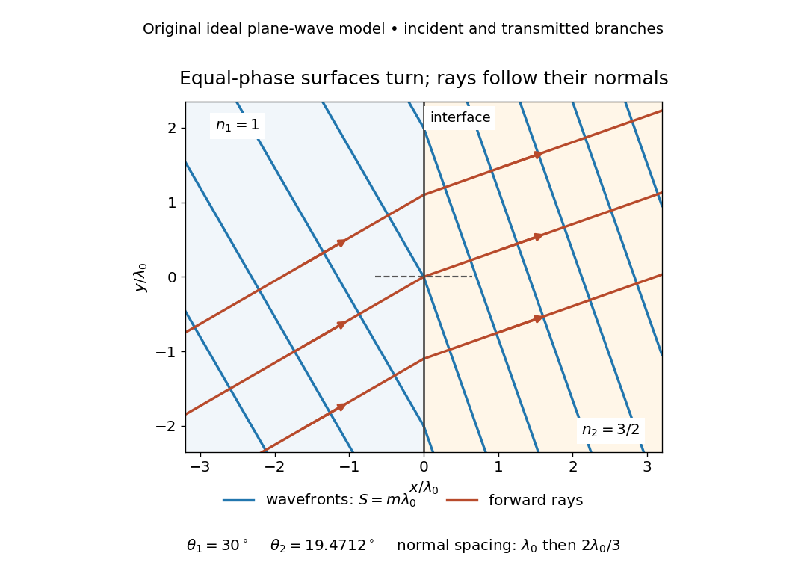

# Wavefront

↑ **Parent:** [Physical optics](physical-optics.md)  
ⓦ [Wiki](https://en.wikipedia.org/wiki/Wavefront)

A [wavefront](wavefront.md) connects points with the same [wave phase](phase-waves.md) at one specified time. It is a surface, rather than the trajectory of a particular piece of [light](light.md). For a scalar [monochromatic wave](monochromatic-wave.md) written as $u(\mathbf r,t)=A(\mathbf r)\cos\Phi(\mathbf r,t)$, a [wavefront](wavefront.md) is a connected [level set](level-set.md) of the [phase function](phase-function.md) $\Phi$; different surfaces can share the same [wave phase](phase-waves.md) modulo $2\pi$. A [plane wave](plane-wave.md) has planar [wavefronts](wavefront.md). An outward wave from an ideal point source in a uniform medium has [spheres](sphere.md) as [wavefronts](wavefront.md), while an [optical lens](lens-optics.md) can turn nearly planar [wavefronts](wavefront.md) into converging ones. The [wavefront](wavefront.md) describes [wave phase](phase-waves.md), not [wave amplitude](wave-amplitude.md): drawing it does not say how bright the beam is. [Wavefronts](rp-photonics-encyclopedia-by-rudiger-paschotta/wavefronts.md)

The relation to [light rays](light-ray.md) becomes precise in a stationary medium with [isotropy](isotropy.md), negligible loss and a real positive scalar [refractive index](refractive-index.md) $n(\mathbf r,\omega)$. In the [geometrical optics](geometrical-optics.md) limit, spatial changes in the [refractive index](refractive-index.md) and [wave amplitude](wave-amplitude.md) are slow on the local [wavelength](wavelength.md) scale. For a single smooth propagation branch, write

$$
\Phi(\mathbf r,t)=k_0S(\mathbf r,\omega)-\omega t+\phi_0,\qquad k_0=\frac{\omega}{c},\qquad |\nabla S|^2=n^2.
$$

Here $\omega>0$ is the [angular frequency](angular-frequency.md), $c$ is the [vacuum](vacuum.md) [speed of light](speed-of-light.md), $S$ has units of length, and the last relation is the optical [eikonal equation](eikonal-equation.md). The local [wavevector](wavevector.md) is $\mathbf k=\nabla\Phi=k_0\nabla S$. Its direction is normal to a smooth [wavefront](wavefront.md), since a [gradient](gradient.md) is normal to its [level sets](level-set.md). A forward [light ray](light-ray.md) has [unit tangent vector](unit-tangent-vector.md) $d\mathbf r/ds=\nabla S/n$, so it follows this normal under the stated assumptions. Along that [light ray](light-ray.md), $dS/ds=\nabla S\cdot(d\mathbf r/ds)=n$: the change in $S$ is the [optical path length](optical-path-length.md). This is the short geometric argument linking [wavefronts](wavefront.md), [light rays](light-ray.md) and [optical path length](optical-path-length.md). [Optics, Lecture 10: Eikonal Equations, Superposition of EM Waves](mit-2-71-and-2-710-optics-spring-2014-by-nicholas-x-fang/optics-lecture-10-eikonal-equations-superposition-of-em-waves.md)

**[Figure 21](#wavefront-refraction-phase-and-rays). Wavefronts and normal light rays at an interface: an original plane wave model of refraction**.

The diagram shows incident and transmitted branches separately, with the reflected branch omitted. Its stipulated [refractive indices](refractive-index.md) are $n_1=1$ and $n_2=3/2$, and its incident [angle](angle.md) is $30^\circ$ to the interface normal. At a stationary interface, the [frequency](frequency.md) and tangential [wavevector](wavevector.md) agree on the two sides: [Snell's law](snell-s-law.md) gives $\sin\theta_2=1/3$, hence $\theta_2\approx19.4712^\circ$. The [wavefronts](wavefront.md) turn while their normal spacing decreases from $\lambda_0$ to $2\lambda_0/3$, where $\lambda_0$ is the [vacuum](vacuum.md) [wavelength](wavelength.md). More explicitly, with $x$ normal to the interface and $y$ tangential, take $S_1=\sqrt3x/2+y/2$ for $x<0$ and $S_2=\sqrt2x+y/2$ for $x>0$. These functions agree at $x=0$; the drawn [wavefronts](wavefront.md) are $S_j=m\lambda_0$ at $t=0$ with $\phi_0=0$. This is an exact piecewise [plane wave](plane-wave.md) phase construction for the stipulated transparent media, not measured material data. [Laws of Geometric Optics](electromagnetism-lecture-notes-by-richard-fitzpatrick/laws-of-geometric-optics.md)

The normal-to-[wavefront](wavefront.md) rule requires its assumptions. In a medium with [anisotropy](anisotropy.md), the [wavevector](wavevector.md) remains normal to a smooth [wavefront](wavefront.md), but the [group velocity](group-velocity.md) and [energy flux](energy-flux.md) need not follow it. [Wavefronts](rp-photonics-encyclopedia-by-rudiger-paschotta/wavefronts.md) Near a [wave caustic](wave-caustic.md), where multiple [light rays](light-ray.md) meet, one smooth [phase function](phase-function.md) may no longer describe the field; [diffraction](diffraction.md) and the full [wave amplitude](wave-amplitude.md) matter. A [wavefront](wavefront.md) is also not generally a surface of equal pulse arrival time. In a medium with [optical dispersion](dispersion-optics.md), a monochromatic [wave phase](phase-waves.md) moves with the [phase velocity](phase-velocity.md), while a sufficiently narrow [wave packet](wave-packet.md) follows the [group velocity](group-velocity.md). Even identical [optical path lengths](optical-path-length.md) at one [frequency](frequency.md) can give different [group delays](group-delay.md). The usual equal-travel-time picture needs a common launch reference and a nondispersive ray model; an arbitrary broadband disturbance has no single monochromatic [wavefront](wavefront.md).[The Feynman Lectures on Physics, Volume I by Richard Feynman and others](the-feynman-lectures-on-physics-volume-i-by-richard-feynman-and-others.md)

**Table of contents**

- [Optical path length](optical-path-length.md)
  - [Optical path difference](optical-path-difference.md)
  - [Group refractive index](group-refractive-index.md)
    - [Group delay](group-delay.md)
- [Wavefront error](wavefront-error.md)
  - [Modal amplitude norm versus wavefront RMS](modal-amplitude-norm-versus-wavefront-rms.md)

## ↑ Ancestors (5)

1. [Physical optics](physical-optics.md)
2. [Optics](optics-split.md)
3. [Branches of physics](branches-of-physics.md)
4. [Physics](physics-split.md)
5. [Codex Wiki](split.md)

## ← Incoming links (30)

- [Acoustic eikonal equation in a shear flow](acoustic-eikonal-equation-in-a-shear-flow.md)
- [Atmospheric turbulence](atmospheric-turbulence.md)
- [Beam waist](beam-waist.md)
- [Elastic ray](elastic-ray.md)
- [Elastic slowness surface](elastic-slowness-surface.md)
- [Elastic wave surface](elastic-wave-surface.md)
- [First-order optical coherence](first-order-optical-coherence.md)
- [Geometrical optics](geometrical-optics.md)
- [Horizontal phase velocity](horizontal-phase-velocity.md)
- [Hyperbolic interface collimation of P-waves](hyperbolic-interface-collimation-of-p-waves.md)
- [Interference fringe](interference-fringe.md)
- [Local wavelength](local-wavelength.md)
- [Optical aberration](optical-aberration.md)
- [Optical path difference](optical-path-difference.md)
- [P-wavefront discontinuity transport](p-wavefront-discontinuity-transport.md)
- [Solution](past-exam-of-the-mathematics-course-of-the-university-of-cambridge/2002/iii/paper-54/1/solution.md)
- [Solution](past-exam-of-the-mathematics-course-of-the-university-of-cambridge/2002/iii/paper-54/3/solution.md)
- [Solution](past-exam-of-the-mathematics-course-of-the-university-of-cambridge/2003/iii/paper-78/2/ii/solution.md)
- [Solution](past-exam-of-the-mathematics-course-of-the-university-of-cambridge/2003/iii/paper-78/2/iii/solution.md)
- [Solution](past-exam-of-the-mathematics-course-of-the-university-of-cambridge/2004/iii/paper-79/2/ii/solution.md)
- [Solution](past-exam-of-the-mathematics-course-of-the-university-of-cambridge/2006/iii/paper-82/4/a/solution.md)
- [Solution](past-exam-of-the-mathematics-course-of-the-university-of-cambridge/2017/iii/paper-338/3/a/ii/solution.md)
- [Solution](past-exam-of-the-mathematics-course-of-the-university-of-cambridge/2019/iii/paper-338/1/d/solution.md)
- [Phase velocity](phase-velocity.md)
- [Ray-tube conservation for a P-wave jump](ray-tube-conservation-for-a-p-wave-jump.md)
- [SH ray-tube amplitude transport](sh-ray-tube-amplitude-transport.md)
- [Slowness](slowness.md)
- [Slowness curvature and wave-surface cusps](slowness-curvature-and-wave-surface-cusps.md)
- [Wavefront](wavefront.md)
- [Wavenumber](wavenumber.md)
