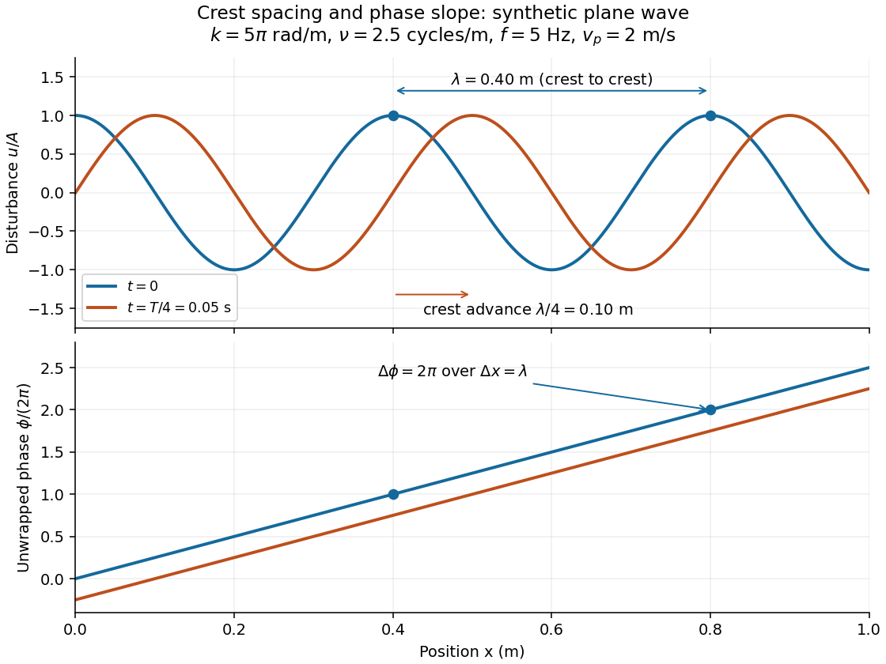

# Wavenumber

↑ **Parent:** [Wave equation](wave-equation-split.md)  
ⓦ [Wiki](https://en.wikipedia.org/wiki/Wavenumber)

A [wavenumber](wavenumber.md) measures how rapidly a [wave phase](phase-waves.md) changes with distance. Two conventions coexist: angular [wavenumber](wavenumber.md) counts [radians](radian.md) per unit length, while ordinary [spatial frequency](spatial-frequency.md) counts cycles per unit length. For a [monochromatic wave](monochromatic-wave.md) with [wavelength](wavelength.md) $\lambda>0$,

$$
K=\frac{2\pi}{\lambda},\qquad \nu_x=\frac1\lambda,\qquad K=2\pi\nu_x.
$$

Here $K\geq0$ is the magnitude of the angular [wavenumber](wavenumber.md). The symbol $k$ can instead denote a signed one-dimensional angular [wavenumber](wavenumber.md): a factor $e^{ikx}$ has [wavelength](wavelength.md) $2\pi/|k|$ for real $k\ne0$. Both conventions have dimensions of inverse length; writing $\mathrm{rad\,m^{-1}}$ or “cycles per metre” exposes the convention. A quoted value in $\mathrm{m^{-1}}$ alone does not resolve the factor of $2\pi$. [Spectroscopic wavenumber](spectroscopic-wavenumber.md) usually uses the cycles-per-length convention.[section 16.2, equations 16.2–16.5: angular convention and sinusoidal wave phase](university-physics-volume-1-by-william-moebs-and-others.md)

For a real [monochromatic](monochromatic-set.md) [plane wave](plane-wave.md), fix the convention

$$
u(\mathbf x,t)=A\cos\phi(\mathbf x,t),\qquad \phi=\mathbf k\cdot\mathbf x-\omega t+\phi_0,\qquad K=|\mathbf k|.
$$

The [wavevector](wavevector.md) $\mathbf k$ supplies both the spatial [wave phase](phase-waves.md) slope and the normal to the [wavefronts](wavefront.md); its [dot product](dot-product.md) with position makes the [wave phase](phase-waves.md) constant on parallel planes. The [angular frequency](angular-frequency.md) is $\omega=2\pi f$, with $f>0$ the ordinary [frequency](frequency.md). Moving a distance $\lambda$ along $\mathbf k$ changes the [wave phase](phase-waves.md) by $2\pi$. Holding a [wave crest](wave-crest.md)'s [wave phase](phase-waves.md) fixed gives its [phase velocity](phase-velocity.md) $\omega\mathbf k/K^2$ and [phase speed](phase-speed.md)

$$
v_p=\frac{\omega}{K}=f\lambda.
$$

In one dimension the signed [phase velocity](phase-velocity.md) is $\omega/k$. This identifies a moving pattern; it does not identify the motion of the medium's particles or a [wave packet](wave-packet.md)'s [group velocity](group-velocity.md).

For the synthetic [plane wave](plane-wave.md) below, choose $\lambda=0.40\,\mathrm m$ and $f=5\,\mathrm{Hz}$. Then $K=5\pi\,\mathrm{rad\,m^{-1}}$, $\nu_x=2.5$ cycles per metre, $\omega=10\pi\,\mathrm{rad\,s^{-1}}$, and $v_p=2\,\mathrm{m\,s^{-1}}$. The [wave crests](wave-crest.md) are $0.40\,\mathrm m$ apart at one instant; after a quarter [oscillation period](period-of-an-oscillation.md), each has advanced $0.10\,\mathrm m$. The lower panel retains whole turns of [wave phase](phase-waves.md), making its slope visible instead of reducing it modulo $2\pi$.

**[Figure 9](#image-synthetic-plane-wave-snapshots-crest-spacing-phase-slope-and-a-quarter-period-advance). Synthetic plane-wave snapshots: crest spacing, phase slope, and a quarter-period advance**.

**Table of contents**

- [Zonal wavenumber](zonal-wavenumber.md)
- [Complex wavenumber](complex-wavenumber.md)
- [Spectroscopic wavenumber](spectroscopic-wavenumber.md)
- [Spatial sampling of a wave](spatial-sampling-of-a-wave.md)
- [Wavelength](wavelength.md)
  - [Acoustic wavelength measurement](acoustic-wavelength-measurement.md)
    - [Oscilloscope](oscilloscope.md)
      - [Oscilloscope probe](oscilloscope-probe.md)
      - [Cathode-ray oscilloscope](cathode-ray-oscilloscope.md)
    - [Propagation of uncertainty](propagation-of-uncertainty.md)
      - [Background-subtracted radiative temperature uncertainty](background-subtracted-radiative-temperature-uncertainty.md)
      - [Ratio-minus-one uncertainty](ratio-minus-one-uncertainty.md)
      - [Magnitude uncertainty of a series RL impedance](magnitude-uncertainty-of-a-series-rl-impedance.md)
      - [Refractive-index uncertainty from Snell's law](refractive-index-uncertainty-from-snell-s-law.md)
      - [Moment-of-inertia uncertainty for an annulus](moment-of-inertia-uncertainty-for-an-annulus.md)
      - [Uncertainty in a cosine of a measured angle](uncertainty-in-a-cosine-of-a-measured-angle.md)
      - [Monomial uncertainty propagation](monomial-uncertainty-propagation.md)
        - [Mass ratio from spring oscillation frequencies](mass-ratio-from-spring-oscillation-frequencies.md)
      - [Repeated-timing uncertainty in a pendulum gravity measurement](repeated-timing-uncertainty-in-a-pendulum-gravity-measurement.md)
  - [Local wavelength](local-wavelength.md)

## ↑ Ancestors (6)

1. [Wave equation](wave-equation-split.md)
2. [Partial differential equation](partial-differential-equation-split.md)
3. [Analysis](analysis-split.md)
4. [Area of mathematics](area-of-mathematics.md)
5. [Mathematics](mathematics-split.md)
6. [Codex Wiki](split.md)

## ← Incoming links (492)

- [Absolute wavenumber](absolute-wavenumber.md)
- [Acoustic waveguide cutoff](acoustic-waveguide-cutoff.md)
- [Airy disk derivation](airy-disk-derivation.md)
- [Alfvén frequency](alfven-frequency.md)
- [Anisotropic transverse scaling of an isotropic roll envelope](anisotropic-transverse-scaling-of-an-isotropic-roll-envelope.md)
- [Attractive potential ordering does not order quantum reflection](attractive-potential-ordering-does-not-order-quantum-reflection.md)
- [Axisymmetric vertical mode of a shearing sheet](axisymmetric-vertical-mode-of-a-shearing-sheet.md)
- [Band curvature](band-curvature.md)
- [Bending stiffness in a membrane waveguide](bending-stiffness-in-a-membrane-waveguide.md)
- [Boundary-forced internal gravity wave](boundary-forced-internal-gravity-wave.md)
- [Bragg path difference](bragg-path-difference.md)
- [Capillary length](capillary-length.md)
- [Carbonyl stretching vibration](carbonyl-stretching-vibration.md)
- [Causal pressure adjustment by internal waves](causal-pressure-adjustment-by-internal-waves.md)
- [Causal vertical wavenumber branch](causal-vertical-wavenumber-branch.md)
- [Chemotactic instability with logistic growth and saturating production](chemotactic-instability-with-logistic-growth-and-saturating-production.md)
- [Clamped--clamped bending mode](clamped-clamped-bending-mode.md)
- [Classically allowed region](classically-allowed-region.md)
- [Coastal Kelvin-wave radiation of long Rossby waves](coastal-kelvin-wave-radiation-of-long-rossby-waves.md)
- [Codimension-two bifurcation](codimension-two-bifurcation.md)
- [Comoving perturbations of a homologously collapsing cloud](comoving-perturbations-of-a-homologously-collapsing-cloud.md)
- [Complex wavenumber](complex-wavenumber.md)
- [Conserved-field sideband dispersion relation](conserved-field-sideband-dispersion-relation.md)
- [Constant-loading acoustic model](constant-loading-acoustic-model.md)
- [Cosmological horizon entry](cosmological-horizon-entry.md)
- [Counterpropagating saturation resonance](counterpropagating-saturation-resonance.md)
- [Counterpropagating wave resonance in a three-layer shear flow](counterpropagating-wave-resonance-in-a-three-layer-shear-flow.md)
- [Critical angle for total internal reflection](critical-angle-for-total-internal-reflection.md)
- [Critical level of an internal gravity wave](critical-level-of-an-internal-gravity-wave.md)
- [Critical Rayleigh number for an isothermal layer](critical-rayleigh-number-for-an-isothermal-layer.md)
- [Crossover resonance](crossover-resonance.md)
- [Cubic-time resistive damping in a differentially rotating cell](cubic-time-resistive-damping-in-a-differentially-rotating-cell.md)
- [Cutoff frequency of a membrane waveguide](cutoff-frequency-of-a-membrane-waveguide.md)
- [Degenerate-plasma zero-point sound](degenerate-plasma-zero-point-sound.md)
- [Density contrast of an entrained dust wave](density-contrast-of-an-entrained-dust-wave.md)
- [Deslandres table](deslandres-table.md)
- [Detuning of a wave resonance](detuning-of-a-wave-resonance.md)
- [Diatomic bond stretch](diatomic-bond-stretch.md)
- [Dimensionless cosmological power spectrum](dimensionless-cosmological-power-spectrum.md)
- [Directly forced cubic amplitude equation](directly-forced-cubic-amplitude-equation.md)
- [Discrete Neumann mode selection](discrete-neumann-mode-selection.md)
- [Dispersion diagram](dispersion-diagram.md)
- [Doppler cooling](doppler-cooling.md)
- [Double-zero internal-wave turning level](double-zero-internal-wave-turning-level.md)
- [Eckhaus instability](eckhaus-instability.md)
- [Elastic-cover frequency ratio for water waves](elastic-cover-frequency-ratio-for-water-waves.md)
- [Electromagnetic waveguide](electromagnetic-waveguide.md)
- [Electron acoustic wave](electron-acoustic-wave.md)
- [Electron affinity](electron-affinity.md)
- [Electrostatic plasma wave](electrostatic-plasma-wave.md)
- [Exact critical Rayleigh relation for vertical-field magnetoconvection](exact-critical-rayleigh-relation-for-vertical-field-magnetoconvection.md)
- [Far-field approximation for an outgoing source](far-field-approximation-for-an-outgoing-source.md)
- [Faraday rotation from circular phases](faraday-rotation-from-circular-phases.md)
- [Finite-aperture stabilization of an inverted liquid surface](finite-aperture-stabilization-of-an-inverted-liquid-surface.md)
- [Finite maximum temporal growth rate](finite-maximum-temporal-growth-rate.md)
- [Finite rectangular barrier matching](finite-rectangular-barrier-matching.md)
- [Finite-thickness magnetorotational instability criterion](finite-thickness-magnetorotational-instability-criterion.md)
- [First arrival of a stationary internal wavefront at a layer boundary](first-arrival-of-a-stationary-internal-wavefront-at-a-layer-boundary.md)
- [First domain length for an unstable Neumann band](first-domain-length-for-an-unstable-neumann-band.md)
- [Flexural support ratio](flexural-support-ratio.md)
- [Flexural wave](flexural-wave.md)
- [Flux-normalized WKB amplitude](flux-normalized-wkb-amplitude.md)
- [Focusing power of internal-wave reflection](focusing-power-of-internal-wave-reflection.md)
- [Forced axisymmetric density mode with vortensity](forced-axisymmetric-density-mode-with-vortensity.md)
- [Fourier transform of the modified Bessel function K0](fourier-transform-of-the-modified-bessel-function-k0.md)
- [Fraunhofer diffraction](fraunhofer-diffraction.md)
- [Frequency gap for higher equatorial wave modes](frequency-gap-for-higher-equatorial-wave-modes.md)
- [Fresnel diffraction](fresnel-diffraction.md)
- [Fresnel diffraction phase curvature](fresnel-diffraction-phase-curvature.md)
- [Fundamental mode](fundamental-mode.md)
- [Gaussian beam](gaussian-beam.md)
- [Gaussian envelope in a Klein-Gordon medium](gaussian-envelope-in-a-klein-gordon-medium.md)
- [Geometrical optics](geometrical-optics-split.md)
- [Global variational form of the Michael criterion](global-variational-form-of-the-michael-criterion.md)
- [Gravity-capillary wave](gravity-capillary-wave.md)
- [Group refractive index](group-refractive-index.md)
- [Group velocity](group-velocity.md)
- [Harmonic sine mode in a half-strip](harmonic-sine-mode-in-a-half-strip.md)
- [Hermite vertical mode of an isothermal disk](hermite-vertical-mode-of-an-isothermal-disk.md)
- [Hexagonal convection amplitude equations](hexagonal-convection-amplitude-equations.md)
- [High-wavenumber instability of a non-monotone Prandtl layer](high-wavenumber-instability-of-a-non-monotone-prandtl-layer.md)
- [Ice-shelf corrugation relaxation](ice-shelf-corrugation-relaxation.md)
- [Infrared cutoff](infrared-cutoff.md)
- [Inhibitor in a reaction-diffusion system](inhibitor-in-a-reaction-diffusion-system.md)
- [Interchange stability of an incompressible magnetized atmosphere](interchange-stability-of-an-incompressible-magnetized-atmosphere.md)
- [Interface phase matching](interface-phase-matching.md)
- [Interfacial gravity wave](interfacial-gravity-wave.md)
- [Interference (wave propagation)](interference-wave-propagation.md)
- [Internal-wave transmission across a stratification step](internal-wave-transmission-across-a-stratification-step.md)
- [Internal-wave transmission across a velocity jump](internal-wave-transmission-across-a-velocity-jump.md)
- [Inviscid Couette continuous spectrum](inviscid-couette-continuous-spectrum.md)
- [Keller--Segel aggregation threshold](keller-segel-aggregation-threshold.md)
- [Kelvin-Helmholtz instability](kelvin-helmholtz-instability.md)
- [Klein-Gordon packet velocities](klein-gordon-packet-velocities.md)
- [Lamb-Mössbauer factor](lamb-mossbauer-factor.md)
- [Laue equations](laue-equations.md)
- [Lippmann fringe spacing](lippmann-fringe-spacing.md)
- [Lithospheric flexure](lithospheric-flexure.md)
- [Local equality of phase and group velocity](local-equality-of-phase-and-group-velocity.md)
- [Long-wave bioconvection threshold in weak stratification](long-wave-bioconvection-threshold-in-weak-stratification.md)
- [Long-wave convection equation with broken Boussinesq symmetry](long-wave-convection-equation-with-broken-boussinesq-symmetry.md)
- [Love-wave interface reflection phase](love-wave-interface-reflection-phase.md)
- [Magnetic energy spectrum](magnetic-energy-spectrum.md)
- [Magnetic-field-aligned rolls evade steady magnetic inhibition](magnetic-field-aligned-rolls-evade-steady-magnetic-inhibition.md)
- [Magnetic stabilization of an equal-density vortex sheet](magnetic-stabilization-of-an-equal-density-vortex-sheet.md)
- [Maximum growth rate of radially stratified magnetorotational instability](maximum-growth-rate-of-radially-stratified-magnetorotational-instability.md)
- [Membrane fluctuation spectrum under tension](membrane-fluctuation-spectrum-under-tension.md)
- [Midpoint correction for two quadratic-dispersion waves](midpoint-correction-for-two-quadratic-dispersion-waves.md)
- [Mixed-mode chemotactic instability threshold](mixed-mode-chemotactic-instability-threshold.md)
- [Nondispersive wave](nondispersive-wave.md)
- [Nonlinear wavenumber](nonlinear-wavenumber.md)
- [Oblique total reflection at an unmagnetized plasma](oblique-total-reflection-at-an-unmagnetized-plasma.md)
- [Odd-parity S-matrix of a symmetric double-delta potential](odd-parity-s-matrix-of-a-symmetric-double-delta-potential.md)
- [Optical path length](optical-path-length.md)
- [Oscillatory neutral curve of rotating convection](oscillatory-neutral-curve-of-rotating-convection.md)
- [Overtone](overtone.md)
- [P-SV characteristic reconstruction](p-sv-characteristic-reconstruction.md)
- [P-wave scattering](p-wave-scattering.md)
- [Solution](past-exam-of-the-advanced-fluid-dynamics-course-of-the-university-of-oxford/2023/1/a/solution.md)
- [Solution](past-exam-of-the-advanced-fluid-dynamics-course-of-the-university-of-oxford/2024/1/d/solution.md)
- [Solution](past-exam-of-the-advanced-fluid-dynamics-course-of-the-university-of-oxford/2024/1/e/solution.md)
- [Solution](past-exam-of-the-astrophysical-fluid-dynamics-course-of-the-university-of-cambridge/2014/paper-1/2/c/solution.md)
- [Solution](past-exam-of-the-astrophysical-fluid-dynamics-course-of-the-university-of-cambridge/2019/section-b/4/solution.md)
- [Solution](past-exam-of-the-astrophysical-fluid-dynamics-course-of-the-university-of-cambridge/2021/section-a/3/solution.md)
- [Solution](past-exam-of-the-astrophysical-fluid-dynamics-course-of-the-university-of-cambridge/2022/section-b/6/b/solution.md)
- [Solution](past-exam-of-the-astrophysics-course-of-the-university-of-oxford/2018/2/a/solution.md)
- [Solution](past-exam-of-the-atomic-and-laser-physics-course-of-the-university-of-oxford/2021/4/b/solution.md)
- [Solution](past-exam-of-the-atomic-and-laser-physics-course-of-the-university-of-oxford/2022/1/b/solution.md)
- [Solution](past-exam-of-the-chemistry-a-course-of-the-university-of-cambridge/2021/paper-1/a3/a/iv/solution.md)
- [Solution](past-exam-of-the-chemistry-a-course-of-the-university-of-cambridge/2023/paper-1/a3/a/ii/solution.md)
- [Solution](past-exam-of-the-chemistry-course-of-the-year-1-of-the-natural-sciences-course-of-the-university-of-cambridge/2022/paper-1/1/a/ii/solution.md)
- [Solution](past-exam-of-the-chemistry-course-of-the-year-3-of-the-natural-sciences-course-of-the-university-of-cambridge/2021/paper-2a/section-a/14/solution.md)
- [Solution](past-exam-of-the-chemistry-course-of-the-year-3-of-the-natural-sciences-course-of-the-university-of-cambridge/2022/paper-2a/section-a/13/solution.md)
- [Solution](past-exam-of-the-chemistry-course-of-the-year-3-of-the-natural-sciences-course-of-the-university-of-cambridge/2022/paper-2a/section-a/15/c/ii/solution.md)
- [Solution](past-exam-of-the-chemistry-course-of-the-year-3-of-the-natural-sciences-course-of-the-university-of-cambridge/2022/paper-2a/section-b/21/a/i/solution.md)
- [Solution](past-exam-of-the-chemistry-course-of-the-year-3-of-the-natural-sciences-course-of-the-university-of-cambridge/2022/paper-2a/section-b/22/a/ii/solution.md)
- [Solution](past-exam-of-the-chemistry-course-of-the-year-3-of-the-natural-sciences-course-of-the-university-of-cambridge/2022/paper-2b/section-b/34/d/i/solution.md)
- [Solution](past-exam-of-the-chemistry-course-of-the-year-3-of-the-natural-sciences-course-of-the-university-of-cambridge/2022/paper-2b/section-b/34/d/iii/solution.md)
- [Solution](past-exam-of-the-collisionless-plasma-physics-course-of-the-university-of-oxford/2025/2/c/solution.md)
- [Solution](past-exam-of-the-collisionless-plasma-physics-course-of-the-university-of-oxford/2025/2/f/solution.md)
- [Solution](past-exam-of-the-collisionless-plasma-physics-course-of-the-university-of-oxford/2025/2/h/solution.md)
- [Solution](past-exam-of-the-collisionless-plasma-physics-course-of-the-university-of-oxford/2025/3/e/solution.md)
- [Solution](past-exam-of-the-condensed-matter-physics-course-of-the-university-of-oxford/2022/2/b/i/solution.md)
- [Solution](past-exam-of-the-elasticity-and-plasticity-course-of-the-university-of-oxford/2009/2/b/ii/solution.md)
- [Solution](past-exam-of-the-elasticity-and-plasticity-course-of-the-university-of-oxford/2010/2/b/solution.md)
- [Solution](past-exam-of-the-elasticity-and-plasticity-course-of-the-university-of-oxford/2010/2/d/solution.md)
- [Solution](past-exam-of-the-elasticity-and-plasticity-course-of-the-university-of-oxford/2011/2/d/solution.md)
- [Solution](past-exam-of-the-elasticity-and-plasticity-course-of-the-university-of-oxford/2023/1/b/solution.md)
- [Solution](past-exam-of-the-fluids-and-waves-course-of-the-university-of-oxford/2017/3/a/i/solution.md)
- [Solution](past-exam-of-the-fluids-and-waves-course-of-the-university-of-oxford/2017/3/b/iii/solution.md)
- [Solution](past-exam-of-the-fluids-and-waves-course-of-the-university-of-oxford/2021/3/b/i/solution.md)
- [Solution](past-exam-of-the-fluids-and-waves-course-of-the-university-of-oxford/2021/3/b/solution.md)
- [Solution](past-exam-of-the-fluids-and-waves-course-of-the-university-of-oxford/2023/3/a/solution.md)
- [Solution](past-exam-of-the-fluids-and-waves-course-of-the-university-of-oxford/2023/3/b/iv/solution.md)
- [Solution](past-exam-of-the-fluids-and-waves-course-of-the-university-of-oxford/2023/3/c/ii/solution.md)
- [Solution](past-exam-of-the-fluids-course-of-the-university-of-oxford/2021/2/d/solution.md)
- [Solution](past-exam-of-the-fluids-course-of-the-university-of-oxford/2022/3/a/solution.md)
- [Solution](past-exam-of-the-fluids-course-of-the-university-of-oxford/2022/3/b/solution.md)
- [Solution](past-exam-of-the-further-mathematical-biology-course-of-the-university-of-oxford/2023/3/d/solution.md)
- [2023](past-exam-of-the-further-quantum-theory-course-of-the-university-of-oxford/2023-split.md)
- [Solution](past-exam-of-the-further-quantum-theory-course-of-the-university-of-oxford/2023/2/d/solution.md)
- [Solution](past-exam-of-the-geophysical-fluid-dynamics-course-of-the-university-of-oxford/2023/1/c/solution.md)
- [Solution](past-exam-of-the-geophysical-fluid-dynamics-course-of-the-university-of-oxford/2023/2/c/solution.md)
- [Solution](past-exam-of-the-geophysical-fluid-dynamics-course-of-the-university-of-oxford/2024/1/c/solution.md)
- [Solution](past-exam-of-the-geophysical-fluid-dynamics-course-of-the-university-of-oxford/2025/1/c/solution.md)
- [Solution](past-exam-of-the-geophysical-fluid-dynamics-course-of-the-university-of-oxford/2025/1/d/solution.md)
- [Solution](past-exam-of-the-kinetic-theory-course-of-the-university-of-oxford/2023/2/c/solution.md)
- [Solution](past-exam-of-the-kinetic-theory-course-of-the-university-of-oxford/2023/2/e/solution.md)
- [Solution](past-exam-of-the-kinetic-theory-course-of-the-university-of-oxford/2024/2/a/solution.md)
- [Solution](past-exam-of-the-kinetic-theory-course-of-the-university-of-oxford/2024/3/d/solution.md)
- [Solution](past-exam-of-the-kinetic-theory-course-of-the-university-of-oxford/2024/3/f/solution.md)
- [Solution](past-exam-of-the-mathematical-methods-ii-course-of-the-university-of-oxford/2015-resit/11/d/solution.md)
- [Solution](past-exam-of-the-mathematical-methods-ii-course-of-the-university-of-oxford/2015/11/d/i/solution.md)
- [Solution](past-exam-of-the-mathematical-methods-ii-course-of-the-university-of-oxford/2015/11/d/ii/solution.md)
- [Solution](past-exam-of-the-mathematical-methods-ii-course-of-the-university-of-oxford/2017-resit/11/a/solution.md)
- [Solution](past-exam-of-the-mathematical-methods-ii-course-of-the-university-of-oxford/2017-resit/11/c/solution.md)
- [Solution](past-exam-of-the-mathematical-methods-ii-course-of-the-university-of-oxford/2018/11/solution.md)
- [Solution](past-exam-of-the-mathematical-methods-ii-course-of-the-university-of-oxford/2021-resit/3/solution.md)
- [Solution](past-exam-of-the-mathematical-methods-ii-course-of-the-university-of-oxford/2021/11/ii/solution.md)
- [Solution](past-exam-of-the-mathematical-methods-ii-course-of-the-university-of-oxford/2021/11/vi/solution.md)
- [Solution](past-exam-of-the-mathematical-methods-ii-course-of-the-university-of-oxford/2022/8/solution.md)
- [Solution](past-exam-of-the-mathematics-and-the-environment-and-mathematical-physiology-course-of-the-university-of-oxford/2008/a/3/iv/solution.md)
- [Solution](past-exam-of-the-mathematics-course-of-the-university-of-cambridge/2001/iii/paper-35/1/solution.md)
- [Solution](past-exam-of-the-mathematics-course-of-the-university-of-cambridge/2001/iii/paper-35/3/solution.md)
- [Solution](past-exam-of-the-mathematics-course-of-the-university-of-cambridge/2001/iii/paper-36/2/c/solution.md)
- [Solution](past-exam-of-the-mathematics-course-of-the-university-of-cambridge/2001/iii/paper-38/1/solution.md)
- [Solution](past-exam-of-the-mathematics-course-of-the-university-of-cambridge/2001/iii/paper-41/3/v/solution.md)
- [Solution](past-exam-of-the-mathematics-course-of-the-university-of-cambridge/2001/iii/paper-42/2/solution.md)
- [Solution](past-exam-of-the-mathematics-course-of-the-university-of-cambridge/2001/iii/paper-42/3/solution.md)
- [Solution](past-exam-of-the-mathematics-course-of-the-university-of-cambridge/2001/iii/paper-45/3/solution.md)
- [Solution](past-exam-of-the-mathematics-course-of-the-university-of-cambridge/2001/iii/paper-54/4/solution.md)
- [Solution](past-exam-of-the-mathematics-course-of-the-university-of-cambridge/2001/iii/paper-70/1/b/solution.md)
- [Solution](past-exam-of-the-mathematics-course-of-the-university-of-cambridge/2002/iii/paper-41/1/solution.md)
- [Solution](past-exam-of-the-mathematics-course-of-the-university-of-cambridge/2002/iii/paper-43/2/solution.md)
- [Solution](past-exam-of-the-mathematics-course-of-the-university-of-cambridge/2002/iii/paper-43/4/solution.md)
- [Solution](past-exam-of-the-mathematics-course-of-the-university-of-cambridge/2002/iii/paper-49/1/solution.md)
- [Solution](past-exam-of-the-mathematics-course-of-the-university-of-cambridge/2002/iii/paper-56/4/a/solution.md)
- [Solution](past-exam-of-the-mathematics-course-of-the-university-of-cambridge/2002/iii/paper-58/4/solution.md)
- [Solution](past-exam-of-the-mathematics-course-of-the-university-of-cambridge/2003/iii/paper-60/2/solution.md)
- [Solution](past-exam-of-the-mathematics-course-of-the-university-of-cambridge/2003/iii/paper-60/3/ii/solution.md)
- [Solution](past-exam-of-the-mathematics-course-of-the-university-of-cambridge/2003/iii/paper-60/4/solution.md)
- [Solution](past-exam-of-the-mathematics-course-of-the-university-of-cambridge/2003/iii/paper-64/1/solution.md)
- [Solution](past-exam-of-the-mathematics-course-of-the-university-of-cambridge/2003/iii/paper-74/1/solution.md)
- [Solution](past-exam-of-the-mathematics-course-of-the-university-of-cambridge/2003/iii/paper-78/3/i/solution.md)
- [Solution](past-exam-of-the-mathematics-course-of-the-university-of-cambridge/2003/iii/paper-78/3/iii/solution.md)
- [Solution](past-exam-of-the-mathematics-course-of-the-university-of-cambridge/2004/iii/paper-60/3/a/solution.md)
- [Solution](past-exam-of-the-mathematics-course-of-the-university-of-cambridge/2004/iii/paper-60/3/b/solution.md)
- [Solution](past-exam-of-the-mathematics-course-of-the-university-of-cambridge/2004/iii/paper-64/2/solution.md)
- [Solution](past-exam-of-the-mathematics-course-of-the-university-of-cambridge/2004/iii/paper-66/1/solution.md)
- [Solution](past-exam-of-the-mathematics-course-of-the-university-of-cambridge/2004/iii/paper-73/2/solution.md)
- [Solution](past-exam-of-the-mathematics-course-of-the-university-of-cambridge/2004/iii/paper-75/5/c/solution.md)
- [Solution](past-exam-of-the-mathematics-course-of-the-university-of-cambridge/2004/iii/paper-76/1/b/iv/solution.md)
- [Solution](past-exam-of-the-mathematics-course-of-the-university-of-cambridge/2004/iii/paper-76/5/a/i/solution.md)
- [Solution](past-exam-of-the-mathematics-course-of-the-university-of-cambridge/2005/ii/paper-2/13e/d/solution.md)
- [Solution](past-exam-of-the-mathematics-course-of-the-university-of-cambridge/2005/iii/paper-65/1/d/solution.md)
- [Solution](past-exam-of-the-mathematics-course-of-the-university-of-cambridge/2005/iii/paper-73/2/iii/solution.md)
- [Solution](past-exam-of-the-mathematics-course-of-the-university-of-cambridge/2005/iii/paper-79/1/b/i/solution.md)
- [Solution](past-exam-of-the-mathematics-course-of-the-university-of-cambridge/2005/iii/paper-79/1/b/ii/solution.md)
- [Solution](past-exam-of-the-mathematics-course-of-the-university-of-cambridge/2005/iii/paper-80/1/solution.md)
- [Solution](past-exam-of-the-mathematics-course-of-the-university-of-cambridge/2005/iii/paper-80/3/solution.md)
- [Solution](past-exam-of-the-mathematics-course-of-the-university-of-cambridge/2005/iii/paper-80/4/solution.md)
- [Solution](past-exam-of-the-mathematics-course-of-the-university-of-cambridge/2005/iii/paper-81/2/iv/solution.md)
- [Solution](past-exam-of-the-mathematics-course-of-the-university-of-cambridge/2005/iii/paper-81/4/ii/b/solution.md)
- [Solution](past-exam-of-the-mathematics-course-of-the-university-of-cambridge/2005/iii/paper-81/4/ii/c/solution.md)
- [Solution](past-exam-of-the-mathematics-course-of-the-university-of-cambridge/2005/iii/paper-82/4/b/solution.md)
- [Solution](past-exam-of-the-mathematics-course-of-the-university-of-cambridge/2006/ib/paper-1/15b/solution.md)
- [Solution](past-exam-of-the-mathematics-course-of-the-university-of-cambridge/2006/ii/paper-1/37c/solution.md)
- [Solution](past-exam-of-the-mathematics-course-of-the-university-of-cambridge/2006/ii/paper-3/13b/b/solution.md)
- [Solution](past-exam-of-the-mathematics-course-of-the-university-of-cambridge/2006/ii/paper-3/13b/c/solution.md)
- [Solution](past-exam-of-the-mathematics-course-of-the-university-of-cambridge/2006/iii/paper-75/1/solution.md)
- [Solution](past-exam-of-the-mathematics-course-of-the-university-of-cambridge/2006/iii/paper-77/1/solution.md)
- [Solution](past-exam-of-the-mathematics-course-of-the-university-of-cambridge/2006/iii/paper-83/1/solution.md)
- [Solution](past-exam-of-the-mathematics-course-of-the-university-of-cambridge/2006/iii/paper-85/4/c/solution.md)
- [Solution](past-exam-of-the-mathematics-course-of-the-university-of-cambridge/2007/iii/paper-65/4/c/solution.md)
- [Solution](past-exam-of-the-mathematics-course-of-the-university-of-cambridge/2007/iii/paper-68/1/solution.md)
- [Solution](past-exam-of-the-mathematics-course-of-the-university-of-cambridge/2007/iii/paper-68/4/solution.md)
- [Solution](past-exam-of-the-mathematics-course-of-the-university-of-cambridge/2007/iii/paper-77/1/solution.md)
- [Solution](past-exam-of-the-mathematics-course-of-the-university-of-cambridge/2007/iii/paper-77/2/solution.md)
- [Solution](past-exam-of-the-mathematics-course-of-the-university-of-cambridge/2007/iii/paper-77/4/solution.md)
- [Solution](past-exam-of-the-mathematics-course-of-the-university-of-cambridge/2007/iii/paper-80/1/a/solution.md)
- [Solution](past-exam-of-the-mathematics-course-of-the-university-of-cambridge/2007/iii/paper-80/2/c/solution.md)
- [Solution](past-exam-of-the-mathematics-course-of-the-university-of-cambridge/2007/iii/paper-80/3/a/solution.md)
- [Solution](past-exam-of-the-mathematics-course-of-the-university-of-cambridge/2007/iii/paper-80/3/c/solution.md)
- [Solution](past-exam-of-the-mathematics-course-of-the-university-of-cambridge/2007/iii/paper-84/2/i/solution.md)
- [Solution](past-exam-of-the-mathematics-course-of-the-university-of-cambridge/2008/iii/paper-62/4/d/solution.md)
- [Solution](past-exam-of-the-mathematics-course-of-the-university-of-cambridge/2008/iii/paper-81/2/solution.md)
- [Solution](past-exam-of-the-mathematics-course-of-the-university-of-cambridge/2008/iii/paper-81/3/solution.md)
- [Solution](past-exam-of-the-mathematics-course-of-the-university-of-cambridge/2009/ii/paper-3/13a/solution.md)
- [Solution](past-exam-of-the-mathematics-course-of-the-university-of-cambridge/2009/iii/paper-66/4/iv/a/solution.md)
- [Solution](past-exam-of-the-mathematics-course-of-the-university-of-cambridge/2009/iii/paper-66/4/iv/c/solution.md)
- [Solution](past-exam-of-the-mathematics-course-of-the-university-of-cambridge/2009/iii/paper-75/1/solution.md)
- [Solution](past-exam-of-the-mathematics-course-of-the-university-of-cambridge/2009/iii/paper-77/1/solution.md)
- [Solution](past-exam-of-the-mathematics-course-of-the-university-of-cambridge/2009/iii/paper-81/4/b/solution.md)
- [Solution](past-exam-of-the-mathematics-course-of-the-university-of-cambridge/2009/iii/paper-81/4/c/solution.md)
- [Solution](past-exam-of-the-mathematics-course-of-the-university-of-cambridge/2010/iii/paper-67/2/solution.md)
- [Solution](past-exam-of-the-mathematics-course-of-the-university-of-cambridge/2010/iii/paper-67/3/solution.md)
- [Solution](past-exam-of-the-mathematics-course-of-the-university-of-cambridge/2010/iii/paper-70/1/a/solution.md)
- [Solution](past-exam-of-the-mathematics-course-of-the-university-of-cambridge/2010/iii/paper-70/1/b/solution.md)
- [Solution](past-exam-of-the-mathematics-course-of-the-university-of-cambridge/2010/iii/paper-71/2/b/solution.md)
- [Solution](past-exam-of-the-mathematics-course-of-the-university-of-cambridge/2010/iii/paper-71/2/d/solution.md)
- [Solution](past-exam-of-the-mathematics-course-of-the-university-of-cambridge/2010/iii/paper-71/4/b/solution.md)
- [Solution](past-exam-of-the-mathematics-course-of-the-university-of-cambridge/2012/iii/paper-57/3/b/solution.md)
- [Solution](past-exam-of-the-mathematics-course-of-the-university-of-cambridge/2012/iii/paper-61/3/ii/solution.md)
- [Solution](past-exam-of-the-mathematics-course-of-the-university-of-cambridge/2012/iii/paper-61/3/iv/solution.md)
- [Solution](past-exam-of-the-mathematics-course-of-the-university-of-cambridge/2012/iii/paper-77/1/solution.md)
- [Solution](past-exam-of-the-mathematics-course-of-the-university-of-cambridge/2012/iii/paper-77/4/solution.md)
- [Solution](past-exam-of-the-mathematics-course-of-the-university-of-cambridge/2012/iii/paper-77/5/ii/solution.md)
- [Solution](past-exam-of-the-mathematics-course-of-the-university-of-cambridge/2012/iii/paper-77/5/iii/solution.md)
- [Solution](past-exam-of-the-mathematics-course-of-the-university-of-cambridge/2013/ib/paper-2/7a/solution.md)
- [Solution](past-exam-of-the-mathematics-course-of-the-university-of-cambridge/2013/iii/paper-66/1/b/solution.md)
- [Solution](past-exam-of-the-mathematics-course-of-the-university-of-cambridge/2013/iii/paper-66/2/solution.md)
- [Solution](past-exam-of-the-mathematics-course-of-the-university-of-cambridge/2013/iii/paper-71/2/solution.md)
- [Solution](past-exam-of-the-mathematics-course-of-the-university-of-cambridge/2013/iii/paper-72/1/a/solution.md)
- [Solution](past-exam-of-the-mathematics-course-of-the-university-of-cambridge/2013/iii/paper-72/1/b/i/solution.md)
- [Solution](past-exam-of-the-mathematics-course-of-the-university-of-cambridge/2013/iii/paper-75/3/d/solution.md)
- [Solution](past-exam-of-the-mathematics-course-of-the-university-of-cambridge/2013/iii/paper-75/4/d/solution.md)
- [Solution](past-exam-of-the-mathematics-course-of-the-university-of-cambridge/2014/iii/paper-58/2/solution.md)
- [Solution](past-exam-of-the-mathematics-course-of-the-university-of-cambridge/2014/iii/paper-74/4/solution.md)
- [Solution](past-exam-of-the-mathematics-course-of-the-university-of-cambridge/2014/iii/paper-76/2/solution.md)
- [Solution](past-exam-of-the-mathematics-course-of-the-university-of-cambridge/2014/iii/paper-76/3/solution.md)
- [Solution](past-exam-of-the-mathematics-course-of-the-university-of-cambridge/2015/iii/paper-64/2/c/solution.md)
- [Solution](past-exam-of-the-mathematics-course-of-the-university-of-cambridge/2015/iii/paper-64/3/d/solution.md)
- [Solution](past-exam-of-the-mathematics-course-of-the-university-of-cambridge/2015/iii/paper-72/4/solution.md)
- [Solution](past-exam-of-the-mathematics-course-of-the-university-of-cambridge/2015/iii/paper-76/1/a/solution.md)
- [Solution](past-exam-of-the-mathematics-course-of-the-university-of-cambridge/2016/iii/paper-330/1/a/solution.md)
- [Solution](past-exam-of-the-mathematics-course-of-the-university-of-cambridge/2016/iii/paper-330/1/c/solution.md)
- [Solution](past-exam-of-the-mathematics-course-of-the-university-of-cambridge/2016/iii/paper-331/1/b/solution.md)
- [Solution](past-exam-of-the-mathematics-course-of-the-university-of-cambridge/2016/iii/paper-331/2/c/solution.md)
- [Solution](past-exam-of-the-mathematics-course-of-the-university-of-cambridge/2016/iii/paper-331/3/a/i/solution.md)
- [Solution](past-exam-of-the-mathematics-course-of-the-university-of-cambridge/2016/iii/paper-331/3/b/i/solution.md)
- [Solution](past-exam-of-the-mathematics-course-of-the-university-of-cambridge/2016/iii/paper-333/1/solution.md)
- [Solution](past-exam-of-the-mathematics-course-of-the-university-of-cambridge/2016/iii/paper-335/1/a/solution.md)
- [Solution](past-exam-of-the-mathematics-course-of-the-university-of-cambridge/2016/iii/paper-335/1/b/solution.md)
- [Solution](past-exam-of-the-mathematics-course-of-the-university-of-cambridge/2016/iii/paper-335/1/c/solution.md)
- [Solution](past-exam-of-the-mathematics-course-of-the-university-of-cambridge/2016/iii/paper-336/3/solution.md)
- [Solution](past-exam-of-the-mathematics-course-of-the-university-of-cambridge/2017/ib/paper-4/18d/solution.md)
- [Solution](past-exam-of-the-mathematics-course-of-the-university-of-cambridge/2017/ii/paper-3/38b/solution.md)
- [Solution](past-exam-of-the-mathematics-course-of-the-university-of-cambridge/2017/ii/paper-4/13b/solution.md)
- [Solution](past-exam-of-the-mathematics-course-of-the-university-of-cambridge/2017/ii/paper-4/37b/solution.md)
- [Solution](past-exam-of-the-mathematics-course-of-the-university-of-cambridge/2017/ii/paper-4/38b/ii/solution.md)
- [Solution](past-exam-of-the-mathematics-course-of-the-university-of-cambridge/2017/ii/paper-4/38b/solution.md)
- [Solution](past-exam-of-the-mathematics-course-of-the-university-of-cambridge/2017/iii/paper-310/2/e/solution.md)
- [Solution](past-exam-of-the-mathematics-course-of-the-university-of-cambridge/2017/iii/paper-320/3/a/solution.md)
- [Solution](past-exam-of-the-mathematics-course-of-the-university-of-cambridge/2017/iii/paper-331/1/a/i/solution.md)
- [Solution](past-exam-of-the-mathematics-course-of-the-university-of-cambridge/2017/iii/paper-331/1/b/ii/solution.md)
- [Solution](past-exam-of-the-mathematics-course-of-the-university-of-cambridge/2017/iii/paper-331/3/a/i/solution.md)
- [Solution](past-exam-of-the-mathematics-course-of-the-university-of-cambridge/2017/iii/paper-331/3/a/ii/solution.md)
- [Solution](past-exam-of-the-mathematics-course-of-the-university-of-cambridge/2017/iii/paper-331/3/b/iv/solution.md)
- [Solution](past-exam-of-the-mathematics-course-of-the-university-of-cambridge/2017/iii/paper-332/1/solution.md)
- [Solution](past-exam-of-the-mathematics-course-of-the-university-of-cambridge/2017/iii/paper-337/1/iii/solution.md)
- [Solution](past-exam-of-the-mathematics-course-of-the-university-of-cambridge/2017/iii/paper-337/2/a/solution.md)
- [Solution](past-exam-of-the-mathematics-course-of-the-university-of-cambridge/2017/iii/paper-337/4/solution.md)
- [Solution](past-exam-of-the-mathematics-course-of-the-university-of-cambridge/2017/iii/paper-344/1/c/solution.md)
- [Solution](past-exam-of-the-mathematics-course-of-the-university-of-cambridge/2018/ii/paper-2/38c/solution.md)
- [Solution](past-exam-of-the-mathematics-course-of-the-university-of-cambridge/2018/ii/paper-3/41e/b/solution.md)
- [Solution](past-exam-of-the-mathematics-course-of-the-university-of-cambridge/2018/iii/paper-321/3/c/solution.md)
- [Solution](past-exam-of-the-mathematics-course-of-the-university-of-cambridge/2018/iii/paper-331/1/c/iv/solution.md)
- [Solution](past-exam-of-the-mathematics-course-of-the-university-of-cambridge/2018/iii/paper-332/1/solution.md)
- [Solution](past-exam-of-the-mathematics-course-of-the-university-of-cambridge/2018/iii/paper-335/3/i/solution.md)
- [Solution](past-exam-of-the-mathematics-course-of-the-university-of-cambridge/2018/iii/paper-345/1/a/solution.md)
- [Solution](past-exam-of-the-mathematics-course-of-the-university-of-cambridge/2018/iii/paper-345/4/d/solution.md)
- [Solution](past-exam-of-the-mathematics-course-of-the-university-of-cambridge/2019/iii/paper-332/3/b/solution.md)
- [Solution](past-exam-of-the-mathematics-course-of-the-university-of-cambridge/2019/iii/paper-332/3/c/solution.md)
- [Solution](past-exam-of-the-mathematics-course-of-the-university-of-cambridge/2019/iii/paper-336/3/a/solution.md)
- [Solution](past-exam-of-the-mathematics-course-of-the-university-of-cambridge/2019/iii/paper-345/1/a/solution.md)
- [Solution](past-exam-of-the-mathematics-course-of-the-university-of-cambridge/2019/iii/paper-345/1/b/solution.md)
- [Solution](past-exam-of-the-mathematics-course-of-the-university-of-cambridge/2019/iii/paper-345/1/c/solution.md)
- [Solution](past-exam-of-the-mathematics-course-of-the-university-of-cambridge/2019/iii/paper-346/1/a/solution.md)
- [Solution](past-exam-of-the-mathematics-course-of-the-university-of-cambridge/2021/ii/paper-1/15b/d/solution.md)
- [Solution](past-exam-of-the-mathematics-course-of-the-university-of-cambridge/2021/iii/paper-333/1/i/solution.md)
- [Solution](past-exam-of-the-mathematics-course-of-the-university-of-cambridge/2022/iii/paper-345/1/e/solution.md)
- [Solution](past-exam-of-the-mathematics-course-of-the-university-of-cambridge/2023/ii/paper-4/38c/d/solution.md)
- [Solution](past-exam-of-the-mathematics-course-of-the-university-of-cambridge/2023/iii/paper-321/2/f/solution.md)
- [Solution](past-exam-of-the-mathematics-course-of-the-university-of-cambridge/2024/iii/paper-332/3/iii/solution.md)
- [Solution](past-exam-of-the-mathematics-course-of-the-university-of-cambridge/2024/iii/paper-333/3/e/solution.md)
- [Solution](past-exam-of-the-mathematics-course-of-the-university-of-cambridge/2024/iii/paper-345/2/b/ii/solution.md)
- [Solution](past-exam-of-the-mathematics-course-of-the-university-of-cambridge/2025/iii/paper-311/4/b/i/solution.md)
- [Solution](past-exam-of-the-mathematics-course-of-the-university-of-oxford/2023/prelims/mathematics-v/6/b/solution.md)
- [Solution](past-exam-of-the-mathematics-course-of-the-year-2-of-the-natural-sciences-course-of-the-university-of-cambridge/2013/paper-1/2/ii/solution.md)
- [Solution](past-exam-of-the-mathematics-course-of-the-year-2-of-the-natural-sciences-course-of-the-university-of-cambridge/2013/paper-2/5/iii/solution.md)
- [Solution](past-exam-of-the-mathematics-course-of-the-year-2-of-the-natural-sciences-course-of-the-university-of-cambridge/2014/paper-2/5/i/solution.md)
- [Solution](past-exam-of-the-optics-and-electrodynamics-course-of-the-university-of-cambridge/2019/section-a/a1/solution.md)
- [Bound-charge response](past-exam-of-the-optics-and-electrodynamics-course-of-the-university-of-cambridge/2019/section-b/b5/bound-charge-response.md)
- [Solution](past-exam-of-the-physics-2-paper-of-the-university-of-oxford/2015/7/solution.md)
- [Solution](past-exam-of-the-physics-2-paper-of-the-university-of-oxford/2019/5/solution.md)
- [Solution](past-exam-of-the-physics-a-course-of-the-university-of-cambridge/2011/paper-1/section-b/b7/solution.md)
- [Solution](past-exam-of-the-physics-a-course-of-the-university-of-cambridge/2012/paper-2/section-b/b6/solution.md)
- [Solution](past-exam-of-the-physics-a-course-of-the-university-of-cambridge/2017/paper-1/section-b/b6/solution.md)
- [Propagation and reflection phases](past-exam-of-the-physics-a-course-of-the-university-of-cambridge/2017/paper-2/section-b/b9/propagation-and-reflection-phases.md)
- [Solution](past-exam-of-the-physics-a-course-of-the-university-of-cambridge/2018/paper-1/section-b/b6/a/solution.md)
- [Solution](past-exam-of-the-physics-a-course-of-the-university-of-cambridge/2018/paper-1/section-b/b6/c/solution.md)
- [Solution](past-exam-of-the-physics-a-course-of-the-university-of-cambridge/2018/paper-2/section-b/b7/b/solution.md)
- [Solution](past-exam-of-the-physics-a-course-of-the-university-of-cambridge/2019/paper-2/section-a/1/solution.md)
- [Solution](past-exam-of-the-physics-a-course-of-the-university-of-cambridge/2019/paper-2/section-b/b9/b/solution.md)
- [Solution](past-exam-of-the-physics-a-course-of-the-university-of-cambridge/2019/paper-2/section-b/b9/c/solution.md)
- [Solution](past-exam-of-the-physics-a-course-of-the-university-of-cambridge/2019/paper-2/section-b/b9/f/solution.md)
- [Solution](past-exam-of-the-physics-a-course-of-the-university-of-cambridge/2019/paper-2/section-c/c11/b/solution.md)
- [Solution](past-exam-of-the-physics-a-course-of-the-university-of-cambridge/2019/paper-2/section-d/d12/solution.md)
- [Solution](past-exam-of-the-physics-a-course-of-the-university-of-cambridge/2021/paper-2/section-b/b6/d/solution.md)
- [Solution](past-exam-of-the-physics-a-course-of-the-university-of-cambridge/2021/paper-2/section-b/b7/a/solution.md)
- [Solution](past-exam-of-the-physics-a-course-of-the-university-of-cambridge/2021/paper-2/section-c/c8/a/solution.md)
- [Solution](past-exam-of-the-physics-a-course-of-the-university-of-cambridge/2022/paper-1/section-a/1/solution.md)
- [Solution](past-exam-of-the-physics-a-course-of-the-university-of-cambridge/2022/paper-2/section-b/b6/a/solution.md)
- [Solution](past-exam-of-the-physics-a-course-of-the-university-of-cambridge/2022/paper-2/section-c/c8/a/solution.md)
- [Solution](past-exam-of-the-physics-b-course-of-the-university-of-cambridge/2014/paper-2/section-b/b6/d/solution.md)
- [Solution](past-exam-of-the-physics-b-course-of-the-university-of-cambridge/2016/paper-1/section-a/a3/solution.md)
- [Solution](past-exam-of-the-physics-b-course-of-the-university-of-cambridge/2017/paper-2/section-a/a1/solution.md)
- [Solution](past-exam-of-the-physics-b-course-of-the-university-of-cambridge/2017/paper-2/section-b/b6/b/solution.md)
- [Solution](past-exam-of-the-physics-b-course-of-the-university-of-cambridge/2017/paper-2/section-b/b7/solution.md)
- [Solution](past-exam-of-the-physics-course-of-the-year-1-of-the-natural-sciences-course-of-the-university-of-cambridge/2015/paper-1/section-d/d12/solution.md)
- [Solution](past-exam-of-the-physics-course-of-the-year-1-of-the-natural-sciences-course-of-the-university-of-cambridge/2019/section-b/8/a/solution.md)
- [Solution](past-exam-of-the-physics-course-of-the-year-1-of-the-natural-sciences-course-of-the-university-of-cambridge/2019/section-b/8/c/solution.md)
- [Solution](past-exam-of-the-physics-course-of-the-year-1-of-the-natural-sciences-course-of-the-university-of-cambridge/2019/section-b/8/f/solution.md)
- [Solution](past-exam-of-the-physics-course-of-the-year-1-of-the-natural-sciences-course-of-the-university-of-cambridge/2022/section-b/9/a/solution.md)
- [Solution](past-exam-of-the-physics-of-atmospheres-and-oceans-course-of-the-university-of-oxford/2015/1/d/solution.md)
- [Solution](past-exam-of-the-physics-of-atmospheres-and-oceans-course-of-the-university-of-oxford/2016/2/solution.md)
- [Solution](past-exam-of-the-physics-of-atmospheres-and-oceans-course-of-the-university-of-oxford/2016/5/solution.md)
- [Solution](past-exam-of-the-physics-of-atmospheres-and-oceans-course-of-the-university-of-oxford/2016/6/solution.md)
- [Solution](past-exam-of-the-physics-of-atmospheres-and-oceans-course-of-the-university-of-oxford/2017/1/a/solution.md)
- [Solution](past-exam-of-the-physics-of-atmospheres-and-oceans-course-of-the-university-of-oxford/2017/3/e/solution.md)
- [Solution](past-exam-of-the-physics-of-atmospheres-and-oceans-course-of-the-university-of-oxford/2018/5/a/solution.md)
- [Solution](past-exam-of-the-physics-of-atmospheres-and-oceans-course-of-the-university-of-oxford/2018/6/c/solution.md)
- [Solution](past-exam-of-the-physics-of-atmospheres-and-oceans-course-of-the-university-of-oxford/2021/5/c/solution.md)
- [Solution](past-exam-of-the-physics-of-atmospheres-and-oceans-course-of-the-university-of-oxford/2021/5/d/solution.md)
- [Solution](past-exam-of-the-physics-of-atmospheres-and-oceans-course-of-the-university-of-oxford/2022/4/b/solution.md)
- [Solution](past-exam-of-the-physics-of-atmospheres-and-oceans-course-of-the-university-of-oxford/2022/6/d/solution.md)
- [Solution](past-exam-of-the-physics-of-the-earth-as-a-planet-course-of-the-university-of-cambridge/2012/paper-1/3/a/solution.md)
- [Solution](past-exam-of-the-physics-of-the-earth-as-a-planet-course-of-the-university-of-cambridge/2013/paper-1/2/a/solution.md)
- [Solution](past-exam-of-the-physics-of-the-earth-as-a-planet-course-of-the-university-of-cambridge/2013/paper-1/3/c/solution.md)
- [Solution](past-exam-of-the-physics-of-the-earth-as-a-planet-course-of-the-university-of-cambridge/2013/paper-1/3/d/solution.md)
- [Solution](past-exam-of-the-physics-of-the-earth-as-a-planet-course-of-the-university-of-cambridge/2016/paper-1/2/a/solution.md)
- [Solution](past-exam-of-the-probability-statistics-and-options-ii-course-of-the-university-of-oxford/2009/k/k4/solution.md)
- [Solution](past-exam-of-the-short-options-paper-shared-by-prelims-and-parts-a-and-b-of-the-physics-course-of-the-university-of-oxford/2015/s12/2/1/solution.md)
- [Solution](past-exam-of-the-soft-condensed-matter-course-of-the-university-of-cambridge/2015/paper-1/2/a/solution.md)
- [Solution](past-exam-of-the-soft-condensed-matter-course-of-the-university-of-cambridge/2017/1/c/solution.md)
- [Solution](past-exam-of-the-theoretical-mechanics-course-of-the-university-of-oxford/2007/b/6/solution.md)
- [Solution](past-exam-of-the-theoretical-mechanics-course-of-the-university-of-oxford/2008/b/7/solution.md)
- [Solution](past-exam-of-the-theoretical-mechanics-course-of-the-university-of-oxford/2011/b/5/b/ii/solution.md)
- [Solution](past-exam-of-the-theoretical-mechanics-course-of-the-university-of-oxford/2011/b/5/b/iv/solution.md)
- [Solution](past-exam-of-the-topics-in-applied-mathematics-course-of-the-university-of-oxford/2007/a/4/v/solution.md)
- [Solution](past-exam-of-the-topics-in-fluid-mechanics-course-of-the-university-of-oxford/2023/1/b/ii/solution.md)
- [Solution](past-exam-of-the-topics-in-fluid-mechanics-course-of-the-university-of-oxford/2023/1/c/solution.md)
- [Periodic stability criterion for a conserved-field uniform amplitude](periodic-stability-criterion-for-a-conserved-field-uniform-amplitude.md)
- [Phase matching for a quadratic wave interaction](phase-matching-for-a-quadratic-wave-interaction.md)
- [Phase modulation](phase-modulation.md)
- [Phase of a resonantly forced topographic edge wave](phase-of-a-resonantly-forced-topographic-edge-wave.md)
- [Phased array](phased-array.md)
- [Photon gas](photon-gas.md)
- [Pinned-square surface displacement mode](pinned-square-surface-displacement-mode.md)
- [Planar viscous-fingering dispersion relation](planar-viscous-fingering-dispersion-relation.md)
- [Plasma wave cutoff](plasma-wave-cutoff.md)
- [Polar-wave deformation-radius identifiability](polar-wave-deformation-radius-identifiability.md)
- [Potential fluctuations per logarithmic wavenumber](potential-fluctuations-per-logarithmic-wavenumber.md)
- [Potential-step threshold wavefunction](potential-step-threshold-wavefunction.md)
- [Prandtl normal-mode equation](prandtl-normal-mode-equation.md)
- [Quadratic wave interaction](quadratic-wave-interaction.md)
- [Quantum reflection at a downward step](quantum-reflection-at-a-downward-step.md)
- [Quantum reflection probability](quantum-reflection-probability.md)
- [Quasilinear diffusion](quasilinear-diffusion.md)
- [Quasistatic solute diffusion](quasistatic-solute-diffusion.md)
- [Radiation sign for an inertial wave](radiation-sign-for-an-inertial-wave.md)
- [Raman shift](raman-shift.md)
- [Ray turning in a wall shear layer](ray-turning-in-a-wall-shear-layer.md)
- [Rayleigh scattering](rayleigh-scattering.md)
- [Razor-thin disk Poisson kernel](razor-thin-disk-poisson-kernel.md)
- [Rectangular-aperture dimensions from diffraction zeros](rectangular-aperture-dimensions-from-diffraction-zeros.md)
- [Reflection of a P-wave from a rigid plane](reflection-of-a-p-wave-from-a-rigid-plane.md)
- [Refraction](refraction.md)
- [Refraction of a stationary internal-wave causal envelope](refraction-of-a-stationary-internal-wave-causal-envelope.md)
- [Refractive index](refractive-index.md)
- [Relaxation-controlled antidune instability](relaxation-controlled-antidune-instability.md)
- [Resistive damping of an Alfvén wave](resistive-damping-of-an-alfven-wave.md)
- [Resonant three-wave triad](resonant-three-wave-triad.md)
- [Rigid-base approximation to Love waves](rigid-base-approximation-to-love-waves.md)
- [Rotating-convection growth-rate polynomial](rotating-convection-growth-rate-polynomial.md)
- [Satellite test of greenhouse spectral change](satellite-test-of-greenhouse-spectral-change.md)
- [Scattering efficiency](scattering-efficiency.md)
- [Schrödinger equation](schrodinger-equation.md)
- [Sediment-bed linear instability](sediment-bed-linear-instability.md)
- [Sideband instability](sideband-instability.md)
- [Sideband spectrum of a real Ginzburg-Landau plane wave](sideband-spectrum-of-a-real-ginzburg-landau-plane-wave.md)
- [Single-slit diffraction](single-slit-diffraction.md)
- [Slowly varying triangular-jet envelope](slowly-varying-triangular-jet-envelope.md)
- [Softened Toomre dispersion relation](softened-toomre-dispersion-relation.md)
- [Spatial damping of a driven Alfvén wave](spatial-damping-of-a-driven-alfven-wave.md)
- [Spatial resolution from momentum transfer](spatial-resolution-from-momentum-transfer.md)
- [Spatial root of a dispersion relation](spatial-root-of-a-dispersion-relation.md)
- [Spatial sampling of a wave](spatial-sampling-of-a-wave.md)
- [Spatial sideband](spatial-sideband.md)
- [Spatially forced convection amplitude equation](spatially-forced-convection-amplitude-equation.md)
- [Spectral acoustic flux](spectral-acoustic-flux.md)
- [Spectral doublet from Michelson visibility revivals](spectral-doublet-from-michelson-visibility-revivals.md)
- [Spectral line strength](spectral-line-strength.md)
- [Spectroscopic wavenumber](spectroscopic-wavenumber.md)
- [Spherical surface-wave evanescence threshold](spherical-surface-wave-evanescence-threshold.md)
- [Squeezed bispectrum configuration](squeezed-bispectrum-configuration.md)
- [Squire transformation](squire-transformation.md)
- [Standing wave](standing-wave.md)
- [Static Jeans growth-rate spectrum](static-jeans-growth-rate-spectrum.md)
- [Stationary neutral curve of rotating convection](stationary-neutral-curve-of-rotating-convection.md)
- [Stationary stratified Rossby-wave group velocity](stationary-stratified-rossby-wave-group-velocity.md)
- [Stress-free convection growth-rate polynomial](stress-free-convection-growth-rate-polynomial.md)
- [Subhorizon vacuum contribution to a de Sitter scalar spectrum](subhorizon-vacuum-contribution-to-a-de-sitter-scalar-spectrum.md)
- [Surface impedance of a good conductor](surface-impedance-of-a-good-conductor.md)
- [Surface-tension-gradient stabilization of viscous fingering](surface-tension-gradient-stabilization-of-viscous-fingering.md)
- [Survey window function](survey-window-function.md)
- [Taylor–Goldstein equation](taylor-goldstein-equation.md)
- [Thermal diffusion rate of a Fourier mode](thermal-diffusion-rate-of-a-fourier-mode.md)
- [Three-to-one spatially forced amplitude equation](three-to-one-spatially-forced-amplitude-equation.md)
- [Toomre marginal algebraic growth](toomre-marginal-algebraic-growth.md)
- [Travelling-pressure response of finite-depth surface gravity waves](travelling-pressure-response-of-finite-depth-surface-gravity-waves.md)
- [Turing threshold of the quadratic activator-inhibitor model](turing-threshold-of-the-quadratic-activator-inhibitor-model.md)
- [Turning height of a stationary wave in linear shear](turning-height-of-a-stationary-wave-in-linear-shear.md)
- [Turning level of a stationary internal wave](turning-level-of-a-stationary-internal-wave.md)
- [Two-beam radiation from a localized oscillating boundary](two-beam-radiation-from-a-localized-oscillating-boundary.md)
- [Vacuum frequency-wavelength relation](vacuum-frequency-wavelength-relation.md)
- [Variable-sound-speed WKB duct amplitude](variable-sound-speed-wkb-duct-amplitude.md)
- [Viscous attenuation of an internal gravity wave](viscous-attenuation-of-an-internal-gravity-wave.md)
- [Viscous attenuation of an internal-wave beam](viscous-attenuation-of-an-internal-wave-beam.md)
- [Viscous instability of an accretion disk](viscous-instability-of-an-accretion-disk.md)
- [Viscous layer model of frazil-pancake ice](viscous-layer-model-of-frazil-pancake-ice.md)
- [Wave conservation equation](wave-conservation-equation.md)
- [Wave dispersion](wave-dispersion.md)
- [Wave packet](wave-packet.md)
- [Wave pseudomomentum](wave-pseudomomentum.md)
- [Wave steepness](wave-steepness.md)
- [Wave turning point](wave-turning-point.md)
- [Wavelength](wavelength.md)
- [Wavenumber](wavenumber.md)
- [Wavenumber selection by a moving observer of deep-water waves](wavenumber-selection-by-a-moving-observer-of-deep-water-waves.md)
- [Wiener-Hopf kernel](wiener-hopf-kernel.md)
- [Zonal wavenumber](zonal-wavenumber.md)
