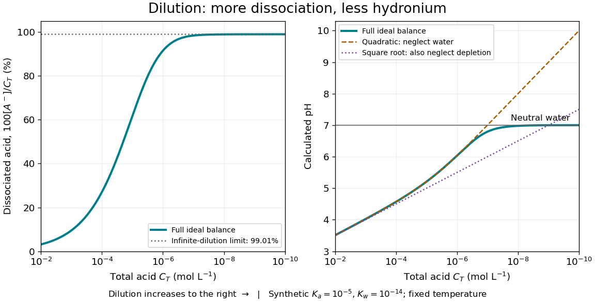

# Weak acid dissociation fraction

↑ **Parent:** [Weak acid](weak-acid.md)

For a [monoprotic acid](monoprotic-acid.md) with [analytical concentration](analytical-concentration.md) $C_T=[\mathrm{HA}]+[\mathrm A^-]$, define the [dimensionless](dimensionless-quantity.md) [weak acid dissociation fraction](weak-acid-dissociation-fraction.md)

$$
\alpha=\frac{[\mathrm A^-]}{C_T},\qquad 1-\alpha=\frac{[\mathrm{HA}]}{C_T}.
$$

This counts acid units in the [conjugate base](conjugate-base.md) form. Identifying it with $[\mathrm H_3\mathrm O^+]/C_T$ additionally requires negligible [self-ionization of water](self-ionization-of-water.md) and no other sources of [electric charge](electric-charge-split.md). In the ideal dilute [chemical solution](solution-chemistry.md) model, with $h=[\mathrm H_3\mathrm O^+]/c^\circ$, the [acid dissociation constant](acid-dissociation-constant.md) gives $\alpha=K_a/(K_a+h)$. Thus lowering [hydronium](hydronium.md) [thermodynamic activity](thermodynamic-activity.md) favors the [conjugate base](conjugate-base.md).

**[Figure 1](#weak-acid-dilution-equilibrium). Dilution increases the weak acid dissociation fraction while raising pH in a synthetic aqueous chemical equilibrium**.

The diagram uses stipulated [dimensionless](dimensionless-quantity.md) [acid dissociation constant](acid-dissociation-constant.md) $K_a=10^{-5}$ and [self-ionization of water](self-ionization-of-water.md) ion product $K_w=10^{-14}$ at fixed [temperature](temperature-split.md); these are model inputs, not measurements of a named substance. It solves the [weak acid mass and charge balances](weak-acid-mass-and-charge-balances.md). At $C_T=0.010\,\mathrm{mol\,L^{-1}}$, the calculated [weak acid dissociation fraction](weak-acid-dissociation-fraction.md) is about $3.11\%$ and [pH](ph.md) about $3.51$; at $C_T=10^{-4}\,\mathrm{mol\,L^{-1}}$, they are about $27.0\%$ and $4.57$. More acid units are dissociated as a fraction of the total, yet fewer [hydronium](hydronium.md) [ions](ion.md) occur per [volume](volume-thermodynamics.md).

At extreme [dilution](dilution.md), [self-ionization of water](self-ionization-of-water.md) makes $h$ approach $\sqrt{K_w}$, so [pH](ph.md) approaches $7$ for the chosen model. The limiting [weak acid dissociation fraction](weak-acid-dissociation-fraction.md) is $K_a/(K_a+\sqrt{K_w})\approx0.9901$, rather than exactly one. The calculation assumes pure added [water](water.md), a neutral [monoprotic acid](monoprotic-acid.md), and no competing [chemical reactions](chemical-reaction-split.md); actual contamination becomes increasingly important as $C_T$ falls.

## ↑ Ancestors (5)

1. [Weak acid](weak-acid.md)
2. [Acid (chemistry)](acid-chemistry.md)
3. [Acid-base chemistry](acid-base-chemistry-split.md)
4. [Chemistry](chemistry-split.md)
5. [Codex Wiki](split.md)

## ← Incoming links (5)

- [Conjugate base](conjugate-base.md)
- [Ideal weak electrolyte dilution law](ideal-weak-electrolyte-dilution-law.md)
- [Weak acid](weak-acid.md)
- [Weak acid dissociation fraction](weak-acid-dissociation-fraction.md)
- [Weak electrolyte](weak-electrolyte.md)
