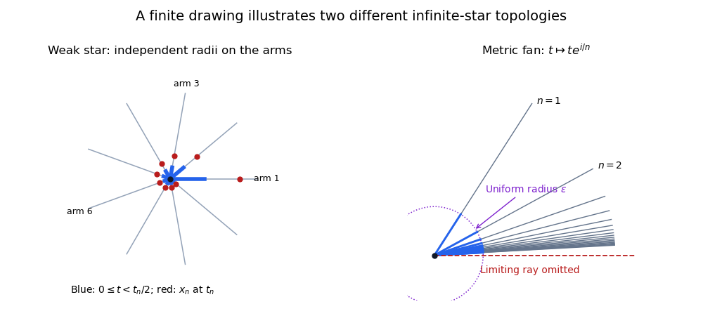

# Weak realization of a countable star

↑ **Parent:** [Weak topology of a simplicial realization](weak-topology-of-a-simplicial-realization.md)

Identify the initial endpoints of countably many [closed intervals](closed-real-interval.md) to a vertex $v$, using the [quotient topology](quotient-topology.md). This is the [geometric realization](geometric-realization-of-a-simplicial-complex.md) of the complex whose only edges are $\{v,u_n\}$. A [neighbourhood](neighbourhood-mathematics.md) of $v$ may contain a separately chosen initial interval $[0,\varepsilon_n)$ on each arm, with no positive lower bound on the $\varepsilon_n$.

The space is not [first countable](first-countable-space.md). Given any proposed countable [neighbourhood basis](neighbourhood-basis.md) $(U_n)$ at $v$, choose a point $x_n$ at coordinate $t_n>0$ on arm $n$ with $x_n\in U_n$. This is possible by the interval topology on that arm. The set whose intersection with arm $n$ is $[0,t_n/2)$ is an open neighbourhood $V$ of $v$, by the simplexwise definition. But $x_n\in U_n\setminus V$ for every $n$, so no $U_n$ lies inside $V$. Consequently this weak star cannot embed in the plane, or in any [metric space](metric-space.md).

The terminal vertices form an infinite [closed discrete subset](closed-discrete-subset.md): on each closed arm they meet only its terminal endpoint. Hence the star is not [compact](compact-space.md), by [closed discrete subsets of compact spaces are finite](closed-discrete-subsets-of-compact-spaces-are-finite.md).

**[Figure 3](#image-independent-weak-star-neighbourhoods-and-the-metric-fan-topology). Independent weak-star neighbourhoods and the metric fan topology**. The finite schematic on the left illustrates different initial lengths on different arms. The planar fan on the right has uniform-radius neighbourhoods at the common vertex and carries the metric realization topology.

## ↑ Ancestors (8)

1. [Weak topology of a simplicial realization](weak-topology-of-a-simplicial-realization.md)
2. [Geometric realization of a simplicial complex](geometric-realization-of-a-simplicial-complex.md)
3. [Simplicial complex](simplicial-complex.md)
4. [Algebraic topology](algebraic-topology-split.md)
5. [Geometry and topology](geometry-and-topology-split.md)
6. [Area of mathematics](area-of-mathematics.md)
7. [Mathematics](mathematics-split.md)
8. [Codex Wiki](split.md)

## ← Incoming links (2)

- [Metric realization of a countable star](metric-realization-of-a-countable-star.md)
- [Solution](past-exam-of-the-topology-course-of-the-university-of-oxford/2017/3/a/iv/solution.md)
