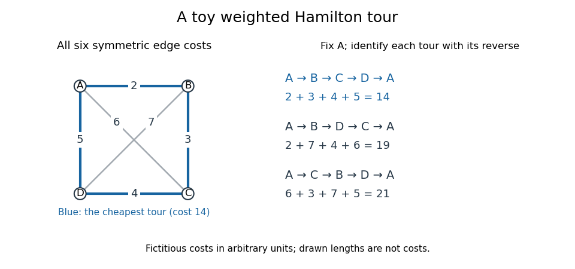

# Weighted Hamilton cycle

↑ **Parent:** [Hamilton cycle](hamilton-cycle.md)

A [weighted Hamilton cycle](weighted-hamilton-cycle.md) is a [Hamilton cycle](hamilton-cycle.md) in a [weighted graph](weighted-graph.md), with cost equal to the sum of its traversed [edge](edge-of-a-graph.md) weights. Here weights represent symmetric nonnegative costs, rather than conductances. Asking whether a [Hamilton cycle](hamilton-cycle.md) exists is a feasibility question; asking for the cheapest one is an instance of the [travelling salesman problem](travelling-salesman-problem.md). A [complete graph](complete-graph.md) supplies every possible connection between distinct [vertices](vertex-graph-theory.md), making feasibility automatic for $n\geq3$, while choosing the cheapest visiting order remains a separate [mathematical optimization](mathematical-optimization-split.md) problem.

**[Figure 23](#weighted-hamilton-cycle-four-vertex-tours). A fictitious weighted graph on four vertices: its three Hamilton cycles, identified under reversal and cyclic rotation, have costs 14, 19 and 21**.

Assign the [complete graph](complete-graph.md) $K_4$ the symmetric [edge](edge-of-a-graph.md) costs $w_{AB}=2$, $w_{BC}=3$, $w_{CD}=4$, $w_{AD}=5$, $w_{AC}=6$ and $w_{BD}=7$, in arbitrary units. Fix the start at $A$ and identify each [Hamilton cycle](hamilton-cycle.md) with its reverse. The three possibilities are

$$
\begin{aligned}
A,B,C,D,A &: 2+3+4+5=14,\\
A,B,D,C,A &: 2+7+4+6=19,\\
A,C,B,D,A &: 6+3+7+5=21.
\end{aligned}
$$

These exhaust the possibilities: the [permutations](permutation.md) of the other three [vertices](vertex-graph-theory.md) give $3!=6$ orders, paired into three reversals. Hence the perimeter tour really is optimal for this toy instance. The diagram's geometric lengths are not costs, and no [triangle inequality](triangle-inequality.md) is assumed.

The usefulness of this model is to distinguish visiting required sites from covering required connections. If tasks are assigned to [vertices](vertex-graph-theory.md) and the route must return after one visit to each, a [weighted Hamilton cycle](weighted-hamilton-cycle.md) captures the ordering requirement. If the job instead requires each [edge](edge-of-a-graph.md) once, the relevant object is an [Euler circuit](euler-circuit.md). The [shortest path problem](shortest-path-problem.md) asks only for a cheapest route between specified endpoints. A 1954 primary research paper gave a concrete motivation for the [travelling salesman problem](travelling-salesman-problem.md): certify that a particular tour through 49 cities has minimum road-distance cost.[Solution of a Large-Scale Traveling-Salesman Problem by G. Dantzig, R. Fulkerson and S. Johnson, abstract; Journal of the Operations Research Society of America 2(4), pp. 393–410 (1954)](solution-of-a-large-scale-traveling-salesman-problem-by-george-b-dantzig-and-others.md)

These are abstract route models. If a cost stands for a whole [graph path](path-in-a-graph.md) through an underlying network, travelling between consecutive task [vertices](vertex-graph-theory.md) can pass through intermediate network [vertices](vertex-graph-theory.md) more than once. One visit per task therefore does not imply one visit per physical junction. One-way connections require a [directed graph](directed-graph.md); changing costs or extra timing constraints require a richer model than the fixed symmetric toy instance.

## ↑ Ancestors (9)

1. [Hamilton cycle](hamilton-cycle.md)
2. [Cycle graph](cycle-graph.md)
3. [Cycle in a graph](cycle-in-a-graph.md)
4. [Path in a graph](path-in-a-graph.md)
5. [Graph theory](graph-theory-split.md)
6. [Foundations of mathematics](foundations-of-mathematics-split.md)
7. [Area of mathematics](area-of-mathematics.md)
8. [Mathematics](mathematics-split.md)
9. [Codex Wiki](split.md)

## ← Incoming links (1)

- [Weighted Hamilton cycle](weighted-hamilton-cycle.md)
