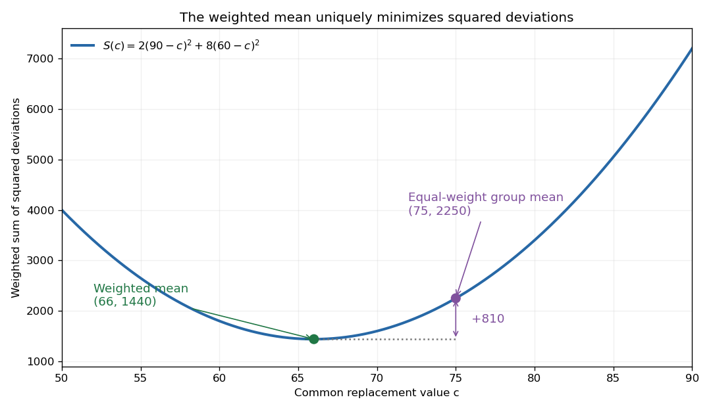

# Weighted mean minimizes squared deviations

↑ **Parent:** [Weighted arithmetic mean](weighted-arithmetic-mean.md)

For a finite list of [real numbers](real-number.md) $x_i$ and nonnegative weights of positive total $W$, the [weighted mean](weighted-arithmetic-mean.md) uniquely minimizes the weighted [sum](sum.md) of squared deviations

$$
S(c)=\sum_iw_i(x_i-c)^2.
$$

Expanding around $\bar x_w$ and using $\sum_iw_i(x_i-\bar x_w)=0$ gives

$$
\boxed{S(c)=S(\bar x_w)+W(c-\bar x_w)^2.}
$$

Every displacement from the [weighted mean](weighted-arithmetic-mean.md) increases the objective. This is the simplest one-parameter [weighted least squares](weighted-least-squares.md) problem: represent all entries by one common value.

For the weighted values $90$ and $60$ with weights $2$ and $8$,

$$
S(c)=2(90-c)^2+8(60-c)^2
=1440+10(c-66)^2.
$$

Thus $S(66)=1440$, while $S(75)=2250$. The minimum is defined by this squared-error criterion; a different loss can select a different summary, such as a [median](median.md) under unweighted absolute deviations.

**[Figure 8](#image-the-weighted-mean-is-the-unique-minimum-of-a-squared-error-objective). The weighted mean is the unique minimum of a squared-error objective**. For $S(c)=2(90-c)^2+8(60-c)^2$, the minimum is at $c=66$. Moving to $75$ increases the objective by $10(75-66)^2=810$.

## ↑ Ancestors (8)

1. [Weighted arithmetic mean](weighted-arithmetic-mean.md)
2. [Sum](sum.md)
3. [Summation](summation.md)
4. [Addition](addition.md)
5. [Arithmetic](arithmetic-split.md)
6. [Area of mathematics](area-of-mathematics.md)
7. [Mathematics](mathematics-split.md)
8. [Codex Wiki](split.md)

## ← Incoming links (2)

- [Arithmetic mean](arithmetic-mean.md)
- [Weighted geometric mean](weighted-geometric-mean.md)
