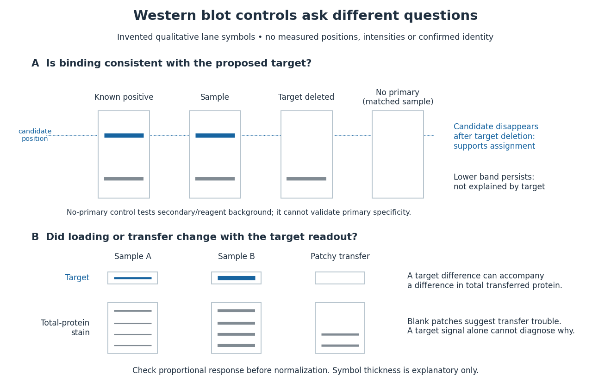

# Western blot controls

↑ **Parent:** [Western blot](western-blot.md)

[Western blot loading controls](western-blot-loading-control.md) ask how much sample entered each lane; [Western blot transfer controls](western-blot-transfer-control.md) ask what reached the receiving sheet; [Western blot antibody specificity controls](western-blot-antibody-specificity-control.md) ask what the [antibodies](antibody.md) recognized. Each closes a different gap in [Western blot band interpretation](western-blot-band-interpretation.md).

**[Figure 31](#image-conceptual-lanes-for-western-blot-controls). Conceptual lanes for Western blot controls**. Original schematic, with invented qualitative marks only. Candidate bands disappear in a target-deleted sample while a lower band persists; a separate panel shows how a loading or transfer difference can accompany a target-band difference. No lane, darkness, band position or relative amount represents a measurement, a specific real [protein](protein.md) or confirmed identity. The no-primary comparison denotes a matched strip processed without [primary antibody](primary-antibody.md).

**Table of contents**

- [Western blot loading control](western-blot-loading-control.md)
- [Western blot transfer control](western-blot-transfer-control.md)
- [Western blot antibody specificity control](western-blot-antibody-specificity-control.md)

## ↑ Ancestors (4)

1. [Western blot](western-blot.md)
2. [Protein](protein.md)
3. [Biology](biology-split.md)
4. [Codex Wiki](split.md)

## ← Incoming links (2)

- [Western blot](western-blot.md)
- [Western blot controls](western-blot-controls.md)
