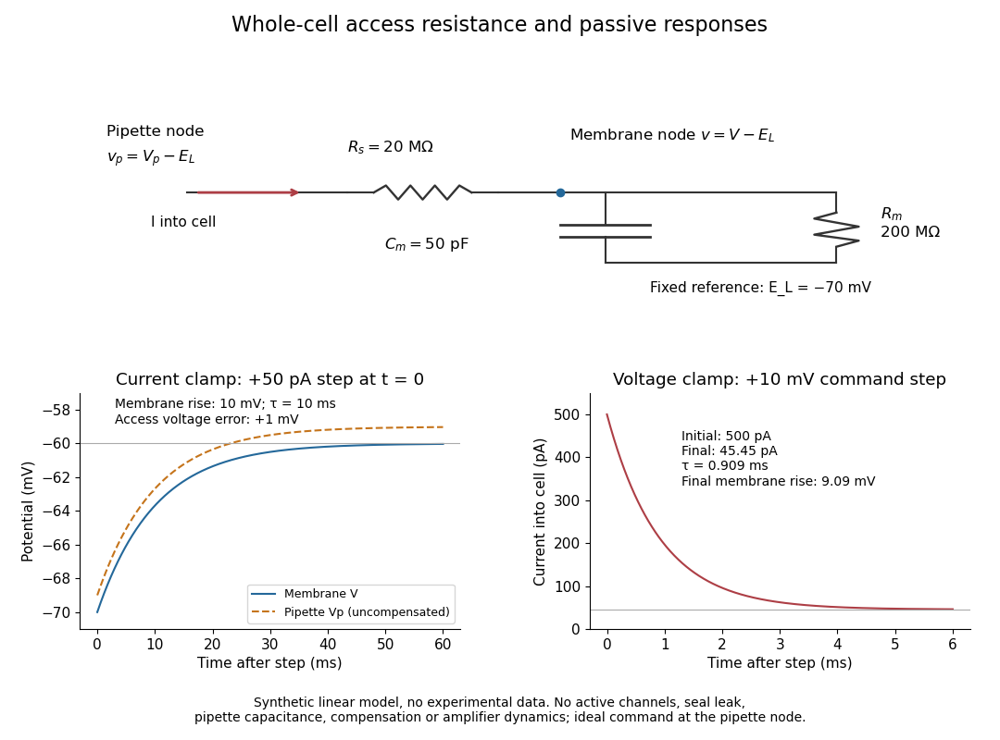

# Whole-cell recording

↑ **Parent:** [Patch clamp](patch-clamp.md)

[Whole-cell recording](whole-cell-recording.md) establishes intracellular electrical access by rupturing the membrane under a sealed [patch pipette](patch-pipette.md) while retaining the [gigaohm seal](gigaohm-seal.md). Under adequate [voltage clamp](voltage-clamp.md), the measured [electric current](electric-current.md) combines contributions from accessible [ion channels](ion-channel.md), [membrane capacitance](membrane-capacitance.md) and [seal leak current](seal-leak-current.md). [Current clamp](current-clamp.md) instead follows [membrane potential](membrane-potential-split.md) while supplying a chosen [electric current](electric-current.md). [Whole-cell recording](whole-cell-recording.md) is useful for linking a [biological cell](biological-cell-split.md)'s total electrical response to its [ion channels](ion-channel.md), but neither mode automatically controls distant [dendrites](dendrite.md) or preserves the original [cytosol](cytosol.md).

In the 1981 methods demonstration, a bovine chromaffin [biological cell](biological-cell-split.md) was tested before and after patch rupture. Small [voltage clamp](voltage-clamp.md) steps produced a much larger capacitive transient after break-in. Integrating it gave $5\,\mathrm{pF}$ for a $13\,\mu\mathrm m$ cell; its decay indicated [patch-clamp series resistance](patch-clamp-series-resistance.md) below $20\,\mathrm{M\Omega}$. Depolarizing commands then revealed ionic [electric currents](electric-current.md). Separate [current clamp](current-clamp.md) recordings showed spontaneous [action potentials](action-potential.md). The comparison established access to the cell interior, rather than a claim that every pipette command equals [membrane potential](membrane-potential-split.md). Slower transients sometimes indicated incomplete rupture, and these small-cell results do not establish spatial control of a branched [neuron](neuron.md).[pp. 98–99, Figure 15 and following voltage-clamp and current-clamp discussion](improved-patch-clamp-techniques-for-high-resolution-current-recording-from-cells-and-cell-free-membrane-patches-by-o-p-hamill-and-others.md)

**[Figure 14](#image-synthetic-whole-cell-recording-patch-clamp-series-resistance-and-passive-responses). Synthetic whole-cell recording: patch-clamp series resistance and passive responses**. An original equivalent [electrical circuit](electrical-circuit-split.md) uses $R_s=20\,\mathrm{M\Omega}$, $R_m=200\,\mathrm{M\Omega}$ and $C_m=50\,\mathrm{pF}$. The [current clamp](current-clamp.md) step and [voltage clamp](voltage-clamp.md) step are separate synthetic experiments. The passive model omits active [ion channels](ion-channel.md), [seal leak current](seal-leak-current.md), pipette [capacitance](capacitance.md) and amplifier dynamics. Curves are calculations, not experimental measurements.

**Table of contents**

- [Patch-clamp series resistance](patch-clamp-series-resistance.md)
- [Membrane capacitance](membrane-capacitance.md)
- [Space clamp](space-clamp.md)
- [Cytosol dialysis](cytosol-dialysis.md)
- [Perforated patch recording](perforated-patch-recording.md)

## ↑ Ancestors (4)

1. [Patch clamp](patch-clamp.md)
2. [Neuroscience](neuroscience-split.md)
3. [Biology](biology-split.md)
4. [Codex Wiki](split.md)

## ← Incoming links (9)

- [Current clamp](current-clamp.md)
- [Cytosol dialysis](cytosol-dialysis.md)
- [Neuron](neuron.md)
- [Outside-out patch](outside-out-patch.md)
- [Patch clamp](patch-clamp.md)
- [Perforated patch recording](perforated-patch-recording.md)
- [Single-channel recording](single-channel-recording.md)
- [Spatial summation](spatial-summation.md)
- [Whole-cell recording](whole-cell-recording.md)
