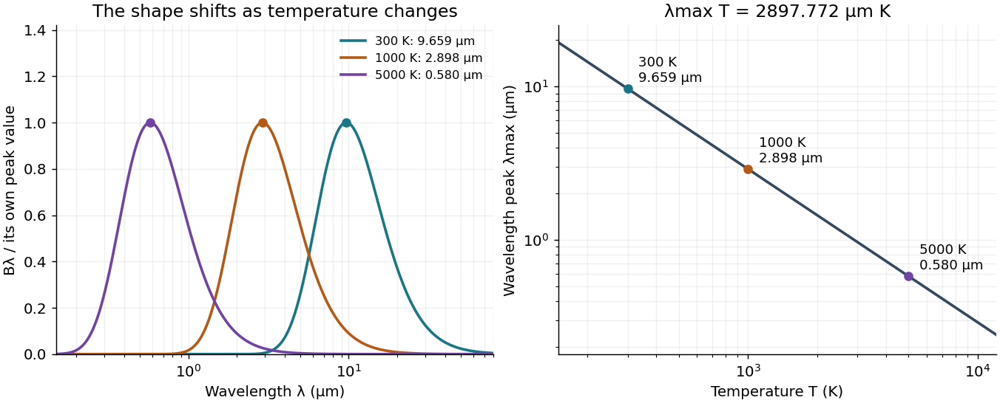

<h1 id="wien-s-displacement-law">Wien's displacement law</h1>

↑ **Parent:** [Planck function](planck-function.md)  
ⓦ [Wiki](https://en.wikipedia.org/wiki/Wien's_displacement_law)

[Wien's displacement law](wien-s-displacement-law.md) says that the [wavelength](wavelength.md) maximizing the [Planck function](planck-function.md) per unit [wavelength](wavelength.md), $B_\lambda(T)$, moves inversely with absolute [temperature](temperature-split.md):

$$
\lambda_{\max}T=b,\qquad b\simeq2.897771955\times10^{-3}\,\mathrm{m\,K}.
$$

Here $b$ is the [Wien displacement constant](wien-displacement-constant.md). Heating an ideal [blackbody](blackbody.md) therefore shifts this peak toward shorter [wavelengths](wavelength.md), while also increasing its emission at every fixed [wavelength](wavelength.md). The peak identifies where equal narrow [wavelength](wavelength.md) intervals carry the most [power](power.md); it is not a single emitted [wavelength](wavelength.md). [Planck's law](planck-s-law.md) supplies the full curve, and the [Stefan–Boltzmann law](stefan-boltzmann-law.md) supplies its integral.

Specify the spectral coordinate before finding a peak. The [frequency form of Wien's displacement law](frequency-form-of-wien-s-displacement-law.md) maximizes $B_\nu$, which is [spectral radiance](spectral-radiance.md) per unit [frequency](frequency.md). Its maximum is not $c/\lambda_{\max}$. The [frequency and wavelength spectral radiance conversion](frequency-and-wavelength-spectral-radiance-conversion.md) changes the density as well as the horizontal coordinate; the existing [frequency and wavelength peaks of Planck's law](frequency-and-wavelength-peaks-of-planck-s-law.md) give a complementary numerical comparison.

In his 11 December 1911 Nobel lecture, [Wilhelm Wien](wilhelm-wien.md) explained the displacement principle through a [thought experiment](thought-experiment.md): compress [black-body radiation](black-body-radiation.md) between reflecting moving walls. Work against [radiation pressure](radiation-pressure.md) raises the [energy density](energy-density.md), while reflection changes each [frequency](frequency.md) by the [Doppler effect](doppler-effect.md). The [Second law of thermodynamics](second-law-of-thermodynamics-split.md) connects the resulting spectrum to one at a higher [temperature](temperature-split.md). This determines how the spectrum scales between [temperatures](temperature-split.md), without determining its complete shape. The [Wien approximation](wien-approximation.md) is a separate, restricted spectral formula.[Nobel Lectures, Physics 1901–1921; Wilhelm Wien, On the laws of thermal radiation, Nobel Lecture, 11 December 1911, printed pp.276–280: cavity, compression argument, displacement and distinction from the spectral-distribution problem](nobel-lectures-physics-1901-1921/on-the-laws-of-thermal-radiation-by-wilhelm-wien.md)

**[Figure 12](#image-wien-s-displacement-law-spectral-peaks-and-inverse-temperature-scaling). Wien's displacement law: spectral peaks and inverse temperature scaling**. Left: [Planck function](planck-function.md) curves divided by their own maxima, for three stipulated [temperatures](temperature-split.md). This normalization hides the increase in absolute [spectral radiance](spectral-radiance.md). Right: the peak [wavelength](wavelength.md) follows $b/T$; a tenfold rise in [temperature](temperature-split.md) divides the peak [wavelength](wavelength.md) by ten. The curves are computed ideal [blackbody](blackbody.md) predictions.

**Table of contents**

- [Derivation of Wien's displacement law](derivation-of-wien-s-displacement-law.md)
- [Frequency form of Wien's displacement law](frequency-form-of-wien-s-displacement-law.md)
- [Wien displacement constant](wien-displacement-constant.md)
- [Blackbody peak and detector response](blackbody-peak-and-detector-response.md)
- [Coblentz's cavity-radiation spectrum measurement](coblentz-s-cavity-radiation-spectrum-measurement.md)

## ↑ Ancestors (6)

1. [Planck function](planck-function.md)
2. [Radiative transfer](radiative-transfer.md)
3. [Astrophysics](astrophysics-split.md)
4. [Branches of physics](branches-of-physics.md)
5. [Physics](physics-split.md)
6. [Codex Wiki](split.md)

## ← Incoming links (14)

- [Black-body radiation](black-body-radiation.md)
- [Frequency and wavelength peaks of Planck's law](frequency-and-wavelength-peaks-of-planck-s-law.md)
- [Infrared](infrared.md)
- [Nobel Prize in Physics in 1911](nobel-prize-in-physics-in-1911.md)
- [Solution](past-exam-of-the-atmospheric-physics-course-of-the-university-of-cambridge/2013/paper-1/2/solution.md)
- [Solution](past-exam-of-the-mathematics-course-of-the-university-of-cambridge/2017/iii/paper-315/1/c/solution.md)
- [Longitudinal coherence estimate](past-exam-of-the-optics-and-electrodynamics-course-of-the-university-of-cambridge/2019/section-a/a3/longitudinal-coherence-estimate.md)
- [Solution](past-exam-of-the-physics-a-course-of-the-university-of-cambridge/2014/paper-1/section-c/c10/solution.md)
- [Solution](past-exam-of-the-physics-a-course-of-the-university-of-cambridge/2021/paper-1/section-d/d9/solution.md)
- [Solution](past-exam-of-the-physics-b-course-of-the-university-of-cambridge/2022/paper-2/section-c/c9/e/solution.md)
- [Planck's law](planck-s-law.md)
- [Planet-star radius estimate in the Rayleigh-Jeans limit](planet-star-radius-estimate-in-the-rayleigh-jeans-limit.md)
- [Wien's displacement law](wien-s-displacement-law.md)
- [Wilhelm Wien](wilhelm-wien.md)
