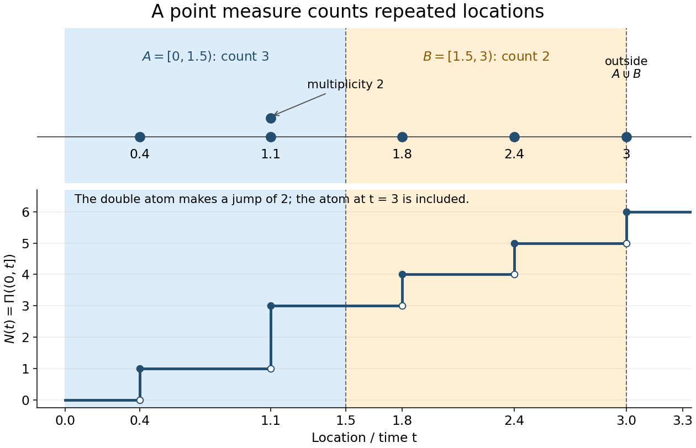

# Window count of a point process

↑ **Parent:** [Point process](point-process.md)

For a bounded [Borel set](borel-set.md) $W\subset\mathbb R^d$, the window count $N_W$ of a locally finite [point process](point-process.md) is a finite [nonnegative integer](natural-number.md) [random variable](random-variable-split.md). It counts multiplicities, and the convention for window boundaries matters. On the time half-line, $N(t)=\Pi((0,t])$ is a [counting process](counting-process.md) and $N(t)-N(s)=\Pi((s,t])$. For pairwise [disjoint observation windows](disjoint-observation-windows.md) $W_1,\ldots,W_m$, the [measure](measure.md) identity

$$
\Pi\!\left(\bigcup_{i=1}^m W_i\right)=\sum_{i=1}^m\Pi(W_i)
$$

is valid for every realization. Additivity of counts supplies no [independence](independent-random-variables.md) assumption.

**[Figure 3](#image-window-counts-include-multiplicity-and-depend-on-boundary-conventions). Window counts include multiplicity and depend on boundary conventions**. One locally finite point [measure](measure.md) is $\delta_{0.4}+2\delta_{1.1}+\delta_{1.8}+\delta_{2.4}+\delta_{3.0}$. The half-open windows $A=[0,1.5)$ and $B=[1.5,3)$ have counts three and two; $\Pi(A\cup B)=5$. The atom at three lies outside both windows. Two stacked dots denote the double atom at $1.1$, and the step plot records $N(t)=\Pi((0,t])$, which includes the atom at three.

**Table of contents**

- [Disjoint observation windows](disjoint-observation-windows.md)

## ↑ Ancestors (6)

1. [Point process](point-process.md)
2. [Probability theory](probability-theory-split.md)
3. [Probability and statistics](probability-and-statistics-split.md)
4. [Area of mathematics](area-of-mathematics.md)
5. [Mathematics](mathematics-split.md)
6. [Codex Wiki](split.md)
