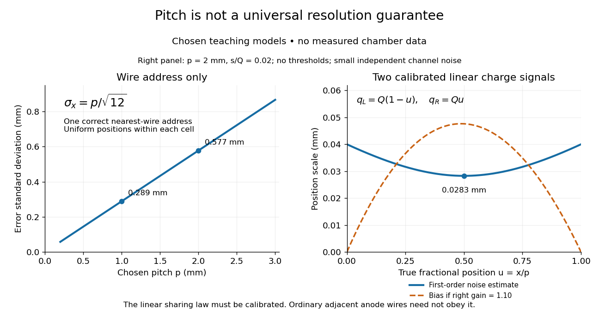

# Wire-address position model

↑ **Parent:** [Multiwire proportional chamber](multiwire-proportional-chamber.md)

Consider an original idealized [track reconstruction](track-reconstruction.md) model. Let equally spaced wires have positions $x_k=kp$ and assign each event to the nearest wire, reporting $\widehat x=x_k$. Assume **exactly one correct wire address**, perfect [detection efficiency](detection-efficiency.md), exact wire positions and a [uniform distribution](continuous-uniform-distribution.md) of true positions within each cell. These assumptions explicitly exclude missed pulses, false addresses and several unresolved tracks.

Writing $u=x-x_k$, the [measurement error](measurement-error.md) is $e=\widehat x-x=-u$, with $u$ uniform on $[-p/2,p/2]$. Symmetry gives zero [expected value](expected-value-split.md). Its [variance](variance-split.md) and [standard deviation](standard-deviation.md) follow by integration:

$$
\mathbb E[e]=0,\qquad
\sigma_x^2=\mathbb E[e^2]=\frac{1}{p}\int_{-p/2}^{p/2}u^2\,du=\frac{p^2}{12},\qquad
\sigma_x=\frac{p}{\sqrt{12}}.
$$

For chosen [wire pitches](wire-pitch.md) $p=2\,\mathrm{mm}$ and $1\,\mathrm{mm}$ this gives $0.577\,\mathrm{mm}$ and $0.289\,\mathrm{mm}$ respectively. These are model [standard deviations](standard-deviation.md), not measured chamber [spatial resolutions](spatial-resolution.md). The largest possible absolute error in this model is $p/2$, which is a different quantity.

A useful subtlety is that the formula depends on the illumination. For an unresolved pencil beam fixed at $x=x_k+0.4p$, every reconstructed position is $x_k$. The repeated estimates have zero [variance](variance-split.md), but every error is $-0.4p$. Small repeat-to-repeat spread can coexist with a biased position. The uniform-cell result therefore cannot be transferred to an arbitrary beam profile or detector selection.

The wire address supplies one transverse coordinate in this model. Combining several separated measurements supports [track reconstruction](track-reconstruction.md); a single address does not specify a complete [trajectory](trajectory.md). If two [charged particles](charged-particle.md) enter the same cell during one accepted interval, an address-only record can be identical to that from one particle. No reconstruction of that record can recover the lost multiplicity without additional information.

**[Figure 2](#image-chosen-wire-address-errors-and-a-calibrated-two-wire-response-model). Chosen wire-address errors and a calibrated two-wire response model**. Original teaching calculations, not measured data. Left: uniform-cell address error. Right: stipulated linear charge response with independent small channel noise; the noise estimate is a first-order approximation, not a chamber performance claim.

## ↑ Ancestors (5)

1. [Multiwire proportional chamber](multiwire-proportional-chamber.md)
2. [Particle detector](particle-detector.md)
3. [Particle detection](particle-detection-split.md)
4. [Physics](physics-split.md)
5. [Codex Wiki](split.md)
