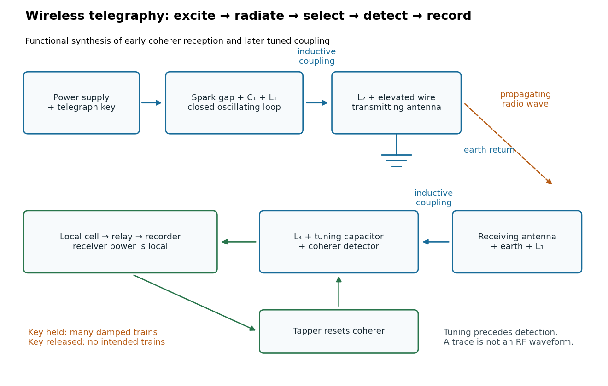

# Wireless telegraphy

↑ **Parent:** [Radio communication](radio-communication.md)  
ⓦ [Wiki](https://en.wikipedia.org/wiki/Wireless_telegraphy)

Wireless telegraphy conveys discrete symbols without a connecting message wire. Here the mechanism is [radio communication](radio-communication.md): keyed excitation produces [radio waves](radio-wave.md), a receiving [antenna](antenna-radio.md) drives a selective [electrical circuit](electrical-circuit-split.md), and a detector produces a readable event. This makes a beautiful bridge between [resonance](resonance.md) and information: accumulating many appropriately timed small electrical disturbances can distinguish one transmission from another. Selectivity is finite, however; [resonance](resonance.md) alone cannot guarantee immunity to strong unwanted [signals](signal.md) or [noise](noise-signal-processing.md).

The 1909 [Nobel Prize in Physics](nobel-prize-in-physics-split.md) recognized [Guglielmo Marconi](guglielmo-marconi.md) and [Karl Ferdinand Braun](karl-ferdinand-braun.md) for contributions to wireless telegraphy.[1909 award motivation and joint laureates](the-nobel-prize-in-physics-1909-by-nobel-prize-outreach.md) Their apparatus should be understood as a developing collection of systems. An early [coherer](coherer.md) receiver, a later tuned receiver and a modern [envelope detector](envelope-detector.md) are different instruments.

**[Figure 24](#image-functional-transmit-and-receive-chain-for-tuned-spark-wireless-telegraphy). Functional transmit and receive chain for tuned spark wireless telegraphy**. Original functional synthesis of [tuned spark wireless apparatus](tuned-spark-wireless-apparatus.md) and early [coherer](coherer.md) reception. Arrows show functional transfer; local [battery](electric-battery.md) [energy](energy-split.md) powers recording.

**Table of contents**

- [Coherer](coherer.md)
- [Telegraph relay](telegraph-relay.md)
- [Tuned spark wireless apparatus](tuned-spark-wireless-apparatus.md)
  - [Braun's receiver coupling experiment](braun-s-receiver-coupling-experiment.md)
- [Spark-excited damped oscillation](spark-excited-damped-oscillation.md)
- [Coupled resonant circuit demonstration](coupled-resonant-circuit-demonstration.md)
  - [Coupled resonant circuit model](coupled-resonant-circuit-model.md)

## ↑ Ancestors (4)

1. [Radio communication](radio-communication.md)
2. [Telecommunication](telecommunication.md)
3. [Electrical engineering](electrical-engineering-split.md)
4. [Codex Wiki](split.md)

## ← Incoming links (5)

- [Guglielmo Marconi](guglielmo-marconi.md)
- [Karl Ferdinand Braun](karl-ferdinand-braun.md)
- [Nobel Prize in Physics in 1909](nobel-prize-in-physics-in-1909.md)
- [Radio communication](radio-communication.md)
- [Telegraphy](telegraphy.md)
