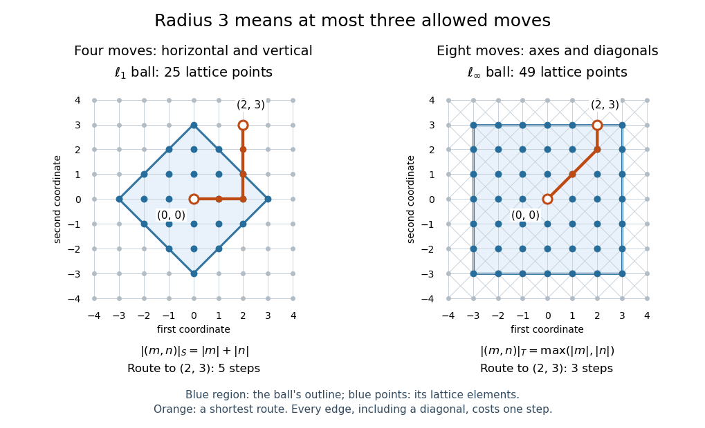

# Word metric balls in the integer lattice

↑ **Parent:** [Word metric ball](word-metric-ball.md)

The additive [group](group-split.md) $\mathbb Z^2$ gives a useful way to see what a [word metric](word-metric.md) measures. Let $e_1=(1,0)$ and $e_2=(0,1)$, and choose the four-move [generating set of a group](generating-set-of-a-group.md) $S=\{\pm e_1,\pm e_2\}$. Its [Cayley graph](cayley-graph.md) is the [square lattice](square-lattice.md). Each move changes exactly one [coordinate](coordinate-linear-algebra.md) by one, so the [word length](word-length.md) is the [L1 norm](l1-norm.md), and the [word metric](word-metric.md) is [Manhattan distance](manhattan-distance.md):

$$
|(m,n)|_S=|m|+|n|.
$$

At least this many moves are necessary, and moving horizontally then vertically attains the bound. Bridson gives this [square lattice](square-lattice.md) as a basic [Cayley graph](cayley-graph.md) example.[Bridson, Example 1.8](https://people.maths.ox.ac.uk/bridson/papers/BATH97.pdf)

Now allow all eight neighbouring lattice points as moves:

$$
T=\{\pm e_1,\pm e_2,\pm(1,1),\pm(1,-1)\},\qquad |(m,n)|_T=\max\{|m|,|n|\}.
$$

Each [coordinate](coordinate-linear-algebra.md) changes by at most one per move. Use diagonal moves until the smaller displacement is exhausted, then use axis moves: the resulting [word length](word-length.md) is the [maximum norm](supremum-norm.md), and the [word metric](word-metric.md) is [Chebyshev distance](chebyshev-distance.md). From $(0,0)$ to $(2,3)$, an $S$-route has five steps, while the $T$-route $(0,0),(1,1),(2,2),(2,3)$ has three.

The closed [word metric balls](word-metric-ball.md) $B_S(0,r)=\{v\in\mathbb Z^2:d_S(0,v)\leq r\}$ consist of lattice points inside a diamond for $S$, and inside an axis-aligned square for $T$. For every nonnegative [integer](integer-split.md) radius $r$,

$$
\#B_S(0,r)=1+\sum_{k=1}^{r}4k=1+2r(r+1),\qquad \#B_T(0,r)=(2r+1)^2.
$$

The diamond has $4k$ lattice points at [word length](word-length.md) $k>0$; the square has $2r+1$ choices for each [coordinate](coordinate-linear-algebra.md). At radius three the counts are $25$ and $49$. These are discrete [closed balls](closed-ball.md) for [Manhattan distance](manhattan-distance.md) and [Chebyshev distance](chebyshev-distance.md); an [Euclidean distance](euclidean-distance.md) bound would instead select lattice points inside a [Euclidean disk](disk-mathematics.md).

**[Figure 2](#image-radius-three-word-metric-balls-in-the-integer-lattice-a-diamond-with-25-points-and-a-square-with-49-points-with-routes-to-2-3). Radius-three word metric balls in the integer lattice: a diamond with 25 points and a square with 49 points, with routes to $(2,3)$**.

## ↑ Ancestors (8)

1. [Word metric ball](word-metric-ball.md)
2. [Word metric](word-metric.md)
3. [Cayley graph](cayley-graph.md)
4. [Geometric group theory](geometric-group-theory-split.md)
5. [Geometry and topology](geometry-and-topology-split.md)
6. [Area of mathematics](area-of-mathematics.md)
7. [Mathematics](mathematics-split.md)
8. [Codex Wiki](split.md)

## ← Incoming links (4)

- [Cayley graph](cayley-graph.md)
- [Equivalence of finite word metrics](equivalence-of-finite-word-metrics.md)
- [Word metric](word-metric.md)
- [Word metric ball](word-metric-ball.md)
