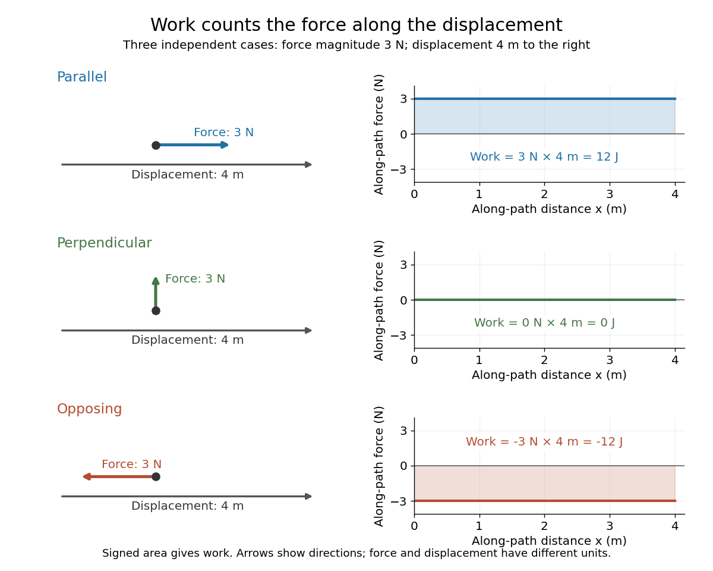

# Work done by a constant force

↑ **Parent:** [Work](work.md)

For a fixed [force](force-split.md) $\mathbf F$ and endpoint [displacement](displacement.md) $\Delta\mathbf r$, the [line integral](line-integral.md) reduces to a [dot product](dot-product.md):

$$
W=\mathbf F\cdot\Delta\mathbf r=Fd\cos\theta,
\qquad F=|\mathbf F|,\quad d=|\Delta\mathbf r|.
$$

Here $\theta$ is the [angle](angle.md) between the [force](force-split.md) and the [displacement](displacement.md). For straight motion, $d$ is also the distance traveled. A $3\,\mathrm N$ [force](force-split.md) acting along a $4\,\mathrm m$ [displacement](displacement.md) does $12\,\mathrm J$ of [work](work.md). Turning the same [force](force-split.md) perpendicular to the [displacement](displacement.md) gives $\cos(\pi/2)=0$ and zero [work](work.md); reversing it gives $\cos\pi=-1$ and $-12\,\mathrm J$. At $\theta=\pi/3$, the [work](work.md) is $6\,\mathrm J$. These signs describe [energy](energy-split.md) transferred to or from the moving body. [OpenStax University Physics 1, §7.1: Constant-force work](https://openstax.org/books/university-physics-volume-1/pages/7-1-work)

**[Figure 1](#image-work-from-parallel-perpendicular-and-opposing-forces). Work from parallel, perpendicular, and opposing forces**. Each left panel shows a $3\,\mathrm N$ [force](force-split.md) and a rightward $4\,\mathrm m$ [displacement](displacement.md). Each right panel plots the along-path [force](force-split.md) component against distance; its signed area is the [work](work.md): $12$, $0$, or $-12\,\mathrm J$. The arrows compare directions; their lengths do not compare quantities with different units. The three panels prescribe motion to illustrate [work](work.md); they are separate cases, not successive stages of one journey.

## ↑ Ancestors (6)

1. [Work](work.md)
2. [Energy](energy-split.md)
3. [Classical mechanics](classical-mechanics-split.md)
4. [Branches of physics](branches-of-physics.md)
5. [Physics](physics-split.md)
6. [Codex Wiki](split.md)
