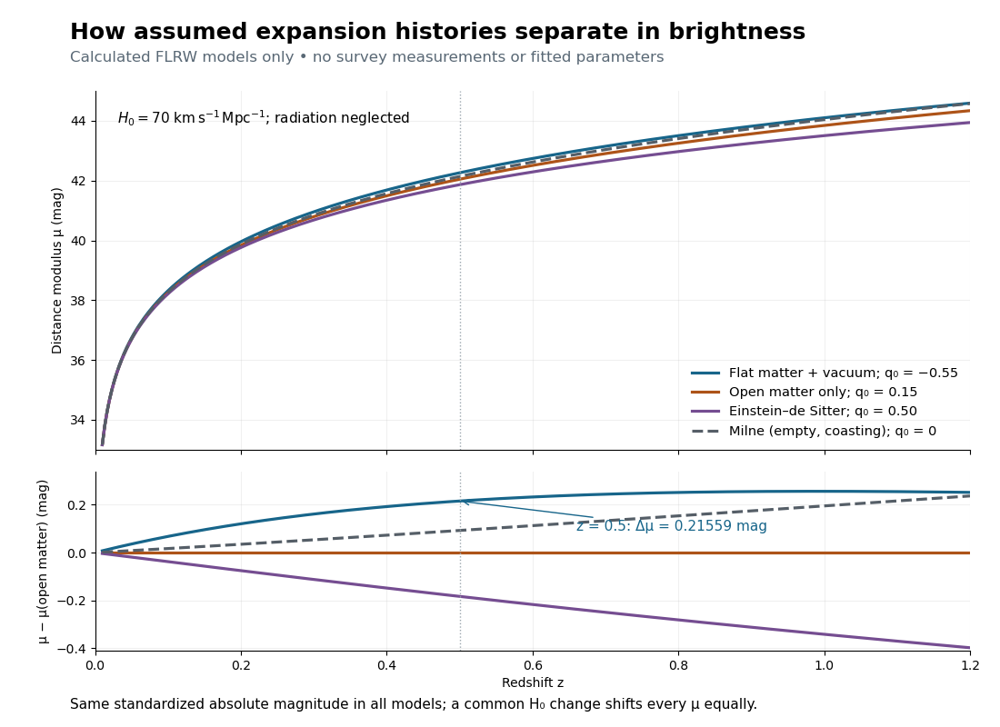

# Worked supernova distance comparison

↑ **Parent:** [Supernova discovery of accelerating expansion](supernova-discovery-of-accelerating-expansion.md)

Stipulate $H_0=70\,\mathrm{km\,s^{-1}\,Mpc^{-1}}$ and $c=299792.458\,\mathrm{km\,s^{-1}}$, so $c/H_0=4282.7494\,\mathrm{Mpc}$. A megaparsec is $10^6$ [parsecs](parsec.md). Neglect [radiation in cosmology](radiation-in-cosmology.md). Compare an accelerating flat model $(\Omega_{m,0},\Omega_{\Lambda,0})=(0.3,0.7)$, an open matter-only model $(0.3,0)$ and the [Einstein-de Sitter universe](einstein-de-sitter-universe.md) $(1,0)$. Their present [deceleration parameters](deceleration-parameter.md) are respectively $-0.55$, $0.15$ and $0.5$. For these models,

$$
E(z)=\frac{H(z)}{H_0}=\sqrt{\Omega_{m,0}(1+z)^3+\Omega_{k,0}(1+z)^2+\Omega_{\Lambda,0}},\qquad
\Omega_{k,0}=1-\Omega_{m,0}-\Omega_{\Lambda,0},
$$

$$
\chi(z)=\int_0^z\frac{dz'}{E(z')},\qquad
d_L=\frac{c}{H_0}(1+z)S_k(\chi),\qquad
S_k(\chi)=\begin{cases}
\sinh(\sqrt{\Omega_{k,0}}\chi)/\sqrt{\Omega_{k,0}},&\Omega_{k,0}>0,\\
\chi,&\Omega_{k,0}=0,\\
\sin(\sqrt{-\Omega_{k,0}}\chi)/\sqrt{-\Omega_{k,0}},&\Omega_{k,0}<0.
\end{cases}
$$

Here $\chi$ is dimensionless; the [radial null geodesic in FLRW spacetime](radial-null-geodesic-in-flrw-spacetime.md) supplies its integral and [spatial curvature of an FLRW universe](spatial-curvature-of-an-flrw-universe.md) supplies $S_k$. The observer-to-source [comoving radial distance](comoving-radial-distance.md) is $(c/H_0)\chi$, whereas the transverse distance uses $S_k$. Omitting the latter distinction would bias the open-model comparison.

At $z=0.5$, [numerical integration](numerical-integration-split.md) gives $\chi=0.440984335$ for the flat accelerating model and $\chi=0.392227378$ for the open matter-only model. Thus

$$
\begin{array}{c|r|r}
(\Omega_{m,0},\Omega_{\Lambda,0})&d_L\ (\mathrm{Mpc})&\mu=5\log_{10}[d_L/(1\,\mathrm{Mpc})]+25\\\hline
(0.3,0.7)&2832.9381&42.26119\\
(0.3,0)&2565.1861&42.04559\\
(1,0)&2357.6975&41.86244
\end{array}
$$

The accelerating model is $0.21559$ mag fainter than the open matter-only prediction at the same [redshift](redshift.md) and standardized [absolute magnitude](absolute-magnitude.md), corresponding to $1.10438$ times the [luminosity distance](luminosity-distance.md) and $0.81991$ times the [radiative flux](radiative-flux.md). These are model calculations, not observations from either collaboration.

**[Figure 6](#image-stipulated-flrw-distance-moduli-and-residuals-at-a-common-hubble-constant). Stipulated FLRW distance moduli and residuals at a common Hubble constant**. Calculated curves only, with no survey points. Residuals use the open matter-only model as reference. The coasting Milne model shows why curvature and the comparison family matter.

The [Milne model](milne-model.md) has $q=0$, $\Omega_{m,0}=\Omega_{\Lambda,0}=0$ and $\Omega_{k,0}=1$, giving $\chi=\log(1+z)$ and $d_L=(c/H_0)(z+z^2/2)$. The [Einstein-de Sitter luminosity-distance relation](einstein-de-sitter-luminosity-distance-relation.md) independently checks the flat matter-only integral. At $z=0.5$, the accelerating model exceeds the [Milne model](milne-model.md) by only $0.12317$ mag, illustrating the dependence of a residual on the chosen reference. Over a longer [redshift](redshift.md) interval, [luminosity distance](luminosity-distance.md) integrates past deceleration as well as recent acceleration; a residual need not increase forever.

Multiplying $H_0$ by $f>0$ at fixed density fractions divides every $d_L$ by $f$ and shifts every [distance modulus](distance-modulus.md) by $-5\log_{10}f$. The predicted [apparent magnitude](apparent-magnitude.md) is unchanged if $M_{B,0}$ simultaneously increases by $5\log_{10}f$. This is the [absolute magnitude–Hubble constant degeneracy](absolute-magnitude-hubble-constant-degeneracy.md). For example, $70\to77\,\mathrm{km\,s^{-1}\,Mpc^{-1}}$ shifts $\mu$ by $-0.20696$ mag and $M_{B,0}$ by $+0.20696$ mag. Relative curves at the same $H_0$ retain their separation; determining $H_0$ requires an external [absolute magnitude](absolute-magnitude.md) calibration.

## ↑ Ancestors (7)

1. [Supernova discovery of accelerating expansion](supernova-discovery-of-accelerating-expansion.md)
2. [Accelerating expansion of the universe](accelerating-expansion-of-the-universe.md)
3. [Deceleration parameter](deceleration-parameter.md)
4. [Cosmology](cosmology-split.md)
5. [Branches of physics](branches-of-physics.md)
6. [Physics](physics-split.md)
7. [Codex Wiki](split.md)

## ← Incoming links (1)

- [Supernova discovery of accelerating expansion](supernova-discovery-of-accelerating-expansion.md)
