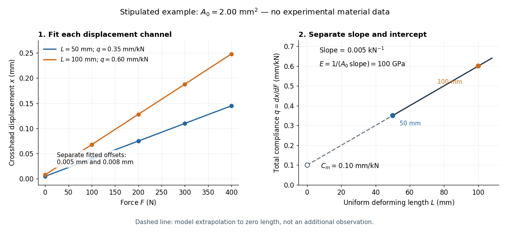

# Worked two-length tensile compliance example

↑ **Parent:** [Two-length machine compliance separation](two-length-machine-compliance-separation.md)

The following values are stipulated arithmetic inputs, not measurements of a material. Take $A_0=2.00\ \mathrm{mm^2}$ and lengths $L_1=50.0\ \mathrm{mm}$, $L_2=100.0\ \mathrm{mm}$. At [forces](force-split.md) $F=(0,100,200,300,400)\ \mathrm{N}$, stipulate [crosshead displacements](crosshead-displacement.md)

$$
\begin{aligned}
x_1&=(0.005,0.040,0.075,0.110,0.145)\ \mathrm{mm},\\
x_2&=(0.008,0.068,0.128,0.188,0.248)\ \mathrm{mm}.
\end{aligned}
$$

The two different initial offsets deliberately test the use of intercepts. [Linear regression](linear-regression-split.md) of $x_i=a_i+q_iF$ gives $a_1=0.005\ \mathrm{mm}$, $a_2=0.008\ \mathrm{mm}$ and

$$
q_1=3.50\times10^{-4}\ \mathrm{mm/N},\qquad
q_2=6.00\times10^{-4}\ \mathrm{mm/N}.
$$

Their reciprocal [spring constants](spring-constant.md) are $k_{\mathrm{obs},1}=2.85714\ \mathrm{kN/mm}$ and $k_{\mathrm{obs},2}=1.66667\ \mathrm{kN/mm}$. The compliance-versus-length slope is

$$
m=\frac{6.00\times10^{-4}-3.50\times10^{-4}}{100.0-50.0}\ \mathrm{N^{-1}}
=5.00\times10^{-6}\ \mathrm{N^{-1}},
$$

so the recovered [Young's modulus](young-s-modulus.md) and [machine compliance](machine-compliance.md) are

$$
E=\frac1{A_0m}=100000\ \mathrm{N/mm^2}=100\ \mathrm{GPa},\qquad
C_m=q_1-mL_1=1.00\times10^{-4}\ \mathrm{mm/N}.
$$

The corresponding apparatus [spring constant](spring-constant.md) is $1/C_m=10.0\ \mathrm{kN/mm}$.

**[Figure 4](#image-stipulated-displacement-fits-separate-length-dependent-compliance-from-apparatus-compliance). Stipulated displacement fits separate length-dependent compliance from apparatus compliance**. Original calculated example, not experimental material data. Left: independent linear displacement fits at lengths 50 and 100 millimetres retain their different offsets. Right: the line through the two compliance values has slope 1/(EA0) and intercept Cm. The dashed segment extrapolates the model to zero length; it is not a third observation.

Check the reconstruction at $400\ \mathrm{N}$. The machine contribution is $C_mF=0.040\ \mathrm{mm}$, and the two specimen contributions are $0.100\ \mathrm{mm}$ and $0.200\ \mathrm{mm}$. Adding the respective offsets gives the stipulated $0.145\ \mathrm{mm}$ and $0.248\ \mathrm{mm}$. An [extensometer](extensometer.md) spanning $L_g=25.0\ \mathrm{mm}$ on either ideal uniform specimen would instead read $0.050\ \mathrm{mm}$ extension: [engineering strain](engineering-strain.md) $0.00200$, at [engineering stress](engineering-stress.md) $200\ \mathrm{N/mm^2}=200\ \mathrm{MPa}$. Their ratio is again $100\ \mathrm{GPa}$. Ignoring [machine compliance](machine-compliance.md) gives apparent moduli $71.43\ \mathrm{GPa}$ and $83.33\ \mathrm{GPa}$ even after removing the offsets. No [yield point](yield-point.md) or real material identity is implied by these stipulated linear inputs.

## ↑ Ancestors (10)

1. [Two-length machine compliance separation](two-length-machine-compliance-separation.md)
2. [Machine compliance](machine-compliance.md)
3. [Tensile modulus experiment](tensile-modulus-experiment.md)
4. [Young's modulus](young-s-modulus.md)
5. [Linear elasticity](linear-elasticity.md)
6. [Elasticity (physics)](elasticity-physics-split.md)
7. [Continuum mechanics](continuum-mechanics-split.md)
8. [Branches of physics](branches-of-physics.md)
9. [Physics](physics-split.md)
10. [Codex Wiki](split.md)
