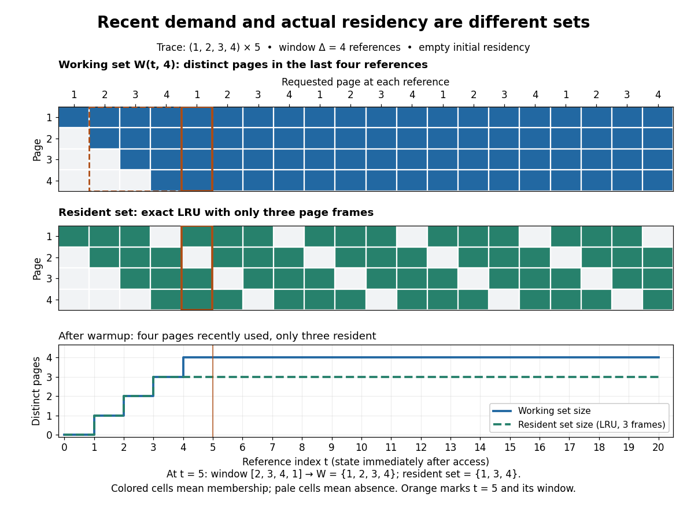

# Working set

↑ **Parent:** [Virtual memory](virtual-memory-split.md)  
ⓦ [Wiki](https://en.wikipedia.org/wiki/Working_set)

An [operating-system process](process-computing.md)'s [working set](working-set.md) is the [set](set-split.md) of distinct [memory pages](memory-page.md) used in a declared recent window. Here the window counts [memory references](memory-reference.md), not clock time: let $r_i$ identify the [memory page](memory-page.md) accessed by the $i$th [memory reference](memory-reference.md), and let the positive [integer](integer-split.md) $\Delta$ be the window length. Immediately after reference $t$,

$$
W(t,\Delta)=\{r_i:\max(1,t-\Delta+1)\leq i\leq t\},\qquad W(0,\Delta)=\varnothing.
$$

Repeated [memory references](memory-reference.md) to the same [memory page](memory-page.md) contribute only one [set element](element-of-a-set.md). The [working set size](working-set-size.md) is the [cardinality](cardinality.md) $|W(t,\Delta)|$. This recent footprint estimates current demand; it cannot guarantee which [memory pages](memory-page.md) future [memory references](memory-reference.md) will need. The [resident set](resident-set.md) instead records which [memory pages](memory-page.md) are actually present in [computer memory](computer-memory.md).

For the 20-reference [sequence](sequence.md) in [memory thrashing](thrashing-computer-science.md) and $\Delta=4$, the successive [working sets](working-set.md) begin $\{1\}$, $\{1,2\}$, $\{1,2,3\}$ and $\{1,2,3,4\}$. At $t=5$, the window is references 2–5, namely $2,3,4,1$, so $W(5,4)=\{1,2,3,4\}$ again. Every later four-reference window contains all four [memory pages](memory-page.md). Under three-[page frame](page-frame.md) [LRU replacement](lru-replacement.md), however, the [resident set](resident-set.md) at $t=5$ is $\{1,3,4\}$: page 2 was evicted. Consequently the [working set size](working-set-size.md) is four even though only three [memory pages](memory-page.md) are resident. Under four-[page frame](page-frame.md) [LRU replacement](lru-replacement.md), the [resident set](resident-set.md) contains the complete [working set](working-set.md) after reference 4.

**[Figure 6](#image-a-four-reference-working-set-remains-four-pages-while-a-three-frame-resident-set-contains-only-three). A four-reference working set remains four pages while a three-frame resident set contains only three**.

Window choice matters: on this same [sequence](sequence.md), $\Delta=2$ reports only two distinct [memory pages](memory-page.md) after reference 2, despite the recurring four-page cycle. A short window forgets useful [memory pages](memory-page.md) sooner; a long window retains evidence from older phases. Enlarging the window can only enlarge or preserve the [working set](working-set.md) at fixed $t$, because the shorter window is contained in the longer one. No single window is best for every workload.

For a concrete [multiprogramming](multiprogramming.md) budget, suppose three [operating-system processes](process-computing.md) each have a four-page [working set](working-set.md), no shared [page frames](page-frame.md), and only eight [page frames](page-frame.md) are available for their data. Their combined demand is 12 [page frames](page-frame.md); all three [working sets](working-set.md) cannot be resident together. Letting two [operating-system processes](process-computing.md) run while the third waits makes their eight-page demand fit in this simplified model. Real budgets also reserve [computer memory](computer-memory.md) for the [operating system](operating-system-split.md) and other uses; shared [memory pages](memory-page.md) must not be counted repeatedly as different physical copies.

Peter J. Denning's [The Working Set Model for Program Behavior, Communications of the ACM, May 1968, sections 3–4](https://denninginstitute.com/pjd/PUBS/WSModel_1968.pdf) formalized the [working set](working-set.md) using recent process execution time, rather than this article's reference count. Its central insight connected memory demand to [process scheduling](process-scheduling.md): deciding which [operating-system processes](process-computing.md) run also decides which [working sets](working-set.md) need room. [Temporal locality](temporal-locality.md) makes recent use informative, without making it a promise about the future. The beautiful distinction is between a large possible [address space](address-space.md) and the smaller footprint of the current activity.

**Table of contents**

- [Working set size](working-set-size.md)

## ↑ Ancestors (4)

1. [Virtual memory](virtual-memory-split.md)
2. [Operating system](operating-system-split.md)
3. [Computer science](computer-science-split.md)
4. [Codex Wiki](split.md)

## ← Incoming links (9)

- [Multiprogramming](multiprogramming.md)
- [Page replacement](page-replacement.md)
- [Solution](past-exam-of-the-mathematics-course-of-the-university-of-cambridge/2007/ia/paper-5/2/a/solution.md)
- [Resident set](resident-set.md)
- [Temporal locality](temporal-locality.md)
- [Thrashing (computer science)](thrashing-computer-science.md)
- [Virtual memory](virtual-memory-split.md)
- [Working set](working-set.md)
- [Working set size](working-set-size.md)
