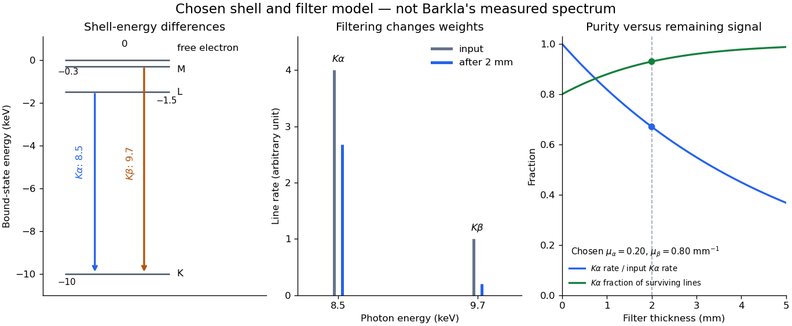

# X-ray spectral attenuation operator

↑ **Parent:** [X-ray emission spectroscopy](x-ray-emission-spectroscopy.md)

For a fixed homogeneous absorber in a narrow-beam geometry, define the [X-ray spectral attenuation operator](x-ray-spectral-attenuation-operator.md) on [L1 space](l1-space.md) over a bounded positive [energy](energy-split.md) interval. A physical input $f(E)\ge0$ is an [integrable function](lebesgue-integrable-function.md) giving incident [photon](photon.md) rate density. Let its [linear attenuation coefficient](linear-attenuation-coefficient.md) $\mu(E)\ge0$ be a [measurable function](measurable-function.md), with $x\ge0$. The transmitted uncollided density is

$$
(A_xf)(E)=e^{-\mu(E)x}f(E),\qquad
S(x)=\int w(E)(A_xf)(E)\,dE.
$$

Here $w(E)\ge0$ is a fixed bounded detector response described by a [measurable function](measurable-function.md); background has been subtracted. This is a positive [linear operator](linear-operator.md) on [L1 space](l1-space.md). Since $0\le e^{-\mu(E)x}\le1$, it cannot increase the integrated absolute incident rate. Multiplication of exponentials proves $A_{x+y}=A_xA_y$ for successive layers of the same material. Ignore secondary radiation entering the detector, saturation and changes to the source. Discrete [spectral lines](spectral-line.md) use the finite-sum version below instead of an ordinary rate density.

For a chosen filter, stipulate $\mu_\alpha=0.20\,\mathrm{mm^{-1}}$, $\mu_\beta=0.80\,\mathrm{mm^{-1}}$ and input line rates $(N_\alpha,N_\beta)=(4,1)$ in a common arbitrary rate unit. Assume equal calibrated detector weight for both lines. At $x=2.0\,\mathrm{mm}$,

$$
\begin{pmatrix}N_\alpha(x)\\N_\beta(x)\end{pmatrix}
=\begin{pmatrix}e^{-0.4}&0\\0&e^{-1.6}\end{pmatrix}
\begin{pmatrix}4\\1\end{pmatrix}
\simeq\begin{pmatrix}2.68128\\0.201897\end{pmatrix}.
$$

The selected $8.5\,\mathrm{keV}$ line's fraction rises from $4/5=0.800$ to $0.929974$, but its absolute rate falls by about $33.0\%$. Filtering improves purity at the cost of signal. It multiplies existing components and cannot create a new emitted [spectral line](spectral-line.md).

**[Figure 9](#image-characteristic-x-ray-line-filtering-model). Shell differences set line energies; an absorber changes their weights**. Original stipulated shell and filter model, not a measured Barkla [frequency spectrum](frequency-spectrum.md). Positive shell [binding energies](binding-energy.md) are plotted as negative bound-state [energies](energy-split.md). The two K lines are sticks with chosen input rates 4 and 1. The L line is outside the displayed filtering band. All attenuation coefficients are illustrative; they do not identify a real filter material.

With just one integrated reading, $S=N_\alpha+N_\beta$, the two unknown line rates are underdetermined. If the source is unchanged between an empty-path reading and a filtered reading, the ideal [inverse problem](inverse-problem-split.md) becomes

$$
\begin{pmatrix}S(0)\\S(2\,\mathrm{mm})\end{pmatrix}
=\begin{pmatrix}1&1\\e^{-0.4}&e^{-1.6}\end{pmatrix}
\begin{pmatrix}N_\alpha\\N_\beta\end{pmatrix}
=\begin{pmatrix}5\\2.88318\end{pmatrix}.
$$

The [determinant](determinant.md) $e^{-1.6}-e^{-0.4}\simeq-0.468424$ is nonzero, so these two ideal readings determine the two stipulated line rates uniquely. Identical coefficients would give zero [determinant](determinant.md) and destroy that separation. This small [linear algebra](linear-algebra-split.md) example explains why absorber contrast supplies information, while also showing its limit: unknown scattered components or unknown detector weights add unknowns that two readings cannot determine.

## ↑ Ancestors (9)

1. [X-ray emission spectroscopy](x-ray-emission-spectroscopy.md)
2. [Characteristic X-ray](characteristic-x-ray.md)
3. [X-ray tube](x-ray-tube.md)
4. [X-ray](x-ray.md)
5. [Electromagnetic radiation](electromagnetic-radiation-split.md)
6. [Electromagnetism](electromagnetism-split.md)
7. [Branches of physics](branches-of-physics.md)
8. [Physics](physics-split.md)
9. [Codex Wiki](split.md)

## ← Incoming links (1)

- [X-ray spectral attenuation operator](x-ray-spectral-attenuation-operator.md)
