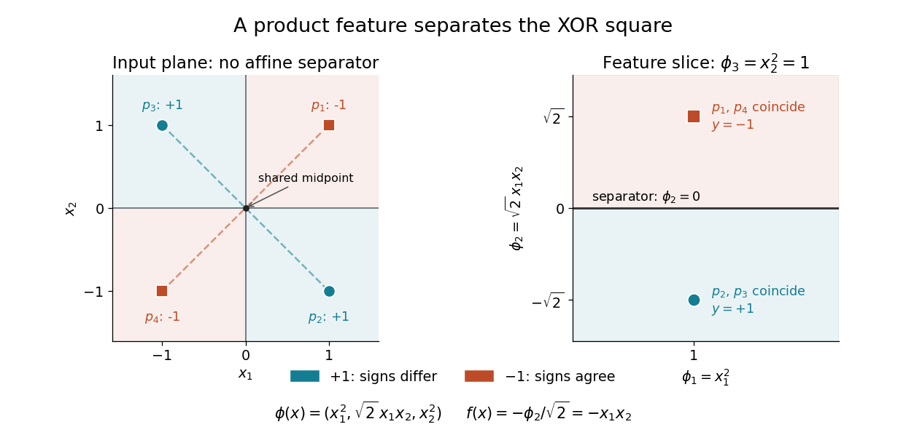

# XOR separation by a product feature

↑ **Parent:** [Kernel trick](kernel-trick.md)

Give the four corners of the square the [exclusive or](exclusive-or.md) labels: $+1$ when the input signs differ and $-1$ when they agree. In the following order,

$$
p_1=(1,1),\quad p_2=(1,-1),\quad p_3=(-1,1),\quad p_4=(-1,-1),\qquad y=(-1,1,1,-1)^T.
$$

No [affine function](affine-function.md) $g(x)=a_1x_1+a_2x_2+b$ has the required strictly positive scores at $p_2,p_3$ and strictly negative scores at $p_1,p_4$: both pairs have midpoint zero, so $g(p_2)+g(p_3)=2b=g(p_1)+g(p_4)$ would have to be both positive and negative. This also rules out perfect classification by a single threshold with a consistent tie rule.

Under the [polynomial kernel](polynomial-kernel.md)'s [quadratic feature map](quadratic-feature-map.md), the two classes become two distinct [vectors](vector.md):

$$
\phi(p_1)=\phi(p_4)=(1,\sqrt2,1)^T,\qquad \phi(p_2)=\phi(p_3)=(1,-\sqrt2,1)^T.
$$

The [hyperplane](hyperplane.md) $\phi_2=0$ separates them. With $w=(0,-1/\sqrt2,0)^T$ and $b=0$, the score and [classifier](classifier.md) are

$$
f(x)=w^T\phi(x)=-x_1x_2,\qquad h(x)=\operatorname{sgn}f(x).
$$

All four signed scores $y_i f(p_i)$ equal one. In the input plane the boundary is $x_1x_2=0$, the union of the coordinate axes; in the derived coordinates it is a single [hyperplane](hyperplane.md). The [feature map](feature-map.md) identifies opposite corners, which is harmless for these labels because opposite corners belong to the same class. A fixed [feature map](feature-map.md) would not separate labels that disagree at identical mapped [vectors](vector.md).

**[Figure 5](#image-xor-labels-in-the-input-square-and-the-quadratic-feature-slice). XOR labels in the input square and the quadratic feature slice**. The dashed diagonals join equal-label input pairs and share their midpoint, obstructing affine separation. In the feature panel all mapped points have third coordinate one; the two coincident pairs are separated by the horizontal hyperplane at second coordinate zero.

## ↑ Ancestors (7)

1. [Kernel trick](kernel-trick.md)
2. [Reproducing kernel Hilbert space](reproducing-kernel-hilbert-space.md)
3. [Positive-semidefinite kernel](positive-semidefinite-kernel.md)
4. [Probability and statistics](probability-and-statistics-split.md)
5. [Area of mathematics](area-of-mathematics.md)
6. [Mathematics](mathematics-split.md)
7. [Codex Wiki](split.md)

## ← Incoming links (2)

- [Dual prediction with a kernel](dual-prediction-with-a-kernel.md)
- [Kernel trick](kernel-trick.md)
