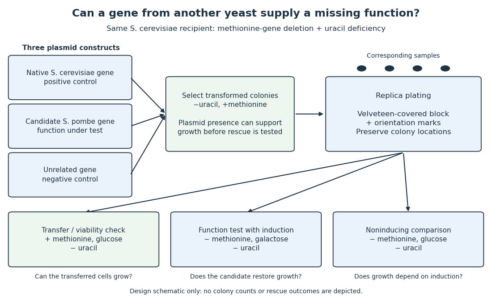

# Yeast cross-species complementation experiment

↑ **Parent:** [Model organism](model-organism.md)

Can a [gene](gene.md) from [Schizosaccharomyces pombe](schizosaccharomyces-pombe.md) replace a missing function in [Saccharomyces cerevisiae](saccharomyces-cerevisiae.md)? A modern laboratory project tested [functional complementation](functional-complementation.md) of [methionine](methionine.md) synthesis. For each tested [gene deletion](gene-deletion.md), the investigators compared [plasmids](plasmid.md) carrying the corresponding [Saccharomyces cerevisiae](saccharomyces-cerevisiae.md) [gene](gene.md), a candidate [Schizosaccharomyces pombe](schizosaccharomyces-pombe.md) [gene](gene.md), and an unrelated [gene](gene.md). The first was a positive [scientific control](scientific-control.md); the last was a negative [scientific control](scientific-control.md). The paper describes this design rather than publishing a complete set of individual growth measurements. [Reeves, Warner, Ludlow and O’Connor (2018), Course Activities, pp. 5–6 and Table 1: three plasmids, replica plating and protein-expression checks](pathways-over-time-functional-genomics-research-in-an-introductory-laboratory-course-by-todd-d-reeves-and-others.md)

The recipient [biological strains](strain-biology.md) also lacked the ability to make [uracil](uracil.md). The pYES2.1/V5-His [plasmids](plasmid.md) carried URA3, a [gene](gene.md) restoring that ability, and used the GAL1 [gene promoter](promoter-genetics.md) to control the inserted [gene](gene.md). Initial plates lacked [uracil](uracil.md) but supplied [methionine](methionine.md): this selected [biological colonies](colony-biology.md) containing [plasmids](plasmid.md) without requiring successful [methionine](methionine.md) synthesis. Subsequent plates lacking [methionine](methionine.md) tested the missing function, comparing [galactose induction](galactose-induction.md) with [glucose](glucose.md) conditions. Thus selecting for a [plasmid](plasmid.md) and testing its functional contribution were separate operations. [O’Connor (2018), Plasmid features enable multiple student experiments and Complementation reveals conservation of function](pathways-over-time-plasmids-engage-students-in-functional-genomics-research-by-clare-o%E2%80%99connor.md)

The apparatus can be simple and informative. In the associated protocol, [replica plating](replica-plating.md) uses a block covered with velveteen to transfer small samples of [biological colonies](colony-biology.md) from a master plate onto plates with different nutrient conditions. Orientation marks preserve correspondence between locations; gentle contact limits the transferred material. The specified replicas omit [uracil](uracil.md) and [methionine](methionine.md) with either inducing [sugar](sugar.md) or [glucose](glucose.md), and include a fresh [glucose](glucose.md) plate supplying [methionine](methionine.md). The readout is growth at corresponding locations, not a direct measurement of [enzyme](enzyme.md) activity. [O’Connor, Investigations in Molecular Cell Biology, §12.6, introductory paragraphs and steps 1–3: velveteen block, orientation marks and three replica media](investigations-in-molecular-cell-biology-by-clare-m-o%E2%80%99connor/12-6-exercise-2-replica-plating-and-complementation.md)

**[Figure 12](#image-separating-plasmid-selection-from-a-yeast-functional-complementation-test). Separating plasmid selection from a yeast functional complementation test**. Original schematic of the reported experimental design, not copied growth data. All three constructs enter the same [Saccharomyces cerevisiae](saccharomyces-cerevisiae.md) [gene deletion](gene-deletion.md) background. Plate labels identify distinct comparisons; arrows show sample transfer, not observed rescue. The candidate [Schizosaccharomyces pombe](schizosaccharomyces-pombe.md) outcome must be measured.

The [scientific controls](scientific-control.md) answer different objections. Growth on the [methionine](methionine.md)-supplied replica checks survival and transfer. Rescue by the native [gene](gene.md) checks that this [biological strain](strain-biology.md) and assay can reveal [functional complementation](functional-complementation.md). The unrelated [gene](gene.md) tests whether carrying a [plasmid](plasmid.md) alone is sufficient. Comparing induction conditions checks dependence on [gene expression](gene-expression.md), although changing the [sugar](sugar.md) also changes [metabolism](metabolism.md): it is not an isolated change of [gene expression](gene-expression.md) in every other respect.

If the candidate [gene](gene.md) restores growth while those comparisons behave as intended, it supplies a function sufficient for the tested growth requirement in this recipient. Failure to rescue is less decisive: the candidate [protein](protein.md) might not be produced, might be altered by its attached tag, or might not work in this cellular context. The investigators therefore also used [Western blots](western-blot.md) to examine [protein](protein.md) production. A detected [protein](protein.md) still does not establish correct [protein folding](protein-folding.md) or catalytic activity. [Reeves et al. (2018), Course Activities, pp. 5–6: functional conservation, tag interference and Western-blot follow-up](pathways-over-time-functional-genomics-research-in-an-introductory-laboratory-course-by-todd-d-reeves-and-others.md)

## ↑ Ancestors (3)

1. [Model organism](model-organism.md)
2. [Biology](biology-split.md)
3. [Codex Wiki](split.md)

## ← Incoming links (9)

- [Cell cycle](cell-cycle.md)
- [Functional complementation](functional-complementation.md)
- [Galactose induction](galactose-induction.md)
- [Genetic transformation](genetic-transformation.md)
- [Model organism](model-organism.md)
- [Model organism evidence transfer](model-organism-evidence-transfer.md)
- [Schizosaccharomyces pombe](schizosaccharomyces-pombe.md)
- [Western blot](western-blot.md)
- [Western blot band interpretation](western-blot-band-interpretation.md)
