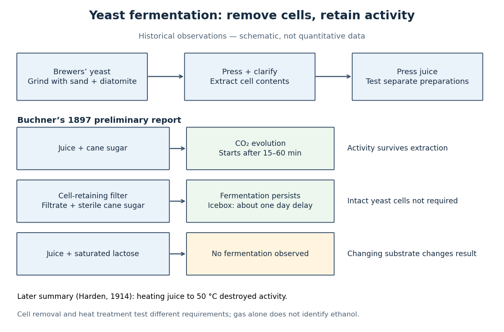

# Yeast

↑ **Parent:** [Fungus](fungus.md)  
ⓦ [Wiki](https://en.wikipedia.org/wiki/Yeast)

[Yeasts](yeast.md) are [fungi](fungus.md) whose growth is predominantly unicellular, commonly through [budding](budding.md) or division into two cells. The word describes a growth form across different fungal lineages, rather than one [species](species.md) or an exclusive [clade](clade.md); some [fungi](fungus.md) can switch between unicellular and filamentous growth. Thus [Saccharomyces cerevisiae](saccharomyces-cerevisiae.md) is a [yeast](yeast.md), but [yeast](yeast.md) is not another name for that one [species](species.md). See [Kurtzman, Fell and Boekhout, The Yeasts, chapter 1 (2011): definition and classification](https://booksite.elsevier.com/samplechapters/9780444521491/9780444521491.pdf).

A [yeast](yeast.md) cell has [eukaryotic](eukaryote.md) organization, including a [cell nucleus](cell-nucleus.md), [mitochondria](mitochondria.md) and a [cell wall](cell-wall.md). Small size and a unicellular lifestyle do not make it a member of [bacteria](bacteria.md). These compartments let an experimentally accessible [biological cell](biological-cell-split.md) retain much of the organization shared with other [eukaryotes](eukaryote.md). See [Clark, Douglas and Choi, Biology 2e, 24.1: fungal cells and yeast growth](https://openstax.org/books/biology-2e/pages/24-1-characteristics-of-fungi).

**A motivating experiment: can [fermentation](fermentation.md) continue without intact [yeast](yeast.md) cells?** In 1897, Eduard Buchner ground brewers' [yeast](yeast.md) with quartz sand and diatomite, added [water](water.md), and pressed out a liquid extract. Adding concentrated cane [sugar](sugar.md) produced [carbon dioxide](carbon-dioxide.md) after 15–60 minutes. A cell-retaining filter still yielded an active filtrate: with sterilized cane [sugar](sugar.md) in an icebox, [fermentation](fermentation.md) began after about a day. Saturated lactose gave no observed [fermentation](fermentation.md). These are reported observations, not invented control results. See [Buchner, Alcoholic fermentation without yeast cells (1897), translated excerpt hosted by Carmen Giunta](https://web.lemoyne.edu/~giunta/buchner.html).

**[Figure 7](#image-removing-intact-yeast-cells-while-retaining-fermentation-activity). Removing intact yeast cells while retaining fermentation activity**. Original qualitative evidence schematic based on Buchner's report and Harden's later summary cited here. No measured rates are plotted; the preparations had different conditions and are not a matched quantitative comparison.

The filtration comparison addresses the objection that surviving intact [yeast](yeast.md) cells caused the activity. The lactose comparison tests [substrate](substrate-biochemistry.md) dependence; it is not a no-[sugar](sugar.md) blank, nor a comparison at matched [sugar](sugar.md) [concentrations](concentration.md). A proposed modern follow-up would also compare the same extract with and without added [sugar](sugar.md), accounting for material already in the extract. That is an experimental suggestion, not a result attributed to Buchner. His report specifies brewers' [yeast](yeast.md); it does not identify the preparation here as a pure [Saccharomyces cerevisiae](saccharomyces-cerevisiae.md) strain.

Heat treatment asks a different question: does destroying activity in the extract stop [fermentation](fermentation.md)? Buchner's preliminary report described weak or absent activity after heating and filtration, rather than one clean universal threshold. Harden's 1914 account of the subsequent work summarized loss of activity on heating the juice to $50\,{}^\circ\mathrm{C}$. Harden also described requirements for both [enzymes](enzyme-split.md) and [coenzymes](coenzyme.md). Cell-free therefore means neither chemical-free nor a preparation containing one purified [enzyme](enzyme-split.md). See [Arthur Harden, Alcoholic Fermentation (1914), chapters II and VI: cell-free activity and the fermenting complex](https://www.gutenberg.org/files/44985/44985-h/44985-h.htm).

The inference is that extracted cellular machinery can sustain these [chemical reactions](chemical-reaction-split.md) without an intact living [biological cell](biological-cell-split.md). This does not show that the extract reproduces, grows or maintains itself like a [yeast](yeast.md). Moreover, gas evolution alone does not identify [ethanol](ethanol.md): [cellular respiration](cellular-respiration.md) can also release [carbon dioxide](carbon-dioxide.md). Product identification is a separate measurement; Harden's account describes both [ethanol](ethanol.md) and [carbon dioxide](carbon-dioxide.md) as products of cell-free [alcoholic fermentation](ethanol-fermentation.md). The beautiful separation is between the [organism](organism-split.md) that produces and maintains the machinery and the machinery that catalyzes a particular transformation.

**Table of contents**

- [Budding yeast](budding-yeast.md)
  - [Yeast budding](yeast-budding.md)
- [Schizosaccharomyces pombe](schizosaccharomyces-pombe.md)
- [Saccharomyces cerevisiae](saccharomyces-cerevisiae.md)

## ↑ Ancestors (5)

1. [Fungus](fungus.md)
2. [Eukaryote](eukaryote.md)
3. [Organism](organism-split.md)
4. [Biology](biology-split.md)
5. [Codex Wiki](split.md)

## ← Incoming links (19)

- [Active site](active-site.md)
- [Cell-free fermentation as a biochemical experiment](cell-free-fermentation-as-a-biochemical-experiment.md)
- [Concanavalin A](concanavalin-a.md)
- [Ethanol fermentation](ethanol-fermentation.md)
- [Eukaryote](eukaryote.md)
- [Evolutionary game theory](evolutionary-game-theory.md)
- [Fungus](fungus.md)
- [Induced fit](induced-fit.md)
- [Mitosis](mitosis.md)
- [Organism](organism-split.md)
- [Solution](past-exam-of-the-biochemistry-course-of-the-university-of-cambridge/2024/paper-5/section-2/c/solution.md)
- [Solution](past-exam-of-the-genetics-course-of-the-university-of-cambridge/2024/paper-2/7/solution.md)
- [Plasmid feature map](plasmid-feature-map.md)
- [Saccharomyces cerevisiae](saccharomyces-cerevisiae.md)
- [Schizosaccharomyces pombe](schizosaccharomyces-pombe.md)
- [Unicellular organism](unicellular-organism.md)
- [Western blot response saturation](western-blot-response-saturation.md)
- [Yeast](yeast.md)
- [Yeast cross-species complementation experiment](yeast-cross-species-complementation-experiment.md)
