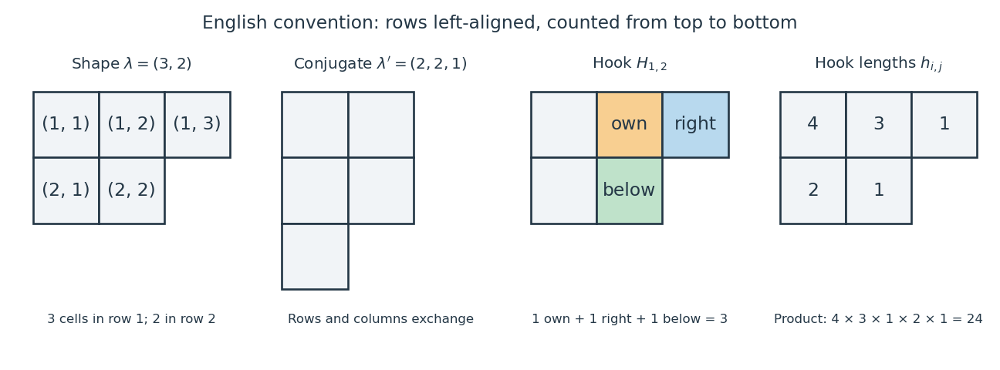

# Young diagram

↑ **Parent:** [Partition of an integer](partition-of-an-integer.md)

**[Figure 1](#image-the-young-diagram-of-3-2-its-conjugate-2-2-1-a-highlighted-hook-and-all-five-hook-lengths). The Young diagram of $(3,2)$, its conjugate $(2,2,1)$, a highlighted hook, and all five hook lengths**.

The Young diagram of a [partition of an integer](partition-of-an-integer.md) $\lambda$ consists of one unit square, or cell, for each pair

$$
Y(\lambda)=\{(i,j):1\leq i\leq\ell(\lambda),\ 1\leq j\leq\lambda_i\}.
$$

Throughout this article we use the English convention: rows are left-aligned, row $1$ is at the top, row indices increase downwards, and column indices increase to the right. The row lengths weakly decrease from top to bottom. Thus $Y(3,2)$ has cells $(1,1),(1,2),(1,3),(2,1),(2,2)$, with three cells above two. In the French convention the longest row is drawn at the bottom; the underlying [partition of an integer](partition-of-an-integer.md) is unchanged, but directions in descriptions of [hooks of a Young diagram](hook-of-a-young-diagram.md) and [standard Young tableaux](standard-young-tableau.md) must be interpreted consistently. See [Grinberg's hook-length-formula teaching slides, §§1.1–1.2, for diagrams with the same orientation](https://www.cip.ifi.lmu.de/~grinberg/t/24s/hooktalk.pdf).

The number of cells is $|\lambda|$, and reading the row lengths recovers the [partition of an integer](partition-of-an-integer.md). Reading the column lengths instead gives its [conjugate partition](conjugate-partition.md). This turns numerical inequalities into visible geometry: [Young diagrams](young-diagram.md) satisfy

$$
Y(\mu)\subseteq Y(\lambda)\quad\Longleftrightarrow\quad
\mu_i\leq\lambda_i\ \text{for every }i,
$$

with missing parts treated as zero. For example, $(2,1)\subseteq(3,2)$. This inclusion is the order in [Young's lattice](young-s-lattice.md); it differs from [dominance order on partitions](dominance-order-on-partitions.md), which compares sums of initial parts of [partitions of an integer](partition-of-an-integer.md) of the same size. The [partition of an integer](partition-of-an-integer.md) $(3,2)$ dominates $(2,2,1)$ because their successive sums are $3\geq2$, $5\geq4$, and $5=5$, but neither [Young diagram](young-diagram.md) contains the other: one has cell $(1,3)$, the other $(3,1)$.

The beauty of a [Young diagram](young-diagram.md) is that its shape simultaneously records a [partition of an integer](partition-of-an-integer.md), indexes a [Specht module](specht-module.md), and supports local quantities such as [hook lengths](hook-length.md) that determine a global [dimension](dimension-vector-space.md). Filling its cells leads to [Young tableaux](young-tableau.md); adding one cell at a time leads to the [Young branching graph](young-branching-graph.md).

**Table of contents**

- [Durfee square](durfee-square.md)
- [Jeu de taquin](jeu-de-taquin.md)
- [Skew Young diagram](skew-young-diagram.md)
  - [Standard skew Young tableau](standard-skew-young-tableau.md)
    - [Standard skew tableau determinant](standard-skew-tableau-determinant.md)
  - [Horizontal strip](horizontal-strip.md)
  - [Totally disconnected skew Young diagram](totally-disconnected-skew-young-diagram.md)
- [Hook partition](hook-partition.md)
- [Addable node of a Young diagram](addable-node-of-a-young-diagram.md)
- [Removable node of a Young diagram](removable-node-of-a-young-diagram.md)
- [Conjugate partition](conjugate-partition.md)
- [Hook of a Young diagram](hook-of-a-young-diagram.md)
  - [Arm of a Young-diagram cell](arm-of-a-young-diagram-cell.md)
  - [Leg of a Young-diagram cell](leg-of-a-young-diagram-cell.md)
  - [Hook length](hook-length.md)
    - [Hook graph of a partition](hook-graph-of-a-partition.md)
      - [Hook product of a partition](hook-product-of-a-partition.md)
  - [Hook-interval decomposition at a Young-diagram cell](hook-interval-decomposition-at-a-young-diagram-cell.md)
  - [Divisor closure of hook lengths](divisor-closure-of-hook-lengths.md)
  - [Rim hook](rim-hook.md)
    - [Border-strip tableau](border-strip-tableau.md)
- [Content of a Young-diagram cell](content-of-a-young-diagram-cell.md)
- [Principal hook lengths of a partition](principal-hook-lengths-of-a-partition.md)

## ↑ Ancestors (7)

1. [Partition of an integer](partition-of-an-integer.md)
2. [Representation theory of the symmetric group](representation-theory-of-the-symmetric-group-split.md)
3. [Representation theory](representation-theory-split.md)
4. [Algebra](algebra-split.md)
5. [Area of mathematics](area-of-mathematics.md)
6. [Mathematics](mathematics-split.md)
7. [Codex Wiki](split.md)

## ← Incoming links (51)

- [Addable node of a Young diagram](addable-node-of-a-young-diagram.md)
- [Arm of a Young-diagram cell](arm-of-a-young-diagram-cell.md)
- [Conjugate partition](conjugate-partition.md)
- [Durfee square](durfee-square.md)
- [Ferrers diagram](ferrers-diagram.md)
- [Greene–Nijenhuis–Wilf hook walk](greene-nijenhuis-wilf-hook-walk.md)
- [Hook graph of a partition](hook-graph-of-a-partition.md)
- [Hook length](hook-length.md)
- [Hook-length formula](hook-length-formula.md)
- [Hook of a Young diagram](hook-of-a-young-diagram.md)
- [Hook partition](hook-partition.md)
- [Hook product of a partition](hook-product-of-a-partition.md)
- [Integer partition](integer-partition.md)
- [Leg of a Young-diagram cell](leg-of-a-young-diagram-cell.md)
- [Multiset](multiset.md)
- [Near Young tableau](near-young-tableau.md)
- [Oscillating path in the Young lattice](oscillating-path-in-the-young-lattice.md)
- [Partition in a rectangle](partition-in-a-rectangle.md)
- [Partition interpretation of Gaussian binomial coefficients](partition-interpretation-of-gaussian-binomial-coefficients.md)
- [Partition of an integer](partition-of-an-integer.md)
- [Solution](past-exam-of-the-mathematics-course-of-the-university-of-cambridge/2001/iii/paper-77/1/solution.md)
- [Solution](past-exam-of-the-mathematics-course-of-the-university-of-cambridge/2001/iii/paper-77/4/solution.md)
- [Solution](past-exam-of-the-mathematics-course-of-the-university-of-cambridge/2001/iii/paper-77/5/solution.md)
- [Solution](past-exam-of-the-mathematics-course-of-the-university-of-cambridge/2005/iii/paper-3/1/solution.md)
- [Solution](past-exam-of-the-mathematics-course-of-the-university-of-cambridge/2005/iii/paper-3/5/solution.md)
- [Solution](past-exam-of-the-mathematics-course-of-the-university-of-cambridge/2006/iii/paper-4/1/solution.md)
- [Solution](past-exam-of-the-mathematics-course-of-the-university-of-cambridge/2006/iii/paper-4/6/solution.md)
- [Solution](past-exam-of-the-mathematics-course-of-the-university-of-cambridge/2009/iii/paper-4/3/solution.md)
- [Solution](past-exam-of-the-mathematics-course-of-the-university-of-cambridge/2012/iii/paper-3/1/solution.md)
- [Solution](past-exam-of-the-mathematics-course-of-the-university-of-cambridge/2012/iii/paper-3/2/solution.md)
- [Solution](past-exam-of-the-mathematics-course-of-the-university-of-cambridge/2013/iii/paper-5/5/solution.md)
- [Solution](past-exam-of-the-mathematics-course-of-the-university-of-cambridge/2016/iii/paper-103/2/a/solution.md)
- [Solution](past-exam-of-the-mathematics-course-of-the-university-of-cambridge/2016/iii/paper-103/3/iii/solution.md)
- [Solution](past-exam-of-the-mathematics-course-of-the-university-of-cambridge/2016/iii/paper-103/4/a/solution.md)
- [Solution](past-exam-of-the-mathematics-course-of-the-university-of-cambridge/2016/iii/paper-103/6/a/i/solution.md)
- [Solution](past-exam-of-the-mathematics-course-of-the-university-of-cambridge/2017/iii/paper-103/1/a/i/solution.md)
- [Solution](past-exam-of-the-mathematics-course-of-the-university-of-cambridge/2017/iii/paper-103/2/c/solution.md)
- [Solution](past-exam-of-the-mathematics-course-of-the-university-of-cambridge/2017/iii/paper-103/2/d/solution.md)
- [Solution](past-exam-of-the-mathematics-course-of-the-university-of-cambridge/2017/iii/paper-103/4/a/solution.md)
- [Solution](past-exam-of-the-mathematics-course-of-the-university-of-cambridge/2017/iii/paper-103/6/a/solution.md)
- [Solution](past-exam-of-the-mathematics-course-of-the-university-of-cambridge/2017/iii/paper-103/6/b/solution.md)
- [Solution](past-exam-of-the-mathematics-course-of-the-university-of-cambridge/2018/iii/paper-103/2/ii/solution.md)
- [Solution](past-exam-of-the-mathematics-course-of-the-university-of-cambridge/2018/iii/paper-103/4/i/solution.md)
- [Solution](past-exam-of-the-mathematics-course-of-the-university-of-cambridge/2021/iii/paper-160/1/a/solution.md)
- [Solution](past-exam-of-the-mathematics-course-of-the-university-of-cambridge/2023/iii/paper-160/1/b/i/solution.md)
- [Removable node of a Young diagram](removable-node-of-a-young-diagram.md)
- [Semistandard Young tableau](semistandard-young-tableau.md)
- [Standard Young tableau](standard-young-tableau.md)
- [Young diagram](young-diagram.md)
- [Young's lattice](young-s-lattice.md)
- [Young tableau](young-tableau.md)
